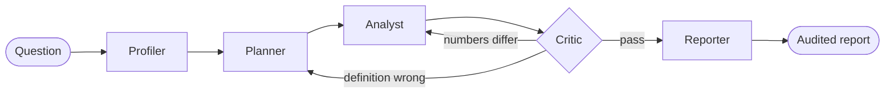

# InsightCrew

A multi-agent data analyst that audits its own numbers before reporting them.

You ask a business question in natural language. Five agents profile the data, plan the analysis, write and run code, independently verify the result, and write a report. If the verification fails, the work goes back to the agent that can fix it. If the question cannot be answered from the data, the system says so instead of producing a number.

Group project for COMP5584 (LLM Agents), The Hong Kong Polytechnic University.

## The problem

Ask an LLM for "East China revenue in Q3 2026" over an orders table and it will often write code that sums the `amount` column. The code runs. The answer looks reasonable. It is 14.8% too high, because revenue is meant to exclude coupons and refunds.

| Calculation | Result | |
|---|---|---|
| `sum(amount)` | 1,189,734.57 | Wrong, and nothing fails |
| `sum(amount - coupon)` | 1,150,599.46 | Still wrong |
| `sum(amount - coupon) - sum(refund)` | 1,036,538.28 | Correct |

Asking the same model to double-check does not help much: it reviews its work with the same assumptions that produced it. InsightCrew gives the checking to a separate agent that differs from the author in context, in implementation and in knowledge.

## How it works



| Agent | Backed by | Job |
|---|---|---|
| Profiler | LLM | Explains what each column means and where the data is risky |
| Planner | LLM | Breaks the question into steps and states the metric definition as structured fields |
| Analyst | LLM + sandbox | Writes Python for the plan, runs it, repairs its own execution errors |
| Critic | Deterministic code | Recomputes the value in SQL and checks the definition against a metric dictionary |
| Reporter | Deterministic template | Reports the value, how it was verified, the confidence and the limits |

Three ideas carry the design:

1. **The verifier is not an LLM.** The Critic compares numbers with a tolerance and compares the plan with a rule dictionary. Its verdict is repeatable and does not depend on the model.
2. **The metric definition is data, not prose.** The Planner must express it as boolean fields such as `subtract_refund`, so that code can check it.
3. **Errors return to the layer that can fix them.** A wrong definition goes back to the Planner. A wrong calculation under a correct plan goes back to the Analyst.

Agents share one blackboard, and every message between them is logged as a structured record. Full detail is in [docs/ARCHITECTURE.md](docs/ARCHITECTURE.md).

## Quick start

Requires Python 3.9 or later. There is nothing to install and no API key is needed.

```bash
python3 ask.py                                      # asks for a question; press Enter for the default
python3 ask.py "2026年8月华南区的营收是多少？"         # South China revenue, August 2026
python3 ask.py "2026年第三季度华东区的营收是多少？" --compare   # with and without the audit
```

On macOS or Linux you can also run `bash start.sh`. On Windows, double-click `start.bat` or use `python` in place of `python3`.

Without an API key the system runs in offline mode. Orchestration, sandboxed execution, SQL recomputation, the dictionary check and the report are all real. Only the model's replies are scripted, and the script deliberately starts with the naive calculation so that the audit has something to catch.

A run with `ask.py` writes three files to `runs/<timestamp>/` and opens the last one in a browser (add `--no-open` to skip that):

| File | Content |
|---|---|
| `trace.jsonl` | Every message and event |
| `blackboard.json` | Final state, including each version of the generated code and its value |
| `report.html` | A timeline replay of the run |

Ask questions in Chinese: the question parser recognises Chinese region and period names. Output is in Chinese too. The [glossary](docs/ARCHITECTURE.md#15-glossary) translates the terms.

## What a run looks like

The default question, offline. This is an excerpt of the console output with status lines and timings removed:

```text
[ Profiler -> Planner  ] PROFILE      画像卡：8 个字段 / 3 条风险
[  Planner -> Analyst  ] PLAN         v1 计划：2 步，指标=营收
  · 工具: 沙箱执行成功：a1 value=1,189,734.57 sum(amount)
  · 工具: L2 独立复算（SQL 路径）：1,189,734.57 vs 执行结果 1,189,734.57 → 一致
  · 工具: L3 口径校验（字典条目：营收，版本 2.3）：1/3 项满足
[   Critic -> Planner  ] REVISE       驳回 a1：L3 / 口径不合规：扣除订单优惠券金额
[  Planner -> Analyst  ] PLAN         根据驳回意见重规划 → v2 计划：3 步，指标=营收
  · 工具: 沙箱执行成功：a2 value=1,036,538.28 sum(amount-coupon)-sum(refund)
  · 工具: L2 独立复算（SQL 路径）：1,036,538.28 vs 执行结果 1,036,538.28 → 一致
  · 工具: L3 口径校验（字典条目：营收，版本 2.3）：3/3 项满足
[   Critic -> Reporter ] CRITIQUE     PASS（L2+L3）
[ Reporter -> User     ] FINALIZE     报告已生成（置信度 高）
```

In the first round the Analyst's Python and the Critic's SQL agree on 1,189,734.57. Both are wrong, because both followed a plan that left out coupons and refunds. Recomputation alone would have passed it. The dictionary check finds one of three required rules met and rejects the plan. The second round passes both checks.

## What you can ask

A metric, optionally a region, and a period.

| | Supported |
|---|---|
| Metric | Revenue (营收), order count (订单量), average order value (客单价), refund rate (退款率) |
| Region | East, North or South China (华东, 华北, 华南), several of them, or the whole company (全公司) |
| Period | Within 2026-06-01 to 2026-10-14: a quarter, a month, "last quarter", "last N months", or a full year |

The system declines these, with a stated reason and no number:

| Question | Reason given |
|---|---|
| Gross margin (毛利率) | The data has no cost column, and estimating is not allowed |
| A 2025 period | Outside the data's date range |
| Southwest region (西南) | No orders for that region in the data |
| Online-channel revenue (线上渠道) | Channel breakdown is not implemented; answering would return the all-channel figure |
| "Write me a poem" | Not a data question |

Refusal has gaps. Some questions the system does not understand are answered anyway: see [Limitations](#limitations).

## Using a real model

Any OpenAI-compatible endpoint works.

```bash
cp .env.example .env        # then set IC_API_KEY, IC_BASE_URL, IC_MODEL
python3 check_api.py        # shows the configuration and sends one test request
python3 check_api.py --run  # also runs one question end to end
```

| Variable | Default | Meaning |
|---|---|---|
| `IC_API_KEY` | empty | Empty means offline mode |
| `IC_BASE_URL` | `https://api.deepseek.com/v1` | Endpoint |
| `IC_MODEL` | `deepseek-chat` | Model name |
| `IC_FORCE_OFFLINE` | off | Set to `1` to use the scripted model even with a key, for a repeatable demo |
| `IC_MAX_TURNS` | 12 | Maximum rounds |
| `IC_MAX_SECONDS` | 240 | Time limit, checked between rounds |
| `IC_MAX_REPEAT` | 2 | Rejections of the same issues before the run stops |
| `IC_SANDBOX_TIMEOUT` | 30 | Seconds per code execution |

Environment variables take precedence over `.env`. With a real model the Profiler, Planner and Analyst are model-driven. The Critic and Reporter do not change.

## Results

| Experiment | Result | Status |
|---|---|---|
| Error injection: 40 known-wrong answers and 10 correct ones given to the Critic | 40 of 40 rejected, 0 of 10 false alarms. 30 were caught only by the dictionary check. | Re-run 2026-11-18 |
| Real model (`deepseek-chat`), 12 questions | 12 of 12. Seven passed first time, three were rejected once and then corrected, two were correctly declined. | Archived result, not re-run |
| Offline ablation: full system, no Critic, single agent | 12 of 12, 2 of 12, 2 of 12 | Re-run 2026-11-18 |

The offline ablation demonstrates the mechanism, not model performance: the scripted first answer is wrong by design. [docs/EVALUATION.md](docs/EVALUATION.md) explains what each number shows, what it does not, and how to reproduce it.

```bash
python3 -m eval.inject_test          # audit sensitivity; no model needed
python3 -m eval.run_eval --mode full # also: no_critic, single
python3 -m eval.mock_online_test     # exercises the real-model code path against a local fake
python3 -m eval.consistency_test     # metric dictionary and SQL implementation in sync
python3 -m eval.online_eval          # 12 questions with a real model; needs an API key
```

## Course requirements

| The brief asks for | Where it is answered |
|---|---|
| A clearly defined task | [The problem](#the-problem); [Architecture 1](docs/ARCHITECTURE.md#1-the-task) |
| Why a multi-agent approach | [Architecture 2](docs/ARCHITECTURE.md#2-why-more-than-one-agent) |
| Role and responsibility of each agent | [Architecture 4](docs/ARCHITECTURE.md#4-agents) |
| Information and tools available to each agent | [Architecture 4](docs/ARCHITECTURE.md#4-agents), including what each agent is not given |
| How tasks are assigned or decomposed | [Architecture 5](docs/ARCHITECTURE.md#5-task-decomposition) |
| How agents communicate | [Architecture 7](docs/ARCHITECTURE.md#7-communication-and-coordination) |
| How the final output is produced | [Architecture 8 to 10](docs/ARCHITECTURE.md#8-verification-and-error-routing) |
| A working, demonstrable implementation | [Quick start](#quick-start) |
| Analysis, design rationale, limitations and failure cases | [Evaluation](docs/EVALUATION.md); [Architecture 12](docs/ARCHITECTURE.md#12-design-decisions) and [14](docs/ARCHITECTURE.md#14-known-limitations) |

Of the designs the brief lists, the system uses role-based collaboration, a planner and executor, a shared workspace, multi-agent verification, tool-using agents, and routing of rejected work.

## Repository layout

```text
ask.py                 Main entry point: ask a question, see the run, open the replay
run_demo.py            Non-interactive run of the default question
check_api.py           Connectivity check for a real model
config.py              All settings; reads .env
agents/                Profiler, Planner, Analyst, Critic, Reporter
core/
  orchestrator.py      Control loop, error routing, limits, degraded output
  blackboard.py        Shared state with versioned results
  messages.py          Structured message log
  sandbox.py           Restricted execution of generated code
  llm.py               OpenAI-compatible client and offline switch
  scripts.py           Scripted model replies for offline mode
  question_parser.py   Question parsing and the scope gate
tools/
  metrics.py           SQL implementation of each metric, used only by the Critic
  metric_dict.py       Metric dictionary access
  data_tools.py        Schema summary and SQLite loading
data/                  Synthetic CSV files, their generator, and the metric dictionary
eval/                  Evaluation scripts and archived results
ui/render_report.py    Builds report.html from a run directory
docs/                  Architecture, evaluation, roadmap
```

## Data

`data/orders.csv` (1,200 orders) and `data/refunds.csv` (166 refunds) are synthetic. `data/make_data.py` regenerates them byte for byte with a fixed seed. They are synthetic so that the correct answer is known and each definition trap occurs at a known rate.

To use other data, replace the two CSV files and `data/metric_dict.json`, keeping these columns:

| Table | Columns |
|---|---|
| `orders.csv` | `order_id`, `order_date` (YYYY-MM-DD), `region`, `channel`, `amount`, `coupon`, `status` |
| `refunds.csv` | `refund_id`, `order_id`, `refund_date`, `refund_amount`, `reason` |

## Limitations

The main ones. The full list, with evidence, is in [docs/EVALUATION.md](docs/EVALUATION.md#failure-cases) and [docs/ROADMAP.md](docs/ROADMAP.md).

- **The audit does not check that the plan matches the question.** It verifies the number against the plan and the plan against the dictionary. A question the system misreads, such as "which region is higher", can be answered with high confidence.
- **Only what can be recomputed is audited**: four metrics, filtered by region and time.
- **The metric dictionary is written by hand** and is the final authority.
- **The sandbox is a course-level safeguard**, not a security boundary.
- **The evaluation set is small**: 12 questions, one model, one run each.

## Documentation

| Document | Content |
|---|---|
| [docs/ARCHITECTURE.md](docs/ARCHITECTURE.md) | Agents, information flow, verification, error routing, design decisions, comparison with related systems |
| [docs/EVALUATION.md](docs/EVALUATION.md) | Experiments, results, failure cases, threats to validity |
| [docs/ROADMAP.md](docs/ROADMAP.md) | Status, findings from the code examination, and what to do next |
| [AGENTS.md](AGENTS.md) | Working rules for AI coding assistants in this repository |
