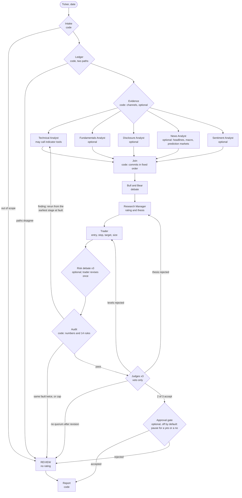

# InsightCrew

A multi-agent trading assistant that audits every number before it reaches you.

Give it a ticker and a date. Model-backed agents read the market facts — and, if you switch on the evidence channels, the company's filed annual figures, its published announcements, dated news with macro series and prediction markets, and social posts — argue both sides, set a rating, and propose a trade. Code computes every fact, checks every cited number and every risk rule, and sends faulty work back to the agent that made it. If you bring a portfolio, three risk debaters critique the proposal before the audit. Three judges then try to refute it. If you switch on the approval gate, the run pauses before delivery until you accept or reject the proposal. If the proposal cannot be verified, or the judges will not accept it, the answer is `REVIEW` with the reason, and no rating.

The flow runs on LangGraph: the analysts compute in parallel, every node commits its events at its end, and an interrupted run resumes from a checkpoint — from the command line or from the page. A timing trace (`trace.jsonl`) is written beside the journal, so the page can show who was working when, for how long, and in what overlap. Delivered decisions are remembered, settled in code once their holding window has traded, and turned into lessons the manager sees on later runs.

Group project for COMP5584 (LLM Agents), The Hong Kong Polytechnic University. Not investment advice: the system executes, routes and simulates no order.

## Quick start

You need [uv](https://docs.astral.sh/uv/getting-started/installation/), which also installs the right Python. Then, in this directory:

```bash
uv sync                      # once: builds .venv from uv.lock (needs network)
uv run insightcrew serve     # opens the local web app at http://127.0.0.1:8765
```

Or run `./start.sh` (macOS, Linux) or `start.bat` (Windows), which check for uv, say how to install it if it is missing, and then run the two commands above.

**No API key is needed to try it.** Without one, every run uses scripted model replies, and the page says so in a badge on every screen (`离线演示 · 脚本化模型`). After `uv sync`, trying it uses no network at all: the demo, the page and the audit run entirely on your machine, so you can disconnect. Pick the `demo` scenario in the form: the audit rejects the Trader's first proposal, the Trader fixes it, and the judges accept it 2 to 1.

**With a key**, copy `.env.example` to `.env` and set `DEEPSEEK_API_KEY`. Each run then calls DeepSeek; the measured cost is about 0.03 USD for the version-2.0 configuration and 0.017 to 0.048 USD for the runs with the version 2.2 capabilities on (nine cells plus a pilot, [docs/EVALUATION.md](docs/EVALUATION.md#3c-the-version-22-cells-on-a-real-model)). Check the connection with `uv run insightcrew check`.

The same from the command line:

```bash
uv run insightcrew analyze                   # the demo scenario (no key), or refuses without a ticker (key)
uv run insightcrew analyze ACME --date 2026-09-30
uv run insightcrew analyze ACME --channels fundamentals,disclosures,news,macro,sentiment   # every channel
uv run insightcrew analyze ACME --portfolio data/portfolios/held_acme.json --risk-rounds 1 --tools --memory
uv run insightcrew analyze ACME --approve    # the approval gate: pause before delivery, ask in the terminal
uv run insightcrew analyze ACME --serial     # analysts one after another; the journal is the same
uv run insightcrew resume runs/<id>          # continue an interrupted run from its checkpoint
uv run insightcrew verify runs/<id>          # offline structural check of a journal; no model, no flow
uv run insightcrew analyze THIN              # refused at intake: 40 bars, below the minimum of 60
```

Everything optional is off by default — channels, portfolio, risk rounds, tools, memory and the approval gate. A run with all of them off writes the artifacts and sends the views of version 2.1, byte for byte. `macro` needs `news` (a run with only macro is refused). A channel or source that cannot be read is reported as unavailable, with the reason, and the run continues.

Each run writes `runs/<run id>/` with `journal.jsonl` (the whole run), `trace.jsonl` (timing and liveness, a sidecar the outcome never depends on), `report.md`, `board.json`, `replay.html` (a page that replays the run with no server) and `checkpoints.sqlite` (what `resume` continues from).

## The claim

Ask a language model for a trade on a stock and it will give you one, with an entry, a stop and a size. The numbers look right. Some of them are misread from the data, some break any sensible risk limit, and nothing in the answer tells you which.

InsightCrew defends one claim: **no number reaches the user unchecked, and no proposal that breaks a stated limit is delivered.** It does not claim to pick stocks well, and [docs/EVALUATION.md](docs/EVALUATION.md#7-what-these-results-do-not-show) says why it cannot.

## How it works



The five analysts after evidence run concurrently when `parallel` is on (the default); each branch computes privately and the join node commits their events in a fixed order, so the journal is the same whether they ran in parallel or in series.

| Agent | Backed by | Does |
|---|---|---|
| Intake | Code | Decides whether the request is in scope: a valid ticker, fresh data, enough history; binds memory lessons and (with tools on) the tool set |
| Ledger | Code | Computes 29 facts (prices, moving averages, RSI, ATR, MACD, Bollinger bands, ranges, returns), then recomputes each in SQL and stops if the two disagree |
| Portfolio stage | Code | Optional. Turns a JSON file of cash, equity and positions into `portfolio/state`: `not_provided`, `flat`, `held` or `unavailable` (currency mismatch) |
| Evidence stage | Code | Optional. Reads each open channel; a channel that fails is marked unavailable and the run continues |
| Technical Analyst | Model | Reads the facts. Each claim cites a fact by ID and restates its value. With tools on, may call `indicator(name, n)` at windows the ledger does not hold; every tool fact is computed on both paths and audited like any other |
| Fundamentals Analyst (optional) | Model | Reads 12 facts computed from the filed annual figures — twice, by two independent paths |
| Disclosure Analyst (optional) | Model | Reads the dated filings and announcements in the window; each signal cites an item by ID |
| News Analyst (optional) | Model | Reads dated headlines, macro facts (FRED series, two paths) and prediction-market questions; each signal cites an item by ID, each macro claim cites a fact |
| Sentiment Analyst (optional) | Model | Reads dated social posts; a 0–10 score must sit inside the band it names; each signal cites a post by ID |
| Bull and Bear Researchers | Model | Argue each side from the analysts' readings, not the raw data |
| Research Manager | Model (stronger tier) | Sets the rating and states the thesis and what would invalidate it; sees only lessons whose outcome was known on the analysis date |
| Trader | Model | Turns the thesis into entry, stop, target, size and horizon, within the stated risk limits |
| Risk debaters: aggressive, conservative, neutral (optional) | Model | Each critiques the trader's proposal and answers the other two; the trader then revises once, and the audit checks the revision |
| Auditor | Code | Checks every restated value against the facts (ledger, fundamentals, macro, tools), every citation, and every proposal against 14 rules |
| Judges: evidence, conservative, aggressive | Model, three instances | Each tries to refute the proposal from one angle. They can veto; they cannot change a number. They do not see the risk debate |
| Reporter | Code | Renders the result. Computes nothing |
| You (approval gate, optional) | Human | Off by default. With `--approve` or the page switch on, the run pauses after the judges accept; you may only accept or reject the proposal — never edit it — and a rejection ends the run `REVIEW` with the reason `rejected_by_user` |
| Reflector (settle, not in the flow) | Model | After a decision's holding window has traded, writes one lesson citing the outcome's fields; the audit checks it before it is stored |

Each model role sees only the board keys it declares. The judges do not see the debate, the risk views or each other. The Research Manager does not see the risk limits. The details, and the reasons, are in [docs/ARCHITECTURE.md](docs/ARCHITECTURE.md#4-agents).

Memory works outside a single run: a delivered decision is appended to a decision log; `insightcrew settle` scores each pending decision in code (two paths must agree), opens a small run for the reflector and stores the lesson if it passes the audit; `insightcrew backtest` walks a grid of dates, settling before each analysis so no future lesson leaks.

## The page

The run page is assembled from modules at build time into one self-contained file with no build step and no external resource. The live page has three screens — an empty hero, the 新建分析 setup and the workspace; a static `replay.html` opens the workspace directly. The workspace is organised by the user's questions:

- **结论 (the answer)**: rating, action, levels with currency, thesis with citation badges, invalidation conditions, two trust lines; four states — running, delivered, `REVIEW` with a reason and a next step, interrupted with a resume button (or, with the approval gate on, 待你确认 with accept/reject). A price chart with the analysis date marked.
- **过程 (why)**: every stage that ran, each role as a card with its model, duration and tokens; the debate rounds; the revision table when the audit or the judges sent work back (one column per version, changed cells marked, the findings under each rejected version); the risk debate's three columns; the judges' rounds.
- **证据 (can it be trusted)**: one fact table with a search box and kind badges (账本/基本面/工具/宏观); every citation badge anywhere on the page is a link that opens the fact or item and can jump to its row; item lists under headings that keep the words 来源原文，未经核验; a line per channel with its state; the data card; the portfolio state.
- **规则与审计**: the rule results with limits and computed values (the formula column on delivered runs, as the report does), and the audit's rounds — findings with their layer, where the flow went, which version fixed them.
- **用量与耗时 (what did it cost)**: a table per role with calls, requests, tokens, cost and duration; three bars against the token, request and time limits; and a waterfall of every model call from the trace, in which parallel analysts are seen to overlap.
- **发起 (launch)**: the 新建分析 screen — the form in three groups with only real fields, and a two-step cost estimate (查看花费预估 → the panel's typical and ceiling calls, ceilings and each channel's coverage for the chosen date → 确认预估并开始; changing a field marks the estimate stale); run history as a standing section with resume buttons; live activity with working-role timers.

The workspace leads with a large symbol heading and a horizontal conclusion card over a circular stage pipeline, and carries the replay controls at its top — play, step, speeds, a draggable position and clickable key-event marks (开始, the audit findings, each 打回, the delivery) that restore the whole page to that moment. Header controls cancel a running analysis (after a confirmation that says the call in flight is not recorded), resume an interrupted one, and open the 新建分析 screen. The page is keyboard-operable, has a dark and a light colour scheme (both at WCAG AA contrast; the dark one follows the kraken design of the owner's OpenDesign prototype), works down to 480 px wide, and says so and retries when a fetch fails. It is this project's own page; it is not a copy of any named product, and it does not stream the model's output — it shows that a role is working and for how long, and the reply appears when the call returns.

## Results

From [docs/EVALUATION.md](docs/EVALUATION.md). Every number comes from a command you can re-run or a journal in `insightcrew/evals/archive/`.

| What | Result |
|---|---|
| Injected faults the audit catches (`eval inject`) | 19 of 19, plus 6 of 6 with both v2.1 channels and 6 of 6 for version 2.2; 0 false alarms (0/6, 0/2, 0/2 valid variants) |
| Two indicator paths agree (`eval consistency`) | 277 data points × 29 outputs, all equal |
| Fundamentals paths agree (`eval consistency`) | 46 dates × 12 facts, all equal |
| Tool consistency (`eval consistency`) | 63 calls × two paths (7 families × 3 dates × 3 windows), all equal |
| Macro consistency (`eval consistency`) | 96 points × two paths, all equal |
| No fact uses a later bar (`eval pit`) | 864 ledger facts; plus channel sweeps and six version 2.2 sweeps: news 9, social 9, macro 91 (two restatements day by day), prediction markets 6, lessons 5, tools 63 — all clean |
| Scripted scenarios: which gate catches which fault (`scenarios`) | 36 of 36 as expected (21 from earlier versions, 13 for the version 2.2 capabilities, 2 for the approval gate) |
| Real-model runs on DeepSeek, final v2.0 configuration | 5 of 5 delivered, about 100 s and 0.03 USD a run; the judges rejected one thesis and the revision was accepted |
| Channels on a real model (v2.1, `eval channels`) | 12 runs: mechanisms verified, citations routed and corrected; four cells cannot say more |
| Ablation on a real model (v2.0, `eval ablation`) | 16 runs: no proposal broke a rule even with the audit off; the judges changed one rating in four cells |
| Version 2.2/2.3 cells on a real model (`eval v22`, run 2026-11-20) | Pilot plus 9 cells, all archived with `trace.jsonl`: 8 delivered, 1 `review` (contested, model variance); 0.3174 USD of the 2 USD cap |
| Parallel against serial, from the traces | The five-analyst group in the all-on run overlapped: call durations sum to 48.0 s, the group spans 13.7 s |
| Replay of every archived journal | 53 of 53 identical (`一致`); `verify` passes on 53 of 53 |
| Tests | 915 passed with Node present; without Node the 2 page-Node tests skip (913 passed, 2 skipped) |

No live endpoint of the new sources (news feeds, StockTwits, Reddit, FRED, Polymarket) has been fetched yet: their adapters are tested offline against hand-built fixtures, and each live request is asked for first.

## Course requirements

| The brief asks for | Where it is answered |
|---|---|
| A clearly defined task | [Architecture 1](docs/ARCHITECTURE.md#1-the-task) |
| Why a multi-agent approach | [Architecture 2](docs/ARCHITECTURE.md#2-why-more-than-one-agent) |
| Role and responsibility of each agent | [Architecture 4](docs/ARCHITECTURE.md#4-agents) |
| Information and tools available to each agent | [Architecture 4](docs/ARCHITECTURE.md#4-agents), including what each agent is not shown |
| How tasks are assigned or decomposed | [Architecture 5](docs/ARCHITECTURE.md#5-the-flow-the-graph) |
| How agents communicate | [Architecture 6](docs/ARCHITECTURE.md#6-communication-the-journal-the-board-and-the-trace) |
| How the final output is produced | [Architecture 7](docs/ARCHITECTURE.md#7-verification) and [8](docs/ARCHITECTURE.md#8-outcomes-and-refusals) |
| A working, demonstrable implementation | [Quick start](#quick-start) |
| Analysis, design rationale, limitations and failure cases | [Evaluation](docs/EVALUATION.md); [Architecture 11](docs/ARCHITECTURE.md#11-design-decisions) and [12](docs/ARCHITECTURE.md#12-known-limitations) |

Of the designs the brief lists, the system uses role-based collaboration, debate (bull/bear and the three-way risk debate), a shared workspace (the board), parallel analyst subgraphs, multi-agent verification, tool use, memory, a human approval gate, and routing of rejected work to the agent at fault.

## Limitations

The main ones. The full list is in [docs/ARCHITECTURE.md](docs/ARCHITECTURE.md#12-known-limitations) and [docs/ROADMAP.md](docs/ROADMAP.md).

- **The audit checks numbers and rules, not judgment.** A proposal can be correct, compliant and still a poor trade. The judges are other models and can share a blind spot.
- **Nothing here measures decision quality.** The evaluation has tens of runs; the synthetic market carries no information by construction. The version 2.2/2.3 cells measure that the capabilities run and what they cost, not that they improve decisions.
- **The model may remember real prices.** The point-in-time rule controls what the tools return, not what the model learned in training.
- **Headlines, posts and market probabilities are source text, not facts.** Code checks that a cited item exists and is dated no later than the analysis date; what it says is not verified, and the report prints market questions under a heading that says so.
- **Resume is not lossless.** The usage of a call interrupted mid-flight is in no file, and an interruption inside a node that makes several calls (the debate, the risk debate, the judges) repeats that node's calls: the result is a valid run, not an identical journal.
- **Trace durations are wall time on one machine and one network,** not a benchmark.
- **The approval gate is a pause for a yes or a no,** not a control of any regulatory kind.
- **Real bars come from unofficial endpoints** (Yahoo, then Eastmoney) that can throttle or change.
- **Every version 2.2 capability and the approval gate ship off by default.** With everything off a run is byte-for-byte version 2.1; the archived journals of versions 2.0 to 2.3 still replay. Which capabilities `insightcrew.toml` switches on is the owner's decision.

## Commands

| Command | Does |
|---|---|
| `uv run insightcrew serve` | The local web app: start runs (with a plan preview), watch them live, cancel or resume them, open past runs and export their report and replay |
| `uv run insightcrew analyze [TICKER]` | One run, printed as it goes. Options: `--date`, `--scenario`, `--universe`, `--channels fundamentals,disclosures,news,sentiment,macro`, `--portfolio PATH`, `--risk-rounds N`, `--tools`, `--memory`, `--approve`, `--no-judges`, `--debate-rounds N`, `--serial`, `--quiet`, `--no-open` |
| `uv run insightcrew resume runs/<id>` | Rebuilds an interrupted run from its journal (a torn last line is repaired, with a note), checks the run signature, and continues the graph from the checkpoint |
| `uv run insightcrew verify runs/<id>` | Offline structural check of a journal (sequence numbers, first and last events, causes, versions, usage sums, outcome). No model, no flow |
| `uv run insightcrew settle [--known-by D]` | Scores every pending decision whose holding window has traded (two paths must agree), runs the reflector, stores lessons that pass the audit |
| `uv run insightcrew backtest TICKER... --from D --to D` | Grid of analysis dates; settles before each analysis, memory on. Options: `--every N`, `--run-id ID` (resumable), `--yes` (required with a real model) |
| `uv run insightcrew facts TICKER` | The ledger, data card, and what each evidence channel would read. No model |
| `uv run insightcrew replay runs/<id>` | Reruns a journal with no model and checks the result is identical; an unfinished journal is reported as such, not diffed |
| `uv run insightcrew scenarios` | The 36 scripted scenarios, expected against actual |
| `uv run insightcrew eval all` | Injection, consistency and point-in-time evaluations, including the version 2.2 blocks. No model |
| `uv run insightcrew eval ablation` | The v2.0 ablation on a real model. Costs about 0.5 USD |
| `uv run insightcrew eval channels` | The v2.1 channels evaluation on a real model. 12 runs, about 0.5 USD |
| `uv run insightcrew eval v22` | The 9 version 2.2 cells on a real model (already run once, 2026-11-20; running it again spends). Without a key it lists the cells and exits 2 |
| `uv run insightcrew check` | Settings without the key, and what the configured models accept |
| `uv run insightcrew fetch AAPL 0700.HK` | Downloads real daily bars and, after them, v2.1 evidence (US from SEC EDGAR when `IC_SEC_CONTACT` is set, HK announcements from Eastmoney). Version 2.2 kinds are separate flags, off by default: `--news`, `--social`, `--macro` (needs `IC_FRED_API_KEY`), `--markets` (Polymarket). Each live request is asked for first |
| `scripts/check.sh` | One command for the whole proof: the three checks, every scenario, a replay sweep of every archived journal, and `eval all`. This is what was actually run; the CI workflow file (`.github/workflows/ci.yml`) has **never been pushed and never run** |
| `uv run pytest` | 915 tests with Node present (without Node, the 2 page-Node tests skip). No network, no key |

**Without uv.** `python3 -m venv .venv`, then `.venv/bin/pip install -e .`, then `.venv/bin/insightcrew serve` (on Windows, `.venv\Scripts\`). This needs Python 3.12 or later and ignores `uv.lock`, so the package versions may differ from the ones tested. It was tried on Python 3.15.2, where pip chose newer minor versions, and the offline demo ran. The test tools are not installed this way.

## Repository layout

```text
insightcrew.toml        Settings: model tiers, flow switches, budgets, source chains. No secrets
insightcrew/
  kernel/               Events, journal, board, budget, run_role, deferred commit and the observer
                        hook (timing only): domain-free
  domain/               Bars, symbols, indicators, ledger, rules, audit; portfolio, risk, news, social,
                        macro and memory contracts; four two-path pairs
  roles/                Role declarations and their prompts (Chinese)
  flows/                The LangGraph graph, the analysis flow, its code stages and the five
                        capability stages; tools; the approval gate; settle
  adapters/             Real, scripted and replayed models; CSV bars; Yahoo, Eastmoney, SEC EDGAR;
                        the source chain and the five live adapters (fixtures only so far)
  app/                  Settings, wiring, CLI, report, the run page (assets/js, assets/css, assembled
                        into one file), the local web app with run control; resume, trace, verify,
                        settle, backtest
  evals/                Scenarios, injection, consistency, point-in-time, ablation, channels, v22;
                        archive/ of real-model journals (each with trace.jsonl from version 2.3 on)
data/
  indicators.toml       Indicator declarations
  rules.toml            The risk rulebook
  fundamentals.toml     Fundamental-fact declarations (12 facts)
  macro.toml            Macro series declarations (4 FRED aliases)
  tool_indicators.toml  The indicator tool families and their ranges
  portfolios/           Example portfolio files (flat_usd, held_acme, low_cash_usd)
  market/synthetic/     Seeded synthetic bars plus statements/, disclosures/, news/, social/, macro/
  scenarios/            36 scripted runs with expected outcomes
scripts/check.sh        The one-command proof (the CI file is a deliverable that has never run)
tests/                  pytest; tests/js/ holds the page's Node tests (skipped when node is absent)
docs/                   Architecture, evaluation, roadmap, and the build plan
```

## Documentation

| Document | Content |
|---|---|
| [docs/ARCHITECTURE.md](docs/ARCHITECTURE.md) | The task, the agents and what each sees, the graph, verification, the journal and the trace, run control, design decisions, limitations |
| [docs/EVALUATION.md](docs/EVALUATION.md) | Offline evaluations, real-model runs, ablation, failure cases, what the results do not show |
| [docs/ROADMAP.md](docs/ROADMAP.md) | What is pending and what comes next |
| [AGENTS.md](AGENTS.md) | Working rules for AI coding assistants in this repository |
| [docs/BLUEPRINT.md](docs/BLUEPRINT.md), [docs/HANDOFF.md](docs/HANDOFF.md) | The build plan and its status board, kept as the record of how the system was built |
| [THIRD_PARTY_NOTICES.md](THIRD_PARTY_NOTICES.md) | The Apache-2.0 notice for the parts adapted from TradingAgents, and the list of adapted files |

Version 1 of this project, a data analyst over CSV tables, is kept under the git tag `v1-data-analyst`; version 2.0 under `v2.0`; version 2.1 under `v2.1`; version 2.2 under `v2.2`.
