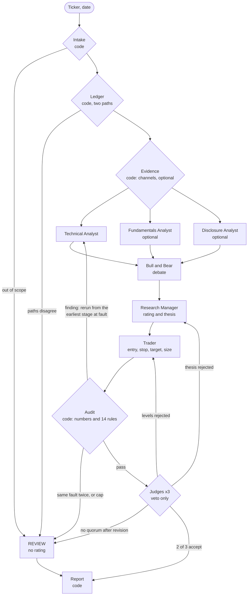

# InsightCrew

A multi-agent trading assistant that audits every number before it reaches you.

Give it a ticker and a date. Eight model-backed agents read the market facts — and, if you switch on the evidence channels, the company's filed annual figures and its published announcements — argue both sides, set a rating, and propose a trade. Code computes every fact, checks every cited number and every risk rule, and sends faulty work back to the agent that made it. Three judges then try to refute the proposal. If the proposal cannot be verified, or the judges will not accept it, the answer is `REVIEW` with the reason, and no rating.

Group project for COMP5584 (LLM Agents), The Hong Kong Polytechnic University. Not investment advice: the system executes, routes and simulates no order.

## Quick start

You need [uv](https://docs.astral.sh/uv/getting-started/installation/), which also installs the right Python. Then, in this directory:

```bash
uv sync                      # once: builds .venv from uv.lock (needs network)
uv run insightcrew serve     # opens the local web app at http://127.0.0.1:8765
```

Or run `./start.sh` (macOS, Linux) or `start.bat` (Windows), which check for uv, say how to install it if it is missing, and then run the two commands above.

**No API key is needed to try it.** Without one, every run uses scripted model replies, and the page says so in a badge on every screen (`离线演示 · 脚本化模型`). Pick the `demo` scenario in the form: the audit rejects the Trader's first proposal, the Trader fixes it, and the judges accept it 2 to 1.

**With a key**, copy `.env.example` to `.env` and set `DEEPSEEK_API_KEY`. Each run then calls DeepSeek and costs about 0.03 to 0.09 USD. Check the connection with `uv run insightcrew check`.

The same from the command line:

```bash
uv run insightcrew analyze                   # the demo scenario (no key), or refuses without a ticker (key)
uv run insightcrew analyze ACME --date 2026-09-30
uv run insightcrew analyze ACME --channels fundamentals,disclosures   # open the evidence channels
uv run insightcrew analyze THIN              # refused at intake: 40 bars, below the minimum of 60
```

The channels are off by default: a run with none open behaves exactly like version 2.0. `fundamentals` reads annual figures as the company filed them (restatements serve at the version on file on the analysis date); `disclosures` reads dated filings and announcements from a 90-day window. A channel that cannot be read is reported as unavailable and the run continues.

Each run writes `runs/<run id>/` with `journal.jsonl` (the whole run), `report.md`, `board.json` and `replay.html`, a page that replays the run with no server.

## The claim

Ask a language model for a trade on a stock and it will give you one, with an entry, a stop and a size. The numbers look right. Some of them are misread from the data, some break any sensible risk limit, and nothing in the answer tells you which.

InsightCrew defends one claim: **no number reaches the user unchecked, and no proposal that breaks a stated limit is delivered.** It does not claim to pick stocks well, and [docs/EVALUATION.md](docs/EVALUATION.md#7-what-these-results-do-not-show) says why it cannot.

## How it works



| Agent | Backed by | Does |
|---|---|---|
| Intake | Code | Decides whether the request is in scope: a valid ticker, fresh data, enough history |
| Ledger | Code | Computes 29 facts (prices, moving averages, RSI, ATR, MACD, Bollinger bands, ranges, returns), then recomputes each in SQL and stops if the two disagree |
| Evidence stage | Code | Optional. Reads each open channel; a channel that fails is marked unavailable and the run continues |
| Technical Analyst | Model | Reads the facts. Each claim cites a fact by ID and restates its value |
| Fundamentals Analyst (optional) | Model | Reads 12 facts computed from the filed annual figures — twice, by two independent paths |
| Disclosure Analyst (optional) | Model | Reads the dated filings and announcements in the window; each signal cites an item by ID |
| Bull and Bear Researchers | Model | Argue each side from the analysts' readings, not the raw data |
| Research Manager | Model (stronger tier) | Sets the rating and states the thesis and what would invalidate it |
| Trader | Model | Turns the thesis into entry, stop, target, size and horizon, within the stated risk limits |
| Auditor | Code | Checks every restated value against the ledger (and the fundamentals facts, and every cited announcement item) and every proposal against 14 rules |
| Judges: evidence, conservative, aggressive | Model, three instances | Each tries to refute the proposal from one angle. They can veto; they cannot change a number |
| Reporter | Code | Renders the result. Computes nothing |

Each model role sees only the board keys it declares. The judges do not see the debate or each other. The Research Manager does not see the risk limits. The details, and the reasons, are in [docs/ARCHITECTURE.md](docs/ARCHITECTURE.md#4-agents).

## Results

From [docs/EVALUATION.md](docs/EVALUATION.md). Every number comes from a command you can re-run or a journal in `insightcrew/evals/archive/`.

| What | Result |
|---|---|
| Injected faults the audit catches (`eval inject`) | 19 of 19, and 0 false alarms on 6 valid edge cases |
| Two indicator paths agree (`eval consistency`) | 277 data points × 29 outputs, all equal |
| No fact uses a later bar (`eval pit`) | 864 facts checked |
| Scripted scenarios: which gate catches which fault (`scenarios`) | 21 of 21 as expected, five of them with both channels open |
| Two fundamentals paths agree (`eval consistency`) | 46 dates × 12 facts, all equal |
| Later filings change no earlier fact (`eval pit`) | 16 channel data points checked |
| Channels on a real model (`eval channels`) | 12 runs: mechanisms verified, citations routed and corrected; four cells cannot say more (see [EVALUATION 7](docs/EVALUATION.md#7-what-these-results-do-not-show)) |
| Real-model runs on DeepSeek, final configuration | 5 of 5 delivered, about 100 s and 0.03 USD a run; the judges rejected one thesis and the revision was accepted |
| Ablation on a real model: 4 cells × 4 configurations | No proposal broke a rule even with the audit off; the judges changed one rating in four cells |

## Course requirements

| The brief asks for | Where it is answered |
|---|---|
| A clearly defined task | [Architecture 1](docs/ARCHITECTURE.md#1-the-task) |
| Why a multi-agent approach | [Architecture 2](docs/ARCHITECTURE.md#2-why-more-than-one-agent) |
| Role and responsibility of each agent | [Architecture 4](docs/ARCHITECTURE.md#4-agents) |
| Information and tools available to each agent | [Architecture 4](docs/ARCHITECTURE.md#4-agents), including what each agent is not shown |
| How tasks are assigned or decomposed | [Architecture 5](docs/ARCHITECTURE.md#5-the-flow) |
| How agents communicate | [Architecture 6](docs/ARCHITECTURE.md#6-communication-the-journal-and-the-board) |
| How the final output is produced | [Architecture 7](docs/ARCHITECTURE.md#7-verification) and [8](docs/ARCHITECTURE.md#8-outcomes-and-refusals) |
| A working, demonstrable implementation | [Quick start](#quick-start) |
| Analysis, design rationale, limitations and failure cases | [Evaluation](docs/EVALUATION.md); [Architecture 11](docs/ARCHITECTURE.md#11-design-decisions) and [12](docs/ARCHITECTURE.md#12-known-limitations) |

Of the designs the brief lists, the system uses role-based collaboration, debate, a shared workspace (the board), multi-agent verification, and routing of rejected work to the agent at fault.

## Limitations

The main ones. The full list is in [docs/ARCHITECTURE.md](docs/ARCHITECTURE.md#12-known-limitations) and [docs/ROADMAP.md](docs/ROADMAP.md).

- **The audit checks numbers and rules, not judgment.** A proposal can be correct, compliant and still a poor trade. The judges are other models and can share a blind spot.
- **Nothing here measures decision quality.** The evaluation has tens of runs; the synthetic market carries no information by construction.
- **The model may remember real prices.** The point-in-time rule controls what the tools return, not what the model learned in training.
- **Real bars come from unofficial endpoints** (Yahoo, then Eastmoney) that can throttle or change.
- **No portfolio yet.** The rules that need a position (`sell_requires_position`, `cash_sufficient`) see an empty account.
- **The evidence channels ship off by default.** The channels evaluation cannot show that more evidence gives better decisions (twelve runs; see [EVALUATION 7](docs/EVALUATION.md#7-what-these-results-do-not-show)), so the default behaviour stays that of version 2.0 and the channels are an option.
- **Titles and signal directions are not verified.** Code checks that a cited announcement exists and was published by the analysis date; what the item says, and whether a reading of it is right, is judgment and goes to the judges.

## Commands

| Command | Does |
|---|---|
| `uv run insightcrew serve` | The local web app: start runs, watch them live, open past runs |
| `uv run insightcrew analyze [TICKER] [--date D] [--scenario NAME]` | One run, printed as it goes |
| `uv run insightcrew facts TICKER` | The ledger, data card, and what each evidence channel would read. No model |
| `uv run insightcrew replay runs/<id>` | Reruns a journal with no model and checks the result is identical |
| `uv run insightcrew scenarios` | The 21 scripted scenarios, expected against actual |
| `uv run insightcrew eval all` | Injection, consistency and point-in-time evaluations. No model |
| `uv run insightcrew eval ablation` | The ablation on a real model. Costs about 0.5 USD |
| `uv run insightcrew eval channels` | The channels evaluation on a real model. 12 runs, about 0.5 USD |
| `uv run insightcrew check` | Settings without the key, and what the configured models accept |
| `uv run insightcrew fetch AAPL 0700.HK` | Downloads real daily bars and, after them, evidence (US from SEC EDGAR when `IC_SEC_CONTACT` is set, HK announcements from Eastmoney); then add `--universe real` to `analyze` |
| `uv run pytest` | 486 tests. No network, no key |

**Without uv.** `python3 -m venv .venv`, then `.venv/bin/pip install -e .`, then `.venv/bin/insightcrew serve` (on Windows, `.venv\Scripts\`). This needs Python 3.12 or later and ignores `uv.lock`, so the package versions may differ from the ones tested. It was tried on Python 3.15.2, where pip chose newer minor versions, and the offline demo ran. The test tools are not installed this way.

## Repository layout

```text
insightcrew.toml        Settings: model tiers, flow switches, budgets. No secrets
insightcrew/
  kernel/               Events, journal, board, budget, run_role: domain-free
  domain/               Bars, symbols, indicators (two paths), ledger, rules, audit
  roles/                Role declarations and their prompts (Chinese)
  flows/                The analysis flow and its code stages
  adapters/             Real, scripted and replayed models; CSV bars; Yahoo and Eastmoney downloads
  app/                  Settings, wiring, CLI, report, run page, local web app
  evals/                Scenarios, injection, consistency, point-in-time, ablation; archive/ of real-model journals
data/
  indicators.toml       Indicator declarations
  rules.toml            The risk rulebook
  fundamentals.toml     Fundamental-fact declarations (12 facts)
  market/synthetic/     Seeded synthetic bars plus statements/ and disclosures/ evidence; make_*.py regenerate them
  scenarios/            21 scripted runs with expected outcomes
tests/                  pytest
docs/                   Architecture, evaluation, roadmap, and the build plan
```

## Documentation

| Document | Content |
|---|---|
| [docs/ARCHITECTURE.md](docs/ARCHITECTURE.md) | The task, the agents and what each sees, the flow, verification, the journal, design decisions, limitations |
| [docs/EVALUATION.md](docs/EVALUATION.md) | Offline evaluations, real-model runs, ablation, failure cases, what the results do not show |
| [docs/ROADMAP.md](docs/ROADMAP.md) | What was cut and what comes next |
| [AGENTS.md](AGENTS.md) | Working rules for AI coding assistants in this repository |
| [docs/BLUEPRINT.md](docs/BLUEPRINT.md), [docs/HANDOFF.md](docs/HANDOFF.md) | The build plan and its status board, kept as the record of how the system was built |

Version 1 of this project, a data analyst over CSV tables, is kept under the git tag `v1-data-analyst`; version 2.0 under `v2.0`.
