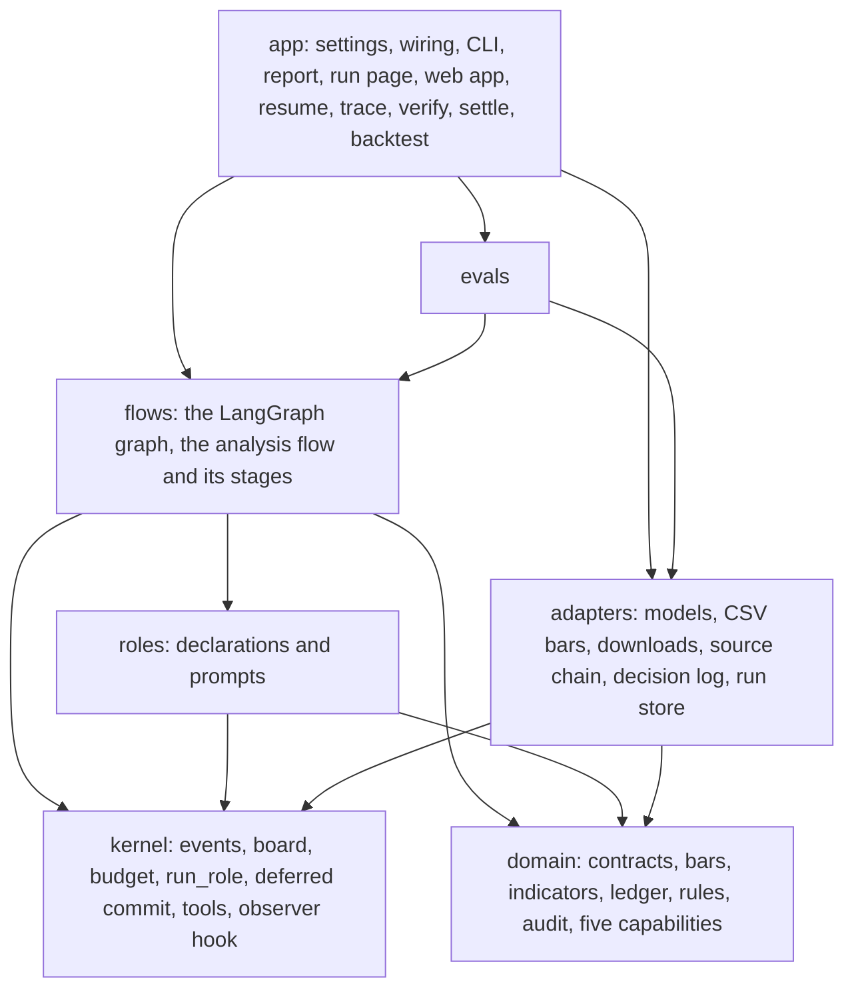

# Architecture

How InsightCrew version 2.3 is built and why. This describes the code as it is. The plan it was built from is [BLUEPRINT.md](BLUEPRINT.md) (section 19 for version 2.2, section 20 for this version); where the two differ, this file and the code are right.

## Contents

1. [The task](#1-the-task)
2. [Why more than one agent](#2-why-more-than-one-agent)
3. [Layers and libraries](#3-layers-and-libraries)
4. [Agents](#4-agents)
5. [The flow: the graph](#5-the-flow-the-graph)
6. [Communication: the journal, the board and the trace](#6-communication-the-journal-the-board-and-the-trace)
7. [Verification](#7-verification)
8. [Outcomes and refusals](#8-outcomes-and-refusals)
9. [Budgets and limits](#9-budgets-and-limits)
10. [Interfaces](#10-interfaces)
11. [Design decisions](#11-design-decisions)
12. [Known limitations](#12-known-limitations)
13. [Related systems](#13-related-systems)
14. [The five capabilities](#14-the-five-capabilities)
15. [The source chain](#15-the-source-chain)
16. [Run control: checkpoints, cancel, resume, approval](#16-run-control-checkpoints-cancel-resume-approval)

## 1. The task

**Input.** A ticker, a US or Hong Kong equity, and an analysis date. The date defaults to the last settled bar in the data. Optionally: evidence channels, a portfolio file, risk-debate rounds, analyst tools, memory, and the approval gate (all off by default).

**Output.** A report in Chinese with:

- a rating (`Buy`, `Overweight`, `Hold`, `Underweight`, `Sell`), or `REVIEW` with a reason;
- a trade proposal: action, entry, stop, target, size as a percentage of equity, and horizon;
- the facts it cites, the thesis and what would invalidate it, the bull and bear cases, and — when on — the portfolio state, the risk debate's three views, news and macro, the sentiment band and the lessons used;
- every risk rule with its computed value;
- the judges' verdicts;
- a two-part confidence label;
- data quality, token use and cost.

The run's journal comes with it, plus a timing trace beside it. The whole run can be replayed from the journal with no model, checked structurally by `verify`, and an interrupted run can be resumed from its checkpoint — from the command line or from the page. With the approval gate on, the run pauses before delivery until a human accepts or rejects the proposal.

**The claim.** No number reaches the user unchecked, and no proposal that breaks a stated limit is delivered. When that cannot be guaranteed, the system refuses: `REVIEW`, the reason, and no rating.

**Not in scope.** Order execution, broker connections, intraday data, short selling, options, portfolio optimisation. Every report and every page says the output is not investment advice and that no order is executed.

## 2. Why more than one agent

A single model asked for a trade produces numbers it read, numbers it computed and judgments it made, all in one paragraph, and the reader cannot tell them apart. Splitting the work changes what can be checked:

- **Each step has a contract.** The analyst returns claims, each citing a fact by ID and restating its value. The manager returns a rating and points that cite those facts. The trader returns levels and a size. The risk debaters return a stance, a critique and optional levels. Code can check each of these, and a fault can be traced to the role that made it and sent back to that role.
- **Opposed roles surface what one voice smooths over.** The bull and bear researchers each argue one side from the same readings; the risk debate argues risk from three stances. The manager answers the first pair; the trader answers the second.
- **Independent judges are different readers.** Three judges look from three angles: evidence, downside risk, opportunity cost. None sees the debate, the risk views or the others' verdicts, so a persuasive argument cannot carry them all at once.
- **The checking that matters is not done by a model.** The facts, the arithmetic and the risk rules are code. That is the central design choice: a model checking a model shares its assumptions, and code does not.

Fourteen model-backed role kinds do the reading, arguing and deciding (technical, fundamentals, disclosure, news and sentiment analysts; bull and bear researchers; the manager; the trader; three risk debaters; three judges; the reflector). Code stages do the computing and checking. The approval gate adds one human decision that code records but never edits.

## 3. Layers and libraries

An arrow means "may import". `tests/test_architecture.py` enforces the arrows, and also which third-party packages each layer may import:

| Layer | Third-party packages it may import |
|---|---|
| `kernel` | `pydantic`, `pydantic_core`, `pydantic_ai` |
| `domain` | `pydantic` |
| `roles` | none |
| `flows` | `langgraph`, and `langchain_core` only for the `RunnableConfig` type (only `flows/graph.py` imports either) |
| `adapters` | `pydantic`, `pydantic_ai`, `httpx2` |
| `evals` | `pydantic` |
| `app` | `pydantic`, `pydantic_settings`, `dotenv`, `fastapi`, `uvicorn`, `typer`, `langgraph` (only the SQLite checkpointer, in `wiring.py` and `resume.py`) |

The flow and the roles otherwise import no library, so they read as plain Python and no library upgrade changes what they mean. Pydantic AI's `Agent` appears in one function, `run_role` in `kernel/runtime.py`. LangGraph appears in one file, `flows/graph.py`.

**What is borrowed and what is ours.** The libraries do the jobs every project has:

| Library | Jobs |
|---|---|
| LangGraph | The `StateGraph`: conditional edges with explicit path maps, parallel branches with private state, the SQLite checkpointer for `resume`, `interrupt` for the approval gate |
| Pydantic AI | Reaching a model and asking it for typed output; the corrective retry; tool calls; provider differences; token usage; prices |
| Pydantic | Contracts and validation |
| FastAPI and Uvicorn | The web app |
| Typer | The command line |
| `pydantic-settings` | Settings |
| uv | The environment, from `uv.lock` |

The project's own code is the part that is its argument: the journal and the board, the trace, the budget policy, the graph and its commit discipline, the two-path fact pairs, the rulebook and the audit, the source chain. The kernel, which knows nothing about trading, is about 550 lines (it gained the 20-line observer hook in version 2.3). Twenty files adapt specific ideas from TradingAgents under Apache-2.0, each with its header line and listed in [THIRD_PARTY_NOTICES.md](../THIRD_PARTY_NOTICES.md); version 2.3 adapted nothing from either reference codebase.

## 4. Agents

Each role is declared as data in `insightcrew/roles/__init__.py`: its prompt, the board keys it reads, the key it writes, its output contract and its model tier. The prompts are in `roles/prompts/`, in Chinese. They state the job, what arrives and the constraints. They contain no data and no output format, because the format is derived from the contract.

| Role | Model tier | Reads | Writes |
|---|---|---|---|
| Technical Analyst | quick | instrument, facts, data card, its own audit findings | `technical/analysis`: claims, each a fact ID, the value restated and a reading. With tools on, the role is declared with `tools=("indicator",)` and a call cap |
| Fundamentals Analyst (optional, channel) | quick | instrument, the fundamentals facts and card, its own audit findings | `fundamentals/analysis`: the same shape as the technical analysis, over annual figures |
| Disclosure Analyst (optional, channel) | quick | instrument, the items in the window and the disclosure card, its own audit findings | `disclosures/analysis`: signals, each an item ID, a direction and a reading; stance and confidence |
| News Analyst (optional, channel) | quick | instrument, `news/items` and `news/card` and `news/status`, `macro/facts` and `macro/markets` and `macro/status`, its own audit findings | `news/analysis`: signals over item or market IDs, claims over macro facts, stance, confidence, narrative |
| Sentiment Analyst (optional, channel) | quick | instrument, `sentiment/posts` and `sentiment/card` and `sentiment/status`, its own audit findings | `sentiment/analysis`: a 0–10 score inside a six-band scale, signals over post IDs, narrative |
| Bull Researcher | quick | instrument, analysis, the channel analyses with their statuses, the bear's argument | `bull/argument` |
| Bear Researcher | quick | instrument, analysis, the channel analyses with their statuses, the bull's argument | `bear/argument` |
| Research Manager | deep, high reasoning effort | instrument, data card, analysis, channel analyses with statuses, both arguments, `memory/lessons` and `memory/status`, its audit findings, judges' dissents on the thesis | `manager/thesis`: rating, points citing fact or item IDs, horizon, invalidation |
| Trader | quick | instrument, facts, thesis, `portfolio/state`, the three `risk/*` views, risk limits, its audit findings, judges' dissents on the levels | `trader/proposal`: action, entry, stop, target, size, horizon, cited facts |
| Risk debaters: aggressive, neutral, conservative (optional) | quick | instrument, facts, thesis, proposal, `portfolio/state`, risk limits, the other two `risk/*` views | `risk/<stance>`: a `RiskView` — stance, critique, optional size/stop/target, cited facts, a rebuttal of the other two |
| Judges: evidence, conservative, aggressive | quick, low reasoning effort | instrument, facts, analysis, channel analyses and their raw evidence, thesis, proposal, risk limits, rule results | `judge.<lens>/verdict`: accept, or a target (thesis or levels), a critique and cited facts |
| Reflector (settle only, not in the flow) | quick | `settle/decision`, `settle/outcome` | `settle/lesson`: one transferable lesson citing outcome fields |
| You (optional, not a model) | — | the proposal, on the page or in the terminal | `approval/decision`: an `Approval` — accept or reject, with an optional note. Only with `approve` on |

A role's `reads` may name keys a run never writes — that is what makes every capability compatible: when tools, memory, the portfolio, the risk debate or a channel is off, the key is simply absent and the view is exactly the version-2.1 view.

The tiers are set in `insightcrew.toml`: quick is `deepseek:deepseek-flash`, deep is `deepseek:deepseek-v4-pro`. Changing the model is one line there.

**What each role does not see, and why.** What a role cannot see is whatever its reads omit. The runtime renders exactly those keys into the prompt and nothing else; a test plants a marker in a forbidden key and checks it never reaches a model.

| Role | Does not see | Reason |
|---|---|---|
| Every role | Any bar, fact, item, post, vintage, market or lesson dated after the analysis date | Point-in-time integrity |
| Researchers | The raw facts, the portfolio | They argue from the analysts' readings, which are audited |
| Research Manager | The risk limits, the portfolio, the risk debate | The rating is a view on the stock, not on what the account can afford |
| Trader | The debate | It implements the thesis; it does not reopen it |
| Judges | The debate, the risk views, the portfolio, each other's verdicts, the history of audit findings | Independent verdicts need independent inputs; the risk debate already argued the plan, the judges check it |
| Analysts | The other analysts' output, the raw bars | Each analyst works from its own evidence |
| Auditor (code) | All prose | It checks structured content only |

The Trader is shown the risk limits and the risk views. A limit is a constraint to meet, not something to infer; the debaters' optional levels are suggestions it may adopt or answer, not numbers it may copy unaudited — whatever it proposes goes through the audit again. Compliance is still decided by code. The human at the approval gate sees the proposal's summary and levels and may only accept or reject: an edited level would be an unaudited author, so the contract has no field for one.

## 5. The flow: the graph

Since version 2.2 the flow is a LangGraph `StateGraph` built by `flows/graph.py` (about 420 lines). `flows/analyze.py` (about 190 lines) keeps `FlowConfig` (`debate_rounds`, `audit`, `judges`, `audit_rounds`, `judge_rounds`, `quorum`, `parallel`, `channels`, `risk_rounds`, `tools`, `memory`, `approve`), `call`, the one `try`/`except Halt`, the entry point `analyze(run, request, deps, cfg=None) -> Outcome` and the resume/approval entry points of section 16; it delegates to `build_graph(stages, cfg, deps) -> CompiledStateGraph`. The graph is built from the `stages` object `analyze` hands in, so a test can swap the whole stage layer (`tests/test_flow.py` does).

**State is routing counters only** (decision 41). `GraphState` is a `TypedDict` with `audit_round`, `judge_round`, `last_findings` (the previous audit's findings signature, for stagnation detection), `route` and a reserved `halt`. Nothing else: `Run` (board, journal, budget), `deps` and the request travel in the graph's `config["configurable"]`, never in state, so a checkpoint can always be checked against the journal, and a replay never depends on graph state at all. Nodes read them through `config["configurable"]`; per-run values that are not events (the final result, the deferred analyst results) go into a mutable holder in the same dict.

**Every node commits at its end** (decision 42). A node wraps a code stage or a model call; when it returns, its events are already in the journal. This is what makes parallelism safe: the two feedback loops of version 2.1 are reproduced by conditional edges whose decisions the nodes compute and leave in `state["route"]` — the routers are pure functions of state, each with an explicit path map listing every value it can return (`tests/test_graph.py` walks every router and checks its values are keys of its map):

- **Audit edge.** No findings → `judges` (or `outcome` with judges off). Findings → the earliest owner in `technical, fundamentals, disclosures, news, sentiment, manager, trader`; every later node reruns. The same findings signature twice → `Halt("stagnation")`; the round cap → `Halt("audit_failed")`.
- **Judges edge.** Quorum → `approval` (with the gate on) or `outcome`. A dissent on the thesis → `manager`; on the levels → `trader`, with the audit counters reset for a fresh audit loop. Round cap → `Halt("contested")`.
- **Approval node** (only with `approve` on; section 16): pauses the graph for a human decision; accepted → `outcome`, rejected → `Halt("rejected_by_user")`.

**A capability that is off adds no node.** With no channels there is no `evidence` node; with `risk_rounds = 0` no `risk` node; with judges off no `judges` node; with `approve = false` (the default) no `approval` node and nothing of the gate exists at run time. The pipeline is otherwise: `intake → ledger → [evidence] → analysts → join → debate → manager → trader → [risk] → audit → [judges] → [approval] → outcome`.

**Parallel analysts.** With `parallel = True` (the default; `--serial` turns it off) the analysts after evidence — `technical` plus one node per open channel analyst — run concurrently, each a subgraph branch with its own message history computing through `run_role_deferred` (the kernel's deferred commit: everything `run_role` does except appending to the journal and putting on the board). The `analysts` node before the fan-out admits the whole group's budget in the fixed order before any branch starts; a reroute back to an analyst group carries its start (`analysts:<owner>`), and the fan-out begins from that analyst. The `join` node then commits the branches' deferred results in the fixed order `technical, fundamentals, disclosures, news, sentiment` — whoever finishes first — and writes `tools/facts` when tools were used. If a resumed run reaches `join` with a result missing (the branch computed before the interruption, the join did not), `join` recomputes that analyst in place with `run_role_deferred` and commits it, so an interruption inside the fan-out or the join still ends with the board of an uninterrupted run (invariant 24). The journals of parallel and serial runs are equal except `ts` values (invariant 19, enforced by `test_graph`).

**The risk debate is asynchronous.** `stage_risk.risk` is `async` and awaits the kernel on the run's event loop, so the server's loop stays free while the debate runs — the event stream keeps moving and a run can be cancelled. Version 2.2 ran the debate in a second thread with its own loop; that is gone. When one parallel branch halts, the calls its siblings already completed are committed before the run degrades, so their spend is in the journal and in `run/usage`.

**Checkpoint and resume.** Real runs compile the graph with a SQLite checkpointer (`AsyncSqliteSaver`, at `<run dir>/checkpoints.sqlite`); tests and replay use an in-memory one, and replay uses none of this. The thread ID is the first 16 hex characters of the SHA-256 of the run signature: ticker, analysis date, the whole `FlowConfig`, the portfolio fingerprint, the tier names. `insightcrew resume RUN_DIR` loads the old events, restores the request, flow and settings from `run.started`, replays the budget usage of every recorded model call (the request count included), repairs a torn last journal line by truncating to the last complete line in bytes (a bad line elsewhere is still an error), recomputes the signature and refuses with a Chinese message if it differs, writes `run.resumed` to the trace, then drives the graph from the checkpoint — rebuilding the tool box and seeding it with the board's `tools/facts` when the run used tools. Because every node commits at its end, the journal after a crash holds exactly the finished nodes; the spend of a call interrupted mid-way is in no journal (section 16 says what resume does and does not recover).

**Wall time lives in the trace, not the flow.** Version 2.2 measured per-analyst wall time in memory and wrote nothing; version 2.3 deleted that code and measures every model call in `<run dir>/trace.jsonl` through the kernel's observer hook (section 6). Nothing about timing is in the journal or on the board.

**The code stages** (`flows/stages.py`) are unchanged in kind: `intake`, `ledger`, `evidence`, `audit`, `report`, plus the helpers the graph calls. Three rules, each with a test in `tests/test_flow.py`, hold as before:

1. **Code checks come before model scrutiny.** A proposal the audit rejects never reaches a judge.
2. **A revision reruns its stage and every stage after it.** Findings go to the earliest stage that owns one.
3. **A changed proposal is audited again before anything else sees it.** This includes the risk debate's revision.

The flow configuration is a contract. A misspelt field in the settings file, a scenario or the web form is an error; `macro` without `news` is refused at `prepare`; `[flow] channels` in `insightcrew.toml` applies when the command line and the form leave channels unset.

## 6. Communication: the journal, the board and the trace

Agents do not message each other. They read from and write to a shared board, everything that happens is an event in one append-only journal, and a second file beside it measures when things happened.

- **Journal** (`kernel/events.py`). A run is a sequence of events in `runs/<id>/journal.jsonl`: `run.started`, `artifact.written`, `model.called`, `model.failed`, `gate.checked`, `route`, `budget.exceeded`, `run.finished`. There are no other types. A `model.called` event holds the prompt as sent and the whole exchange in the agent library's message format, including any corrective retry and any tool calls, with usage and cost. The journal is the only source of truth: the board, every report and the page are projections of it.
- **Board** (`kernel/board.py`). The latest version of every artifact, obtained by folding the journal. Keys have the form `<owner>/<name>`. It holds plain JSON; types are applied at each read (`board.get(key, Contract)`). A board rebuilt from a file is identical to the live one; a test checks this.
- **Views.** The keys a role declares in `reads`. The only path from the board into a prompt.
- **Contracts.** Every value that crosses a boundary (a model's output, a board value, a file, an HTTP body, the settings) is a frozen Pydantic model that rejects unknown fields.

Everything a user sees is a projection of the journal: the board, `report.md`, the run page, the cost table, the evaluation. `uv run insightcrew replay runs/<id>` reruns a run with the recorded replies in place of a model and checks that the outcome and the board are identical; a journal with no `run.finished` is reported as unfinished rather than diffed. `uv run insightcrew verify runs/<id>` checks a journal's structure offline (section 10). Inputs from outside the repository's data — the portfolio file at intake, the decision log's lessons, an approval decision — are journaled at intake or recorded at the gate, and replay supplies them from the journal and writes nothing (decision 44).

**The trace** (`app/trace.py`, `<run dir>/trace.jsonl`). One JSON object per line: `ts` (UTC, milliseconds), `kind`, then fields.

| `kind` | Written by | Fields besides `ts` and `kind` |
|---|---|---|
| `role.started` | the kernel observer hook | `step`, `role`, `tier`, `model` |
| `role.finished` | the kernel observer hook | `step`, `role`, `ms`, `ok`, `requests`, `input_tokens`, `output_tokens`, `tool_calls` |
| `role.failed` | the kernel observer hook | `step`, `role`, `ms` |
| `run.resumed` | `app/resume.py` | `after_seq` (the journal's last sequence number at resume) |
| `run.cancelled` | `app/server.py` | — |

The hook is the one kernel change of version 2.3 (`Run.observe`, notified inside `contextlib.suppress`, called in three guarded places in `run_role_deferred`; with no observer set the kernel makes no extra clock call, and an observer that raises changes nothing — invariant 23). The trace is measurement and nothing else: no role reads it, no number in a report comes from it, replay and resume do not read its contents, and deleting it changes no outcome (invariant 22, enforced by `tests/test_trace.py`, which compares whole journals with and without a tracer). It is attached in `wiring.run_flow` and in the resume path, so real command-line and web runs write it; scenarios, tests and `replay` do not. A `role.started` with no end is a call that was interrupted; the page draws its waterfall and its working-role timers from these lines, and the static `replay.html` embeds the trace beside the events. The durations are wall time on one machine and one network; they are not a benchmark.

## 7. Verification

| Layer | What is checked | By | If it fails |
|---|---|---|---|
| L1 Context | Each role receives only its view | The runtime, by construction | n/a |
| L2 Numbers | Claims match facts; citations exist; every fact agrees with an independent recomputation — indicators, fundamentals, macro and tool facts alike; a cited announcement item, headline, post or market question exists and is dated no later than the analysis date; a sentiment score sits inside its band; a lesson cites outcome fields and carries no numbers | Code | The owner revises; a recomputation disagreement stops the run |
| L3 Rules | The proposal against 14 rules, with `position_pct` and `cash_pct` when a portfolio is present | Code | The Trader revises |
| L4 Judgment | Whether the thesis follows from the evidence and the risk is acceptable | Three model judges, quorum of two | One revision, then `REVIEW` |
| After L4 | Whether a human stands behind the proposal (only with the gate on) | You: accept or reject | Rejection ends `review`, `rejected_by_user` |

**Facts, computed twice — four pairs.** A number the audit checks exists only with two independent implementations, each pair sharing no code and importing only the standard library:

| Pair | Path 1 | Path 2 | What | `eval consistency` |
|---|---|---|---|---|
| Indicators | `domain/indicators.py` | `domain/recompute.py` (SQL over in-memory SQLite) | The ledger's 29 facts; also every tool fact (invariant 21) | 277 data points × 29 outputs |
| Fundamentals | `domain/fundamentals.py` | `domain/fundamentals_sql.py` | The 12 facts of the fundamentals channel | 46 dates × 12 facts |
| Macro | `domain/macro.py` | `domain/macro_sql.py` | Macro facts from FRED-style vintages (`level`, `chg_3m`, `yoy`) | 96 points |
| Settlement | `domain/memory.py` | `domain/memory_sql.py` | An outcome's six computed fields (known_on, holding days, return, benchmark return, alpha, hit) | Two-path agreement asserted in `test_memory`; a disagreement leaves the decision pending |

The ledger gate compares the two indicator paths on every run; the tool wrapper computes both and halts on disagreement; `flows/settle.py` compares the six settlement fields before any outcome is stored.

**Explicit absence.** A capability never leaves a reader guessing. When it is on and has something to show, it writes its keys; when it is on and has nothing, it writes a state: `portfolio/state.state` is one of `not_provided`, `flat`, `held`, `unavailable` (currency mismatch); each new channel writes `news/status`, `sentiment/status`, `macro/status` with per-source reasons; memory writes `memory/status` as `{"state": "none_known" | "available", "reason"}`. When the capability is off, it writes no key at all, and every role's view is exactly the version-2.1 view. The prompts tell each model what every state means and that it must not assume a default. The same discipline covers `unavailable` channels from version 2.1: reported, with the reason, never as empty.

**Disclosures, news and markets are checked, not verified.** Code checks that every cited item exists, and its date. Whether a reading of an item is right is judgment, and goes to the judges. Item titles, headline text and market questions are the source's own wording and are printed only from the item lists, never from a model's output; prediction-market probabilities are quoted as given, 0 to 1, and are not facts.

**Point in time.** Market data is reached only through `history(ticker, as_of)`, which returns settled bars dated on or before the date. There is no method that returns a later bar. Macro observations are served at the latest vintage whose `realtime_start` is not after the analysis date; a market snapshot is read only when its `fetched_on` equals the analysis date; a lesson is visible only when its outcome's `known_on` is on or before the analysis date. `eval pit` sweeps all of this: 864 ledger facts, 16 channel points, news 9, social 9, macro 91, markets 6, lessons 5, tools 63.

**The audit** (`domain/audit.py`) runs the L2 checks (at least three claims; each claim cites a fact that exists in `ledger/facts` ∪ `tools/facts` ∪ the channel facts; each restated value within 0.5 percent or 0.01; each channel analysis's signals cite known items and each macro claim a known fact; the sentiment score inside its band; each thesis point cites a claimed fact or a read item; horizon 1 to 60; the proposal cites known facts and matches the thesis horizon), then the rulebook:

| Rule | Passes when | Limit |
|---|---|---|
| `data_fresh` (intake) | Days from the last bar to the analysis date ≤ limit | 10 |
| `min_history` (intake) | Settled bars ≥ limit | 60 |
| `action_matches_rating` | `Buy` only under `Buy`/`Overweight`; `Sell` only under `Underweight`/`Sell` | |
| `hold_is_flat` | A `Hold` has no levels and size 0 | |
| `sell_requires_position` | A `Sell` only reduces a position that is held | |
| `stop_required`, `stop_side` | A `Buy` has entry and stop, stop below entry, target above | |
| `size_range` | 0 < size ≤ 100 | |
| `max_risk_per_trade_pct` | (entry − stop) / entry × size ≤ limit | 1.0 |
| `max_position_pct` | size + current position ≤ limit (meaningful with a portfolio) | 20 |
| `min_reward_risk` | (target − entry) / (entry − stop) ≥ limit | 1.5 |
| `min_stop_distance_atr` | (entry − stop) / ATR ≥ limit | 1.0 |
| `entry_near_market` | |entry − close| / ATR ≤ limit | 2.0 |
| `cash_sufficient` | size ≤ available cash, when cash is known (meaningful with a portfolio) | |

The model states no derived number. Risk, reward-to-risk and distances are computed by the rules and printed from there. Each finding names the role that can fix it and goes back to that role.

**The judges** can only veto. A `Verdict` has no field for a price or a size, so no judge output can become a level or a rating.

## 8. Outcomes and refusals

The flow has one `try` and one `except Halt`. What is delivered depends on the reason:

| Reason | Raised by | Outcome |
|---|---|---|
| `invalid_ticker`, `unknown_ticker`, `no_data`, `future_date`, `stale_data`, `insufficient_history`, `source_unavailable` | intake | `review`. No model call is made |
| `ledger_inconsistent` | ledger gate | `review` |
| `malformed_output` | flow | `review` |
| `stagnation`, `audit_failed` | flow | `review`, facts and rules unverified |
| `contested` | flow | `review`, facts and rules verified, judgment contested |
| `rejected_by_user` | the approval gate | `review`, facts and rules verified, the human refused the proposal |
| `budget_exhausted`, `time_exhausted`, `calls_exhausted`, `model_unavailable` | runtime | Delivered with "not reviewed" if the current proposal has passed the audit and no judge round has finished; otherwise `review` |

A `review` outcome shows no rating and no level anywhere: not in the report, not in the result area of the page. A `review` report also withholds the thesis text and the finding messages, which mention the levels. It shows the checks, their limits and computed values, and the refusal reason. The thesis and proposal stay in the journal for inspection.

An **interrupted** run (a crash, Ctrl-C, or cancel from the page) is neither delivered nor reviewed: the journal has no `run.finished`, the trace ends in `run.cancelled` when cancelled, and the run waits to be resumed (section 16). A run paused at the approval gate is the same kind of unfinished, waiting for a decision instead of a resume.

The confidence label has two parts, kept apart on purpose. **Facts and rules** is `verified` or `unverified`, decided by code. **Judgment** is `accepted n/3`, `contested` or `not reviewed: <reason>`, decided by the judges (and, with the gate on, by you: a rejection is `not reviewed`, whatever the judges said).

## 9. Budgets and limits

`kernel/budget.py` keeps a ledger of tokens and cost per role and model. Ceilings apply at three scopes, batch, run and role group (the three judges share the group `judge`), and an inner scope can narrow a ceiling but not widen it. The check happens before each call, so a run can overshoot by at most the one call that crosses; that call's result is kept, which lets an audited proposal survive a ceiling reached during judging. In parallel mode the whole analyst group is admitted before any branch starts. Token counts come from the provider's reply, and prices from the agent library's table. A model with no known price is reported as "not priced".

`Limits` adds a cap on model requests (40), on wall time and on each request's duration. The backtest command stops at `budget.batch_*` and can be resumed with the same `--run-id`. A resumed run replays the request count of every recorded call before it continues, so the request cap is not counted from zero after an interruption.

The values in `insightcrew.toml` were set from the real-model runs ([EVALUATION.md](EVALUATION.md#3-real-model-runs)); the version 2.2/2.3 capabilities are now measured too ([section 3c](EVALUATION.md#3c-the-version-22-cells-on-a-real-model)): the largest observed run is 113,906 tokens (all capabilities on, delivered) against `budget.run_tokens = 220000`, and the slowest of the nine cells took about 327 seconds against `limits.max_seconds = 900`. The model client retries transient errors itself (the OpenAI SDK's default of two retries, confirmed from the installed source; two of 102 calls in the cells were retried there); the kernel adds no retry of its own.

## 10. Interfaces

| Interface | What it is |
|---|---|
| `uv run insightcrew analyze` | One run, printed as it goes (a line when a role starts, one with the duration when it ends); writes the run directory (journal, trace, report, board, replay page, checkpoints). `--approve` pauses for a terminal decision. An unexpected exception writes the page for what exists, prints one line with the class and `可用 insightcrew resume <运行目录> 续跑`, and exits 1 |
| `uv run insightcrew resume RUN_DIR` | Continues an interrupted run from its checkpoint, after repairing a torn last line and checking the run signature |
| `uv run insightcrew verify RUN_DIR` | An offline structural check of a journal: sequence numbers run from 1 with no gap; the first event is `run.started`; at most one `run.finished`, last; every `caused_by` names an earlier event; artifact versions increase by one; every `model.called` with output is followed by the `artifact.written` it caused; `run/usage` equals the sums; `run/outcome` exactly when `run.finished`. Prints `通过` (with a `未结束` note for an unfinished journal) or the problems; exit 0 or 1 |
| `uv run insightcrew settle` / `backtest` | Memory: settle pending decisions (with the reflector), or walk a grid of dates, settling before each analysis. `backtest --run-id` resumes; with a real model it refuses without `--yes` |
| `uv run insightcrew serve` | A FastAPI app bound to `127.0.0.1` only (section 16): a form with a plan preview, the run streamed live as server-sent events, cancel, resume, approval, exports, the list of past runs. One run at a time. It refuses a `Host` that is not this machine and a `POST` whose `Origin` is not the page itself; a portfolio is chosen by name from `meta.portfolios`, never by server path |
| `uv run insightcrew fetch` | Real bars and evidence into `data/market/real/` (git-ignored). Version 2.2 kinds — `--news`, `--social`, `--macro`, `--markets` — are off by default; each live request is asked for first |
| `report.md` | The board rendered as Markdown by `app/report.py`, which computes nothing. A fact's value is printed from the ledger by ID, never from a claim |
| `replay.html` | One self-contained page, written next to each journal with the events, the bars and — when it exists — the trace embedded. It opens from disk with no server and no network request, and replays the run with play, pause, step and speed controls |
| `scripts/check.sh` | The whole proof in one command: the three checks, every scenario, a replay sweep of all 53 archived journals, `eval all`. The CI workflow file `.github/workflows/ci.yml` mirrors the three checks and has **never been pushed and never run**; the script is the evidence that exists |

**The run page** is the same assembled file in both modes: with the events, bars and trace embedded (static) or streamed from the server (live). Its source is split by view under `insightcrew/app/assets/` (13 JS modules and 7 CSS files); `app/replay_html.py` splices them into the one file at two marker lines, with no build step and no package. All modules share one function scope; the ones numbered below 20 touch no `document` or `window` when they load, so the model and label layers run under Node's test runner without a browser (`tests/js/`, 47 tests; the pytest wrapper skips with a reason when Node is absent).

One pure function, `fold(events, trace, live)`, computes the model every view draws: status (running, delivered, review, interrupted), the board, per-key artifact versions, one entry per model call (with `ms` from the trace), the gates and routes, the audit's rounds, the fact and item tables with `cited_by` (who cited what), the trace spans and the usage totals. Views register into a shell that renders at most once per animation frame and only the visible tab. The layout answers the user's questions in order:

| View | Shows |
|---|---|
| 结论 (always visible) | The verdict card in four states — running, delivered (rating, action, levels with currency, thesis with citation badges, invalidation, trust lines), review (reason and a next step, no rating), interrupted (progress and resume) or, with the gate on, 待你确认 with accept/reject. A price chart with the levels and the analysis date marked |
| 过程 | Every stage that ran: analyst cards side by side (label, model, duration, tokens, output rendered from its contract), the debate rounds, the manager and trader, the revision table when work was sent back (one column per version, changed cells marked, the findings under each rejected version), the risk debate's three columns under a heading that keeps the words 未经审计的意见, the judges' rounds |
| 证据 | One fact table with a search box and kind badges (账本/基本面/工具/宏观), the roles that cite each fact; item lists under headings that keep 来源原文，未经核验 and 来源原话，未经核验; a line per channel with its state and reason; the data card; the portfolio state; the lessons used. Every citation badge anywhere on the page opens the fact or item and can jump to its row |
| 规则与审计 | The rule results (Chinese label, formula on delivered runs only, limit, computed value, pass/fail), and the audit's rounds: findings with their layer (L1 context, L2 numbers and citations, L3 rules; L4 is judgment), where the flow went, which version fixed them |
| 用量与耗时 | A table per role (calls, requests, tokens, cost, duration when the trace exists), three bars against the token, request and time limits, and a waterfall of every call from the trace — parallel analysts visibly overlap; `run.resumed` and `run.cancelled` are marked; a span with no end is drawn as interrupted. Without a trace (a scenario, or a run from before version 2.3) the duration column and the waterfall say so |
| 原始事件 | The swim lanes, the playback bar and the event detail, as since version 2.0: every event opens to the prompt as sent and the reply as received |
| 发起 (launch) | The form in four groups (标的与日期, 流程, 证据通道, 组合) with a plan preview before anything is spent, the last values remembered, the run history with resume buttons, and the live activity: each pipeline stage waiting, running, done, sent back or skipped (channel unavailable), working-role timers, elapsed time |

The page is operable from the keyboard (tabs, drawer, buttons), announces status and activity changes to assistive technology, tells no state by colour alone, meets WCAG AA contrast in both its dark and light schemes, overflows nothing at 480 px (wide tables scroll in their own box), shows a banner with a retry when a fetch fails, and says so and reconnects when the event stream drops. Run data is inserted as text and never as markup, under a content security policy that blocks every external resource. It is this project's own page: it does not stream the model's output (it shows who is working and for how long; the reply appears when the call returns), and it is not a copy of any named product.

The report gains six key-driven sections, absent when their keys are absent (with every capability off it is byte-identical to version 2.1, verified on the `demo` and `uncovered` boards): the portfolio state; the risk debate's three views (stance and critique only — suggested levels are never printed; the levels shown are the audited proposal's); tool facts as rows in the facts table marked 工具; news and macro (items, facts, and market questions under the heading "来源原文，未经核验"); the sentiment band with its posts; and the lessons used.

With no API key, runs use `Script`, a model built on Pydantic AI's `FunctionModel` that answers from authored replies — including authored tool calls, and a replay mode that gives back the recorded tool calls so they run again. A scripted run goes through the same agent, validation and retry as a real one. The 36 scenarios in `data/scenarios/` are scripted runs with expected outcomes — 21 from earlier versions, 13 for the version 2.2 capabilities, 2 for the approval gate (an approval and a rejection); they are the offline demo and an executable specification.

## 11. Design decisions

| Decision | Reason |
|---|---|
| Code owns truth; models own judgment | A model may select, read, argue and decide, but may not compute or assert a number. This makes "every number is checked" a structural property |
| The workflow is a LangGraph `StateGraph` with state limited to routing counters | The fixed pipeline with two feedback loops gained parallel analysts, explicit path maps and checkpointed resume without the journal changing; state that cannot hold data cannot leak it into a checkpoint |
| Every node commits at its end; parallel branches join in a fixed order, and the join recomputes a missing analyst in place | A journal must be the same whether the analysts ran in parallel or in series, or replay and resume break; an interruption anywhere in the fan-out or the join must still end with the same board |
| One append-only journal is the only persisted state (plus the checkpoints, which are derived) | Replay, the offline view of a real run, resume, cost accounting and the page all come from one file |
| Timing goes into a sidecar trace, never into the journal | Durations differ on every run; in the journal they would break replay's whole-board comparison and the parallel/serial equality. The kernel's observer hook is the only way to learn when a call starts, and it is one field with three guarded calls |
| Cancel stops the run and leaves it unfinished and resumable; it writes nothing to the journal | One meaning for "interrupted" on every surface, no new outcome reason, no special case in replay |
| The approval gate pauses on LangGraph's `interrupt`, and a human may only accept or reject | A pause that costs no model call while waiting; an edited level would bypass the audit |
| Facts have semantic IDs (`rsi_14`) | Stable across runs and dates, readable in claims, and citable by scripted scenarios |
| A revision reruns everything downstream | A thesis built on a misread fact is not repaired by correcting the fact |
| The risk debate runs before the audit and may change the proposal only through the trader; the judges stay after it and may only veto | Two different jobs: improve the plan, then check it. The cells measure whether both earn their cost |
| Judges veto and never edit | A judge that could change numbers would be an unaudited author |
| Tools compute only through the two indicator paths, at declared ranges | Invariant 4 holds for tool facts with no new indicator code |
| Explicit-absence states, never silence | `unavailable` with a reason, `none_known`, `not_provided`: a model told what is missing does not invent it |
| Live-only sources are archived by `fetch` and read from the archive | Point-in-time: a feed holding hours of items is no history at all; a window the archive does not cover is honestly unavailable |
| Pydantic AI as the agent library, LangGraph as the graph | The agent library does typed output, the retry, tool calls, providers and usage; the graph does edges, fan-out, checkpoints and interrupts. Control flow and state stay ours |
| Declarations in TOML, validated into contracts at start-up | A mistyped rule, indicator or macro series is an error before the first run, not a surprise in the middle of one |
| A real-model setting comes from measurement | The output ceilings, the judges' reasoning effort, the token budget and the time limit were each changed after reading real journals; [EVALUATION.md](EVALUATION.md#4-what-the-real-runs-changed) |
| Refuse rather than guess | Out of scope, unverifiable, contested, refused by the user or out of budget: `REVIEW` with the reason |

Four decisions were the owner's: using maintained libraries instead of a standard-library-only kernel, adding the live web app, the five capabilities of version 2.2, and the scope of version 2.3 (the fixes, the trace, cancel and resume, the page rebuild, the approval gate as a stretch). The full list, with what each would cost to reverse, is in [BLUEPRINT.md section 4](BLUEPRINT.md#4-decisions).

## 12. Known limitations

- **The audit checks numbers and rules, not judgment.** A correct, compliant proposal can still be a poor trade. The judges are models and can share a blind spot.
- **Numbers in prose are not checked.** The audit reads structured fields only. The report prints fact values from the ledger, so a misquoted number in a narrative does not reach the result, but it can appear in an analyst's reading text.
- **The capabilities are measured, not vindicated.** The nine cells and the pilot show that every capability runs on a real model and what it costs; they cannot say whether any capability improves decisions (tens of runs, mostly synthetic bars).
- **Resume is not lossless.** The usage of a call interrupted mid-flight is in no file, and an interruption inside a node that makes several calls (the debate, the risk debate, the judges) repeats that node's calls: the result is a valid run, not an identical journal. Three known gaps wait on the owner (HANDOFF questions 38, 43, 44): `resume`'s model source ignores `IC_FORCE_OFFLINE`; a run with a portfolio fails the signature check on resume; a run cancelled before its first checkpoint fails on resume.
- **Trace durations are wall time on one machine and one network,** not a benchmark.
- **No token streaming.** A call's output appears only when it returns; the page shows liveness, not partial output.
- **The approval gate is a pause for a yes or a no,** not a control of any regulatory kind, and its rejection reason is printed by the page with a Chinese label while `report.md` prints the raw key (the label's placement is an open question for the owner).
- **No new live source has been fetched.** The five live adapters (news RSS, StockTwits, Reddit, FRED, Polymarket) are tested against hand-built fixtures; each live request waits for the owner's approval, and FRED additionally needs `IC_FRED_API_KEY`, not yet supplied. Live-only feeds hold no history: an analysis date before the archive's `covers_from` is honestly `unavailable`.
- **The model's memory is outside the point-in-time rule.** A model trained on later prices may know what happened. The two DeepSeek models state cutoffs of 2024-06 and 2023-10. These are the models' own claims and are unverified.
- **Real bars come from unofficial endpoints.** Yahoo throttled every attempt from the development machine; the Eastmoney fallback works, but either can change without notice. Instrument names from Eastmoney are in Chinese.
- **Titles, headlines, posts and market probabilities are not verified,** only existence and dates. Whether an item says what the analyst thinks it says is judgment.
- **One model family.** Every real-model result is from DeepSeek. Other providers that speak the OpenAI protocol should work through `IC_BASE_URL`, but none was tried.
- **Small evaluation.** Tens of real-model runs. Enough to show the mechanism works, not to measure anything about trading.
- **The CI workflow has never run.** It is a file; `scripts/check.sh` is the local proof that was actually executed.

## 13. Related systems

Two systems were studied for comparison.

- **TradingAgents** builds a trading firm of LLM agents on LangGraph: analysts, a bull and bear debate, a trader and a risk team. Verification is by debate between models. InsightCrew keeps the debate as one source of argument and adapted twenty framework-independent pieces of it (prompts, settlement and log conventions, the source-chain pattern, the backtest grid; each listed in [THIRD_PARTY_NOTICES.md](../THIRD_PARTY_NOTICES.md)) — but puts the numbers and the risk limits in code. In this design a debate can change a rating through the trader; it cannot approve a number. InsightCrew also took its parallel-analyst subgraphs, run-signature checkpoints and path-mapped edges as patterns for its own graph; the graph itself is this project's own code over LangGraph. Version 2.3 took only ideas from it (spans and a waterfall, prompt-integrity tests, the test harness, one command for every check).
- **open-multi-agent** is a TypeScript runtime with a coordinator, consensus judges and shared memory. InsightCrew's three judges with a quorum, and its budget scopes, follow its ideas. Its coordinator decides the order of work at run time. InsightCrew fixes the order in the graph, so every run can be audited against the same flow. Version 2.3 took only ideas from it (spans with start, end and duration; cancel reaching the model call; a human approval before delivery; a dry-run plan preview; offline structural verification of a recorded run). Nothing was taken from it.

[TRANSFORMATION.md](TRANSFORMATION.md) records the comparison in more detail, and how the design was arrived at.

## 14. The five capabilities

Every capability is off by default and switched on per run (`--portfolio`, `--risk-rounds`, `--tools`, `--memory`, `--channels news,sentiment,macro`, `--approve`) or by `insightcrew.toml` (the owner decides; the settings file today switches none on). With everything off, a run is byte-for-byte version 2.1 — the compatibility rule every proof rests on. Nine new modules implement them behind the switches:

| Module | Does |
|---|---|
| `flows/tools.py` | Builds the analyst's `indicator(name, n)` tool from `data/tool_indicators.toml`: checks family and range (an error string ending `数据不可用，不要编造。` otherwise), computes through both indicator paths on bars up to the analysis date, halts on disagreement, returns `{"id", "value", "unit", "as_of"}` and collects each new fact for `tools/facts`. A resumed run rebuilds the box and reseeds it from the board |
| `flows/stage_portfolio.py` | Runs after `ledger`: turns the loaded `Portfolio` into `portfolio/state` (`not_provided`, `flat`, `held`, `unavailable`) with `position_pct` and `cash_pct` at the ledger's close; writes `portfolio/input` for replay |
| `flows/stage_risk.py` | The three-way debate: per round, aggressive, conservative, neutral speak in that order (each answering the other two), then the trader revises once; two malformed replies stop the run as elsewhere. Runs before the audit; the audit checks the revision. Asynchronous since version 2.3 |
| `flows/stage_news.py` | The news and macro evidence: reads the window's headlines (inclusive ends, undated dropped and counted, truncation counted, `N1…` IDs), recomputes macro on both paths and halts on disagreement, reads the day's market snapshot only when `fetched_on` equals the analysis date (`P1…` IDs), and writes the items, cards, facts and statuses with per-source reasons |
| `flows/stage_sentiment.py` | The same shape over social posts (`S1…` IDs), for the sentiment analyst |
| `flows/stage_memory.py` | `lessons` at intake: reads only outcomes known by the analysis date, writes `memory/lessons` and `memory/status` (`none_known` with a reason when empty). `record` at the end: appends one decision per delivered run; in replay it writes nothing |
| `flows/settle.py` | Settlement: for each pending decision whose holding window has traded, both paths compute the six outcome fields (a disagreement leaves it pending and is reported); for each new outcome it opens a small run (`runs/memory/settle/<id>/`), calls the reflector, audits the lesson, and stores outcome and lesson together only on a pass |
| `app/settle.py` | The `settle` command over `flows/settle.py`, `--known-by D` |
| `app/backtest.py` | The `backtest` command: a grid of trading days, settle-then-analyse with memory on (no lesson from after the date can leak), atomic `progress.json`, resumable by `--run-id`, batch-budget stop, per-rating summary (count, settled, mean return, mean alpha, stop and target hits). Refuses without `--yes` when a real model is configured |

Behind them sit the new domain modules (`portfolio.py`, `risk.py`, `news.py`, `social.py`, `macro.py`/`macro_sql.py`, `memory.py`/`memory_sql.py`), their adapters (`portfolio_json.py`, `news_json.py`, `social_json.py`, `macro_json.py`, `decision_log.py` with atomic writes and a cross-process lock, pending entries never dropped) and the generators under `data/make_*.py` (deterministic synthetic news, posts and macro series, including FRED-style restatements and observations dated after the analysis window that must never be read).

**Portfolio.** `analyze --portfolio PATH` (or `[portfolio] path`) loads a JSON file of currency, cash, equity and positions (`data/portfolios/` holds `flat_usd`, `held_acme`, `low_cash_usd`; the page chooses by name). A currency mismatch with the instrument makes the state `unavailable` and the portfolio rules fall back to their defaults. `sell_requires_position`, `max_position_pct` and `cash_sufficient` become meaningful; `max_position_pct` and `cash_sufficient` apply only when a portfolio is present. The trader sees the state and what each state means; the fingerprint of the portfolio is part of the run signature.

**Risk debate.** `--risk-rounds N` (N ≥ 1) adds the `risk` node between trader and audit. Three quick-tier roles each return a `RiskView` (stance, critique, optional size/stop/target, cited facts, a rebuttal of the other two); the trader reads all three and revises once per round; the audit then checks the revision as any other. The judges never see the debate. The report prints each stance and critique only.

**Tools.** `--tools` gives the technical analyst the `indicator` tool with a call cap (`[tools] max_tool_calls = 6`; requests capped at `max_tool_calls + 2`; over-cap returns a message telling the model to answer now; an identical repeat returns the earlier result). Every tool fact is a full fact, audited like a ledger fact, and lands in the facts table marked 工具.

**News, macro, sentiment.** `--channels news[,sentiment][,macro]` (macro requires news) adds the analysts. The news analyst reads dated headlines, macro facts and prediction-market questions; the sentiment analyst reads dated posts and must score inside the band it names. Both cite by ID; claims over macro facts are checked like any claim. Market probabilities are source text.

**Memory.** `--memory` turns on lessons and decision recording; `settle` and `backtest` are commands, not switches. Lessons never carry numbers (an audit check), cite outcome fields, and reach the manager only when their outcome was known on the analysis date — in `analyze` and in every backtest cell.

## 15. The source chain

`adapters/vendors.py` provides `first_ok(chain)` and `scrub(text)`. `first_ok` tries each `(name, call)` in order: `NoData` and `NotCovered` move on; `SourceUnavailable` moves on and is remembered; `NotConfigured` (a key is absent) moves on. When all fail it raises `SourceUnavailable` whose message lists each vendor and its reason, passed through `scrub`, which removes query parameters named like `key`, `token` or `api_key` and any value of an environment variable whose name ends in `KEY` or `TOKEN`. No URL with a key in it is ever printed or logged.

The chains live in `[sources]` of `insightcrew.toml` and are a parameter of `fetch`:

| Kind | Chain (default order) |
|---|---|
| bars | `yahoo`, `eastmoney` |
| announcements | `sec` (US, needs `IC_SEC_CONTACT`), `eastmoney` (HK) |
| news | `google_rss`, `yahoo_rss` |
| social | `stocktwits`, `reddit` |
| macro | `fred` (needs `IC_FRED_API_KEY`) |
| markets | `polymarket` |

The five live adapters are functions on an `httpx2.Client` (`news_rss.py`, `stocktwits.py`, `reddit.py`, `fred.py`, `polymarket.py`), each parsing its source into the archive shape the JSON adapters read. **No live endpoint has been requested yet**: each adapter is tested against fixtures built by hand from the sources' public documentation, and every live request is asked for first, naming the endpoint.

`fetch` appends to the archives under `data/market/real/` (git-ignored): news and social de-duplicate by URL and move `covers_to` forward, keeping `covers_from` at the archive's first day; macro archives are the union by `(date, realtime_start)`; markets keep one file per day. Reading follows the same honesty: a window outside `[covers_from, covers_to]` raises `NotCovered`, an undated item is dropped and counted, an item dated after the analysis date never passes a port, and a market snapshot is read only on the day it was fetched.

## 16. Run control: checkpoints, cancel, resume, approval

Version 2.3 made an interrupted run a recoverable state on every surface instead of a dead end. The rules:

- **Checkpointed runs.** Every real run — command line or web — compiles the graph with the SQLite checkpointer and writes `trace.jsonl`. The server runs the same `wiring.run_flow` the command line does, so a run started in the browser can be resumed after the browser closed.
- **Cancel.** `POST /api/runs/{run_id}/cancel` cancels the run's task (the in-flight model call included), waits for it, appends `run.cancelled` to the trace and clears the active run. The journal gets no event: the run is unfinished, and resumable. The usage of the call that was in flight is in no file, and the page's confirmation says so before you confirm.
- **Resume.** `POST /api/runs/{run_id}/resume` (or `insightcrew resume RUN_DIR`) continues an unfinished run that has a checkpoint and a matching signature, as the active task. Refusals are 409 with the Chinese reason: another run is active, the run already finished, the signature differs, the run is from before version 2.2 (no checkpoint), or there is no such run. The event stream carries the trace lines (each resent whole on every connection), a keep-alive comment every 15 seconds, and an `end` event with `status: finished` or `interrupted`.
- **The approval gate.** `FlowConfig.approve` (off by default; `analyze --approve` or the form). After the judges accept — or after the audit passes when judges are off — and before the outcome, the graph pauses on LangGraph's `interrupt`. No model call is made while it waits. The decision is an `Approval` (accept or reject, with an optional note), delivered by the terminal ask (`--approve`), by `POST /api/runs/{run_id}/approval` (the page's two buttons), or — for scenarios and replay — preset from the scenario file or supplied from the journal, so the gate replays like any other outside input. A rejection ends the run `review` with the reason `rejected_by_user`; the judgment label reads "not reviewed". A run left waiting is simply interrupted and resumable.
- **Exports and preview.** `GET /api/runs/{run_id}/report` and `/replay` download the report and the static replay (404 when absent; the page probes with HEAD before showing the links). `POST /api/plan` answers, with no model call and no run directory, what a request would do: the stages with their roles (the analysts marked parallel), typical and ceiling calls, the token and cost ceilings, each channel's coverage for that date with the reason, and the portfolio's state.
- **What it does not claim.** Resume is not lossless (above); the trace is measurement, not a benchmark; the gate is a pause for a yes or a no, not a control of any regulatory kind.
