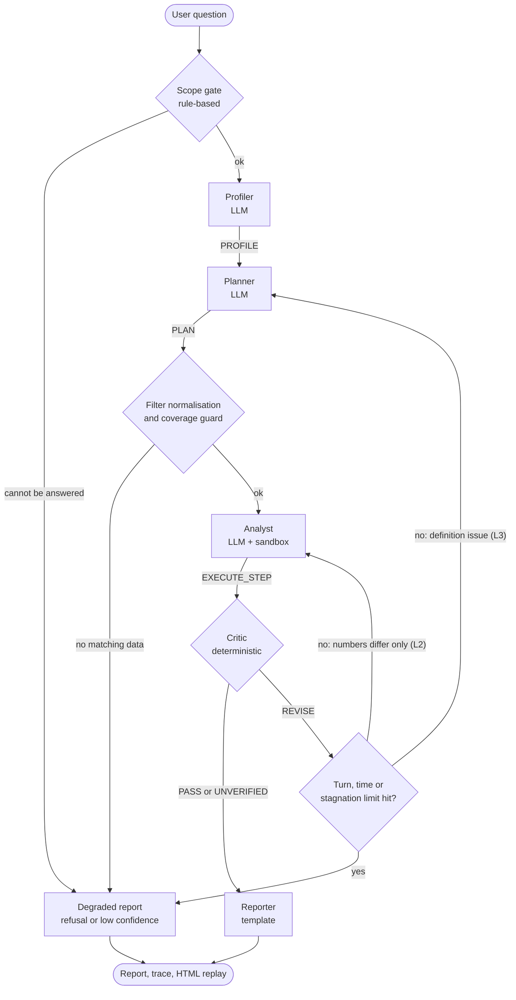
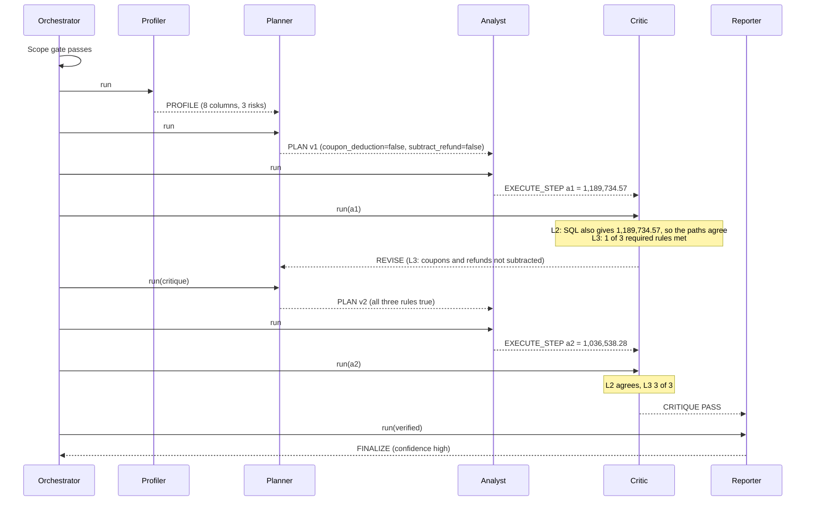

# InsightCrew architecture

This document describes how InsightCrew is built and why. It follows the five things the COMP5584 brief asks a project to define: each agent's role, what each agent can see and use, how work is decomposed, how agents communicate, and how the final output is produced.

Everything here describes the code as it stands. Known gaps are listed in [section 14](#14-known-limitations) and tracked in [ROADMAP.md](ROADMAP.md). Measured results are in [EVALUATION.md](EVALUATION.md).

The system's console output, reports and metric names are in Chinese. A [glossary](#15-glossary) at the end maps the terms used in this document.

## 1. The task

A user asks a business question in natural language, such as "What was East China's revenue in Q3 2026?". The system answers with one number computed from two CSV tables (`orders`, `refunds`), plus a record of how the number was checked.

The hard part is not arithmetic. It is the **metric definition**: the business rules that say what counts. In this dataset, revenue must exclude cancelled orders, subtract coupons, and subtract refunds. Code that sums the `amount` column runs without error and returns a plausible figure that is 14.8% too high.

| Calculation for East China, Q3 2026 | Result | Status |
|---|---|---|
| `sum(amount)`, cancelled orders excluded | 1,189,734.57 | Wrong: coupons and refunds not subtracted |
| `sum(amount - coupon)` | 1,150,599.46 | Wrong: refunds not subtracted |
| `sum(amount - coupon) - sum(refund)` | 1,036,538.28 | Correct under the metric dictionary |

So the system has to defend against three different failures: wrong arithmetic, a wrong definition, and answering a question the data cannot support.

## 2. Why more than one agent

A single LLM asked to compute and then check its own work has the same context, the same assumptions and the same blind spot both times. If it forgot refunds when writing the code, it will usually accept the result when reviewing it.

InsightCrew splits the work so that the checker differs from the producer in three ways, which the code calls L1 to L3:

| Layer | What is kept separate | How |
|---|---|---|
| L1 | Context | The Critic receives only the result value and the structured plan. It never reads the Analyst's code, output or prompt. |
| L2 | Implementation | The Analyst computes in Python over CSV files. The Critic recomputes in SQL over SQLite, from separately written code. |
| L3 | Knowledge | The required rules for each metric live in a metric dictionary that only the Critic consults. |

L2 catches arithmetic and implementation errors. L3 catches definition errors, which L2 cannot: if the plan says "do not subtract refunds", both implementations agree on the same wrong number. The default demo run shows exactly this (see [section 6](#6-a-run-step-by-step)).

## 3. System overview



The pieces:

| Component | File | Purpose |
|---|---|---|
| Orchestrator | `core/orchestrator.py` | The only control loop. Runs agents in order, routes rejections, enforces limits, guarantees an output. |
| Blackboard | `core/blackboard.py` | Shared state for one run: question, profile, plan, filters, versioned results, critiques, report. |
| Message bus | `core/messages.py` | Structured log of every agent-to-agent message and system event, written to `trace.jsonl`. |
| Agents | `agents/*.py` | Five roles, described next. |
| Sandbox | `core/sandbox.py` | Runs the Analyst's generated code in a restricted subprocess. |
| Metric dictionary | `data/metric_dict.json`, `tools/metric_dict.py` | Definitions, formulas and required rules per metric. |
| SQL metrics | `tools/metrics.py` | The Critic's independent implementation of each metric. |
| Scope gate | `core/question_parser.py` | Rule-based check that a question is answerable before any model call. |
| LLM client | `core/llm.py` | Standard-library HTTP client for any OpenAI-compatible endpoint, plus the offline scripted model. |

There is no agent framework. The loop is about 290 lines of plain Python, chosen so that every routing decision can be read, tested and explained.

## 4. Agents

Five roles take part. Three call an LLM. Two are deterministic code, on purpose: see [decision 1](#decision-1-the-critic-is-not-an-llm).

| Agent | Backed by | Responsibility | Reads | Tools | Writes |
|---|---|---|---|---|---|
| **Profiler** | LLM | Turn the raw table structure into column meanings and a list of data risks. Does not compute or plan. | Question; a schema summary with row counts, value ranges and empty counts | None (the summary is computed for it) | `profile`: columns, risks, notes |
| **Planner** | LLM | Break the question into at most five steps and state the metric definition as structured filters. Revise when rejected. | Question; data date range; region list; `profile`; the Critic's issues from the previous round | None | `plan`, `filters`, `target_metric` |
| **Analyst** | LLM | Write Python that follows the plan, run it, and fix its own execution errors once. | Question; plan; filters; metric definition and formula; schema summary; profile risks; its own error output or the audit hint on a retry | Sandbox | A versioned artifact per execution: code, stdout, stderr, value, unit, method |
| **Critic** | Deterministic code | Recompute the value independently (L2) and check the filters against the metric dictionary (L3). Decide PASS, REVISE or UNVERIFIED. | The artifact's value; `filters`; `target_metric` | SQL recomputation; metric dictionary | A critique: verdict, issues, evidence |
| **Reporter** | Deterministic template | State the conclusion, the definition applied, the verification history, the confidence and the limits. | The whole blackboard | None | `report` (Markdown) |

### What each agent is deliberately not given

| Agent | Withheld | Reason |
|---|---|---|
| Planner | The metric dictionary | The Planner learns a rule only when the Critic rejects a plan for breaking it. This keeps the dictionary an independent check rather than something the plan was copied from. |
| Analyst | The dictionary's list of required rules; the SQL implementation; the expected value | If the Analyst saw what the Critic checks, "independent recomputation" would become copying. On a numeric mismatch it is told the size of the deviation, never the right answer. |
| Critic | The Analyst's code, output and prompt | The Critic judges the result, not the argument for it. |
| Reporter | Any way to compute | Every number in the report comes from an artifact on the blackboard. A Reporter that recalculated would add an unaudited source of numbers. |

One qualification: all five agents hold a reference to the same blackboard object, and the blackboard has no access control. The separation above is enforced by what each agent's `run()` method reads when it builds its prompt or its check, not by a permission system. It can be verified by reading each `run()` method; the longest is 80 lines.

## 5. Task decomposition

Work is decomposed at two levels.

**Fixed pipeline.** Every question goes through the same stages: profile, plan, execute, audit, report. The stages are the roles above, and the order is the Orchestrator's coordination policy.

**Per-question plan.** The Planner returns two things:

```json
{
  "target_metric": "营收",
  "steps": [
    {"step_id": 1, "desc": "Select East China orders in Q3 that are not cancelled", "expected": "order rows"},
    {"step_id": 2, "desc": "Subtract coupons and refunds", "expected": "adjusted rows"},
    {"step_id": 3, "desc": "Aggregate using the revenue formula", "expected": "revenue"}
  ],
  "filters": {
    "region": "华东", "start": "2026-07-01", "end": "2026-09-30",
    "exclude_cancelled": true, "coupon_deduction": true, "subtract_refund": true
  }
}
```

The `filters` object is the key design element. The metric definition is written as three booleans and three scalars, not as prose. That makes the definition something code can check: the Critic compares the booleans against the dictionary's required rules, and its SQL implementation reads the same object to recompute the value.

The steps guide a single code-generation call by the Analyst. They are not dispatched and executed one by one, so the `EXECUTE_STEP` intent name describes one execution of the whole plan.

## 6. A run, step by step

The default question in offline mode, where the scripted model's first plan uses the naive calculation:



In round 1 the two implementations agree on a wrong number. Recomputation alone would have passed it. Only the dictionary check rejects it.

## 7. Communication and coordination

### Blackboard

One `Blackboard` object per run is the single source of truth. Agents do not pass results to each other directly; they write to the blackboard and the next agent reads from it.

| Field | Written by | Read by |
|---|---|---|
| `question` | Orchestrator | All |
| `profile` | Profiler | Planner, Analyst (risks only) |
| `plan`, `filters`, `target_metric` | Planner; the Orchestrator normalises regions and clips dates | Analyst, Critic, Reporter |
| `artifacts` (`a1`, `a2`, ...) | Analyst | Critic (value only), Reporter |
| `critiques` | Orchestrator, from the Critic's return value | Reporter; the Orchestrator for routing |
| `caveats`, `notes`, `turn`, `tokens`, `degraded` | Orchestrator | Reporter |
| `report` | Reporter | User |

Artifacts are versioned and never overwritten. A critique refers to a specific artifact ID, so after a re-run it stays clear which version was rejected and why.

### Messages

Each agent announces its output on the message bus as a structured message: sender, recipient, an intent from a fixed set, a JSON payload and references to artifact IDs.

| Intent | From → to | Meaning |
|---|---|---|
| `PROFILE` | Profiler → Planner | Profile is ready |
| `PLAN` | Planner → Analyst | New or revised plan, with filters and steps in the payload |
| `EXECUTE_STEP` | Analyst → Critic | An artifact was produced |
| `REVISE` | Critic → Planner | Rejected, with the list of issues |
| `CRITIQUE` | Critic → Reporter | PASS or UNVERIFIED |
| `FINALIZE` | Reporter → User | Report written |
| `STOP` | (defined, not currently sent) | Termination is logged as a `budget` event instead |

The bus also records system events: `tool` (sandbox runs, L2 and L3 results), `verdict`, `state`, `budget` and `scope`.

**The bus is a record, not a router.** Messages are appended to `trace.jsonl` and never read back. Control flow is decided by the Orchestrator, and data moves through the blackboard and direct return values. The bus exists so that a run can be replayed and audited afterwards. Free-form chat between agents was rejected because it can be neither validated by code nor inspected by a reviewer.

### Feedback edges

Two edges make this a loop rather than a pipeline:

- **Critic → Planner.** The rejection carries structured issues. Each definition issue names the filter field and the value it must take, so the Planner is told which switch to change rather than left to interpret a sentence.
- **Critic → Analyst.** When the plan is compliant but the numbers differ, the Orchestrator sends the Analyst back to its code with the relative deviation, the dictionary formula and the dictionary's known pitfall for that metric.

## 8. Verification and error routing

### The Critic's verdict

| Condition, checked in this order | Verdict |
|---|---|
| The SQL value and the Analyst's value differ by more than 0.01 | REVISE |
| No independent value could be computed (metric has no SQL path, or the denominator is zero) | UNVERIFIED |
| The metric is not in the dictionary | UNVERIFIED |
| Any required rule in the dictionary is not set in `filters` | REVISE |
| None of the above | PASS |

UNVERIFIED exists so that "could not check" is never reported as "checked".

### Routing an error to the layer that can fix it

| Error | Detected by | Fixed by | Why there |
|---|---|---|---|
| Syntax error, wrong column name, missing `RESULT:` line | Sandbox | Analyst, one self-repair with the error text | A local coding slip. No one else needs to know. |
| Definition not compliant (L3) | Critic | Planner re-plans | The Analyst follows the filters it is given and does not hold the rules. |
| Values differ, plan compliant (L2 only) | Critic | Analyst re-codes; plan unchanged | The plan is right. Re-planning cannot fix a wrong denominator. |
| Missing field, region, period or dimension | Scope gate, filter normalisation, coverage guard | Nobody: the system declines | New data is needed, not new code. |

The third row was added after testing with a real model. When every rejection went back to the Planner, a pure implementation bug caused repeated re-planning with no progress until the run hit its limit.

## 9. Termination and degraded output

The loop ends in one of these ways:

| Exit | Trigger | Output |
|---|---|---|
| PASS | Critic accepts | Report with high confidence |
| UNVERIFIED | No independent check available | Report with low confidence |
| Turn limit | `IC_MAX_TURNS` rounds, default 12 | Degraded report |
| Time limit | `IC_MAX_SECONDS`, default 240, checked between rounds | Degraded report |
| Stagnation | The same set of issues rejected `IC_MAX_REPEAT` times, default 2 | Degraded report |
| Exception | Model timeout, unparseable model output, or any other error inside a round | Degraded report |
| Out of scope | Scope gate, filter normalisation or coverage guard | Degraded report with no number |

A degraded report states the reason, lists unresolved issues and is marked low confidence. The principle is that the system returns something explainable instead of crashing mid-demo.

One path does not yet follow that principle. The Profiler runs before the loop, outside the error handler, so a model failure on that first call raises an exception and no report is written. Planner and Analyst failures are handled.

### Guards against confident wrong answers

Three checks run outside the LLM, because they protect against failures the audit itself cannot see:

- **Scope gate** (`question_parser.scope`), before any model call. Declines when the question has no data-related wording, names an unsupported metric (gross margin has no cost column), asks for a channel breakdown, falls entirely outside the data's date range, or names a region absent from the data.
- **Filter normalisation** (`Orchestrator._normalize_filters`), after planning. Maps "whole company" phrasing to no region filter, strips suffixes from region names, and declines when the plan names a region that has no rows. Validation is against values present in the data, not a list of regions that ought to exist.
- **Coverage guard** (`Orchestrator._coverage_guard`), after planning. Declines when the period does not overlap the data, clips a partly covered period and records a caveat that the report must print, and declines when the filters match zero orders.

The zero-row rule matters because the sum of an empty set is 0. Both implementations would agree on 0, the definition check would pass, and the system would deliver "0.00" with high confidence.

## 10. Producing the final output

The Reporter builds the report from the blackboard with a fixed template:

1. **Conclusion.** The value of the most recent artifact that has one, with the unit taken from the metric dictionary.
2. **Scope and definition.** Region, period, and which rules were applied.
3. **Verification record.** One line per round with the verdict and the issues.
4. **Confidence.** High only when the Critic returned PASS and the run was not degraded. Low otherwise.
5. **Limits.** The degradation reason, coverage caveats, unresolved issues, and a statement that the result should not be extrapolated beyond its scope.

Each run then leaves three files in `runs/<timestamp>/`:

| File | Content |
|---|---|
| `trace.jsonl` | Every message and event in order |
| `blackboard.json` | Final state, including the code and value of every artifact version |
| `report.html` | A single-file timeline replay built by `ui/render_report.py` |

Because `blackboard.json` contains the exact code that produced each value, any reported number can be re-derived by hand.

## 11. Supporting mechanisms

### Sandbox

Generated code runs through three layers in `core/sandbox.py`:

1. **Static check.** The code is parsed and rejected if it imports a listed module (`os`, `sys`, `subprocess`, `socket`, `urllib` and others) or calls a listed function (`eval`, `exec`, `__import__` and others).
2. **Process isolation.** The code runs in a subprocess, in a fresh temporary directory holding copies of the CSV files, with a minimal environment. The parent's environment variables are not inherited, so the API key is not visible through `os.environ`.
3. **Resource limits.** A timeout (default 30 s) and truncated output.

Output contract: the code's last line must be `RESULT:{"value": ..., "unit": ..., "method": ...}`. The sandbox parses it, accepting a Python dict literal as well as JSON.

This is a course-level safeguard, not a security boundary. See [section 14](#14-known-limitations).

### LLM client and offline mode

`core/llm.py` calls `/chat/completions` on any OpenAI-compatible endpoint using only `urllib`. It requests JSON output, retries without `response_format` if the endpoint rejects it, makes up to three attempts with backoff on network failures, and extracts JSON from fenced or padded replies. Temperature is 0.

With no API key, or with `IC_FORCE_OFFLINE=1`, the client is replaced by `ScriptedLLM` (`core/scripts.py`). The scripted model returns a naive plan and code on the first call and a corrected version on the second, for all four metrics. Everything else is real: orchestration, sandbox execution, SQL recomputation, dictionary check, trace and report. Offline mode therefore tests the mechanism and gives a repeatable demo. It says nothing about how well a real model plans or codes.

### Adding a metric

A metric must be registered in three places, or the system will refuse it or fail the drift check:

1. `data/metric_dict.json`: definition, formula, unit, required rules, pitfall.
2. `tools/metrics.py`: SQL implementation, plus entries in `SUPPORTED` and `_DISPATCH`.
3. `core/question_parser.py`: `METRIC_ALIASES` and `SUPPORTED_METRICS`.

Then run `python3 -m eval.consistency_test`. For offline demos, also add a branch in `core/scripts.py`.

## 12. Design decisions

### Decision 1: the Critic is not an LLM

An LLM reviewer given the same data and context as the producer tends to agree with it. So the Critic's criteria are deterministic: a numeric tolerance for L2 and a set comparison for L3. The result is repeatable, testable without a model, and unaffected by swapping the model.

The cost is coverage. A deterministic Critic can only check what has a second implementation and a dictionary entry. Anything else is UNVERIFIED.

### Decision 2: definitions are structured fields

A plan that says "use the finance definition" cannot be checked by code. Three booleans can. This is what makes L3 possible without a model.

The cost is expressiveness. Only definitions that fit the six filter keys can be represented.

### Decision 3: errors go to the layer that can fix them

See [section 8](#routing-an-error-to-the-layer-that-can-fix-it). The alternative, sending every rejection to the Planner, does not converge on implementation bugs.

### Decision 4: decline rather than guess

A refusal is a correct output when the data cannot support the question. Several guards exist only to turn "plausible wrong number" into "explicit refusal".

### Decision 5: no framework, no dependencies

The system uses only the Python standard library. The control loop is short enough to read in one sitting, and a reviewer can run it with nothing installed.

The cost is that features a framework would provide, such as checkpointing, parallel execution and tracing integrations, are absent.

## 13. Relation to the two reference systems

The workspace includes two open-source systems that were studied while designing this one.

| | TradingAgents | Open Multi-Agent (OMA) | InsightCrew |
|---|---|---|---|
| Task | Trading decisions | General agent runtime | Metric questions over tabular data |
| Coordination | LangGraph state graph with fixed stages | Coordinator plans a task graph in one model call; a deterministic scheduler runs it | Hand-written loop with fixed stages and two feedback edges |
| Verification | Bull and bear researchers debate, then three risk analysts debate; a manager LLM decides | Optional consensus: judge agents try to refute a proposer's answer until a quorum accepts | Deterministic recomputation plus a rule dictionary |
| Shared state | Graph state; a persistent decision log with reflections | Shared memory; run journal | Per-run blackboard; trace file |
| Offline demo | No | Scripted model responses drive the real scheduler | Scripted model responses drive the real loop |

The main difference is the verification mechanism, and it follows from the task. A trading decision has no ground truth at decision time, so structured disagreement between LLMs is a reasonable way to test an argument. A revenue figure has a computable ground truth, so checking it with a second LLM would add cost and variance where a second implementation gives a definite answer.

Ideas from the references that would fit here are listed in [ROADMAP.md](ROADMAP.md): separate model tiers per role, a cross-run memory of past rejections, and an LLM judge limited to the one check that has no deterministic form.

## 14. Known limitations

Each of these was observed while examining the system on 2026-11-18. Evidence and proposed fixes are in [ROADMAP.md](ROADMAP.md); reproduction steps are in [EVALUATION.md](EVALUATION.md#failure-cases).

1. **Nothing checks that the plan matches the question.** The Critic verifies the number against the plan and the plan against the dictionary. If the question is misread, for example "which region is higher" read as a sum of both regions, the wrong question is answered with high confidence.
2. **The Critic covers only what it can recompute.** Four metrics, two filter dimensions (region and time). Medians, growth rates and channel breakdowns are out of scope.
3. **The dictionary is the authority and is hand-written.** Remove a required rule from `metric_dict.json` and the system stops enforcing it.
4. **The sandbox can be bypassed.** The static check is a deny-list. Generated code can still open files by absolute path.
5. **A degraded report still prints the last value as the headline**, even if the Critic rejected that value. It is marked low confidence.
6. **A failure of the first model call is not degraded.** It raises an exception. See [section 9](#9-termination-and-degraded-output).
7. **Two of the five roles make no model calls.** This is intended, but it means the LLM-driven collaboration is among the Profiler, Planner and Analyst, with the Critic as a deterministic referee.
8. **The evaluation set is small**: 12 questions, several of which share one computation.

## 15. Glossary

| Term in code or output | Meaning |
|---|---|
| 口径 | Metric definition: the rules for what a metric includes and excludes |
| 营收 | Revenue, net of coupons and refunds, cancelled orders excluded |
| 订单量 | Order count, cancelled orders excluded |
| 客单价 | Average order value: revenue divided by order count |
| 退款率 | Refund rate: refund amount divided by order amount, as a percentage |
| 毛利率 | Gross margin. In the dictionary but not computable: there is no cost column |
| 华东, 华北, 华南 | East, North and South China: the three regions in the data |
| 全公司 | Whole company: no region filter |
| 驳回 | Rejected (verdict REVISE) |
| 降级 | Degraded output |
| 置信度 高 / 低 | Confidence high / low |
| 离线剧本 | Offline scripted mode |
