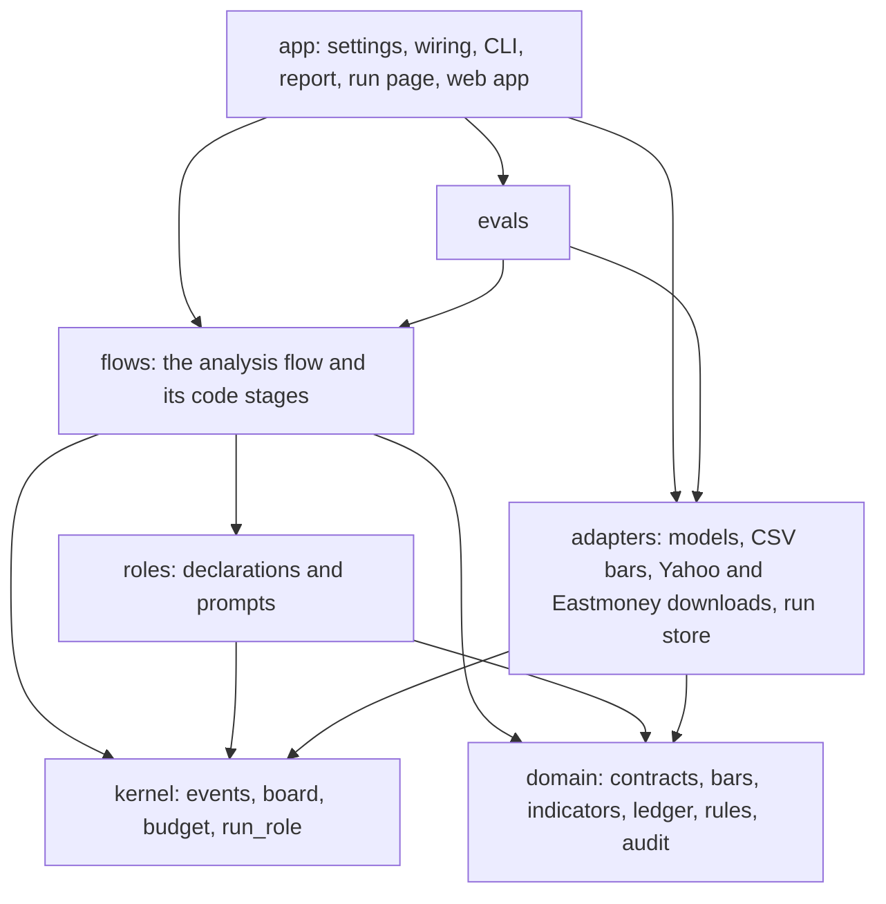

# Architecture

How InsightCrew version 2 is built and why. This describes the code as it is. The plan it was built from is [BLUEPRINT.md](BLUEPRINT.md); where the two differ, this file and the code are right.

## Contents

1. [The task](#1-the-task)
2. [Why more than one agent](#2-why-more-than-one-agent)
3. [Layers and libraries](#3-layers-and-libraries)
4. [Agents](#4-agents)
5. [The flow](#5-the-flow)
6. [Communication: the journal and the board](#6-communication-the-journal-and-the-board)
7. [Verification](#7-verification)
8. [Outcomes and refusals](#8-outcomes-and-refusals)
9. [Budgets and limits](#9-budgets-and-limits)
10. [Interfaces](#10-interfaces)
11. [Design decisions](#11-design-decisions)
12. [Known limitations](#12-known-limitations)
13. [Related systems](#13-related-systems)

## 1. The task

**Input.** A ticker, a US or Hong Kong equity, and an analysis date. The date defaults to the last settled bar in the data.

**Output.** A report in Chinese with:

- a rating (`Buy`, `Overweight`, `Hold`, `Underweight`, `Sell`), or `REVIEW` with a reason;
- a trade proposal: action, entry, stop, target, size as a percentage of equity, and horizon;
- the facts it cites, the thesis and what would invalidate it, and the bull and bear cases;
- every risk rule with its computed value;
- the judges' verdicts;
- a two-part confidence label;
- data quality, token use and cost.

The run's journal comes with it, and the whole run can be replayed from it with no model.

**The claim.** No number reaches the user unchecked, and no proposal that breaks a stated limit is delivered. When that cannot be guaranteed, the system refuses: `REVIEW`, the reason, and no rating.

**Not in scope.** Order execution, broker connections, intraday data, short selling, options, portfolio optimisation. Every report and every page says the output is not investment advice and that no order is executed.

## 2. Why more than one agent

A single model asked for a trade produces numbers it read, numbers it computed and judgments it made, all in one paragraph, and the reader cannot tell them apart. Splitting the work changes what can be checked:

- **Each step has a contract.** The analyst returns claims, each citing a fact by ID and restating its value. The manager returns a rating and points that cite those facts. The trader returns levels and a size. Code can check each of these, and a fault can be traced to the role that made it and sent back to that role.
- **Opposed roles surface what one voice smooths over.** The bull and bear researchers each argue one side from the same readings. The manager has to answer both.
- **Independent judges are different readers.** Three judges look from three angles: evidence, downside risk, opportunity cost. None sees the debate or the others' verdicts, so a persuasive argument cannot carry them all at once.
- **The checking that matters is not done by a model.** The facts, the arithmetic and the risk rules are code. That is the central design choice: a model checking a model shares its assumptions, and code does not.

Six model-backed roles do the reading, arguing and deciding. Four code stages do the computing and checking.

## 3. Layers and libraries

An arrow means "may import". `tests/test_architecture.py` enforces the arrows, and also which third-party packages each layer may import:

| Layer | Third-party packages it may import |
|---|---|
| `kernel` | `pydantic`, `pydantic_core`, `pydantic_ai` |
| `domain` | `pydantic` |
| `roles`, `flows` | none |
| `adapters` | `pydantic`, `pydantic_ai`, `httpx2` |
| `evals` | `pydantic` |
| `app` | `pydantic`, `pydantic_settings`, `dotenv`, `fastapi`, `uvicorn`, `typer` |

The flow and the roles import no library, so they read as plain Python and no library upgrade changes what they mean. Pydantic AI's `Agent` appears in one function, `run_role` in `kernel/runtime.py`.

**What is borrowed and what is ours.** The libraries do the jobs every project has:

| Library | Jobs |
|---|---|
| Pydantic AI | Reaching a model and asking it for typed output; the corrective retry; provider differences; token usage; prices |
| Pydantic | Contracts and validation |
| FastAPI and Uvicorn | The web app |
| Typer | The command line |
| `pydantic-settings` | Settings |
| uv | The environment, from `uv.lock` |

The project's own code is the part that is its argument: the journal and the board, the budget policy, the flow, the two indicator paths, the rulebook and the audit. The kernel, which knows nothing about trading, is about 420 lines.

## 4. Agents

Each role is declared as data in `insightcrew/roles/__init__.py`: its prompt, the board keys it reads, the key it writes, its output contract and its model tier. The prompts are in `roles/prompts/`, in Chinese. They state the job, what arrives and the constraints. They contain no data and no output format, because the format is derived from the contract.

| Role | Model tier | Reads | Writes |
|---|---|---|---|
| Technical Analyst | quick | instrument, facts, data card, its own audit findings | `technical/analysis`: claims, each a fact ID, the value restated and a reading |
| Fundamentals Analyst (optional, channel) | quick | instrument, the fundamentals facts and card, its own audit findings | `fundamentals/analysis`: the same shape as the technical analysis, over annual figures |
| Disclosure Analyst (optional, channel) | quick | instrument, the items in the window and the disclosure card, its own audit findings | `disclosures/analysis`: signals, each an item ID, a direction and a reading; stance and confidence |
| Bull Researcher | quick | instrument, analysis, both channel analyses with their statuses, the bear's argument | `bull/argument` |
| Bear Researcher | quick | instrument, analysis, both channel analyses with their statuses, the bull's argument | `bear/argument` |
| Research Manager | deep, high reasoning effort | instrument, data card, analysis, both channel analyses with their statuses, both arguments, its audit findings, judges' dissents on the thesis | `manager/thesis`: rating, points citing fact IDs or item IDs, horizon, invalidation |
| Trader | quick | instrument, facts, thesis, portfolio, risk limits, its audit findings, judges' dissents on the levels | `trader/proposal`: action, entry, stop, target, size, horizon, cited facts |
| Judges: evidence, conservative, aggressive | quick, low reasoning effort | instrument, facts, analysis, both channel analyses and their raw evidence (facts and items), thesis, proposal, risk limits, rule results | `judge.<lens>/verdict`: accept, or a target (thesis or levels), a critique and cited facts |

The Manager also reads `memory/lessons` and the Trader `portfolio/state`. Nothing writes either key yet, because memory and the portfolio were cut ([ROADMAP.md](ROADMAP.md)); a key that is absent is simply not rendered. The same property is what makes the channels compatible: a role's `reads` may name keys that a run never writes, and the prompt is then exactly the version-2.0 prompt.

The tiers are set in `insightcrew.toml`: quick is `deepseek:deepseek-flash`, deep is `deepseek:deepseek-v4-pro`. Changing the model is one line there.

**What each role does not see, and why.** What a role cannot see is whatever its reads omit. The runtime renders exactly those keys into the prompt and nothing else; a test plants a marker in a forbidden key and checks it never reaches a model.

| Role | Does not see | Reason |
|---|---|---|
| Every role | Any bar or fact after the analysis date | Point-in-time integrity |
| Researchers | The raw facts, the portfolio | They argue from the analyst's readings, which are audited |
| Research Manager | The risk limits, the portfolio | The rating is a view on the stock, not on what the account can afford |
| Trader | The debate | It implements the thesis; it does not reopen it |
| Judges | The debate, each other's verdicts, the history of audit findings | Independent verdicts need independent inputs |
| Fundamentals Analyst | Price facts except through `pe_fy`, the items, the other analysts' output | It reads statements. Each analyst works from its own evidence |
| Disclosure Analyst | Every fact, the other analysts' output | It reads what the company published |
| Auditor (code) | All prose | It checks structured content only |

The Trader is shown the risk limits. A limit is a constraint to meet, not something to infer, so hiding it would test nothing. Compliance is still decided by code.

## 5. The flow

The flow is ordinary `async` Python in one file, `insightcrew/flows/analyze.py`, about 170 lines. It runs one role at a time, in this order: intake, ledger, evidence (only when channels are named), technical, fundamentals and disclosures analysts (only when their channel is available), debate (bull then bear, one round by default), manager, trader, audit, judges, report. The channels are a flow setting (`channels = ["fundamentals", "disclosures"]` or `--channels`); with none named, the run writes the artifacts and sends the prompts of version 2.0 — the property every compatibility proof rests on.

Three rules, each with a test in `tests/test_flow.py`:

1. **Code checks come before model scrutiny.** A proposal the audit rejects never reaches a judge.
2. **A revision reruns its stage and every stage after it.** Findings go to the earliest stage that owns one. A thesis built on a misread fact is not repaired by correcting the fact alone.
3. **A changed proposal is audited again before anything else sees it.** After the judges send work back, the audit runs before the next judge round.

Two feedback loops:

- **Audit loop.** Up to three revisions (`flow.audit_rounds`). The same set of findings twice in a row stops the run (`stagnation`). Still failing after the cap stops it too (`audit_failed`).
- **Judge loop.** The judges are asked in turn, and the round stops once the result is decided: two accepts, or two dissents. A dissent on the thesis reruns from the manager; a dissent on the levels reruns from the trader. Two rounds in all (`flow.judge_rounds`), so one revision; then `contested`. A judge whose reply is still invalid after its one correction counts as a dissent.

The flow configuration (debate rounds, audit `on` or `shadow`, judges on or off, round caps, quorum) is a contract. A misspelt field in the settings file, a scenario or the web form is an error. `shadow` runs and records the audit but routes nothing; it exists for the ablation.

## 6. Communication: the journal and the board

Agents do not message each other. They read from and write to a shared board, and everything that happens is an event in one append-only journal.

- **Journal** (`kernel/events.py`). A run is a sequence of events in `runs/<id>/journal.jsonl`: `run.started`, `artifact.written`, `model.called`, `model.failed`, `gate.checked`, `route`, `budget.exceeded`, `run.finished`. There are no other types. A `model.called` event holds the prompt as sent and the whole exchange in the agent library's message format, including any corrective retry, with usage and cost.
- **Board** (`kernel/board.py`). The latest version of every artifact, obtained by folding the journal. Keys have the form `<owner>/<name>`. It holds plain JSON; types are applied at each read (`board.get(key, Contract)`). A board rebuilt from a file is identical to the live one; a test checks this.
- **Views.** The keys a role declares in `reads`. The only path from the board into a prompt.
- **Contracts.** Every value that crosses a boundary (a model's output, a board value, a file, an HTTP body, the settings) is a frozen Pydantic model that rejects unknown fields.

Everything a user sees is a projection of the journal: the board, `report.md`, the run page, the cost table, the evaluation. `uv run insightcrew replay runs/<id>` reruns a run with the recorded replies in place of a model and checks that the outcome and the board are identical.

## 7. Verification

| Layer | What is checked | By | If it fails |
|---|---|---|---|
| L1 Context | Each role receives only its view | The runtime, by construction | n/a |
| L2 Numbers | Claims match facts; citations exist; every fact agrees with an independent recomputation — indicators and fundamentals alike; a cited announcement item exists and was published by the analysis date | Code | The owner revises; a recomputation disagreement stops the run |
| L3 Rules | The proposal against 14 rules | Code | The Trader revises |
| L4 Judgment | Whether the thesis follows from the evidence and the risk is acceptable | Three model judges, quorum of two | One revision, then `REVIEW` |

**Facts, computed twice.** `data/indicators.toml` declares 29 facts: prices, volume, three simple and two exponential moving averages, RSI, ATR, MACD with signal and histogram, Bollinger bands, 20/60/252-day highs and lows, and 5/20/60-day returns. Path 1 (`domain/indicators.py`) computes them in Python for the ledger. Path 2 (`domain/recompute.py`) computes them in SQL over an in-memory SQLite table. The two share no code and import only the standard library. The ledger gate compares them on every run; `eval consistency` compares them over 277 data points.

**Fundamentals, computed twice too.** When the `fundamentals` channel is open, `data/fundamentals.toml` declares 12 facts (revenue, net income, diluted EPS, operating cash flow, assets, liabilities, year-on-year growth, margins, leverage, price-to-earnings, filing age). Path 1 (`domain/fundamentals.py`, Python) and path 2 (`domain/fundamentals_sql.py`, SQL) again share no code. Figures are served as filed — a restated year answers at the version on file on the analysis date — in millions of the reporting currency, and nothing is converted across currencies (the price multiple is unavailable when they differ). `eval consistency` compares the two paths over 46 dates.

**Disclosures are checked, not verified.** Code checks that every cited item exists in the window's list and was published on or before the analysis date. Whether a reading of an item is right is judgment, and goes to the judges. Item titles are the source's own wording and are printed only from the item list, never from a model's output.

**Point in time.** Market data is reached only through `history(ticker, as_of)`, which returns settled bars dated on or before the date. There is no method that returns a later bar. A row with no close is an unsettled session and is dropped. Nothing is gap-filled.

**The audit** (`domain/audit.py`) runs six L2 checks, then the rulebook:

- the analysis has at least three claims (the fundamentals analysis at least three, or every fundamentals fact if there are fewer);
- each claim cites a fact that exists;
- each restated value is within 0.5 percent (or 0.01) of the fact;
- a disclosure analysis has at least one signal, and each signal cites an item in the list;
- each thesis point cites a fact some analyst claimed, or an item some signal read;
- the thesis horizon is 1 to 60 days;
- the proposal cites known facts, and its horizon matches the thesis.

**The rulebook** (`data/rules.toml` and `domain/rules.py`):

| Rule | Passes when | Limit |
|---|---|---|
| `data_fresh` (intake) | Days from the last bar to the analysis date ≤ limit | 10 |
| `min_history` (intake) | Settled bars ≥ limit | 60 |
| `action_matches_rating` | `Buy` only under `Buy`/`Overweight`; `Sell` only under `Underweight`/`Sell` | |
| `hold_is_flat` | A `Hold` has no levels and size 0 | |
| `sell_requires_position` | A `Sell` only reduces a position that is held | |
| `stop_required`, `stop_side` | A `Buy` has entry and stop, stop below entry, target above | |
| `size_range` | 0 < size ≤ 100 | |
| `max_risk_per_trade_pct` | (entry − stop) / entry × size ≤ limit | 1.0 |
| `max_position_pct` | size + current position ≤ limit | 20 |
| `min_reward_risk` | (target − entry) / (entry − stop) ≥ limit | 1.5 |
| `min_stop_distance_atr` | (entry − stop) / ATR ≥ limit | 1.0 |
| `entry_near_market` | |entry − close| / ATR ≤ limit | 2.0 |
| `cash_sufficient` | size ≤ available cash, when cash is known | |

The model states no derived number. Risk, reward-to-risk and distances are computed by the rules and printed from there. Each finding names the role that can fix it and goes back to that role.

**The judges** can only veto. A `Verdict` has no field for a price or a size, so no judge output can become a level or a rating.

## 8. Outcomes and refusals

The flow has one `try` and one `except Halt`. What is delivered depends on the reason:

| Reason | Raised by | Outcome |
|---|---|---|
| `invalid_ticker`, `unknown_ticker`, `no_data`, `future_date`, `stale_data`, `insufficient_history`, `source_unavailable` | intake | `review`. No model call is made |
| `ledger_inconsistent` | ledger gate | `review` |
| `malformed_output` | flow | `review` |
| `stagnation`, `audit_failed` | flow | `review`, facts and rules unverified |
| `contested` | flow | `review`, facts and rules verified, judgment contested |
| `budget_exhausted`, `time_exhausted`, `calls_exhausted`, `model_unavailable` | runtime | Delivered with "not reviewed" if the current proposal has passed the audit and no judge round has finished; otherwise `review` |

A `review` outcome shows no rating and no level anywhere: not in the report, not in the result area of the page. A `review` report also withholds the thesis text and the finding messages, which mention the levels. It shows the checks, their limits and computed values, and the refusal reason. The thesis and proposal stay in the journal for inspection.

The confidence label has two parts, kept apart on purpose. **Facts and rules** is `verified` or `unverified`, decided by code. **Judgment** is `accepted n/3`, `contested` or `not reviewed: <reason>`, decided by the judges.

## 9. Budgets and limits

`kernel/budget.py` keeps a ledger of tokens and cost per role and model. Ceilings apply at three scopes, batch, run and role group (the three judges share the group `judge`), and an inner scope can narrow a ceiling but not widen it. The check happens before each call, so a run can overshoot by at most the one call that crosses; that call's result is kept, which lets an audited proposal survive a ceiling reached during judging. Token counts come from the provider's reply, and prices from the agent library's table. A model with no known price is reported as "not priced".

`Limits` adds a cap on model requests (40), on wall time and on each request's duration.

The values in `insightcrew.toml` were set from the real-model runs ([EVALUATION.md](EVALUATION.md#3-real-model-runs)):

- `budget.run_tokens = 220000`, about twice the largest run observed (107,145 tokens);
- `limits.max_seconds = 900`, against a slowest run of 338 seconds.

## 10. Interfaces

| Interface | What it is |
|---|---|
| `uv run insightcrew analyze` | One run, printed as it goes; writes the run directory |
| `uv run insightcrew serve` | A FastAPI app bound to `127.0.0.1` only: a form to start a run, the run streamed live as server-sent events, and the list of past runs. One run at a time. It refuses a `Host` that is not this machine, and a `POST` whose `Origin` is not the page itself |
| `report.md` | The board rendered as Markdown by `app/report.py`, which computes nothing. A fact's value is printed from the ledger by ID, never from a claim |
| `replay.html` | One self-contained page, written next to each journal. It opens from disk with no server and no network request, and replays the run with play, pause, step and speed controls |

The page is the same file in both modes: with the events embedded (static) or streamed from the server (live). It shows a mode badge on every screen, so a scripted run never looks like a model's work. It also shows the pipeline, a timeline with one lane per actor in which every event can be opened to the prompt and reply, the result, the evidence tables, usage against the ceilings, and a price chart with the levels. Run data is inserted as text and never as markup, under a content security policy that blocks every external resource.

With no API key, runs use `Script`, a model built on Pydantic AI's `FunctionModel` that answers from authored replies. A scripted run goes through the same agent, validation and retry as a real one. The 21 scenarios in `data/scenarios/` are scripted runs with expected outcomes — five of them with both channels open, including one where the fundamentals analyst misquotes a fact and one where the disclosure analyst cites a ghost item; they are the offline demo and an executable specification.

## 11. Design decisions

| Decision | Reason |
|---|---|
| Code owns truth; models own judgment | A model may select, read, argue and decide, but may not compute or assert a number. This makes "every number is checked" a structural property |
| The workflow is code in one file, not a graph framework | A fixed pipeline with two feedback loops reads best as about 170 lines of Python |
| One append-only journal is the only persisted state | Replay, the offline view of a real run, cost accounting and the page all come from one file |
| Facts have semantic IDs (`rsi_14`) | Stable across runs and dates, readable in claims, and citable by scripted scenarios |
| A revision reruns everything downstream | A thesis built on a misread fact is not repaired by correcting the fact |
| Judges veto and never edit | A judge that could change numbers would be an unaudited author |
| Pydantic AI as the agent library | It does what this design needs (typed output, the retry, provider profiles, usage, a test double) and leaves control flow and state alone |
| Declarations in TOML, validated into contracts at start-up | A mistyped rule or indicator is an error before the first run, not a surprise in the middle of one |
| A real-model setting comes from measurement | The output ceilings, the judges' reasoning effort, the token budget and the time limit were each changed after reading real journals; [EVALUATION.md](EVALUATION.md#4-what-the-real-runs-changed) |
| Refuse rather than guess | Out of scope, unverifiable, contested or out of budget: `REVIEW` with the reason |

Two decisions were the owner's: using maintained libraries instead of a standard-library-only kernel, and adding the live web app. The full list, with what each would cost to reverse, is in [BLUEPRINT.md section 4](BLUEPRINT.md#4-decisions).

## 12. Known limitations

- **The audit checks numbers and rules, not judgment.** A correct, compliant proposal can still be a poor trade. The judges are models and can share a blind spot.
- **Numbers in prose are not checked.** The audit reads structured fields only. The report prints fact values from the ledger, so a misquoted number in a narrative does not reach the result, but it can appear in the analyst's reading text.
- **No portfolio.** Position and cash are not modelled yet: every run sees an empty account, so `sell_requires_position` can never pass and `cash_sufficient` never applies.
- **The model's memory is outside the point-in-time rule.** A model trained on later prices may know what happened. The two DeepSeek models state cutoffs of 2024-06 and 2023-10. These are the models' own claims and are unverified.
- **Real bars come from unofficial endpoints.** Yahoo throttled every attempt from the development machine; the Eastmoney fallback works, but either can change without notice. Instrument names from Eastmoney are in Chinese.
- **The channels ship off, and their real sources are only partly verified.** Twelve real-model runs cannot say that more evidence gives better decisions, so the default behaviour stays that of version 2.0. The SEC and Eastmoney-announcement adapters are tested against saved responses; the live downloads were blocked by the network during the build (see [ROADMAP.md](ROADMAP.md)), so the evaluation ran on synthetic evidence, and on real tickers the channels reported unavailable.
- **Titles and signal directions are not verified**, only existence and dates. Whether an announcement says what the analyst thinks it says is judgment.
- **One model family.** Every real-model result is from DeepSeek. Other providers that speak the OpenAI protocol should work through `IC_BASE_URL`, but none was tried.
- **Small evaluation.** Tens of real-model runs. Enough to show the mechanism works, not to measure anything about trading.

## 13. Related systems

Two systems were studied for comparison; no code was taken from either.

- **TradingAgents** builds a trading firm of LLM agents on LangGraph: analysts, a bull and bear debate, a trader and a risk team. Verification is by debate between models. InsightCrew keeps the debate as one source of argument, but puts the numbers and the risk limits in code. In this design a debate can change a rating; it cannot approve a number.
- **open-multi-agent** is a TypeScript runtime with a coordinator, consensus judges and shared memory. InsightCrew's three judges with a quorum, and its budget scopes, follow its ideas. Its coordinator decides the order of work at run time. InsightCrew fixes the order in code, so every run can be audited against the same flow.

[TRANSFORMATION.md](TRANSFORMATION.md) records the comparison in more detail, and how the design was arrived at.
