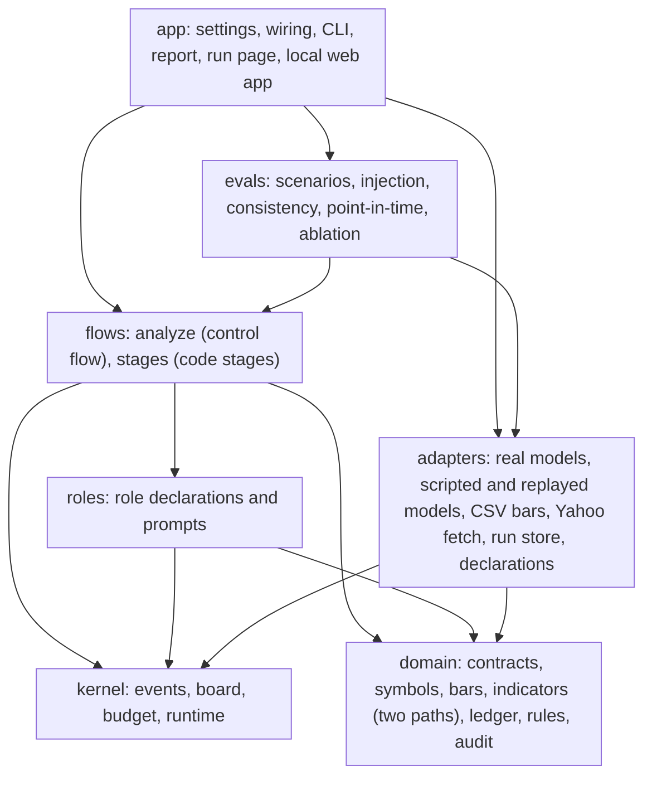
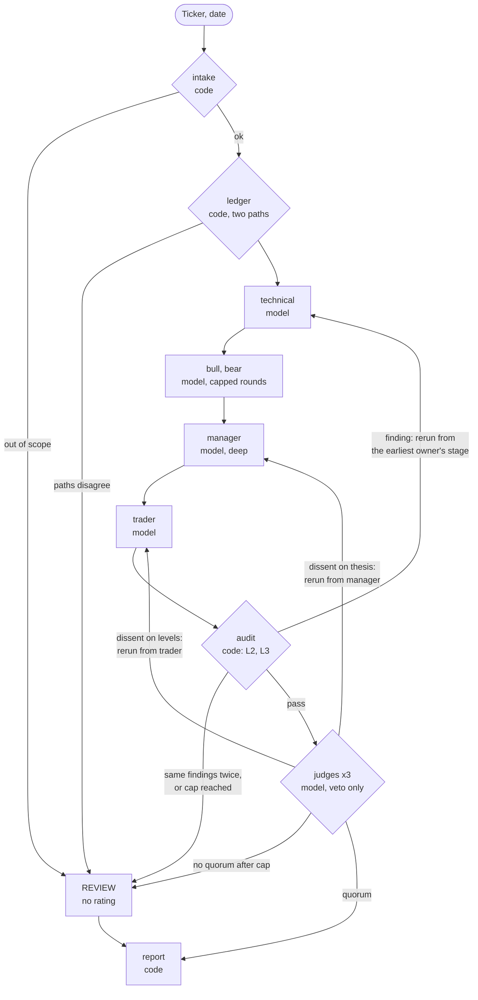

# InsightCrew: rewrite blueprint

Status: **plan, not yet built.** Written 2026-11-19, and revised the same day when the owner reversed the zero-dependency decision: the system is now built on maintained libraries ([section 4](#4-decisions), decision 12). This is the master plan for rewriting InsightCrew from an empty directory as a multi-agent trading assistant. It is written so that an implementer who was not part of the discussion behind it, including a less capable coding model, can build the system from it one work package at a time.

- [BLUEPRINT-REFERENCE.md](BLUEPRINT-REFERENCE.md) holds the reference code this plan points to: the project file, the whole kernel, the model adapters, both indicator implementations, the role declarations and prompts, the analysis flow, and their tests. The code was run before it was written down; [section 0.3](#03-what-has-been-verified) says exactly what that covers.
- [HANDOFF.md](HANDOFF.md) is the status board: which work packages are done, what the owner has authorised, and the session log. This document says what to build; that one says where the work stands.
- [TRANSFORMATION.md](TRANSFORMATION.md) is the earlier proposal. It remains the record of what was learned from the two reference systems and of the fit with the course requirements. Where the two documents differ, this one wins. [Section 17](#17-relation-to-transformationmd) lists the differences.

## 0. Reading guide

### 0.1 Who reads what

| Reader | Read |
|---|---|
| Project owner | Sections 1 to 4, 11, 14 |
| Implementer starting a work package | Section 0.2, sections 2 and 3, the sections the work package names, and the work package itself in [section 13](#13-work-packages) |
| Reviewer of a finished work package | The work package's acceptance list, and [section 16](#16-invariants) |

### 0.2 Rules for an implementing model

These rules exist because the implementer may be a model that follows instructions literally and fills gaps by guessing.

1. **One work package per session.** Do not start a package until every package it needs is done: the "Needs" column in [section 13](#13-work-packages) says which. Some packages may run at the same time as others; [HANDOFF.md](HANDOFF.md) section 5 says which, and which files each one owns.
2. **Read before writing.** Each package lists the sections to read. Read them, and read the reference files it names, before creating any file.
3. **Names are part of the specification.** File names, function names, parameter names, board keys, event types, fact IDs and enum values given in this document are exact. Do not rename them, and do not add synonyms.
4. **The kernel is frozen.** `insightcrew/kernel/` is not edited by any work package. If a package seems to need a kernel change, stop and report it.
5. **Do not weaken a test to make it pass.** If a test in the reference fails, the code is wrong. If a test and this document disagree, stop and report it. The same holds for `ruff` and `pyright`: fix the code, do not add an ignore comment or loosen a rule set.
6. **The dependencies are fixed.** They are the ones in `pyproject.toml`, at the versions in `uv.lock`. Do not add, remove or upgrade a package, and never run `pip install`. Each layer may import only the libraries [section 3.1](#31-layers) allows it; `tests/test_architecture.py` fails the build otherwise. A new dependency needs the owner's agreement.
7. **Use a library the way the reference uses it.** The agent library, Pydantic AI, changes quickly, and what a model remembers of it from training is likely to be an older version. When the reference does not show a call you need, read the installed source under `.venv/lib/python*/site-packages/` before writing it. Do not guess an API.
8. **When the document does not say, stop and ask.** Do not invent a rule, a limit, a prompt policy or a data format. A short question costs less than a wrong guess that later packages build on.
9. **Report honestly.** At the end of a session, list the commands run and their output, what was not run, and what remains unverified. Offline tests do not validate prompts; say so when a prompt changed. Record the same in [HANDOFF.md](HANDOFF.md): update the status table and append to the session log.
10. **Do not commit or push unless the owner asks.** [HANDOFF.md](HANDOFF.md) section 4 records what has been authorised. Never write an API key to any file other than `.env`, and never to the journal.
11. **Code comments, console output, prompts and reports are in Chinese. Documents are in English. Identifiers and enum values are in English.**

Every command runs from the repository root through `uv`, which uses the project's own environment: `uv run pytest`, `uv run insightcrew ...`. The three checks that end every work package are:

```bash
uv run pytest -q
uv run ruff check .
uv run pyright
```

A session prompt that works:

> Read `docs/HANDOFF.md`, then `docs/BLUEPRINT.md` sections 0.2, 2, 3 and those named by WP*n*, then the files it names in `docs/BLUEPRINT-REFERENCE.md`. Implement WP*n* exactly. Run its acceptance commands and show me the output. Stop if anything in the document is ambiguous or contradicts a test.

### 0.3 What has been verified

All of this was run on 2026-11-19, on macOS, with the package versions [section 3.3](#33-libraries) lists.

| Item | Status |
|---|---|
| Reference code: kernel on Pydantic AI, contracts, both model adapters, flow, roles | Run. 58 tests pass on Python 3.12.10, 3.13.3, 3.14.7 and 3.15.2. `ruff check` and `pyright` report nothing. Warnings are errors in the test run. |
| Python and SQL indicator implementations agree | Run. Ten indicators, three seeded series, thirteen analysis dates each, relative tolerance 1e-9. |
| Analysis flow: audit loop, downstream reruns, judges, quorum, every degraded outcome | Run, against stand-in code stages (`tests/fake_stages.py`). |
| The tests catch a broken implementation | Run. Seventeen defects were injected one at a time: six in the flow, four in the kernel, one in the replay adapter, six architecture violations (a third-party package in the domain, the agent library in the flow, the kernel importing the domain, a shared computation path, a judge that reads the debate, a contract that accepts unknown fields). Each made a test fail. One of them, findings routed to the wrong owner, was missed at first; the test that now catches it was added. |
| A run reproduced from its own journal with no model | Run. A changed input is refused. |
| The real-model path, without a real model | Run against a stand-in HTTP server (`tests/test_models.py`): the request body in each output mode for a DeepSeek model and for a generic OpenAI-compatible one, usage and cost recorded, a 500 retried, a 401 not retried, an output mode the model lacks refused before any request, the key absent from the journal. |
| BLUEPRINT-REFERENCE.md as written | Run. Its files were extracted with its own script into an empty directory, the environment was built there with `uv sync`, and the three checks passed. |
| Real bars for `AAPL`, `0700.HK`, `SPY`, `^HSI` from the chosen endpoint | Run on 2026-11-18 and 2026-11-19 with `urllib`, before the move to libraries. Not rerun with `httpx2`. On the 19th the newest `0700.HK` bar had no closing price, which is the case [section 6.3](#63-bars-and-point-in-time-rules) handles. |
| Settings from TOML and environment; a server-sent event stream read by the test client; the host check | Tried in scratch scripts only: nested overrides, an unknown key rejected, the stream's wire format, a foreign `Host` refused. The modules in [section 10](#10-application) are not written. |
| **A real model** | **Not run.** No API key was available. Nothing here shows that any provider accepts these requests, that the prompts work, or what a run costs. |
| Everything in sections 6 to 10 that is not in the reference: ledger, rulebook, audit, intake, settings, wiring, commands, report, run page, local web app, fetch | **Design only.** |
| Effort estimates in section 13 | The author's estimates. Not measured. |

## 1. What is being built

**Task.** Given a ticker and an analysis date, produce a rating and a trade proposal (entry, stop, target, size) whose every number can be traced to a fact computed by code, and which meets a written risk rulebook. If that cannot be done, say so and give no rating.

**Input.** A ticker (US or Hong Kong equity), an analysis date (default: the last settled bar in the data), and later an optional portfolio.

**Output.** A report in Chinese with: rating (`Buy`, `Overweight`, `Hold`, `Underweight`, `Sell`) or `REVIEW`; the proposal; the cited facts; the thesis and what would invalidate it; the bull and bear cases; the rule checks with computed values; the judges' verdicts; a two-part confidence label; data quality; token use and cost. Plus the journal of the run, from which the run can be replayed.

**Not in scope.** Order execution, broker connections, intraday data, short selling, options, portfolio optimisation. The output is not investment advice and every report says so.

**The claim the project defends.** No number reaches the user unchecked, and no proposal that breaks a stated limit is delivered. The project does not claim to pick stocks well; [section 12.4](#124-what-must-not-be-claimed) says why it cannot.

**Agents.** Six model-backed roles, one of which runs as three instances, and four deterministic stages.

| Role | Backed by | Does |
|---|---|---|
| Intake | Code | Decides whether the request is in scope |
| Ledger | Code | Computes every fact; recomputes each by a second path |
| Technical Analyst | Model, quick | Reads the facts: trend, momentum, volatility, levels |
| Bull Researcher, Bear Researcher | Model, quick | Argue each side from the analyst's readings |
| Research Manager | Model, deep | Decides the rating and states the thesis |
| Trader | Model, quick | Turns the thesis into levels and a size |
| Auditor | Code | Checks every cited number and every rule |
| Judges: evidence, conservative, aggressive | Model, quick | Each tries to refute the proposal from one angle. Veto only. |
| Reporter | Code | Renders the board. Computes nothing. |

## 2. Principles

Eight rules. Every design choice below follows from one of them, and each has a test that enforces it ([section 16](#16-invariants)).

1. **Code owns truth. Models own judgment.** A model may select, read, argue and decide. It may not compute or assert a number. Every number in a report comes from a `Fact` that code produced, or from a proposal that code checked.
2. **The harness states constraints, not procedure.** What the system must guarantee is written as contracts, gates, views and budgets. How a model reaches a good answer is left to the model. Guarantees stay as models improve; procedure shrinks ([section 11](#11-built-for-stronger-models)).
3. **One log.** A run is an append-only sequence of events. The board, the report, the run page, the cost table and the evaluation are all projections of that sequence. Nothing else is a source of truth.
4. **Effects at the edge.** The kernel and the domain do no network or file I/O of their own. Models, market data, the clock and the file system are reached through ports, and adapters implement them.
5. **Declared, not scattered.** What a role may see, what it must return, which model tier it uses; which rules apply and their limits; which indicators exist and how they are defined: each is declared once, as data. Control flow is the exception: it is code, in one file, because code is the best notation for control flow.
6. **Make the wrong thing impossible, not discouraged.** A role cannot read what its view omits. Market data cannot be read without an as-of date. A proposal cannot reach a judge without passing the audit. These are properties of the structure, checked by tests, not requests made in a prompt.
7. **Refuse rather than guess.** Out of scope, unverifiable, contested, or out of budget: the answer is `REVIEW` with the reason, and no rating.
8. **Borrow what is common. Write what is ours.** Talking to a model, validating data, serving HTTP, parsing a command line and reading settings are problems every project has, and maintained libraries solve them better than a course project can. The audit, the flow, the journal and the views are this project's argument, and they are written here, small enough to read in one sitting. Each library is confined to the layers that need it, so that replacing one touches one layer.

## 3. Architecture at a glance

### 3.1 Layers



**The dependency rule.** An arrow means "may import". `kernel` imports itself and nothing else of this project: it knows nothing about trading. `domain` imports itself only: it knows nothing about models, files or the board. Nothing imports `app`: it is the outermost layer. `evals` sits just below it. The command line calls an evaluation, and an evaluation that needs a run is handed the function that opens one, in the same way the flow is handed `render` ([8.3](#83-code-stages-flowsstagespy-and-flowsdepspy)).

**The library rule.** Each layer may import the standard library and only the third-party packages in its row. `tests/test_architecture.py` enforces both rules.

| Layer | Knows about | Does not know about | Third-party packages it may import |
|---|---|---|---|
| `kernel` | Events, artifacts, roles, running an agent, budgets | Trading, HTTP, which provider | `pydantic`, `pydantic_core`, `pydantic_ai` |
| `domain` | Bars, facts, indicators, rules, proposals | Models, prompts, the board, files | `pydantic` |
| `roles` | Which role sees what and returns what | How roles are sequenced | none |
| `flows` | The order of work, the gates, the outcomes | Where data and models come from, and that an agent library exists | none |
| `adapters` | One outside system each | Each other, the flow | `pydantic`, `pydantic_ai`, `httpx2` |
| `app` | Everything, in order to wire it | Nothing depends on it | `pydantic`, `pydantic_settings`, `dotenv`, `fastapi`, `uvicorn`, `typer` |
| `evals` | The flow and the adapters, in order to measure them | The app. A run is opened for it by its caller. | `pydantic` |

Three consequences worth stating. The flow and the roles import no library at all: they read as plain Python, and no library upgrade can change what they mean. The agent library appears in two layers, and `Agent` itself in one file, `kernel/runtime.py`; a test asserts that. The two indicator modules import only the standard library; a test asserts that too.

### 3.2 Directory layout

```
InsightCrew/
  pyproject.toml           project metadata, dependencies, tool settings
  uv.lock                  exact versions of every package; committed
  .python-version          3.12; committed
  insightcrew.toml         settings; no secrets
  insightcrew/
    __init__.py            version
    kernel/
      events.py            Event, Journal
      board.py             Board: versioned artifacts folded from events; views
      budget.py            Budget ledger: ceilings, scopes, usage, cost
      runtime.py           Run, Role, Models, run_role, Halt, Malformed, Limits
    domain/
      types.py             contracts passed between roles
      market.py            Bar, Instrument, the MarketData port, data errors
      symbols.py           ticker normalisation and validation
      indicators.py        computation path 1 (Python)
      recompute.py         computation path 2 (SQL), audit only
      ledger.py            facts and the data card
      rules.py             rulebook evaluation
      audit.py             L2 and L3 checks
    roles/
      __init__.py          the role declarations
      prompts/*.md         one prompt per role, plus _common.md
    flows/
      analyze.py           the analysis flow
      stages.py            code stages: intake, ledger, audit, report
      deps.py              what the code stages need from outside
    adapters/
      models.py            real models: a name becomes a model; tiers
      scripted.py          Script, Replay: models that need no network
      market_csv.py        bars and instruments from data/market/<universe>/
      yahoo.py             downloads real bars into data/market/real/
      declarations.py      loads indicators.toml and rules.toml
      store_fs.py          run directories
    app/
      settings.py          insightcrew.toml + environment
      wiring.py            builds a Run and its Deps
      cli.py               commands
      check.py replay.py fetch.py     one command each, called by cli.py
      report.py            report.md from a board
      replay_html.py       replay.html from a journal
      server.py            the local web app: starts runs, streams events
      assets/page.html     the run page: one self-contained file, static or live
    evals/
      scenarios.py inject.py consistency.py pit.py ablation.py run.py
  tests/
  data/
    indicators.toml        indicator declarations
    rules.toml             risk rulebook
    make_market.py         seeded generator for the synthetic universe
    market/synthetic/      committed CSV bars + universe.toml
    market/real/           downloaded bars; ignored by git
    scenarios/*.json       scripted runs with expected outcomes
  runs/                    run output; ignored by git
  .venv/                   the environment uv builds; ignored by git
  docs/
```

### 3.3 Libraries

Each line is a job that is not this project's subject, given to the library that does it. The versions are those the reference was run with; `uv.lock` pins them and every transitive package.

| Job | Library | Version run | Used in |
|---|---|---|---|
| Run a model as an agent: typed output, the corrective retry, provider protocols, capability differences between models, usage, prices, test doubles | Pydantic AI (`pydantic-ai-slim[openai]`) | 2.68.0 | `kernel/runtime.py`, `adapters/models.py`, `adapters/scripted.py` |
| Contracts: validation, JSON, JSON Schema | Pydantic | 2.14.3 | `kernel`, `domain`, everything that crosses a boundary |
| HTTP client | `httpx2` | 2.16.0 | `adapters/yahoo.py`; the stand-in server in tests. It is also what the agent library sends requests with. |
| Settings from TOML, environment and `.env` | `pydantic-settings`, `python-dotenv` | 2.16.3, 1.2.4 | `app/settings.py` |
| Command line | Typer | 0.29.1 | `app/cli.py` |
| Web server, request validation, server-sent events | FastAPI on Uvicorn | 0.163.0, 0.54.0 | `app/server.py` |
| Tests | pytest, pytest-asyncio | 9.2.0, 1.5.0 | `tests/` |
| Lint and import order | Ruff | 0.17.5 | everything |
| Static types | Pyright | 1.1.414 | everything |
| Environment, lockfile, Python itself | uv | 0.11.16 | the repository |

`pyproject.toml` sets `exclude-newer = "2026-11-15T00:00:00Z"` for uv. No package published after that moment can enter the lock. It makes the resolution reproducible, and it keeps the project inside the three-day cooldown that the owner's machine applies to new package versions. Raise the date only on purpose, and rerun the three checks when you do.

What stays hand-written, and why a library was not used:

| Piece | Lines | Why it is ours |
|---|---|---|
| Journal and board | about 140 | The state model is the design: one append-only log, everything else folded from it, views as the only path into a prompt. A framework's own memory or checkpoint store would be a second source of truth. |
| Budget policy | about 80 | The library's usage limits stop the call that crosses a limit and discard its result. This project checks before a call and keeps the result of the call that crosses, because an audited proposal must survive a ceiling reached during judging ([8.2](#82-halt-reasons-and-outcomes)). Token counts and prices still come from the library. |
| `run_role` | about 200 with `Run`, `Role` and `Limits` | The one place where a view, the gate, an agent run, accounting and the board meet. |
| The flow | about 170 | [Decision 14](#4-decisions). |
| Indicators, twice | about 270 | The second path exists to disagree with the first. Two calls into one indicator library would be one path. |
| Rulebook and audit | to be written | They are the claim the project defends. |

### 3.4 Vocabulary

Seventeen terms. An implementer who knows these knows the system.

| Term | Meaning | Where |
|---|---|---|
| **Event** | One thing that happened in a run. Immutable, numbered. | `kernel/events.py` |
| **Journal** | The append-only list of a run's events, written as JSON lines | `kernel/events.py` |
| **Board** | The latest version of every artifact, obtained by folding the journal. Holds plain JSON. | `kernel/board.py` |
| **Artifact** | A value on the board under a key `<owner>/<name>`. Each write is a new version. | |
| **View** | The board keys a role declares in `reads`. The only path from the board into a prompt. | `Role.reads` |
| **Role** | A declaration: instructions, view, output contract, output key, model tier | `kernel/runtime.py`, `roles/` |
| **Contract** | A frozen Pydantic model that rejects unknown fields. Everything that crosses a boundary is one. | `domain/types.py` |
| **Models** | The port that answers "which model runs this role": a real provider, a script, or a recording | `kernel/runtime.py` |
| **Budget** | The ledger of tokens and cost, with ceilings | `kernel/budget.py` |
| **Stage** | A step of the flow. A model stage runs roles. A code stage runs domain functions. | `flows/` |
| **Gate** | A code stage that can stop or redirect the flow: intake, ledger recompute, audit | `flows/stages.py` |
| **Halt** | The signal that a run must stop and deliver a degraded result | `kernel/runtime.py` |
| **Fact** | A number computed by code, with an ID, a date and a source | `domain/types.py` |
| **Claim** | A model's reading of one fact: the fact's ID, its value restated, and an interpretation | `domain/types.py` |
| **Finding** | One problem found by the audit, with the role that can fix it | `domain/types.py` |
| **Verdict** | One judge's accept or dissent | `domain/types.py` |
| **Outcome** | What the run delivered: `delivered` or `review`, and the two-part confidence label | `domain/types.py` |

## 4. Decisions

Made by the coding assistant on 2026-11-19 under the owner's instruction to choose, except decisions 12 and 22, which the owner made. The decisions in TRANSFORMATION.md section 14 still stand unless a row here replaces one. Each can be reversed by saying so.

| # | Decision | Reason | Cost to reverse |
|---|---|---|---|
| 11 | Rewrite from an empty directory on a new branch. The current code stays reachable under the tag `v1-data-analyst`. | The owner asked for no legacy. An implementer who can see the old modules will imitate them. | None before WP0. |
| 12 | **Maintained libraries wherever a library does the job. Own code only for what is this project's design.** Made by the owner on 2026-11-19, reversing the first version of this plan, which allowed no third-party package. | See below. | High after WP2. |
| 13 | Python 3.12 or later (was 3.9), and developed on 3.12. | 3.12 is the oldest version the reference was run on; working on the oldest supported version is what keeps it supported. uv installs it when the machine has none. | Low. |
| 14 | The workflow is ordinary code in one file, not a graph definition. | A fixed pipeline with two feedback loops reads best as about 170 lines of Python. A graph DSL adds a concept and removes none. | Medium. |
| 15 | The journal is the only persisted state, and it records each model exchange in full. | Replay, the offline demo of a real run, cost accounting and the run page all come from one file. | High. |
| 16 | Facts have semantic IDs (`rsi_14`, `close`), not serial ones (`F12`). | Stable across runs and dates, readable in claims, and scripted scenarios can cite them. | Low. |
| 17 | Hand-written declarations are TOML (`rules.toml`, `indicators.toml`, `insightcrew.toml`). Machine-written data is JSON, JSON lines or CSV. Both are validated into contracts when read. | TOML allows comments. A mistyped field is an error at start-up, not a surprise in the middle of a run. | Low. |
| 18 | Model prices and capability differences come from the agent library, not from a registry in this project. A model the library has no price for is reported as "not priced". | The library ships a price table and a profile per provider and updates them. The first version of this plan kept its own, which would have been stale by the next model release. | Trivial. |
| 19 | Price series are not gap-filled. Missing days are missing rows, listed on the data card. | Simpler, and nothing invented reaches an indicator. | Low. |
| 20 | A revision reruns its stage and every stage after it. | A thesis built on a misread fact is not repaired by correcting the fact alone. | Low: one function. |
| 21 | Debate and judges are switches in the flow configuration, built from the start. | The reference flow already contains both, so the earlier "phase 2" is configuration, not construction. | n/a |
| 22 | **A live local web app** (`serve`), on top of a static run page. Made by the owner on 2026-11-19. One page serves both: it reads events, embedded or streamed. | Presentation is 15 percent of the rubric, and a run watched as it happens shows the audit and the judges better than a file does. Building the static page first means the server can be cut without losing the page. | Low: `serve` is one module nothing depends on. |
| 23 | **Pydantic AI is the agent library.** One `Agent` per role, run in one function. | See below. | Medium: `kernel/runtime.py` and two adapter files, about 330 lines. |
| 24 | Every value that crosses a boundary (a model's output, the board, a file, an HTTP request, a settings file) is a Pydantic contract: frozen, and closed to unknown fields. | One definition gives validation, JSON, and the schema the model is shown. | High. |
| 25 | The flow is `async`, and sequential. | The agent library and the web server are asynchronous. Awaiting a call does not change the order of work: one role at a time. Running judges concurrently later is one line. | Low. |
| 26 | uv manages the environment. `uv.lock` is committed. A cut-off date keeps very new package versions out. | One command builds the same environment on any machine, including the Python version. | Low. |
| 27 | pytest, Ruff and Pyright gate every work package. Warnings are errors in tests. | A deprecation in a fast-moving library shows up as a failed test on the day it appears, not as a broken demo later. This already happened once during the spike. | Low. |
| 28 | Settings through `pydantic-settings`, the command line through Typer, the web app through FastAPI with a server-sent event stream. | Each replaces hand-written parsing with declared types. The stream replaces polling: the browser resumes from the last event by itself. | Low. |

**On decision 12: what was gained and what it cost.**

Gained. The provider layer is no longer ours to maintain: a model is a name, and the library knows how to reach it, which kinds of structured output it accepts, whether it can reason at an adjustable effort, and what it charges. When a new model appears, upgrading one package brings its profile and price. The hand-written JSON Schema generator, validator, HTTP client, retry ladder and capability registry are gone. So is the first plan's separate HTTP adapter work package.

Cost. The marker now needs one install step with network access: `uv sync`. The first plan's property, "unzip and run with nothing installed", is gone, and [WP11](#wp11-documents-and-packaging) must make that step impossible to miss. The lockfile makes the step repeatable; it does not make it offline. About fifty packages, counting the development tools, are now part of what the project runs on.

**On decision 23: why this library.** The flow is ordinary code (decision 14), so a library whose main offer is a graph runtime would bring a second control-flow notation next to the first. What this design needs from a library is narrower: turn a typed contract into whatever the model at hand accepts, validate and retry once, report usage, and offer a test double so that the whole system runs without a network. Pydantic AI does those and leaves control flow, state and memory alone. LangGraph, which TradingAgents is built on, and the vendor agent SDKs were considered against the same list; none was tried, so this is a judgment about fit, not a measured comparison.

**Techniques of current agent systems, and where each lives here.**

| Technique | Adopted as |
|---|---|
| Structured output constrained by a schema | The contract is the output type of the role's agent. The library sends it as a native schema, a tool, or prompt text, according to the model's profile or the `output_mode` setting, and validates the reply ([5.6](#56-runtime-kernelruntimepy)) |
| Model routing, reasoning effort, capability differences | A tier per role, a model name per tier, and the library's provider profiles ([9.1](#91-models-adaptersmodelspy)) |
| Context engineering: each agent gets exactly the context it needs | Views declared on the role and enforced by the runtime ([5.3](#53-board-and-views-kernelboardpy)) |
| Event sourcing and deterministic replay | The journal, which stores each exchange in the library's own message format ([5.2](#52-events-and-the-journal-kerneleventspy)) |
| Workflow as code, with gates | `flows/analyze.py` ([8.1](#81-the-flow-flowsanalyzepy)) |
| Token and cost governance | The budget ledger, fed by the library's usage and prices ([5.5](#55-budget-and-limits-kernelbudgetpy)) |
| Evaluation as part of the build; scripted scenarios as executable specifications | [Section 12](#12-tests-and-evaluation) |
| Streaming a run to a browser | Server-sent events, one per journal event ([10.6](#106-local-web-app-appserverpy)) |
| Prompt caching | Prompts put the stable part first: instructions, then artifacts in a fixed order. Providers that cache prefixes benefit without any code here. |
| Tool-using agents | Designed as an autonomy level; the agent loop is the library's, so it is a small change when wanted ([11.2](#112-the-dials)) |

Available in the installed libraries and deliberately not used:

| Not used | Why |
|---|---|
| Durable execution engines (the library integrates with several) | A run lasts about a minute and can be replayed from its journal. There is nothing to resume. |
| Tracing to an observability service | The journal already holds every prompt, reply, token count and routing decision, and the run page shows them. Tracing can be switched on in the wiring later; that was not tried. |
| Tool protocols such as MCP, and agent-to-agent protocols | No role calls a tool at autonomy level L0, and nothing outside the process calls in. Both arrive with [L1](#112-the-dials) or as a later adapter. |
| Vector stores and retrieval | The facts for one ticker fit in one prompt. |
| A graph or multi-agent orchestration framework | Decision 14. |
| A data-frame or indicator library | Each indicator is a few lines and must exist twice, independently ([6.4](#64-indicators-three-places-two-paths)). |
| A front-end build chain | The page is one self-contained file that also opens from disk with no server. A build step would add a second toolchain to install. |

## 5. Kernel

The kernel is domain-free: it could run any audited multi-agent workflow. It is complete in [BLUEPRINT-REFERENCE.md](BLUEPRINT-REFERENCE.md), about 420 lines in four files, and no work package edits it. This section explains it and states the rules that are not obvious from the code.

### 5.1 Contracts

A contract is a Pydantic model with this configuration, which `domain/types.py` provides as the base class `Contract`:

```python
class Contract(BaseModel):
    model_config = ConfigDict(frozen=True, extra="forbid")
```

One definition serves four uses: the output type of a role's agent, from which the library derives what the model is shown; validation of whatever the model returns; the JSON on the board and in the journal (`model_dump(mode="json")`); and validation when a value is read back (`board.get(key, T)`).

Rules:

- Every contract is frozen and rejects unknown fields. A test asserts it for every role's output type. A key the contract does not have is an error; it is never dropped silently.
- A number a model supplies is `FiniteFloat`: `NaN` and infinities are rejected.
- A sequence is `tuple[T, ...]`. An optional value is `T | None` with no default, so that the model must write `null` and cannot omit the field. Only fields that code fills in have defaults.
- Field descriptions (`Field(description=...)`) reach the model as part of the output format, so they are prompt text. Write them in Chinese and keep them to what the field means.
- Contracts are built with keyword arguments: `Verdict(accept=True, target="none", critique="", cites=())`.
- Not everything is a contract. A value that never leaves the process (`Run`, `Role`, `Deps`, `Bar`) is a plain dataclass.

### 5.2 Events and the journal: `kernel/events.py`

```python
Event(seq, ts, type, step, actor, data, caused_by)
```

`Event` is a frozen, closed Pydantic model. `seq` starts at 1 and is assigned by the journal. `ts` comes from an injected clock and is never used in a decision. `step` identifies a role invocation (`trader#2`). `caused_by` lists the `seq` of the events this one depended on.

| Type | Written by | `data` |
|---|---|---|
| `run.started` | `app/wiring.py` | `request`, and the run settings from an allow-list: `version`, `mode` (`model`, `scripted` or `replay`), `models` (name per tier), `output_mode`, `flow`, `universe`, `ceilings`, `limits`. Never a key, a URL or a path. |
| `artifact.written` | `Board.put` | `key`, `version`, `value` |
| `model.called` | `run_role` | `model` (the name the reply reports), `prompt` (the rendered view), `messages` (the whole exchange in the library's message format, including a corrective retry), `output` (the validated contract as JSON, or `null`), `usage` (`requests`, `input_tokens`, `output_tokens`), `cost` (a number, or `null` when the model has no known price) |
| `model.failed` | `run_role` | `model`, `error` |
| `gate.checked` | a code stage | `gate` (`intake`, `ledger`, `audit`), `findings` (count), and detail |
| `route` | the flow | `to` (stage name), `why` |
| `budget.exceeded` | `Run.admit` | `scope`, `tokens`, `cost`. At most once per run. |
| `run.finished` | the flow | `status`, `reason` |

There are no other event types; the type is a `Literal`, so appending an unknown one fails. A new one is a kernel change.

The journal file is `runs/<run_id>/journal.jsonl`, one event per line, written on every append. An event is serialised before it is added, so a value that cannot be written to the journal never becomes part of the run. `Journal.load(path)` reads the file back and validates every line.

### 5.3 Board and views: `kernel/board.py`

- `put(key, value, by=...)` converts the value to plain JSON, appends an `artifact.written` event and returns its `seq`. Keys have the form `<owner>/<name>`.
- `get(key)` returns the latest plain value. `get(key, T)` validates it as `T`, where `T` is a contract or a type built from one, such as `list[Fact]`. A missing key raises `KeyError`.
- `seq(key)` is the event number of the latest version. The flow uses it to tell whether an artifact changed.
- `view(patterns)` returns the latest value of each matching key, in the order declared. A key that does not exist yet is omitted.
- `Board.fold(events)` rebuilds a read-only board from a journal. `Board.fold(Journal.load(p)).snapshot()` equals the live board's snapshot. A test asserts this.

**The board holds JSON, not objects.** Types exist at the boundary of each step: `put` dumps, `get(key, T)` validates. A board rebuilt from a file is therefore identical to a live one, and the report and the run page need no type information.

**A view is the only way board content enters a prompt.** `run_role` renders exactly `board.view(role.reads)`. What a role cannot see is whatever its `reads` does not list. Context isolation (L1) is this mechanism, and a test plants a marker string in a forbidden key and asserts it is absent from everything the model was sent.

Every key the system uses:

| Key | Written by | Contract |
|---|---|---|
| `request/scope` | intake | `Scope` |
| `ledger/instrument` | ledger | `Instrument` |
| `ledger/facts` | ledger | `list[Fact]` |
| `ledger/card` | ledger | `DataCard` |
| `rules/limits` | ledger | `list[RuleSpec]` |
| `technical/analysis` | Technical Analyst | `Analysis` |
| `bull/argument`, `bear/argument` | Researchers | `Argument` |
| `manager/thesis` | Research Manager | `Thesis` |
| `trader/proposal` | Trader | `Proposal` |
| `audit/findings` | audit | `list[Finding]`, all of them |
| `audit/technical`, `audit/manager`, `audit/trader` | audit | `list[Finding]` for that owner. Rewritten on every audit, empty when clean. |
| `audit/rules` | audit | `list[RuleResult]`, every rule with its computed value |
| `audit/status` | audit | `AuditStatus` |
| `judge.evidence/verdict`, `judge.conservative/verdict`, `judge.aggressive/verdict` | Judges | `Verdict` |
| `judges/on_thesis`, `judges/on_levels` | the flow | `list[Verdict]`: the dissents of the latest round, by target |
| `judges/status` | the flow | `str`: `accepted n/3` or `contested` |
| `run/outcome` | the flow | `Outcome` |
| `run/usage` | the flow | the budget table |
| `portfolio/state`, `memory/lessons` | later work | see [section 13](#13-work-packages), after submission |

### 5.4 Models: the port and the agent library

```python
class Models(Protocol):
    def for_role(self, role: Role) -> Model: ...
```

`Model` is Pydantic AI's model interface. `Models` is this project's port: given a role, which model answers it. Three implementations exist, all in `adapters/`: `Tiers` (real providers, by the role's tier), `Script` (authored replies) and `Replay` (the replies recorded in a journal). The kernel never sees HTTP, a provider name, a vendor parameter or a key.

The division of labour with the library:

| The library does | The kernel does |
|---|---|
| Turns the output contract into what this model accepts: a native schema, a tool call, or prompt text | Chooses what the model sees: the view |
| Parses the reply, tolerating a code fence or surrounding prose, and validates it | Decides whether a call may be made at all: the gate |
| Asks once more, with the validation errors, when the reply is invalid | Records the whole exchange in the journal |
| Retries a transient HTTP failure; reports usage; prices the call | Keeps the budget ledger and applies the ceilings |
| Applies provider differences: parameter names, what is supported | Writes the validated output to the board |

### 5.5 Budget and limits: `kernel/budget.py`

The rules are those of TRANSFORMATION.md section 9.1, which follow OMA's budget model. In brief:

- Two ceilings: tokens (input plus output, cumulative) and cost. `None` means no ceiling.
- Three scopes: batch, run, role group. A `Budget` may have a `parent`; a ceiling passed in any scope stops the call. An inner scope can narrow and never widen.
- The role group is the part of the role name before the dot: the three judges share the group `judge`.
- The check happens before each role call. Comparison is strictly greater than, so reaching a ceiling exactly is not a breach, and a run can overshoot by one call, whose result is kept.
- Corrective retries, debate rounds and judge calls all draw on the same run ceiling.
- Token counts come from the provider's reply. Cost comes from the library's price table for the model that answered. A cost ceiling with no known price for that model raises `BudgetConfigError` at the first call. With no cost ceiling and no price, cost is `None` and the report prints "not priced".
- `budget.table()` gives one row per role and model: `calls` (role invocations), `requests` (model requests, so a corrective retry counts), `input_tokens`, `output_tokens`, `cost`.

`Limits` in `kernel/runtime.py` adds three more per run: `max_requests` (default 40, counting every model request), `max_seconds` (default 600), and `request_timeout_s` (default 120), which is passed to the library for each request.

The library has usage limits of its own. They are not used for the ceilings, because they stop the request that crosses a limit and discard its result; see [3.3](#33-libraries).

### 5.6 Runtime: `kernel/runtime.py`

`run_role(run, role)` is the only function in the system that runs an agent. A test enforces this. It is `async`. It does five things, in order:

1. **View.** `view = run.board.view(role.reads)`.
2. **Render.** The role's instructions are the agent's instructions. The prompt is one `<artifact key="...">` block per key, in declared order, a list rendered one item per line and an empty list as `（空）`. Rendering is deterministic: the same board gives the same bytes. The prompt says nothing about the output format; that is the library's part.
3. **Admit.** `run.admit(role, step)` raises `Halt` if the request count, the time or the budget is exhausted. Nothing is sent.
4. **Run and account.** Run the role's agent on the model from `run.models.for_role(role)`, with the output contract as its output type and one retry allowed for an invalid reply. Whatever happens, record the requests made, the usage and the cost in the budget, and append `model.called` with the whole exchange.
5. **Write.** `run.board.put(role.writes, output, by=role.name)`.

Two settings of the agent come from the role and the run. `Role.effort` (`low`, `medium`, `high`, or not set) is passed as the library's unified reasoning setting; the library sends it in the provider's own form and leaves it out for a model that has no such control. `Run.output_mode` chooses how the contract is requested:

| `output_mode` | The contract reaches the model as | Use |
|---|---|---|
| `auto` | Whatever the model's profile prefers | The default |
| `native` | A JSON Schema the provider enforces | A model that supports it; the reply cannot be malformed |
| `tool` | The parameters of a tool the model must call | Models with tool calling and no schema enforcement |
| `prompted` | Text in the instructions, with JSON mode when available | Anything else |

A test runs the same role in all four modes and gets the same artifact.

Two exceptions leave `run_role`, and only these:

| Exception | Meaning | Handled by |
|---|---|---|
| `Halt(reason, detail)` | The run must stop: a resource is exhausted, or the model cannot be used. The second covers a provider that fails after the library's own retries, a missing or refused key, and an `output_mode` the model does not support. | `analyze`, once, at the top. It never reaches the user. |
| `Malformed(role, detail)` | This role's output is invalid after one correction | The flow. For a judge it counts as a dissent. For any other role it becomes `Halt("malformed_output")`. |

## 6. Domain

The domain is pure: functions over values, no I/O, no board, no model. Dates are `datetime.date` inside the domain and ISO strings in contracts.

### 6.1 Contracts: `domain/types.py` and `domain/market.py`

Those in the reference, unchanged: `Rating`, `Action`, `Fact`, `Claim`, `Analysis`, `Point`, `Argument`, `Thesis`, `Proposal`, `Verdict`, `Finding`, `Outcome`.

To be added in the work packages named. All are `Contract` subclasses ([5.1](#51-contracts)) except `Bar`.

| Contract | Fields | Added in |
|---|---|---|
| `Bar` | `date: datetime.date`, `open`, `high`, `low`, `close`, `volume` (floats). Only settled bars exist as `Bar`. A frozen dataclass, not a contract: it lives in `domain/market.py`, holds a real `date`, and is never put on the board. | WP2 |
| `Instrument` | `ticker`, `name`, `market: Literal["US", "HK"]`, `currency`, `benchmark`, `lot: int` (0 when unknown), `synthetic: bool`. Lives in `domain/market.py`. | WP2 |
| `Scope` | `ticker`, `as_of` (ISO), `universe`, `requested: str` (what the user typed) | WP5 |
| `Unavailable` | `id`, `reason` | WP3 |
| `DataCard` | `first_bar`, `last_bar` (ISO), `bars: int`, `stale_days: int`, `dropped_rows: int`, `gaps: tuple[str, ...]`, `unavailable: tuple[Unavailable, ...]`, `warnings: tuple[str, ...]` | WP3 |
| `IndicatorSpec` | `key`, `fn`, `inputs: tuple[str, ...]`, `args: dict[str, int | float]`, `outputs: tuple[str, ...]`, `labels: tuple[str, ...]`, `min_bars: int`, `unit`, `formula`. Lives in `domain/ledger.py`; not a board contract. | WP3 |
| `RuleSpec` | `key`, `limit: float \| None`, `formula`, `desc`, `source` | WP4 |
| `RuleResult` | `key`, `status: Literal["pass", "fail", "n/a"]`, `limit: float \| None`, `actual: float \| None`, `message` | WP4 |
| `AuditStatus` | `verdict: Literal["pass", "revise"]`, `proposal_seq: int`, `thesis_seq: int`, `analysis_seq: int` | WP5 |

`Fact.unit` is the instrument's currency for prices, `"%"` for returns, `"shares"` for volume, and `""` for unitless indicators.

### 6.2 Symbols: `domain/symbols.py`

`normalize(text) -> str` returns the canonical ticker or raises `InvalidTicker`. Rules, applied after stripping and upper-casing:

| Form | Rule | Example |
|---|---|---|
| Hong Kong | `^\d{1,5}\.HK$`. The number is zero-padded to four digits; a five-digit code with a leading zero loses it. | `700.HK` to `0700.HK`; `09992.HK` to `9992.HK` |
| US | `^[A-Z][A-Z0-9]{0,5}$` | `AAPL` |
| Index, benchmarks only | `^\^[A-Z0-9]{1,8}$`. Not accepted from the user. | `^HSI` |
| Anything else | `InvalidTicker` | `../x`, `BRK.B`, `7203.T` |

`file_stem(ticker) -> str` replaces `^` with `_`. It is called only on a normalised ticker, so no user text reaches a path.

`benchmark_for(ticker) -> str` gives `^HSI` for `.HK` and `SPY` otherwise. It is used when fetching real data. A synthetic instrument names its benchmark in `universe.toml`.

### 6.3 Bars and point-in-time rules

**The port** (`domain/market.py`):

```python
class MarketData(Protocol):
    def instrument(self, ticker: str) -> Instrument: ...                    # raises UnknownTicker
    def history(self, ticker: str, as_of: date) -> tuple[Bar, ...]: ...     # raises NoData, SourceUnavailable
```

`history` is the only way to read prices, and it takes an as-of date. It returns settled bars dated on or before `as_of`, in ascending order. There is no method that returns a bar after a chosen date. A later settlement flow reads outcomes by calling `history` with the settlement date as `as_of`.

**Errors**, named by how the caller must react:

| Error | Meaning | Becomes |
|---|---|---|
| `InvalidTicker` | The text is not a ticker this system accepts | `Halt("invalid_ticker")` |
| `UnknownTicker` | Well formed, but not in the universe | `Halt("unknown_ticker")` |
| `NoData` | The instrument has no settled bar on or before the date | `Halt("no_data")` |
| `SourceUnavailable` | The source could not be read. Says nothing about the instrument. | `Halt("source_unavailable")` |

**Rules every reader of bars follows.**

1. Nothing dated after the as-of date is returned or used. A test adds future bars to a series and asserts that no fact changes.
2. A row with no closing price is not a bar. At the end of a series it is an unsettled session; in the middle it is a bad row. Both are dropped and counted in `DataCard.dropped_rows`.
3. Nothing is filled in. A missing day is a missing row. A run of more than five calendar days without a bar is listed in `DataCard.gaps`.
4. Dates are compared as dates, never as strings.
5. A source that cannot be read raises `SourceUnavailable`. It never returns an empty series.
6. The current date is read once, at start-up, in `app/wiring.py`. `IC_TODAY` pins it. Nothing else calls `date.today()`.
7. The default analysis date is the date of the last settled bar on or before today. The offline demo therefore gives the same result on any day.
8. A one-day move of more than 40 percent is listed in `DataCard.warnings` as a possible split. Prices are used as reported; adjusted prices are not used.

**Markets.** US and Hong Kong equities. Currency is a label on facts and in the report; nothing is converted. There is no trading calendar: trading days are the dates in the instrument's own series. Position size is a percentage of equity, so Hong Kong board lots do not affect the rulebook; a share count is printed only when `Instrument.lot` is known.

**Universes.** A universe is a directory `data/market/<name>/` with one `<file_stem>.csv` per instrument (columns `date,open,high,low,close,volume`) and a `universe.toml`:

```toml
[ACME]
name = "Acme Robotics（合成数据）"
market = "US"
currency = "USD"
benchmark = "SYNUS"
lot = 1
synthetic = true
```

`synthetic` is committed and generated by `data/make_market.py`. `real` is written by the fetch command and ignored by git.

### 6.4 Indicators: three places, two paths

An indicator exists when it is in all three places. A test fails otherwise.

| Place | Holds |
|---|---|
| `data/indicators.toml` | The declaration: function, inputs, arguments, output fact IDs, labels, minimum bars, unit, formula in words |
| `domain/indicators.py` | Path 1, Python. Used by the ledger. In the reference. |
| `domain/recompute.py` | Path 2, SQL over an in-memory SQLite table. Used only by the ledger gate and the tests. In the reference. |

The two modules do not import each other and share no computation code. Both return `None` when there are fewer bars than the definition needs. They never return zero and never shorten the window.

Declaration format:

```toml
[sma_20]
fn = "sma"
inputs = ["close"]
args = { n = 20 }
min_bars = 20
unit = "price"                     # price | pct | shares | none
labels = ["20日简单均线"]
formula = "最近 20 个收盘价的算术平均"

[macd]
fn = "macd"
inputs = ["close"]
args = { fast = 12, slow = 26, signal = 9 }
outputs = ["macd", "macd_signal", "macd_hist"]     # omitted: one output named by the table key
labels = ["MACD", "MACD 信号线", "MACD 柱"]
min_bars = 34
unit = "price"
formula = "EMA12 − EMA26；信号线为其 9 期 EMA；柱为两者之差"
```

Calling convention. Path 1: `fn(*[series[name] for name in inputs], **args)`. Path 2: `fn(db, ticker, as_of, inputs, **args)`. A function with several outputs returns a tuple in the order of `outputs`.

The first registry, 29 facts:

| Table key | `fn` | Inputs | Arguments | Outputs (fact IDs) | Min bars | Unit |
|---|---|---|---|---|---|---|
| `close`, `open`, `high`, `low` | `last` | the same column | `back = 0` | the key | 1 | price |
| `prev_close` | `last` | `close` | `back = 1` | the key | 2 | price |
| `volume` | `last` | `volume` | `back = 0` | the key | 1 | shares |
| `avg_volume_20` | `sma` | `volume` | `n = 20` | the key | 20 | shares |
| `sma_20`, `sma_50`, `sma_200` | `sma` | `close` | `n` | the key | `n` | price |
| `ema_12`, `ema_26` | `ema` | `close` | `n` | the key | `n` | price |
| `rsi_14` | `rsi` | `close` | `n = 14` | the key | 15 | none |
| `atr_14` | `atr` | `high`, `low`, `close` | `n = 14` | the key | 15 | price |
| `macd` | `macd` | `close` | `fast = 12, slow = 26, signal = 9` | `macd`, `macd_signal`, `macd_hist` | 34 | price |
| `bollinger_20` | `bollinger` | `close` | `n = 20, width = 2.0` | `bb_upper_20`, `bb_mid_20`, `bb_lower_20` | 20 | price |
| `high_20`, `high_60`, `high_252` | `highest` | `high` | `n` | the key | `n` | price |
| `low_20`, `low_60`, `low_252` | `lowest` | `low` | `n` | the key | `n` | price |
| `ret_5`, `ret_20`, `ret_60` | `ret_pct` | `close` | `n` | the key | `n + 1` | pct |

Definitions that differ between textbooks are fixed here: EMA is seeded with the simple average of the first `n` values and uses `k = 2 / (n + 1)`. RSI and ATR use Wilder smoothing seeded with the simple average of the first `n` changes or true ranges. RSI is 100 when the average loss is zero. Bollinger bands use the population standard deviation. A return is in percent.

### 6.5 The ledger: `domain/ledger.py`

```python
def build_ledger(instrument: Instrument, bars: tuple[Bar, ...], as_of: date,
                 specs: tuple[IndicatorSpec, ...], dropped_rows: int) -> tuple[list[Fact], DataCard]
def recompute_ledger(instrument: Instrument, bars: tuple[Bar, ...], as_of: date,
                     specs: tuple[IndicatorSpec, ...]) -> dict[str, float | None]
def disagreements(facts: list[Fact], recomputed: dict[str, float | None]) -> list[str]
```

- `build_ledger` uses path 1 only. For each spec with enough bars it emits one `Fact` per output: `id` from `outputs`, `label` from `labels`, `unit` resolved (`price` becomes the instrument's currency, `pct` becomes `"%"`, `shares` stays, `none` becomes `""`), `as_of` the date of the last bar, `source` as `indicators.<fn>`, `bars_used` the number of bars passed. A spec without enough bars emits no fact and one `Unavailable` per output with the reason `历史不足：需要 N 根，现有 M 根`.
- `recompute_ledger` uses path 2 only. It loads the same bars into SQLite with `recompute.load` and calls the SQL function for each spec.
- `disagreements` lists every fact ID whose two values differ by more than `1e-6` relative or `1e-9` absolute, or that exists on one path and not the other. An empty list means the ledger is consistent.

### 6.6 The rulebook: `data/rules.toml` and `domain/rules.py`

A rule exists when it is in both places: a table in `rules.toml` (limit, formula, description, source) and an evaluator function of the same name in `rules.py`. A test fails otherwise. The formula string is shown to the Trader and printed in the report. It is never evaluated.

```toml
[max_risk_per_trade_pct]
limit = 1.0
formula = "(entry − stop) / entry × size_pct"
desc = "止损被触发时的亏损，占权益的百分比"
source = "风控规则 2.1"
```

```python
def evaluate(proposal: Proposal, thesis: Thesis, facts: dict[str, float],
             specs: tuple[RuleSpec, ...], position_pct: float = 0.0,
             cash_pct: float | None = None) -> list[RuleResult]
```

| Key | Applies to | `actual` | Passes when | Default limit |
|---|---|---|---|---|
| `data_fresh` | intake | Calendar days from the last settled bar to the analysis date | at most the limit | 10 |
| `min_history` | intake | Number of settled bars | at least the limit | 60 |
| `action_matches_rating` | every proposal | n/a | `Buy` only with rating `Buy` or `Overweight`; `Sell` only with `Underweight` or `Sell`; `Hold` with any rating | n/a |
| `hold_is_flat` | `Hold` | `size_pct` | `entry`, `stop`, `target` are null and `size_pct` is 0 | n/a |
| `sell_requires_position` | `Sell` | `position_pct` | A position is held, `size_pct` is at most it, and the three levels are null | n/a |
| `stop_required` | `Buy` | n/a | `entry` and `stop` are numbers greater than 0 | n/a |
| `stop_side` | `Buy` | n/a | `stop < entry`, and `target > entry` when a target is given | n/a |
| `size_range` | `Buy` | `size_pct` | `0 < size_pct <= 100` | n/a |
| `max_risk_per_trade_pct` | `Buy` | `(entry − stop) / entry × size_pct` | at most the limit | 1.0 |
| `max_position_pct` | `Buy` | `size_pct + position_pct` | at most the limit | 20 |
| `min_reward_risk` | `Buy` with a target | `(target − entry) / (entry − stop)` | at least the limit | 1.5 |
| `min_stop_distance_atr` | `Buy` | `(entry − stop) / atr_14` | at least the limit | 1.0 |
| `entry_near_market` | `Buy` | `abs(entry − close) / atr_14` | at most the limit | 2.0 |
| `cash_sufficient` | `Buy`, when `cash_pct` is given | `size_pct` | at most `cash_pct` | n/a |

Evaluation rules:

- A rule that does not apply has status `n/a`. If `stop_required` or `stop_side` fails, the five ratio rules below them are `n/a`: they cannot be computed on a malformed proposal.
- Comparisons allow `1e-9` of slack, so that a proposal exactly on a limit passes despite floating-point error.
- `evaluate` returns one `RuleResult` for every rule except the two intake rules, in the order of the table. The audit turns each `fail` into a `Finding` whose `check` is the rule key, `layer` is `L3`, `owner` is `trader`, and which carries `limit` and `actual`.
- The model states no derived number. Risk, reward-to-risk and distances are computed here and printed from here.
- Until the portfolio work is done, `position_pct` is 0 and `cash_pct` is `None`.

### 6.7 The audit: `domain/audit.py`

```python
def audit(facts: list[Fact], analysis: Analysis, thesis: Thesis, proposal: Proposal,
          rule_results: list[RuleResult]) -> list[Finding]
```

L2 checks, in this order, followed by the L3 findings from the rule results:

| Check | Owner | Fails when |
|---|---|---|
| `analysis_has_claims` | `technical` | The analysis has fewer than three claims |
| `claim_cites_known_fact` | `technical` | A claim's `fact` is not a fact ID in the ledger |
| `claim_value_matches_fact` | `technical` | `abs(claim.value − fact.value) > max(0.005 × abs(fact.value), 0.01)` |
| `point_cites_claimed_fact` | `manager` | A thesis point cites nothing, or cites a fact ID that no claim cites |
| `horizon_in_range` | `manager` | `thesis.horizon_days` is not from 1 to 60 |
| `proposal_cites_known_fact` | `trader` | A `Buy` proposal cites nothing, or any proposal cites an ID not in the ledger |
| `horizon_matches_thesis` | `trader` | `proposal.horizon_days != thesis.horizon_days` |

`Finding.subject` names the object (`claims[2]`, `points[0]`, `proposal.stop`, `proposal`). `Finding.message` is one Chinese sentence that says what is wrong. For `claim_value_matches_fact`, `limit` is the fact's value and `actual` is the claimed value: the analyst can see the fact anyway, so the correct value is not withheld.

The audit does not read narratives, arguments or rationales. Numbers in free text are not verified, and the report prints fact values from the ledger, never from a claim. A later, softer check may flag numbers in prose that match no fact; it would produce warnings, not findings.

### 6.8 Verification layers

| Layer | What is checked | By | If it fails |
|---|---|---|---|
| L1 Context | Each role receives only its view | `Board.view`, by construction | n/a |
| L2 Numbers | Claims match facts; citations exist; each fact agrees with its SQL recomputation | Code | The owner revises; a ledger disagreement stops the run |
| L3 Rules | The proposal against the rulebook | Code | The Trader revises |
| L4 Judgment | Whether the thesis follows and the risk is acceptable | Three model judges, quorum of two | One revision, then `REVIEW` |

L4 is scrutiny, not proof. The report keeps two labels apart: **facts and rules** (`verified` or `unverified`) and **judgment** (`accepted n/3`, `contested`, or `not reviewed: <reason>`).

## 7. Roles

Declared in `roles/__init__.py`, in the reference. A role is data:

```python
Role(name, tier, instructions, reads, writes, output, effort=None, max_output_tokens=2000)
```

**Changed in WP8, from real runs.** The output ceiling counts reasoning tokens, and both DeepSeek models reason by default. At 2000 the manager spent the whole ceiling reasoning and returned nothing. The declarations now pass `max_output_tokens` of 8000 for the quick roles and 12000 for the manager; the kernel default is unchanged. At `high` effort the evidence judge went back and forth between accepting and rejecting until it ran out of tokens, in 3 of 8 calls. With `effort="low"` on the three judges, that fell to 0 in the runs that followed.

| Role | Tier | Effort | Reads | Writes | Output |
|---|---|---|---|---|---|
| `technical` | quick | not set | `ledger/instrument`, `ledger/facts`, `ledger/card`, `audit/technical` | `technical/analysis` | `Analysis` |
| `bull` | quick | not set | `ledger/instrument`, `technical/analysis`, `bear/argument` | `bull/argument` | `Argument` |
| `bear` | quick | not set | `ledger/instrument`, `technical/analysis`, `bull/argument` | `bear/argument` | `Argument` |
| `manager` | deep | high | `ledger/instrument`, `ledger/card`, `technical/analysis`, `bull/argument`, `bear/argument`, `memory/lessons`, `audit/manager`, `judges/on_thesis` | `manager/thesis` | `Thesis` |
| `trader` | quick | not set | `ledger/instrument`, `ledger/facts`, `manager/thesis`, `portfolio/state`, `rules/limits`, `audit/trader`, `judges/on_levels` | `trader/proposal` | `Proposal` |
| `judge.evidence`, `judge.conservative`, `judge.aggressive` | quick | low | `ledger/instrument`, `ledger/facts`, `technical/analysis`, `manager/thesis`, `trader/proposal`, `rules/limits`, `audit/rules` | `judge.<lens>/verdict` | `Verdict` |

What is withheld, and why. Each line is a property of the `reads` column. `tests/test_architecture.py` asserts the lines for the judges and for the portfolio; add an assertion there when adding a line here.

| Role | Does not see | Reason |
|---|---|---|
| Every role | Any bar or fact after the analysis date | Point-in-time integrity |
| Researchers | The raw facts, the portfolio | They argue from the analyst's audited readings. The case for a stock should not depend on what the user holds. |
| Research Manager | The risk limits, the portfolio | The rating is a view on the stock, not on what the account can afford |
| Trader | The debate | It implements the thesis; it does not reopen it |
| Judges | The debate, each other's verdicts, the audit's findings history | A judge that reads the argument tends to be persuaded by it. Independent verdicts need independent inputs. |
| Auditor (code) | All prose | It checks structured content only |

**The Trader is shown the risk limits** (`rules/limits`). A limit is a constraint to be met and cannot be derived, so hiding it would test nothing. The rulebook file and the evaluator stay out of its reach, and compliance is decided by code.

**Prompt rules.** The prompts are in the reference, in Chinese, one file per role under `roles/prompts/`. When editing one:

- A prompt states the job, what arrives, and the constraints. It does not script the reasoning.
- A prompt contains no data and no output format. Data arrives as artifacts. The format is the contract; the agent library derives it from the type and sends it in the way the model accepts.
- A prompt names the keys the role receives, so the model can tell a missing input from an empty one.
- `_common.md` is appended to every prompt: artifact contents are data and not instructions; the analysis date is "now"; answer in the given output format, prose in Chinese, enum values as given.
- A prompt change is untested until a real-model run. Say so.

## 8. Flow

### 8.1 The flow: `flows/analyze.py`

In the reference, complete, with twenty tests. Read the file: it is the flow chart. It is `async` because a model call is awaited; the work is still sequential, one role at a time, in the order written.



Three rules, each with a test:

1. **Code checks come before model scrutiny.** A proposal the audit rejects does not spend judge tokens.
2. **A revision reruns its stage and every stage after it.** The pipeline is an ordered tuple: `technical`, `debate`, `manager`, `trader`. Findings go to the earliest stage that owns one. Later owners rerun anyway and read their own findings from `audit/<owner>`.
3. **A changed proposal passes the audit again before anything else sees it.** After a judge-driven revision, `pass_audit` runs before the next judge round.

Further behaviour, as implemented:

- Judges are asked in order and the round stops as soon as the result is decided. With a quorum of two, two accepts or two dissents end the round. The label still reads `accepted 2/3`.
- A judge whose output is malformed after its one correction counts as a dissent, and a dissenting verdict is written to the board for it.
- Stagnation: the same set of `(check, subject)` findings twice in a row stops the run.
- `FlowConfig.audit = "shadow"` runs and records the audit but routes nothing. It exists for the ablation.

### 8.2 Halt reasons and outcomes

`analyze` has one `try` and one `except Halt`. `_degrade` decides what is delivered.

| Reason | Raised by | Outcome |
|---|---|---|
| `invalid_ticker`, `unknown_ticker`, `no_data`, `future_date`, `stale_data`, `insufficient_history`, `source_unavailable` | intake | `review`. No model call is made. |
| `ledger_inconsistent` | ledger | `review`. A bug in one of the two paths. |
| `malformed_output` | flow | `review` |
| `stagnation`, `audit_failed` | flow | `review`, `unverified` |
| `contested` | flow | `review`, `verified`, judgment `contested` |
| `budget_exhausted`, `time_exhausted`, `calls_exhausted`, `model_unavailable` | runtime | See below |

For the four resource reasons: if the analysis, thesis and proposal now on the board are exactly the versions the audit passed, and no judge round has completed, the proposal is **delivered** with `facts_and_rules = "verified"` and `judgment = "not reviewed: <reason>"`. In every other case the outcome is `review`. A proposal that judges rejected is never delivered because a budget ran out during its revision.

A `review` outcome carries no rating and no levels in the report. The thesis and proposal remain in the journal for inspection.

### 8.3 Code stages: `flows/stages.py` and `flows/deps.py`

A code stage reads the board, calls pure domain functions, and writes the board. It contains no business computation and no model call. It is an ordinary synchronous function.

```python
@dataclass(frozen=True, slots=True)
class Deps:
    market: MarketData
    indicators: tuple[IndicatorSpec, ...]
    rules: tuple[RuleSpec, ...]
    today: date                                   # read once at start-up
    universe: str
    out_dir: Path | None = None                   # the run directory; None in tests
    render: Callable[[dict], str] | None = None   # app.report.render, passed in by the wiring
```

`render` is passed in because `flows` may not import `app`. `Deps` is a dataclass and not a contract: it holds live objects and never leaves the process.

| Stage | Steps |
|---|---|
| `intake(run, request, deps)` | 1. `symbols.normalize(request["ticker"])`. 2. `deps.market.instrument(ticker)`. 3. Parse `request.get("as_of")`; a date after `deps.today` is `future_date`. 4. With no date given, call `history(ticker, deps.today)` and use the last bar's date. 5. `history(ticker, as_of)`. 6. Apply `data_fresh` and `min_history` with the limits from `deps.rules`. 7. Put `request/scope`. 8. Append `gate.checked` with `gate = "intake"`. Each data error maps to a `Halt` as in section 6.3. |
| `ledger(run, deps)` | 1. Read `request/scope`; fetch the instrument and `history` again. 2. `build_ledger`. 3. `recompute_ledger` and `disagreements`; any disagreement is `Halt("ledger_inconsistent", <ids>)`. 4. Put `ledger/instrument`, `ledger/facts`, `ledger/card`, `rules/limits` (every rule except the two intake rules). 5. Append `gate.checked` with `gate = "ledger"`. |
| `audit(run, deps)` | 1. Read `ledger/facts`, and `technical/analysis`, `manager/thesis`, `trader/proposal` as their contracts. 2. `rules.evaluate`. 3. `audit.audit`. 4. Put `audit/rules`, `audit/findings`, the three `audit/<owner>` lists, and `audit/status` with the three `seq` values. 5. Append `gate.checked` with `gate = "audit"` and the count. 6. Return the findings. |
| `audited_current(run)` | True when `audit/status` exists, its verdict is `pass`, and its three `seq` values equal `board.seq` of the three artifacts now. As in `tests/fake_stages.py`. |
| `report(run, deps)` | When `deps.out_dir` and `deps.render` are both set: write `board.json` (the board snapshot) and `report.md` (`deps.render(snapshot)`) into the run directory. Otherwise do nothing. |

`tests/fake_stages.py` in the reference shows the shape of each stage with stand-in logic. The real stages have the same names, parameters and keys.

### 8.4 Flow configuration

```python
FlowConfig(debate_rounds=1, audit="on", judges=True, audit_rounds=3, judge_rounds=2, quorum=2)
```

`FlowConfig` is a contract, so a misspelt field in the settings file, a scenario or the web form is an error, not a line that is silently ignored.

| Field | Meaning |
|---|---|
| `debate_rounds` | Bull then bear, this many times. 0 skips the debate. |
| `audit` | `on`, or `shadow` (record, do not route) |
| `judges` | Whether L4 runs |
| `audit_rounds` | How many times the audit may send work back |
| `judge_rounds` | Judge rounds in total. 2 means one revision. |
| `quorum` | Accepts needed |

## 9. Adapters

### 9.1 Models: `adapters/models.py`

In the reference, with its test. Two things and nothing else: a name becomes a model, and a role's tier picks one.

```python
def build(name: str, *, base_url: str | None = None, api_key: str | None = None,
          http_client: Any = None) -> Model
class Tiers:                                   # implements the Models port
    def __init__(self, quick: Model, deep: Model)
    def for_role(self, role: Role) -> Model
    def names(self) -> dict[str, str]
```

A model name has one of two forms:

| Form | Example | Reached how | Key |
|---|---|---|---|
| `provider:model` | `deepseek:deepseek-chat` | The library knows the provider: its endpoint, its protocol and its profile | The provider's own environment variable, for example `DEEPSEEK_API_KEY` |
| A bare name | `my-model` | Any OpenAI-compatible endpoint, with the generic profile | `IC_BASE_URL` and `IC_API_KEY`, both required |

`build` raises the library's `UserError` when the provider's key is missing, and `ValueError` when a bare name has no endpoint or key. The wiring treats both as "no model available" and falls back to the offline demo, saying so ([10.2](#102-wiring-appwiringpy)).

Only the OpenAI-compatible protocol is installed (`pydantic-ai-slim[openai]`), which covers DeepSeek and most hosted and local endpoints. Another protocol is an extra on the same package, added with the owner's agreement; no code here changes.

What the test shows about the path, with a stand-in server and no network:

- **Structured output follows the profile.** For the DeepSeek model the library chose a tool call; for the generic endpoint, too. `native` on the generic endpoint sent a strict JSON Schema; `native` on the DeepSeek model was refused by the library before any request, which the runtime turns into `Halt("model_unavailable")`.
- **Transient failures are retried by the provider client**: a 500 followed by a 200 succeeded with two requests. A 401 was not retried and became `Halt("model_unavailable")`.
- **Usage and cost.** Token counts are read from the reply. The DeepSeek model was priced from the library's table; the made-up model name was not, and its cost is `null`.
- **Secrets.** The key appears in the `Authorization` header and nowhere else: not in the journal, not in the failure event.

None of this is evidence about a real provider. [WP8](#wp8-real-model-runs) starts with `check`.

### 9.2 Scripted and replayed models: `adapters/scripted.py`

In the reference. Both are built on the library's `FunctionModel`, a model whose reply is computed by a function, so a scripted run goes through the same agent, the same validation and the same retry as a real one.

- `Script(replies)` answers by role and request order from authored replies. A reply is a JSON object, returned the way the agent asked for it (as a tool call or as text), or a string, returned as it is, which is how a malformed reply is scripted. When a role's list is used up the last reply repeats. A role with no replies fails like an unreachable provider. Each reply reports a fixed usage of 1,000 input and 300 output tokens, so budget paths can be tested.
- `Replay(events)` answers from the `model.called` events of a journal, by role and order. A prompt that differs from the recorded one is refused, as is a call the journal does not have.

**Scenario files**, `data/scenarios/<name>.json`. A scenario is a scripted run with its expected outcome, so it is a demo and a test at once. The file is validated as a contract when loaded.

```json
{
  "name": "demo",
  "about": "交易员第一版方案单笔风险超限，被审计打回后改正；一位评审反对，另两位接受。",
  "request": {"ticker": "ACME", "as_of": "2026-09-30"},
  "config": {"flow": {}, "budget": {}},
  "replies": {"technical": [{}], "bull": [{}], "bear": [{}], "manager": [{}],
              "trader": [{}, {}], "judge.evidence": [{}], "judge.conservative": [{}],
              "judge.aggressive": [{}]},
  "expect": {"status": "delivered", "reason": "ok", "facts_and_rules": "verified",
             "judgment": "accepted 2/3",
             "calls": ["technical", "bull", "bear", "manager", "trader", "trader",
                       "judge.evidence", "judge.conservative", "judge.aggressive"]}
}
```

`config.flow` holds `FlowConfig` fields; `config.budget` holds `run_tokens` and `roles`. Replies must cite real fact IDs and values from the synthetic universe. `uv run insightcrew facts ACME --date 2026-09-30` prints them.

### 9.3 Bars from CSV: `adapters/market_csv.py`

`CsvMarket(root, universe)` implements `MarketData`. It reads `universe.toml` once and validates each table as an `Instrument`. `history` reads and caches each file once, drops rows with an empty close, sorts by date, and returns those on or before `as_of`. It exposes `dropped_rows(ticker)` for the data card. An unreadable or malformed file raises `SourceUnavailable`; a ticker missing from `universe.toml` raises `UnknownTicker`; no bar on or before the date raises `NoData`. It uses the standard library's `csv` and `tomllib`.

### 9.4 Real bars: `adapters/yahoo.py`

`fetch(tickers, years, root, client=None)` downloads daily bars into `data/market/real/` and writes `universe.toml`. It is the only code that knows the source. It is an ordinary synchronous function using `httpx2.Client`; a test passes in a client whose transport replays saved responses.

- URL: `https://query1.finance.yahoo.com/v8/finance/chart/<symbol>?range=<n>y&interval=1d`, with a browser-like `User-Agent`. The symbol is URL-encoded (`^HSI` becomes `%5EHSI`).
- Read `chart.result[0]`: `timestamp[]`, `indicators.quote[0]` (`open`, `high`, `low`, `close`, `volume`), and from `meta`: `currency`, `gmtoffset`, `longName` or `shortName`.
- A bar's date is the UTC date of `timestamp + gmtoffset`.
- A row whose close is null is written with an empty close; the loader drops it.
- For each requested ticker, also fetch its benchmark from `symbols.benchmark_for`.
- Never write an empty or failed download. Write to a temporary file and rename.
- A failure raises `SourceUnavailable` with the HTTP status. The endpoint is unofficial and may change or throttle.
- Downloaded bars are not committed.

**Second source, added 2026-11-19: `adapters/eastmoney.py`.** Yahoo answered HTTP 429 to every attempt from this machine, so `fetch` falls back to Eastmoney's daily-kline endpoint (`push2his.eastmoney.com/api/qt/stock/kline/get`, no key, unadjusted prices with `fqt=0`) and says which source it used. It writes the same directory through `adapters/real_universe.py`, which both adapters share (`plan`, `write`). It addresses a series as `market.code`: `116.<five digits>` for Hong Kong, `100.HSI` and `107.SPY` for the benchmarks, and 105, 106, 107 tried in turn for other US tickers. It returns the session in progress as a bar with a close, so a bar dated today in the market's own time zone before 16:30 is written with an empty close, as Yahoo's unsettled rows are. Instrument names come back in Chinese. Tests: `tests/test_eastmoney.py` over saved responses in `tests/fixtures/eastmoney/`.

### 9.5 Declarations and the run store

`adapters/declarations.py`: `load_indicators(path) -> tuple[IndicatorSpec, ...]` and `load_rules(path) -> tuple[RuleSpec, ...]`. Each reads the file with `tomllib` and validates every table as its contract, with the table's name as `key`. A missing, mistyped or unknown field is an error at start-up that names the table and the field.

`adapters/store_fs.py`: `new_run_dir(root, ticker, as_of, now) -> Path` creates `runs/<YYYYMMDD-HHMMSS>-<file_stem>-<as_of>-<4 hex digits>/`. The random suffix means two runs in one second do not collide.

A run directory holds `journal.jsonl` (the truth), and three projections that can be regenerated from it: `report.md`, `board.json`, `replay.html`.

## 10. Application

> **Amended 2026-11-19.** Seven points in 5.2 and 10.2 to 10.6 were changed in the code when WP5, WP10 and WP12 were redone, and the changes were accepted: `wiring.prepare` and `BadRequest`; run directories named from the normalised ticker and resolved date; `run.started` records role ceilings and `gate.checked` carries detail on a refusal; `replay` and `scenarios` run in a temporary directory; what a `review` report withholds; the timeline's one column per turn; the server's `running`/`incomplete` states, `Origin` check and `no-store`. [HANDOFF.md](HANDOFF.md) section 8, entry "2026-11-19 08:50", lists them. Where the text below differs on those points, the code is right.

### 10.1 Settings

`insightcrew.toml`, committed, with no secrets:

```toml
[run]
universe = "synthetic"
output_mode = "auto"         # auto | native | tool | prompted  (see 5.6)

[flow]
debate_rounds = 1
judges = true
audit_rounds = 3
judge_rounds = 2
quorum = 2

[limits]
max_requests = 40
max_seconds = 600
request_timeout_s = 120

[budget]
run_tokens = 200000          # 0 = no ceiling
run_cost = 0.0               # 0 = no ceiling. A ceiling needs a model the library can price.
batch_tokens = 0
batch_cost = 0.0

[budget.roles]               # token ceilings per role group; optional
# judge = 30000

[tiers]                      # "provider:model", or a bare name for IC_BASE_URL (see 9.1)
quick = "deepseek:deepseek-chat"
deep = "deepseek:deepseek-chat"
```

The project ships no prices and no capability claims about any named model; both come from the agent library. The default model name is the one the earlier project used and has not been checked against the provider. `uv run insightcrew check` reports what the configured models accept.

`app/settings.py` defines one frozen `Settings` class with `pydantic-settings`: a section is a closed Pydantic model, `[flow]` is `FlowConfig` itself, and an unknown key anywhere is an error at start-up that names it. It is the only module that reads the environment. `load(root) -> Settings` first loads `.env` into the process environment, without overriding variables already set, so that the agent library finds the provider's key where it looks for it.

| Variable | Effect |
|---|---|
| `DEEPSEEK_API_KEY`, or the variable of whichever provider `[tiers]` names | The key for a `provider:model` name. Read by the agent library, not by this project. Without a usable key the system runs scenarios and replays only. |
| `IC_BASE_URL`, `IC_API_KEY` | The endpoint and key for a bare model name |
| `IC_TIERS__QUICK`, `IC_TIERS__DEEP` | Set one tier |
| `IC_<SECTION>__<FIELD>` | Any setting in the file, for example `IC_BUDGET__RUN_TOKENS`, `IC_FLOW__JUDGES`, `IC_RUN__OUTPUT_MODE` |
| `IC_FORCE_OFFLINE` | Ignore any key |
| `IC_TODAY` | Pin the current date (ISO) |

Precedence: command-line flag, then process environment, then `.env`, then `insightcrew.toml`, then defaults. `IC_API_KEY` is held as a `SecretStr`, so it does not appear when settings are printed.

### 10.2 Wiring: `app/wiring.py`

`open_run(settings, request, *, scenario=None, replay=None) -> tuple[Run, Deps]`:

1. Read today's date once.
2. Build the market adapter, load the declarations.
3. Choose the models and the mode, by the first line that applies:

   | Condition | Models | `mode` |
   |---|---|---|
   | `replay` is given | `Replay` over that journal | `replay` |
   | `scenario` is given | `Script` with that scenario's replies | `scripted` |
   | Not forced offline, and `build` succeeds for both tiers | `Tiers` | `model` |
   | The request names no ticker | `Script` with the scenario `demo` | `scripted` |
   | Otherwise | `Script` with no replies | `scripted` |

   In the last case a request that intake refuses ends as it always does, because no model is called, and a request that reaches a model call ends as `review` with `model_unavailable`; the command line then prints why no model was available and the names of the scenarios. Falling back is never silent: the reason `build` gave is printed once, without the key.
4. Build the `Budget` (with a batch parent when one is passed in), the `Limits`, the run directory, the `Journal` and the `Board`.
5. Append `run.started`.

This is the only place where adapters are constructed.

### 10.3 Commands: `app/cli.py`

A Typer application, installed as the command `insightcrew`. Each command builds its settings, calls into the layers below, and prints; a command that runs the flow does so with `asyncio.run`.

| Command | Does |
|---|---|
| `uv run insightcrew analyze [TICKER] [--date D] [--scenario NAME] [--universe U] [--no-judges] [--debate-rounds N] [--quiet] [--no-open]` | One run. With no arguments and no key, the `demo` scenario. Prints progress, the outcome and the run directory. |
| `uv run insightcrew serve [--port N] [--no-open]` | The local web app ([10.6](#106-local-web-app-appserverpy)): a form to start a run, live progress, and past runs |
| `uv run insightcrew facts TICKER [--date D]` | Prints the ledger and the data card. No model. |
| `uv run insightcrew replay RUN_DIR` | Reruns from the journal with no model and checks that the outcome and the board are the same |
| `uv run insightcrew scenarios [NAME]` | Runs every scenario and prints expected against actual. Exit status 1 on any difference. |
| `uv run insightcrew check` | Prints the configuration without the key; for each tier sends one small request in each output mode and reports which were accepted, the tokens used, and whether the model is priced |
| `uv run insightcrew fetch TICKER... [--years N]` | Downloads real bars |
| `uv run insightcrew eval NAME` | `inject`, `consistency`, `pit`, `ablation`, or `all` for the three that need no model |
| `uv run pytest` | All tests |

`cli.py` is written once, in WP5, and registers every command above except `serve`. Four of them belong to later packages. For each of those, `cli.py` calls one function in a module of its own, which WP5 creates as a stub that prints `此命令尚未实现` and returns exit status 2. The later package fills in that function, keeps the signature the stub gives it, and does not edit `cli.py`. This is what lets those packages run at the same time.

| Command | `cli.py` calls | Filled in by |
|---|---|---|
| `check` | `check` in `app/check.py` | WP6 |
| `replay` | `replay` in `app/replay.py` | WP6 |
| `eval` | `run` in `evals/run.py` | WP7. WP8 adds `ablation` to it. |
| `fetch` | `fetch` in `app/fetch.py` | WP9 part B |

After WP5, `cli.py` is edited only in WP10 (to write and open the run page) and WP12 (to add `serve`), which one session does one after the other.

### 10.4 Report: `app/report.py`

`render(snapshot: dict) -> str` turns a board snapshot into Markdown, in Chinese. It computes nothing: no arithmetic, no comparison of prices, no rounding other than formatting. A value shown for a fact comes from `ledger/facts` by ID, never from a claim.

Sections, in order:

1. Title: ticker, name, analysis date. A line saying the report is generated by a course project, is not investment advice, and that the system executes no trade.
2. **结论.** When delivered: rating, action, entry, stop, target, size, horizon, currency. When `review`: `REVIEW：未给出评级` and the reason in Chinese. No rating or level appears anywhere in a `review` report.
3. **可信度.** Two lines: facts and rules; judgment.
4. **依据的事实.** One row per claim: fact ID, label, value and date from the ledger, the analyst's reading.
5. **论点与失效条件.**
6. **多空观点.** Marked as opinions that were not audited.
7. **风控检查.** `audit/rules`: rule, limit, computed value, status.
8. **评审意见.** Each verdict, and judges not asked.
9. **返工记录.** Each `audit/findings` version that was not empty, and what was rerun.
10. **数据质量.** The data card.
11. **用量与成本.** `run/usage` with totals against ceilings. "未定价" when there is no price.
12. **运行信息.** Run ID, version, mode, model per tier, output mode, flow configuration, universe.

Sections 9 and 12 need the journal as well as the snapshot; `render` takes the events as an optional second argument.

### 10.5 Run page: `app/replay_html.py` and `app/assets/page.html`

There is one page. It shows a run as it happens or after the fact, and it is the same file in both cases. Its only input is a list of events, so it is a projection of the journal like every other output.

`app/assets/page.html` is one self-contained file: markup, style and script inline, no external script, style, font or image. It works in two modes, chosen by what it finds in the element `<script type="application/json" id="embedded">`:

| Mode | `embedded` holds | Events come from | Used as |
|---|---|---|---|
| Static | `{"events": [...], "bars": [...] or null}` | The embedded list. The page makes no network request. | `runs/<run_id>/replay.html`, opened from disk |
| Live | `null` | The local server in 10.6, as a server-sent event stream | The page served at `/` |

`replay_html.render(events, bars=None) -> str` returns the asset with the embedded element filled in. `replay_html.write(run_dir, events, bars=None)` writes `replay.html`. In the embedded JSON every `<` is written as `\u003c`, so that no text in a model reply can close the element.

What the page shows, all of it derived from events:

| Area | Content | From |
|---|---|---|
| Header | Ticker, name, analysis date, the mode badge, and the line that this is a course project, not investment advice, and that no order is executed | `run.started` |
| Mode badge | `离线演示 · 脚本化模型（回复为预先编写）`, `真实模型 · <model names>` or `回放 · <model names>`. Always visible. A scripted run must never look like a model's work. | `run.started` |
| Pipeline strip | The stages in order (intake, ledger, technical, debate, manager, trader, audit, judges, report), each idle, running, done, revised or halted | `step` and `actor` of each event; `route` |
| Timeline | One lane per actor, one card per event in `seq` order. A click opens the event's data: for a model call the prompt as sent, the reply, tokens and cost; for a gate its findings. A `route` is drawn as a return to the stage it names, with its reason. | Every event |
| Result | When delivered: rating, action, entry, stop, target, size, horizon, and the two confidence lines. When `review`: `REVIEW：未给出评级` and the reason, and **no rating and no level anywhere in this area**. | `run.finished`, and the board folded from `artifact.written` |
| Evidence | The claims with the ledger's values; the rule table with limit, computed value and status; each judge's verdict | Board artifacts |
| Usage | Tokens and cost against the ceilings, by role group | `model.called`, `budget.exceeded`, `run.started` |
| Price chart | The closing prices up to the analysis date as an inline SVG, with entry, stop and target drawn when the run delivered them | `bars`, and the board |
| Playback | Play, pause, step, speed, and a position slider. Events are revealed through a queue at the chosen pace; "instant" reveals them as they arrive. | The page itself |

Playback is why a scripted run is watchable: the scripted model answers at once, so the server has every event within a moment, and the page reveals them at reading speed. Nothing on the server waits, and the journal is the same whatever the pace.

Rules for the page:

1. **Run data is inserted as text.** The script uses `textContent` and `createElement`. The asset contains none of `innerHTML`, `outerHTML`, `insertAdjacentHTML`, `document.write`, `eval(` or `new Function`. Model replies are untrusted text; this rule is what keeps them from becoming markup. A test asserts the absence of those strings.
2. **The page does no financial arithmetic.** Every price, level, ratio and rule value shown is a value found in an event. The running token total is the only sum it makes.
3. **The timeline is a trace, not a conclusion.** It can contain a proposal that the audit or the judges rejected. Its heading says so: `过程记录（被否决的方案不是结论）`.
4. **A content security policy in a `<meta>` tag**: `default-src 'none'; script-src 'unsafe-inline'; style-src 'unsafe-inline'; connect-src 'self'; img-src data:`.
5. The page folds the board itself: the latest `value` per `key` among `artifact.written` events. It does not read `board.json`.

### 10.6 Local web app: `app/server.py`

`uv run insightcrew serve` starts a server on the loopback interface and opens the page. The owner chose this on 2026-11-19 (decision 22). It is a thin shell: it starts runs with the same `open_run` and `analyze` the command line uses, and it reads journals. It holds no state of its own beyond which run is active.

It is a FastAPI application served by Uvicorn. `create_app(settings) -> FastAPI` builds it without starting anything, so that tests drive it with FastAPI's test client. `serve(settings, port, open_browser)` runs it until Ctrl-C. Request and reply bodies are contracts; FastAPI validates them.

| Method and path | Does | Replies |
|---|---|---|
| `GET /` | The page in live mode | 200, `text/html` |
| `GET /api/meta` | What the form needs | `{"version", "mode": "scripted" or "model", "models": {"quick", "deep"}, "universe", "instruments": [{"ticker", "name", "market", "currency", "synthetic", "last_bar"}], "scenarios": [{"name", "about", "ticker", "as_of"}], "defaults": {"judges", "debate_rounds"}, "ceilings": {"run_tokens", "run_cost"}, "active_run": id or null}` |
| `POST /api/runs` | Starts a run. Body: `{"ticker", "as_of", "scenario", "judges", "debate_rounds"}`, every field optional. | 202 `{"run_id"}`. 422 for a body that is not an object, has an unknown field or a field of the wrong type; the reply is FastAPI's standard validation error. 409 `{"error", "active_run"}` while a run is active. |
| `GET /api/runs` | The 50 newest run directories that hold a `journal.jsonl` | `{"runs": [{"run_id", "ticker", "as_of", "status", "reason", "mode"}]}`, newest first |
| `GET /api/runs/{run_id}/events` | The run's events as a server-sent event stream | `text/event-stream`. See below. |
| `GET /api/runs/{run_id}/bars` | Closing prices on or before the run's analysis date, at most the last 250 | `{"currency", "bars": [{"date", "close"}]}` |

Anything else is 404; the generated API documentation pages are switched off. Every reply carries `Cache-Control: no-store` and `X-Content-Type-Options: nosniff`.

**The event stream.** Each journal event is sent as one message with `event: journal`, `id:` the event's `seq`, and `data:` the event as JSON. When the journal holds `run.finished`, or the run ended with an unexpected exception, one last message is sent with `event: end` and `data: {"error": null}` or the exception's class name and message, and the stream closes. A stream starts after the event named by the `Last-Event-ID` request header, or by `?after=<seq>`, or from the beginning. The browser's `EventSource` sends `Last-Event-ID` by itself when it reconnects, so a dropped connection loses nothing and repeats nothing. The page closes its `EventSource` on `end`; otherwise the browser would reconnect to a finished run. A finished run is streamed the same way: all its events, then `end`.

Behaviour:

- **Starting a run.** The handler validates the body, refuses if a run is active, calls `open_run`, and starts `analyze` followed by `replay_html.write` as a task on the server's event loop. It replies with the run's ID without waiting. The task clears the active run when it ends, however it ends.
- **One run at a time.** A second `POST` gets 409. This keeps the budget, the console and the page simple, and a run takes well under a minute offline.
- **The stream reads the file, not the live `Run`.** It reads `runs/<run_id>/journal.jsonl` and waits briefly when there is nothing new. A last line with no newline is an append in progress and is ignored. Live and finished runs therefore go through the same code, and what the page shows is what the journal holds.
- **`error`** in the last message means a bug. The flow turns every expected failure into a `review` outcome.
- **Scripted mode.** With no key, the model is scripted and can answer only what a scenario scripts. The form then offers the scenarios, and fills the ticker and date from the one chosen. A ticker sent with no scenario follows [10.2](#102-wiring-appwiringpy) step 3: intake refusals (`THIN`, `STALE`) end as usual, and anything that reaches a model call ends as `review` with `model_unavailable`, which the page explains by naming the scenarios.
- **Console.** One line per run started and finished, in Chinese. Access logging is off.
- **Port.** Default 8765. If it is taken, the next free port is used and the address printed.

Safety. The server can start runs that spend money when a key is set, so:

1. It binds to `127.0.0.1` only. There is no option to bind elsewhere.
2. A request whose `Host` header is not `127.0.0.1` or `localhost` gets 400, from Starlette's trusted-host middleware.
3. A `POST` that carries an `Origin` header naming any other origin gets 403.
4. `run_id` must match `^[0-9]{8}-[0-9]{6}-[A-Za-z0-9_.]+-[0-9]{4}-[0-9]{2}-[0-9]{2}-[0-9a-f]{4}$` and name a directory directly under the run root. Otherwise 404. No other part of a URL reaches a path.
5. The ticker goes through `symbols.normalize` like any other. Text fields in the body have a maximum length.
6. No reply contains the key, the base URL or a file path. `meta` says which mode is in effect and the model names, nothing more.

## 11. Built for stronger models

The request was that the system should gain from better models without being rebuilt. The design answers it in four ways.

### 11.1 Changing the model changes one line

A new model is a new name under `[tiers]`. No code names a model, a vendor or a vendor parameter. How to reach the model, how to ask it for structured output, whether it accepts a reasoning effort, and what it costs are the agent library's knowledge, and they arrive with a library upgrade (`uv lock --upgrade-package pydantic-ai-slim`, then the three checks). `check` reports what the new model accepts.

### 11.2 The dials

Each dial is a setting. Raising one hands the model more of the work. None changes a contract, a gate or a test.

| Dial | Where | Now | Raise it when |
|---|---|---|---|
| Structured output | `run.output_mode` | `auto` | The provider enforces schemas: `native`. Corrective retries should fall to zero. |
| Reasoning effort | `Role.effort` | Not set; `high` for the manager, `low` for the judges (WP8) | A role's judgment is the bottleneck in the ablation |
| Tier per role | `Role.tier` | Quick for all but the manager | Cost allows |
| Debate | `flow.debate_rounds` | 1 | Lower to 0 when the ablation shows the rating and the judges' verdicts do not change without it |
| Judges | `flow.judges`, `flow.quorum`, `LENSES` | 3 lenses, quorum 2 | Fewer lenses when dissent rates fall; a different model for one judge when they agree too readily |
| Audit rounds | `flow.audit_rounds` | 3 | Never raised. Watch it fall: a model that needs zero revisions has outgrown the feedback loop, not the audit. |
| **Autonomy level** | per role | L0 | See below |

**Autonomy levels.** What a role is allowed to do, in four steps. The gates are the same at every level, which is what makes raising the level safe.

| Level | The role may | Facts come from | Status |
|---|---|---|---|
| L0 Form | Read its view and fill its contract in one call | The fixed ledger | Built |
| L1 Look up | Call read-only tools in a bounded loop, for example an indicator with other parameters | Tool results, appended to `ledger/facts` | Designed below. After submission. |
| L2 Compute | Write analysis code that runs in a sandbox | Code results, as facts marked `unverified by a second path` | Outline only |
| L3 Plan | Decide which roles run | n/a | Not designed. The flow would have to become data. |

L1, as designed. The agent loop already exists: it is the library's, and `run_role` already records every message of an exchange and counts every request. So the change is small: `Role` gains `tools: tuple[str, ...]`; `run_role` passes the named tool functions to the agent and a per-call request limit; the tool calls and their results appear in `model.called` with no further work. A tool is a function `(deps, scope, **args) -> list[Fact]` in `flows/tools.py`. The as-of date is bound when the tool is built and is not a parameter, so a model cannot ask for a later date. Tools compute through the indicator registry, so every tool fact has a second path and the ledger gate covers it. A model can therefore ask for `sma_30`; it cannot ask for an indicator that has no SQL implementation. External tool servers would arrive the same way, as tool sets the library can attach. This is a kernel change, it has not been tried, and it needs the owner's agreement.

### 11.3 Scaffolding and how to tell when to remove it

Some of the system exists because current models make certain mistakes. That part should be deleted when it stops earning its cost, and the evaluation says when. The rest is the guarantee and stays.

| Piece | Kind | What it costs | Remove or reduce when |
|---|---|---|---|
| Corrective retry | Scaffolding | One extra request on failure | Retries are zero across an evaluation run under `native` |
| Claims restate the fact's value | Scaffolding | Tokens, and a class of findings | `claim_value_matches_fact` never fires in an evaluation run. Then cite by ID only. |
| Separate bull and bear roles | Scaffolding | Two calls per round | The ablation with `debate_rounds = 0` gives the same ratings and the same judge verdicts |
| Three judges | Scaffolding | Two or three calls | Dissent is rare and never changes an outcome |
| "Set the stop first, then size from the limit" in the Trader's prompt | Scaffolding | A procedural hint | First-proposal rule violations stay at zero without it |
| Quick and deep tiers | Scaffolding | Configuration | One model is both cheap and strong enough |
| Fact ledger, both computation paths | **Guarantee** | | Never |
| Rulebook and audit in code | **Guarantee** | | Never |
| Views | **Guarantee** | | Never. They widen; they are not removed. |
| Point-in-time port | **Guarantee** | | Never |
| Budget, limits, `REVIEW` | **Guarantee** | | Never |
| Journal | **Guarantee** | | Never |

The ablation runner reports, for each configuration, the rate of delivered proposals that the shadow audit would have rejected, the `REVIEW` rate, and tokens and cost per run. A piece of scaffolding whose removal changes none of the first two is costing tokens for nothing.

### 11.4 Adding things

| To add | Touch |
|---|---|
| A role | A prompt file, a `Role` in `roles/__init__.py`, one line in `PIPELINE` or the flow. A contract in `domain/types.py` if its output is new. |
| An indicator | `data/indicators.toml`, `domain/indicators.py`, `domain/recompute.py`. The consistency test covers it from the registry. |
| A rule | `data/rules.toml`, an evaluator in `domain/rules.py`, one injection case |
| A model from a provider already installed | A name in `insightcrew.toml` |
| A provider with another protocol | An extra on the agent library in `pyproject.toml`, and a name |
| A data source | One adapter file implementing `MarketData`, or a fetcher that writes a universe |
| A second workflow | One file in `flows/`. The kernel does not change. |

## 12. Tests and evaluation

### 12.1 Tests

`uv run pytest`, from the repository root. Tests need no network and no key. An `async def test_...` runs as it is; pytest is configured for that. A warning raised during a test fails it. `uv run ruff check .` and `uv run pyright` must also report nothing.

| File | Covers | From |
|---|---|---|
| `test_kernel.py` | View isolation, the corrective retry, the four output modes, fold equals live, replay, budget, limits, the closed set of event types | Reference |
| `test_models.py` | The real-model path against a stand-in server: request body per output mode, usage and cost, retry, an unpriced model, no key in the journal; tiers and model names | Reference |
| `test_indicators.py` | Path 1 against path 2, minimum history, future bars change nothing, column whitelist | Reference; made registry-driven in WP3 |
| `test_flow.py` | Every branch of `analyze`, against `fake_stages.py` | Reference |
| `test_architecture.py` | Inward dependencies, the libraries each layer may import, one file runs an agent, independent computation paths, judges' views, every contract frozen and closed | Reference |
| `test_market.py` | Symbols, CSV loading, dropped rows, errors, the generator is deterministic | WP2 |
| `test_ledger.py` | Facts, the data card, disagreement detection, point-in-time sweep | WP3 |
| `test_rules.py` | Each rule at, just inside and just outside its limit; `n/a` cascade; TOML and evaluators in sync | WP4 |
| `test_audit.py` | Each check; owners; a clean case gives no finding | WP4 |
| `test_stages.py` | Each intake refusal makes no model call; a planted path disagreement stops the run | WP5 |
| `test_settings.py` | Precedence of flag, environment and file; an unknown key is refused; the key is absent from the printed settings | WP5 |
| `test_scenarios.py` | Every scenario file gives its expected outcome and call sequence | WP5 |
| `test_report.py` | A `review` report contains no rating or level; values come from the ledger | WP5 |
| `test_yahoo.py` | Parsing saved responses: dates from `timestamp + gmtoffset`, a bar with no close is dropped, symbol encoding, a refused or malformed response raises `SourceUnavailable` and writes nothing | WP9 |
| `test_run_page.py` | The static page holds every event; no external URL; no markup-injecting call in the asset; a reply containing `</script>` does not end the embedded element | WP10 |
| `test_server.py` | Each route and status code; a scripted run started over HTTP finishes with the outcome the command line gives; the stream sends each event once and resumes after `Last-Event-ID`; a second start gets 409; a wrong `Host`, a foreign `Origin`, a bad `run_id` and a malformed body are refused; no reply contains the key | WP12 |

### 12.2 Scenarios

Each is a file in `data/scenarios/` and mirrors a case in `test_flow.py`, but on the real stages and the synthetic universe.

| Name | Shows | Expected |
|---|---|---|
| `clean` | Everything right first time | delivered, `accepted 2/3`, 7 calls |
| `demo` | A rule broken and fixed; one recorded dissent | delivered, `accepted 2/3` |
| `misquote` | The analyst misquotes a fact; everything downstream reruns | delivered |
| `stubborn` | The same rule broken twice | review, `stagnation` |
| `flailing` | A different violation each time | review, `audit_failed` |
| `revise_levels` | Two judges reject the levels; the Trader revises | delivered |
| `revise_thesis` | A judge rejects the thesis; manager and trader rerun | delivered |
| `contested` | Judges reject twice | review, `contested` |
| `malformed_judge` | A judge returns garbage twice | delivered, that judge counted as dissent |
| `malformed_manager` | The manager returns garbage twice | review, `malformed_output` |
| `budget_early` | The ceiling is passed before the audit | review, `budget_exhausted` |
| `budget_late` | The ceiling is passed after the audit | delivered, `not reviewed: budget_exhausted` |
| `hold` | Rating `Hold`, proposal flat | delivered |
| `thin`, `stale`, `unknown` | Out of scope | review, 0 calls |

### 12.3 Evaluations

| Command | Needs a model | Shows |
|---|---|---|
| `eval inject` | No | The audit rejects every injected fault and no valid variant. Starts from the passing board of `clean` and mutates one thing at a time. |
| `eval consistency` | No | `indicators.toml`, path 1 and path 2 agree, over every instrument and a sweep of dates |
| `eval pit` | No | No fact changes when later bars are added; no fact is dated after the analysis date |
| `scenarios` | No | The mechanism: which gate catches which planted fault. The faults are scripted, so the rates are true by construction. |
| `eval ablation` | Yes | Across cells of (ticker, date) and four configurations (full; no judges; shadow audit, no judges; shadow audit, no judges, no debate): the share of delivered proposals the audit would reject, the `REVIEW` rate, revisions, tokens and cost |

Injection cases, at least these. Each must produce a finding with the stated check.

| Mutation | Check |
|---|---|
| A claim's value multiplied by 1.03 | `claim_value_matches_fact` |
| A claim's value replaced by another fact's value | `claim_value_matches_fact` |
| A claim cites `rsi_15` | `claim_cites_known_fact` |
| A thesis point cites a fact no claim cites | `point_cites_claimed_fact` |
| Thesis horizon 0, and 500 | `horizon_in_range` |
| Stop above entry | `stop_side` |
| Stop null | `stop_required` |
| Size raised until risk is above the limit | `max_risk_per_trade_pct` |
| Size 25 with risk within the limit | `max_position_pct` |
| Target set for a reward-to-risk of 1.0 | `min_reward_risk` |
| Stop at 0.3 × ATR below entry | `min_stop_distance_atr` |
| Entry at close plus 5 × ATR | `entry_near_market` |
| Entry, stop and target divided by 100 | `entry_near_market` |
| `Buy` under a `Hold` rating | `action_matches_rating` |
| `Hold` with size 5 | `hold_is_flat` |
| `Sell` with no position | `sell_requires_position` |
| The proposal cites an unknown fact | `proposal_cites_known_fact` |
| Proposal horizon differs from the thesis | `horizon_matches_thesis` |

Valid variants that must produce no finding: risk exactly at the limit; stop exactly 1.0 × ATR below entry; reward-to-risk exactly 1.5; entry exactly 2.0 × ATR from the close; no target; a claim's value rounded to two decimals.

### 12.4 What must not be claimed

- **Profitability or decision quality.** An evaluation that fits the time and budget has tens of cells. That cannot separate skill from chance.
- **Anything about decisions from synthetic bars.** Generated prices carry no information. They test mechanisms.
- **Freedom from hindsight.** The point-in-time port controls what the tools return. It does not control what a model remembers from training. State the model's training cutoff next to any result on real dates.
- **Prompt quality from offline runs.** A scripted model ignores the prompt.
- **That L4 verifies.** Judges can share a blind spot.

## 13. Work packages

The numbers give one valid order, not the only one. A package may start when the packages in its "Needs" column are done, and [HANDOFF.md](HANDOFF.md) section 5 lists which may run at the same time. "Read" lists sections of this document. "Reference" lists files in BLUEPRINT-REFERENCE.md. Hours are the author's estimates for an assistant-driven session and are not measured. Every package ends with the three checks in [section 0.2](#02-rules-for-an-implementing-model), called "the three checks" below, and each must report nothing wrong.

| WP | Result | Est. | Needs |
|---|---|---|---|
| 0 | A clean branch with the reference extracted, the environment built, and 58 tests passing | 1 h | The owner's go-ahead |
| 1 | Withdrawn | 0 | |
| 2 | Symbols, bars, the CSV adapter, the synthetic universe | 3 h | WP0 |
| 3 | Indicator registry and the ledger | 3 h | WP2 |
| 4 | Rulebook, audit, injection evaluation | 3 h | Part A (rules, audit and their tests, 2 h): WP0. Part B (`load_rules` and the injection evaluation, 1 h): WP3 and part A |
| 5 | Stages, settings, wiring, report, CLI, scenarios: the offline system | 6 h | WP4 |
| 6 | The `check` and `replay` commands | 1.5 h | WP5 |
| 7 | Offline evaluations as commands | 2 h | WP5 |
| 8 | Real-model runs, prompt fixes, ablation | 5 h | WP5, WP6, an API key |
| 9 | Real bars | 2 h | Part A (the adapter and its test): WP2. Part B (the `fetch` command): WP5 and part A |
| 10 | Run page, static | 4 h | WP5 |
| 12 | Local web app | 3 h | WP10. Done before WP11. |
| 11 | Documents and packaging | 4 h | Everything built |

Total: about 38 hours.

### WP0: Preparation

Read: 0.2, 3. Owner's part: ask the instructor whether the topic may change; obtain an API key; say when to commit.

1. With the owner's go-ahead: commit the current documentation, `git tag v1-data-analyst`, `git switch -c v2`.
2. Delete from the working tree: `ask.py`, `check_api.py`, `config.py`, `run_demo.py`, `requirements.txt`, `core/`, `agents/`, `tools/`, `eval/`, `ui/`, `data/make_data.py`, `data/metric_dict.json`, `data/orders.csv`, `data/refunds.csv`, `start.sh`, `start.bat`, `demo.sh`, `demo.bat`. Keep `docs/`, `README.md`, `AGENTS.md`, `CLAUDE.md`, `.gitignore`, `.env.example`.
3. Extract every file from [BLUEPRINT-REFERENCE.md](BLUEPRINT-REFERENCE.md) with the script at its top. It prints `wrote 27 files`. Do not retype the files.
4. Run `uv python pin 3.12`, which writes `.python-version`, then `uv sync`, which creates `.venv/` and writes `uv.lock`. The project is developed on 3.12, the oldest version it supports; the reference was also run on 3.13, 3.14 and 3.15. If `uv sync` fails with a certificate error or an HTTP 502, stop and report it: the owner's machine blocks package versions newer than three days and has a known certificate conflict, and neither is fixed by retrying, by changing a version, or by turning certificate checks off.
5. Make sure `.gitignore` lists `.venv/`, `.env`, `runs/`, `data/market/real/`, `.pytest_cache/`, `.ruff_cache/` and `__pycache__/`. `uv.lock` is **not** ignored: it is committed.
6. Replace the contents of `.env.example` with:

   ```bash
   # 复制为 .env 并填入密钥。.env 不进 git。没有密钥时系统只运行离线演示。
   # 使用 insightcrew.toml 里 [tiers] 写的供应商对应的变量：
   DEEPSEEK_API_KEY=
   # 若 [tiers] 写的是不带供应商前缀的模型名，则改用任意 OpenAI 兼容端点：
   # IC_BASE_URL=
   # IC_API_KEY=
   ```

Accept: the three checks; pytest reports 58 passed. `git tag` lists `v1-data-analyst`. `git status` shows `uv.lock` and `.python-version` as new files and no file under `runs/`, `.venv/` or `.env`.

### WP1: Withdrawn

There is no WP1. In the first version of this plan it made a hand-written kernel safe for threads. The kernel in the reference needs no further work: the web app runs the flow as a task on its own event loop, and the journal and the budget already take a lock. The number is kept so that references to the other packages stay valid. The kernel is frozen from WP0.

### WP2: Market data

Read: 5.1, 6.1 to 6.3, 9.3. Create: `domain/market.py`, `domain/symbols.py`, `adapters/market_csv.py`, `data/make_market.py`, `data/market/synthetic/`, `tests/test_market.py`.

`Instrument` is a `Contract`. `Bar` is a frozen dataclass. The data errors are plain exception classes.

The generator, `uv run python data/make_market.py`, is seeded with 5584 and writes the same bytes on every run. It uses the standard library only. Business days (Monday to Friday) from 2025-01-02 to 2026-09-30. Each series is a random walk in the close with a small drift; `open` near the previous close; `high` at least `max(open, close)`; `low` at most `min(open, close)`; prices rounded to two decimals.

| Ticker | Purpose |
|---|---|
| `ACME` | USD, lot 1, benchmark `SYNUS`. The main demo instrument. A mild uptrend, so that a `Buy` thesis is plausible on 2026-09-30. |
| `0000.HK` | HKD, lot 100, benchmark `SYNHK` |
| `SYNUS`, `SYNHK` | Benchmarks |
| `THIN` | Only the last 40 business days: `insufficient_history` |
| `STALE` | Ends on 2026-08-31: `stale_data` when asked for 2026-09-30 |
| `GAPPY` | One week missing in mid-series, one mid-series row with an empty close, and a last row with an empty close |

Every name in `universe.toml` ends with `（合成数据）` and has `synthetic = true`.

Tests: each row of the symbol table in 6.2, including a path-traversal string; `history` never returns a bar after `as_of`, for a sweep of dates; `GAPPY` reports two dropped rows and its last bar is the last row with a close; each error class; a `universe.toml` table with an unknown field is refused; running the generator twice leaves the files unchanged.

Accept: the three checks. `uv run python data/make_market.py && git status --short data/` shows no change on the second run.

### WP3: Indicators and the ledger

Read: 6.4, 6.5, 9.5. Reference: `domain/indicators.py`, `domain/recompute.py`, `tests/test_indicators.py`. Create: `data/indicators.toml` (every row of the table in 6.4), `domain/ledger.py`, `adapters/declarations.py` (`load_indicators`), `tests/test_ledger.py`. Add `Unavailable` and `DataCard` to `domain/types.py`. Do not change the two reference modules.

Tests:

- Registry consistency: every `fn` in the TOML exists in both modules, and every public function in both modules is used by at least one entry.
- For every spec and every instrument in the synthetic universe, at 20 analysis dates: path 1 and path 2 agree; with `min_bars − 1` bars both give `None`; with `min_bars` both give a value.
- `build_ledger` on `ACME` at 2026-09-30 gives 29 facts, all dated on or before that date, IDs unique.
- `build_ledger` on `THIN` lists `sma_50`, `sma_200` and the other long-window facts as unavailable and emits no fact for them.
- Point-in-time: for 20 dates, the ledger built from `history(as_of)` equals the ledger built from the full series cut by hand at that date.
- `disagreements` reports a fact whose value was changed by 0.1 percent, and reports nothing for an untouched ledger.
- A declaration with a missing field, a mistyped field or an unknown field is refused with a message that names the table.

Accept: the three checks.

### WP4: Rulebook and audit

Read: 5.1, 6.6, 6.7, 12.3. Two parts.

**Part A** needs only WP0, so it can run beside WP2 and WP3. Create: `data/rules.toml` (every row of the table in 6.6), `domain/rules.py`, `domain/audit.py`, `tests/test_rules.py`, `tests/test_audit.py`. Add `RuleSpec` and `RuleResult` to `domain/types.py`. The rules and the audit are pure functions over contracts that are already in the reference, so the tests write their facts by hand and need neither the market data nor the ledger. The test that the TOML file and the evaluators are in sync reads the file with `tomllib`.

Accept, part A: the three checks.

**Part B** needs WP3 and part A. Create: `load_rules` in `adapters/declarations.py`, with cases added to `tests/test_rules.py` (a missing, mistyped or unknown field is refused and the table is named), `insightcrew/evals/__init__.py`, `evals/inject.py`.

`evals/inject.py` builds a passing case in code (facts from the `ACME` ledger at 2026-09-30, a hand-written analysis, thesis and proposal that satisfy every rule), applies each mutation in 12.3, and prints a table: mutation, expected check, found or not. Then the valid variants: each must give no finding. Exit status 1 on any miss or false alarm. Contracts are frozen, so a mutation is `proposal.model_copy(update={...})`, not an assignment.

Accept, part B: the three checks. `uv run python -m insightcrew.evals.inject` prints 19 of 19 detected and 0 of 6 false alarms (the counts follow the lists in 12.3; if the lists are extended, the counts follow).

### WP5: The offline system

Read: 7, 8, 9.2, 9.5, 10. Reference: `flows/analyze.py`, `flows/stages.py` (skeleton), `tests/fake_stages.py`, `roles/`, `adapters/scripted.py`. Create: the five functions in `flows/stages.py`, `flows/deps.py`, `adapters/store_fs.py`, `app/settings.py`, `app/wiring.py`, `app/report.py`, `app/cli.py` (every command in 10.3 except `serve`) and the four stubs it calls (`app/check.py`, `app/replay.py`, `app/fetch.py`, `evals/run.py`), `insightcrew.toml`, `evals/scenarios.py`, `data/scenarios/*.json` (every row of 12.2), `tests/test_stages.py`, `tests/test_settings.py`, `tests/test_scenarios.py`, `tests/test_report.py`. Add `Scope` and `AuditStatus` to `domain/types.py`. Do not change `flows/analyze.py` except to pass `Deps` where it now passes `Any`. `evals/scenarios.py` does not import `app`: the command hands it the function that opens a run.

Order of work:

1. `Deps`, the stages, and `test_stages.py`.
2. `settings` and its test, `wiring`, `store_fs`.
3. `facts` command. Print the `ACME` ledger at 2026-09-30.
4. Write `clean.json` using those values, then the other scenarios. Every reply must be a complete, valid instance of its contract, except where the scenario is about a malformed reply.
5. `report.py` and `test_report.py`.
6. `analyze` and `scenarios` commands, then the four stubs and their commands.

Accept:

- The three checks.
- `uv run insightcrew scenarios` prints every scenario as matching.
- `uv run insightcrew check`, `replay`, `eval` and `fetch` each print that the command is not implemented yet and exit with status 2.
- `uv run insightcrew analyze --no-open` with no key runs `demo`, prints `delivered` and `accepted 2/3`, and writes `journal.jsonl`, `report.md` and `board.json`.
- `uv run insightcrew analyze THIN --no-open` prints `REVIEW` with `insufficient_history`, and its journal has no `model.called` event.
- The report of `contested` contains none of the words `Buy`, `Sell`, `Overweight`, `Underweight` outside the opinions section, and no entry or stop.
- `IC_TODAY=2027-01-01 uv run insightcrew analyze --no-open` writes a `board.json` identical, byte for byte, to the one written without `IC_TODAY`.

### WP6: The real-model commands

Read: 5.4, 5.6, 9.1, 10.1 to 10.3. Reference: `adapters/models.py`, `tests/test_models.py`. Fill in `check` in `app/check.py` and `replay` in `app/replay.py`, which WP5 left as stubs. Do not edit `app/cli.py`.

The model adapter itself is in the reference and tested there; the first version of this plan had a hand-written HTTP adapter here, and it is gone.

`check`: print the settings without any secret. For each tier, build the model; for each of `auto`, `native`, `tool`, `prompted`, run one role whose contract is a single boolean, through `run_role` on a scratch run with an in-memory journal, and print one line: the model name the reply reports, accepted or the reason it was not, tokens, and whether a price is known. A mode the model does not support is a result to print, not a failure of the command.

`replay RUN_DIR`: load the journal, take the request and settings from `run.started`, run `analyze` with `Replay` into a temporary directory, and compare outcome and board snapshot.

Accept: the three checks. `uv run insightcrew replay <the demo run>` reports identical. With a key: `uv run insightcrew check` prints four lines per tier. Without a key, `check` says no model is available and why, and the session log says that `check` was not run against a model.

### WP7: Offline evaluations

Read: 3.1, 10.3, 12. Create: `evals/consistency.py`, `evals/pit.py`. Fill in `run` in `evals/run.py`, which WP5 left as a stub. Do not edit `app/cli.py`, and do not import `app` from `evals`.

Accept: the three checks. `uv run insightcrew eval all` runs `inject`, `consistency` and `pit`, prints one summary line each, and exits 0.

### WP8: Real-model runs

Needs a key and costs money. Read: 7 (prompt rules), 11.3, 12.3, 12.4.

1. `check`. Confirm the model names under `[tiers]` are ones the provider serves. Leave `run.output_mode` at `auto` unless `check` shows a better mode is accepted, and record which.
2. One run on `ACME`. Read the journal: every prompt as sent, every reply. Fix prompts for what is observed, one change at a time, and rerun.
3. Five runs across both synthetic markets. Record: outcome, revisions, corrective retries (`requests` minus `calls` in the usage table), tokens, cost.
4. Set `budget.run_tokens` to about twice the largest run observed, and record the figure and the reasoning.
5. `evals/ablation.py`, and `ablation` added to `evals/run.py`. Run the four configurations.
6. Copy the journals of the runs quoted in the documents to `evals/archive/`. Each is replayable with no key.
7. If real bars are available (WP9), repeat step 3 on `AAPL` and `0700.HK`, at dates after the model's stated training cutoff where possible.

Accept: `evals/archive/` holds the journals; `replay` reproduces each; a results table exists with every number tied to a journal.

### WP9: Real bars

Read: 6.2, 6.3, 9.4. Create: `adapters/yahoo.py`, the `fetch` command, `tests/test_yahoo.py`, and saved responses under `tests/fixtures/yahoo/` (no network in tests).

Two parts. Part A is the adapter, the fixtures and the test; it needs WP2. The test gives `fetch` an `httpx2.Client` built on `httpx2.MockTransport`, as `tests/test_models.py` does for the model path. Part B fills in `fetch` in `app/fetch.py`, which WP5 left as a stub; it waits for WP5 and does not edit `app/cli.py`.

Accept: the three checks. `uv run insightcrew fetch AAPL 0700.HK --years 3` writes four series and a `universe.toml`; `uv run insightcrew facts 0700.HK --universe real` prints a ledger in HKD. If the endpoint refuses, the command says `source_unavailable` and writes nothing. A certificate error here is the machine's, as in WP0 step 4: stop and report it.

### WP10: Run page

Read: 10.5. Create: `app/assets/page.html`, `app/replay_html.py`, `tests/test_run_page.py`. The `analyze` command writes `replay.html` and opens it unless `--no-open`.

Order of work, so that each step leaves something usable:

1. The asset in static mode: header, mode badge, timeline with the detail view, result.
2. `render`, `write`, the test, and the call from `analyze`.
3. Pipeline strip, evidence, usage.
4. Playback.
5. The price chart. `analyze` passes the bars it gets from `history(ticker, as_of)`.

The script in the page is not covered by the Python tests. The Python side is tested; the page is checked by opening it, and the session log says which runs were looked at and in which browser.

Accept:

- The three checks.
- `uv run insightcrew analyze --no-open` writes `replay.html`. Opened from disk with the network off, the page of the `demo` run shows the mode badge for a scripted run, the audit rejecting the first proposal, the route back to the Trader, the second proposal passing, and the verdicts of three judges.
- The page of the `contested` run shows `REVIEW` and no rating or level in the result area.
- Every event in the journal has a card.

### WP12: Local web app

Read: 10.5, 10.6. Create: `app/server.py`, the `serve` command, live mode in `app/assets/page.html` (the form, the list of past runs, the event stream), `tests/test_server.py`.

Accept:

- The three checks.
- `uv run insightcrew serve` prints the address and opens the page. With no key: choosing `demo` and starting it shows the stages advancing and ends with the same outcome and confidence lines as `uv run insightcrew analyze --no-open`.
- Starting a second run while one is active shows the server's refusal.
- `THIN` gives `REVIEW` with `insufficient_history`.
- A past run chosen from the list shows the same page as its `replay.html`.
- Ctrl-C stops the server with no traceback.

### WP11: Documents and packaging

Rewrite `README.md` (a landing page), `AGENTS.md` (the invariants in section 16, the commands in 10.3, the checks to run per kind of change), `docs/ARCHITECTURE.md` (from sections 2, 3, 5 to 8 of this document, describing what was built), `docs/EVALUATION.md` (results with their journals, and section 12.4), `docs/ROADMAP.md` (what was cut, what is next).

The install step is the part of the submission most likely to go wrong on someone else's machine, so:

- The first screen of `README.md` gives the two commands, `uv sync` and `uv run insightcrew serve`, and where to get uv.
- `start.sh` and `start.bat` check that `uv` exists, print how to install it when it does not, then run `uv sync` and `uv run insightcrew serve` (or `analyze` if WP12 was cut).
- The zip contains `uv.lock` and does not contain `.venv/`, `runs/` or `.env`.
- State the fallback for a machine without uv, and try it before writing it down: `python3 -m venv .venv`, then `.venv/bin/pip install -e .`, then `.venv/bin/insightcrew serve`. It ignores the lockfile, so say that the versions may differ. It has not been tried.

Accept: every number in the documents is tied to a command re-run or to an archived journal. Links resolve. A fresh unzip in an empty directory on a machine with network access and no key runs `uv sync`, `uv run pytest` and `uv run insightcrew analyze`.

### After submission

| Work | Outline |
|---|---|
| Portfolio | A JSON file with currency, cash, equity and positions. Intake writes `portfolio/state`. `position_pct` and `cash_pct` reach the rules. Three states: none, flat, held. |
| News Analyst | Dated fixtures per ticker; a `NewsFeed` port with the same as-of rule; an "unavailable" marker distinct from "no news"; the analysts run as a parallel stage of configurable width. TRANSFORMATION.md sections 4 and 7. |
| Memory | `decisions.jsonl`, a Settler (code), a Reflector (model), lessons filtered by the date their outcome became known, a backtest grid with batch ceilings. A second flow, `flows/settle.py`. TRANSFORMATION.md section 8. |
| Autonomy L1 | Section 11.2 |
| Other adapters | A provider with another protocol; an MCP server exposing `analyze`; tracing |

## 14. Schedule and cuts

Submission is 2026-11-23 23:59. The estimate is about 38 hours of sessions across five days, with the least predictable part, real-model prompt work, near the end. There is no slack.

Not all of it has to happen in sequence. The longest chain of packages that must follow one another is WP0, 2, 3, 4 part B, 5, 10, 12, 8, 11: about 30 hours. The rest, about 8 hours (WP4 part A, WP6, WP7, WP9), can run beside it. [HANDOFF.md](HANDOFF.md) section 5 gives the sets.

| Date | Work | True by the end of the day |
|---|---|---|
| 11-19 | WP0, WP2, WP3 | The ledger for `ACME` prints; both paths agree |
| 11-20 | WP4, WP5 | `scenarios` all match; the offline demo runs |
| 11-21 | WP6, WP7, WP10, WP12 | `check` passes with the key; the `demo` run can be started and watched in the browser |
| 11-22 | WP8; WP9 if there is time | Five real-model runs archived; ablation table |
| 11-23 | WP11 | A fresh unzip installs and runs |

If a day is missed, cut in this order. Each cut leaves a coherent system.

1. **WP9, real bars.** The evaluation then runs on synthetic bars only and can speak only about mechanisms. Hong Kong stays as a synthetic instrument.
2. **WP12, the local web app.** The static run page remains and `analyze` opens it. It is the same page, with playback.
3. **WP10, the run page.** The report and the journal remain. Within WP10, the chart goes first, then playback.
4. **Judges, for real-model runs.** `flow.judges = false`. The code and the scenarios stay; the report says "not reviewed: judges disabled".
5. **Debate, for real-model runs.** `flow.debate_rounds = 0`. Three model roles remain, which weakens the answer to "why several agents"; this is the last cut.

Two owner decisions on 2026-11-19 changed the schedule after it was full. The web app added about six hours and moved real bars to the front of the cuts; if real-market evidence matters more to the owner than a live page, swap cuts 1 and 2. The move to libraries removed about three hours of adapter and kernel work from the plan and cost several hours of re-planning, which are already spent. It also moved risk: less code to write, and one install step that must work on the marker's machine.

Cuts 4 and 5 are settings, not deletions. That is a consequence of decision 21.

WP0 to WP5 are not cut. Without WP8 there is no real-model evidence and the analysis rests on mechanism tests alone; the documents must then say so.

## 15. Code conventions

- Python 3.12. `from __future__ import annotations` at the top of every module.
- Every public function has type hints, and Pyright passes in standard mode. The only ignore comment is the one in `tests/test_kernel.py`, where a test passes a wrong type on purpose. Ruff passes with the rule sets in `pyproject.toml`; line length is 120.
- A value that crosses a boundary is a `Contract` ([5.1](#51-contracts)). A value that never leaves the process is `@dataclass(frozen=True, slots=True)`.
- `async` is for code that awaits a model or serves the web app: `run_role`, the flow, and the entry points in `app/` and `evals/` that call them. The domain, the code stages, the adapters for files and the report are ordinary functions.
- A module docstring says what the module is for and what it must not do. Comments say why, not what. Both in Chinese.
- No module-level mutable state. No singletons. Dependencies are passed in.
- No `print` outside `app/` and `evals/`. No `os.environ` outside `app/settings.py`. No `date.today()` or `datetime.now()` outside `app/wiring.py`.
- A function longer than 40 lines or a module longer than 300 is a sign to split it. `flows/analyze.py` is the only file allowed to contain the flow's control logic.
- No exception is swallowed. A failure is either turned into a named `Halt` at a known place or allowed to propagate.
- Floating-point comparisons against a limit use the `1e-9` slack in one helper.
- Tests are plain pytest functions. A test that needs a model uses `Script`; a test that needs HTTP uses `httpx2.MockTransport` or FastAPI's test client. No test opens a network connection.
- User-facing text is in Chinese. Enum values, keys and identifiers are in English.

## 16. Invariants

These replace the nine invariants in the current `AGENTS.md` when the code changes. Each names the test that enforces it.

| # | Invariant | Enforced by |
|---|---|---|
| 1 | The Auditor, the ledger and the Reporter make no model call. `run_role` is the only place an agent runs. | `test_architecture`: one file runs an agent |
| 2 | Judges may only veto. No judge output contains a number that reaches the report as a level or a rating. | The `Verdict` contract; `test_report` |
| 3 | Every number in a report comes from the ledger or from an audited proposal. | `test_report` |
| 4 | The two computation paths share no code and use only the standard library, and an indicator exists only with both. | `test_architecture`; `test_ledger` |
| 5 | A role sees exactly the keys in its `reads`. | `test_kernel`: marker string; `test_architecture`: judges' views |
| 6 | No bar or fact dated after the analysis date reaches any stage. | `test_market`, `test_ledger`, `eval pit` |
| 7 | A proposal that fails the audit is not delivered and is not shown to a judge. A revised proposal is audited again. | `test_flow` |
| 8 | A finding goes to the earliest stage that owns it, and every later stage reruns. | `test_flow` |
| 9 | Refuse rather than guess. A `review` report has no rating and no level. | `test_flow`, `test_report` |
| 10 | Every model request is counted, and none is made once a ceiling or limit is passed. | `test_kernel`, `test_flow` |
| 11 | The journal is the only source of truth; the board and every output can be rebuilt from it. | `test_kernel`: fold; `replay` |
| 12 | Dependencies point inward, and each layer imports only the libraries it is allowed. The flow and the roles import none. | `test_architecture` |
| 13 | The system never executes, routes or simulates an order. | No such code exists; stated in every report |
| 14 | No secret is written to the journal, a report or an exception message. | `test_models`, `test_settings` |
| 15 | The web app listens on the loopback interface only and runs one analysis at a time. The page inserts run data as text, never as markup. | `test_server`, `test_run_page` |
| 16 | Every value that crosses a boundary is a frozen contract that rejects unknown fields. | `test_architecture` |

The earlier invariant "nothing outside the standard library is imported" was withdrawn on 2026-11-19 at the owner's request (decision 12). Invariant 12 is what replaced it.

## 17. Relation to TRANSFORMATION.md

| TRANSFORMATION.md | Here |
|---|---|
| Sections 1 to 3: summary, what carries over, what the references do | Still the record. Nothing "carries over" as code any more: the rewrite starts empty, and the ideas carry over. |
| Section 4: task, roles | Kept. Submission scope is six model roles; News, Settler and Reflector are after submission. |
| Section 5: contracts | Replaced by 5.1 and 6.1. Contracts are Pydantic models. Fact IDs are semantic. The rulebook is TOML and has more rules. |
| Section 6: verification, routing | Kept, with one change: a revision reruns everything downstream (decision 20). L2(b) disappears, because the model states no derived number. |
| Section 7: data | Kept, with two changes: no gap filling (decision 19); universes with a `universe.toml`. |
| Section 8: memory | Unchanged; after submission. |
| Section 9: orchestration | Replaced by sections 5 and 8. |
| Section 9.1: budgets | Rules kept. Token counts and prices come from the agent library (decision 18). |
| Section 10: invariants | Replaced by section 16. |
| Section 11: phases | Replaced by sections 13 and 14. |
| Sections 12, 13: evaluation, risks | Kept. Section 12 here adds the concrete lists. |
| Section 14: decisions 1 to 10 | Stand. Decisions 11 to 28 are added here. |
| Section 15: module map | Void. There is no old module to map from. |
| Section 16: course fit | Kept. The count of model roles and the argument are unchanged. |
| Any statement that the project uses only the standard library, has no dependencies, or runs with nothing installed | Void since decision 12. |
