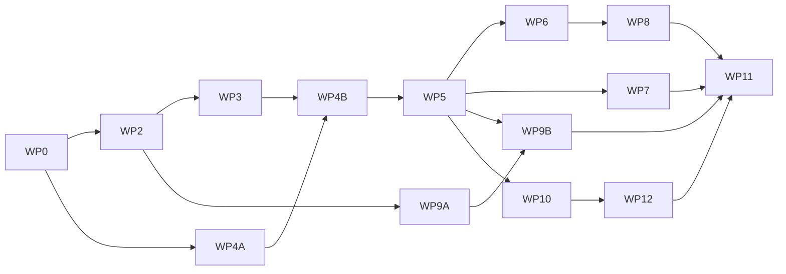
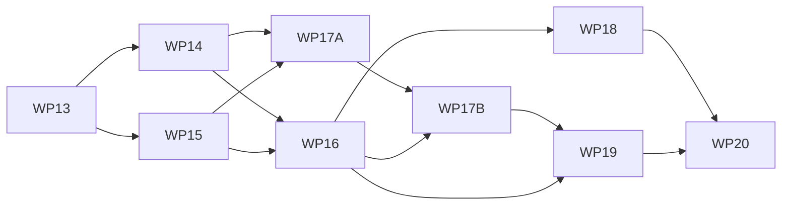
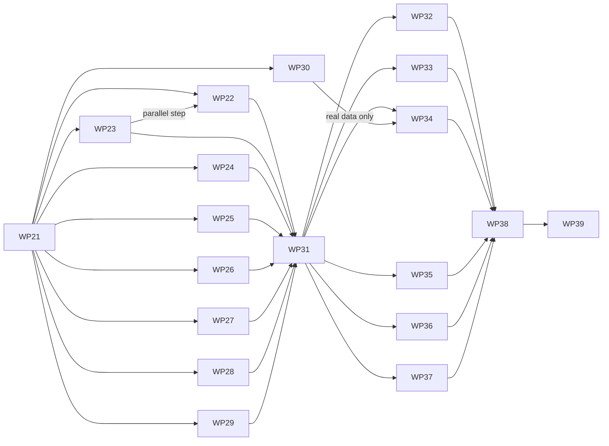
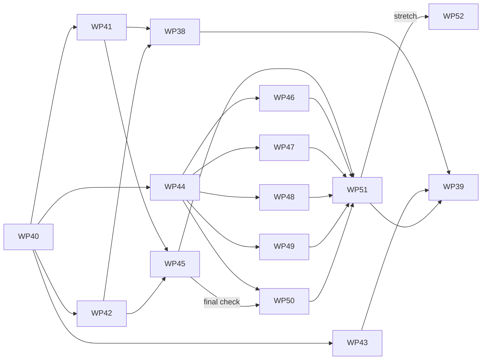

# InsightCrew: handoff

The status board for the rewrite described in [BLUEPRINT.md](BLUEPRINT.md). The blueprint says what to build. This file says where the work stands, what the owner has authorised, and what earlier sessions learned.

**Every session reads this file first, and before it ends updates [section 2](#2-status) and appends to [section 8](#8-session-log).**

Last updated: 2026-11-23 09:20, by the owner-asked workbench polish (process tab collapsed digests, opaque drawer entrance, status-aware interrupt banner). Submission is 2026-11-23 23:59.

> **Version 2.3 is built: work packages 40 to 52, WP38 and WP39 are done** (status table below); what remains is the owner's acceptance and the open questions of section 7. Questions 38, 43, 44 and 45 were fixed on 2026-11-21 (session log). The rest of this paragraph was written before the build and is kept as history. Version 2.3 was planned and authorised as work packages 40 to 52, in [BLUEPRINT.md section 20](BLUEPRINT.md#20-version-23-hardening-run-control-and-the-workbench-page). It fixes the defects a review of version 2.2 found (five of them before WP38 spends money), adds a timing trace beside the journal, cancel and resume from the page, and rebuilds the run page around the user's questions. Start with WP40 (alone). [Section 5.6](#56-version-23-work-packages-40-to-52) says which packages run at the same time and which files each owns; [section 4](#4-what-the-owner-has-authorised) the version 2.3 authorisations. **WP38 now runs on `v2.3`, after WP41 and WP42, with a cap of 2 USD. WP39 comes last.** Version 2.2 as built stays at the tag `v2.2`, which WP40 creates.

> **Version 2.2 is built except its real-model runs (WP38) and its packaging (WP39): work packages 21 to 37 are done.** The paragraph that follows was written before the build and is kept as history. Version 2.2 was planned and authorised as work packages 21 to 39, in [BLUEPRINT.md section 19](BLUEPRINT.md#19-version-22-langgraph-orchestration-and-five-capabilities). LangGraph orchestration with parallel analysts and resume, a portfolio, a three-way risk debate, analyst tools, news with macro data and social sentiment, memory with settlement and backtest. Start with WP21 (alone). [Section 5.5](#55-version-22-work-packages-21-to-39) says which packages run at the same time and which files each owns; [section 4](#4-what-the-owner-has-authorised) the version 2.2 authorisations, including **ask the owner before every network request and every real-model spend**. Version 2.1 stays the submission until 2.2 is packaged; WP21 tags it `v2.1`.

> **Version 2.1 is built: work packages 13 to 20 are done except WP17B's live acceptance, which is blocked on the network (see its row below and question 11).** The two evidence channels work end to end against a real model; the default behaviour with no channel open is byte-for-byte that of version 2.0, and every archived journal still replays. `../InsightCrew.zip` is the 2.1 package; version 2.0 remains at the tag `v2.0`.

> **The plan changed on 2026-11-19.** The owner reversed the zero-dependency decision: the system is built on maintained libraries (Pydantic AI, Pydantic, FastAPI, Typer, uv). BLUEPRINT.md, BLUEPRINT-REFERENCE.md and this file were revised together and are consistent. If you remember, or find in an older transcript, a version of the plan that says "standard library only", `python3 -m unittest`, `kernel/schema.py` or `adapters/openai_compat.py`, it is void.

## 1. Start here

Read in this order:

1. This file.
2. [BLUEPRINT.md](BLUEPRINT.md) sections 0.2, 2 and 3.
3. The work package you were given, and the sections it names. WP0 to WP12 are in BLUEPRINT.md section 13. WP13 to WP20 are in section 18.14; for those, read 18.1 to 18.3 as well. WP21 to WP39 are in section 19.18; for those, read 19.1 to 19.4 and [section 5.5](#55-version-22-work-packages-21-to-39) of this file as well. WP40 to WP52, and WP38 and WP39 as amended, are in section 20.14; for those, read 20.1 to 20.6 and [section 5.6](#56-version-23-work-packages-40-to-52) of this file as well.
4. The files it names in [BLUEPRINT-REFERENCE.md](BLUEPRINT-REFERENCE.md). WP13 to WP52 name none: read the code as built.

Which document to believe:

| Question | Believe |
|---|---|
| What to build, and every name in it | BLUEPRINT.md |
| What is already built, and what is allowed | This file |
| Why the design is what it is; the course fit | [TRANSFORMATION.md](TRANSFORMATION.md). Background only. Where it differs from the blueprint, the blueprint wins. |
| `README.md`, the body of `AGENTS.md`, `ARCHITECTURE.md`, `EVALUATION.md`, `ROADMAP.md` | Since WP11 they describe version 2.0 as built, and are right about it. They say nothing about version 2.1. WP20 updates them; no earlier package of version 2.1 edits them. |

## 2. Status

Statuses: `not started`, `in progress`, `done` (every acceptance command passed and the output is in the session log), `blocked` (say on what).

| WP | Result | Status | Notes |
|---|---|---|---|
| 0 | Clean branch, reference extracted, environment built, 58 tests pass | done | Committed by tonight's delegated session (the owner authorised "do all the planned work" on 2026-11-19 evening). `uv sync` succeeded; no certificate problem. |
| 1 | Withdrawn | n/a | The kernel is in the reference and frozen from WP0 |
| 2 | Symbols, bars, CSV adapter, synthetic universe | done | 44 tests. Determinism, point-in-time, all error classes verified. Interpretations in the session log. |
| 3 | Indicator registry and the ledger | done | 40 tests. Both paths agree over 277 data points (eval consistency). Interpretations in the session log. |
| 4A | Rulebook and audit, with their tests | done | 66 tests. Intake evaluator signatures and other interpretations in the session log. |
| 4B | `load_rules` and the injection evaluation | done | 19/19 mutations detected, 0/6 false alarms, exit 0. 8 new loader tests. |
| 5 | The offline system | done | All 16 scenarios match; `analyze --no-open` delivers with `accepted 2/3`; THIN refused with no model call; `IC_TODAY` board.json byte-identical; four stub commands exit 2. **Redone by the planning session on 2026-11-19 08:50 (`stages.py`, `wiring.py`, `report.py`, `cli.py` rewritten; acceptance re-run) — see the session log.** |
| 6 | `check` and `replay` commands | done | `replay` reproduces a demo run identically (exit 0) and a THIN refusal; `check` prints settings without secrets and the no-key reason, exit 2. Against a real provider: not run, no key — the with-model path was exercised against a temporary stand-in server and is covered by `tests/test_models.py`. |
| 7 | Offline evaluations as commands | done | `eval all` runs inject (19/19), consistency (277 points × 29 outputs), pit (864 facts) — exit 0. |
| 8 | Real-model runs, prompt fixes, ablation | done | 30 real-model journals in `insightcrew/evals/archive/`, all replay `一致`; ablation table in `archive/ablation.json`; results table in the session log entry "2026-11-19 09:45". Tiers `deepseek-flash` / `deepseek-v4-pro`. |
| 9A | Yahoo adapter and its test | done | 16 tests over saved fixtures; no network in tests. |
| 9B | `fetch` command | done | Yahoo still throttles (429); since `4228e68` `fetch` falls back to Eastmoney. `fetch AAPL 0700.HK --years 3` wrote four series (about 750 bars each); `facts 0700.HK --universe real` prints an HKD ledger. |
| 10 | Run page, static | done | Verified in the in-app browser: mode badge, pipeline, audit rejection, route back to Trader, three judges, price chart, playback controls. **Page rewritten by the planning session on 2026-11-19 08:50 and verified again in the browser.** |
| 12 | Local web app (`serve`) | done | Verified live in the browser: form starts a demo run, stream advances stages, same outcome and confidence lines as the CLI; THIN refuses; past runs open; clean shutdown. 409 covered by test. **Server rewritten by the planning session on 2026-11-19 08:50 and verified again.** |
| 11 | Documents and packaging | done | README, AGENTS, ARCHITECTURE, EVALUATION, ROADMAP rewritten; `start.sh`, `start.bat`; a `git archive` zip unzipped into an empty directory passes `uv sync`, 380 tests and a keyless `analyze`. Session log entry "2026-11-19 10:05". |
| 13 | Version 2.1: tag, branch, shared contracts, ports, the two analyst roles, audit checks, flow switch, settings | done | Authorised 2026-11-19; built the same evening. All seven contracts, both ports, both roles, the six audit checks, the flow switch and `[disclosures]` settings in place. `evidence` is the WP13 stub (every named channel `unavailable`, reason `尚未接入数据源`). 406 tests. |
| 14 | Version 2.1: statements, both paths, the fundamentals ledger, synthetic statements | done | Both paths agree at every swept date; acceptance numbers exact (940 / 1105 / 1081 with warnings / 1090 / NotCovered); generator deterministic. 424 tests. Owner settled questions 8 and 9. |
| 15 | Version 2.1: disclosures adapter, synthetic items | done | 14 tests; window edges inclusive, undated dropped and counted, out-of-cover and missing file NotCovered, malformed SourceUnavailable; generator deterministic; the three acceptance numbers of 18.14 hold. 438 tests. |
| 16 | Version 2.1: the offline system with channels; 21 scenarios | done | Real `evidence`, wiring, `--channels`, `facts` channels, the grown views and prompt paragraphs, two report sections, five scenarios, three evaluation blocks. 21 scenarios match; eval all prints both blocks; `uncovered`'s report verified; replay of a channel run 一致. 462 tests. |
| 17A | Version 2.1: SEC EDGAR and Eastmoney announcement adapters, with tests | done | 20 tests over synthetic saved responses (structure real, no real download): tag order per concept, span and form filters, duplicate keys keep the last, titles for 8-K items, paging and covers_from. 483 tests. |
| 17B | Version 2.1: `fetch` downloads evidence | done (code); live acceptance pending | The code is complete, offline-tested and committed (`5a086bd`), and is in the package zip. The live acceptance run is blocked: Eastmoney's bars endpoint answered `Server disconnected without a response` on every attempt (three, Yahoo 429 as before), so `fetch` exits at the bars stage and the evidence downloads never start. `IC_SEC_CONTACT` **is** set in `.env` (key checked, value not read). Retry `fetch AAPL 0700.HK --years 3` when the network allows, then `facts AAPL --universe real` / `facts 0700.HK --universe real`; question 11 (the `client()` factory in `adapters/edgar.py`) still waits for the owner. |
| 18 | Version 2.1: run page sections | done | Pipeline shows the two analyst stages when a run has them; the evidence area gains a channel-status line, a fundamentals table with the card, and an item list with signals; verified in the in-app browser for `channels_clean`, `uncovered` and `demo` (no channel → the page shows nothing new). 486 tests. |
| 19 | Version 2.1: real-model runs with channels, `eval channels` | done | 13 real runs archived (one pilot + 12 evaluation), every journal replays 一致; no prompt fix was needed (the pilot journal showed clean channel outputs and substantive, not mechanical, dissents); `[flow] channels` stays unset. Total spend ≈ 0.5 USD of the 2 USD cap. |
| 20 | Version 2.1: documents and packaging | done | README, AGENTS, ARCHITECTURE, EVALUATION, ROADMAP updated (counts: 486 tests, 21 scenarios, 8 agent kinds, 43 archives, invariants 3/4/6 reworded, 17/18 added; the 30 v2.0 journals are marked as made before the prompt change, the 13 v2.1 after). Link check bad 0; the zip rebuilt from the head and verified from a fresh unzip. |

| 21 | Version 2.2: tag `v2.1`, branch `v2.2`, no-network fixture, two literals, `NotConfigured`, `THIRD_PARTY_NOTICES.md` | done | Tag on `082a0a32`; branch `v2.2` and plan commit `506dd4d`; 486 tests, ruff/pyright clean; 21 scenarios 相符; 43/43 replays 一致; socket guard shown both ways (temp test, deleted). Question 15 (the notices' copyright line) awaits the owner. |
| 22 | Version 2.2: LangGraph graph, parallel analysts, wall time, checkpointer, `resume` | done | Critical path. First step `uv add langgraph langgraph-checkpoint-sqlite`; on failure stop (fallback in BLUEPRINT 19.5 item 7). Its parallel step waits for WP23. `uv add` done (langgraph 1.2.22, langgraph-checkpoint-sqlite 3.1.3). Built by the coordinator: graph, parallel/serial analysts (journals equal, invariant 19), in-memory wall time (persistence = question 20), AsyncSqliteSaver checkpointer + run signature + `resume` command, `--serial`. 723 tests; questions 20/27/28. |
| 23 | Version 2.2: kernel deferred commit and tools | done | BLUEPRINT 19.6 的两条、仅这两条：`run_role = commit(run, await run_role_deferred(run, role))`，事件与拆分前一致（`tests/test_kernel.py` 16 项原样通过）；`Role.tools`/`max_tool_calls`、`Run.tools`，工具包装（上限回那句提示、同名同参回放缓存、`tool_calls`/`repeated_tool_calls` 计数、请求数封顶 `max_tool_calls + 2`）经 `FunctionToolset` 子类实现，内核不认识任何工具名。12 项新测试（`tests/test_kernel_v22.py`）。Built by a delegated session; committed by the coordinator. |
| 24 | Version 2.2: portfolio core | done | Contracts byte-identical to 19.7 (plus PEP 8 blank lines); `state_for` four states; `fingerprint` SHA-256 first 16 over canonical JSON. Examples: held_acme (90 股 @ 100,现金 1000,权益 10000 → close 100 时 position_pct 恰为 90.0)、flat_usd、low_cash。23 tests;坏文件以文件名报 ValueError。Built by a delegated session; committed by the coordinator. |
| 25 | Version 2.2: risk core (contract, three prompts) | done | `RiskView` exactly as 19.7 prints it: all seven fields required (built with keyword arguments); `size_pct`/`stop`/`target` nullable with no default, as declared. Three prompts adapted from the TradingAgents debators, each starting with the attribution line, naming 19.10's reads and explaining the four `portfolio/state` states (no default assumed when unavailable or 无). 5 tests; no role loads the prompts yet (WP31 declares them, WP32 the stage). |
| 26 | Version 2.2: tools core | done | 24 new tests. `indicator("sma",20)` on ACME's last bar equals the ledger's `sma_20`; all 7 families agree across both paths at both range ends; out-of-range/unknown/insufficient history return the error string ending `数据不可用，不要编造。`; later bars proven inert (leaky-market test). Interpretation: `indicator`'s return annotation is `dict | str` (errors are strings per 19.11; the blueprint's `-> dict` describes the success shape). |
| 27 | Version 2.2: news and sentiment core | done | Contracts exactly as 19.7 prints them (`BAND_RANGES` 照抄：0–2/2–4/4–6/4–6/6–8/8–10，两端含；六档带名取自 TradingAgents 的 SentimentBand，文件头有改编声明)。`news_findings`/`sentiment_findings` 覆盖 19.12 每一项（news_has_signals、news_signal_cites_known_item、claim 两查 owner "news"；sentiment_has_signals、sentiment_signal_cites_known_post、sentiment_score_matches_band）。适配器照 disclosures_json：无日期丢弃计数、窗口出界/缺文件 NotCovered、坏文件 SourceUnavailable；social 正文截 280 字、非法 tag 按坏文件处理。生成器确定性，覆盖 2026-09-30 前后（7 天窗口 4 条/4 帖、1 条无日期、1 条晚于分析日）。两个提示词带改编声明头，尚无角色加载（预期）。43 个新测试；全仓失败仅在 WP22/WP28/WP29 的进行中文件。 |
| 28 | Version 2.2: macro core | done | Contracts of 19.7 verbatim + `build_macro`; two independent paths agree on all 4 synthetic series at every month-end 2025-01…2026-12 × 3 analysis dates × 3 transforms (864 comparisons); a vintage after the analysis date is never used; cpi 的 2026-01 重述在 2026-03-12 前读旧值 329.4、之后读 329.5。20 tests; `tests/test_market.py` 不受 macro/ 子目录影响。四个解释记为问题 16 到 19。 |
| 29 | Version 2.2: memory core | done | 31 测（test_memory 23 + test_decision_log 8）：settle 在窗口走完前 None、两路逐项一致、hit 四情形（同根同日按 stop）、select_lessons 不见 as_of 之后的结果（不变量 20）、两进程 spawn 并发追加一条不丢、重复 decision 忽略、pending 永不淘汰。结算与缺基准的读法四条待主人：问题 21–24。 |
| 30 | Version 2.2: source chain, live adapters, `fetch` | done | `first_ok`+`scrub`（`adapters/vendors.py`，改编自 router/errors/net，带头行）、五个线上适配器（news_rss、stocktwits、reddit、fred、polymarket，除 news_rss 外均带 19.4 头行），各自把夹具解析成 19.8 的归档形状；46 个测试全部离线（夹具全部手工构造，各夹具目录注明，未发任何真实请求）。`fetch` 增 news/social/macro/markets 关键字参数（默认关）与 `SourceOrder` 链参数（缺省 19.12 全链；bars 缺省顺序与 2.1 相同）；归档合并（url 去重、covers_from 留在首写日、macro 按 (date, realtime_start) 并集、markets 按天一份）用 MockTransport 临时脚本离线验证。线上验收等 owner 批准端点与 `IC_FRED_API_KEY`；问题 25–26。 |
| 31 | Version 2.2: integration points (every shared file) | done | Committed as `fb09d2b` and logged at "2026-11-20 01:30 · WP31"; the row had been left at `in progress` and was corrected by the review session on 2026-11-20. Question 20's option A was tried and reverted to C (see that question). |
| 32 | Version 2.2: portfolio and risk in the flow | done | Overnight session. stage_risk 正文（每轮 aggressive→conservative→neutral→trader，同步签名经线程桥跑异步内核）、stage_portfolio 仅文档句更新；五场景全 ✓ 相符（预存 21 个逐一验证亦 ✓）；test_stage_portfolio_risk.py 8 项绿；43/43 归档重放一致；本包文件 ruff/pyright 干净。两条第 7 节请求（v22_switches 的 risk 桩断言、wiring 的组合指纹）；全量 `scenarios` 仍被 WP34 的 macro_clean 挡住（WP34 的请求行）。 | |
| 33 | Version 2.2: tools in the flow | done | Overnight session. Script 学会恰两键 {"tool","args"} 的回答（内核包装真执行、结果送回）、Replay 原样重放录制的工具调用；两场景 tools_clean、tools_out_of_range 均 ✓ 相符（tools/facts 形状缺口由协调者按 §7 请求修复：板键存完整 Fact、模型仍收四键；xfail 标记已摘）。 |
| 34 | Version 2.2: news, macro, sentiment in the flow | done | Overnight session. stage_news/stage_sentiment 正文：窗口、上限、显式缺席、宏观双路径复算、markets 的 fetched_on 规则；四场景 news_clean、news_uncovered、sentiment_clean、macro_clean 均 ✓ 相符（stages.audit 的宏观键守卫由协调者按 §7 请求补上）。真实归档的 facts 验收仍等 WP30 端点批准。 |
| 35 | Version 2.2: memory, `settle`, `backtest` | done | Overnight session. stage_memory 正文（lessons：重放替身的 journaled_lessons 原样奉还（决策 44）、场景内联字典行先校验再 select_lessons、空时写 none_known；record：交付运行按黑板组 DecisionRecord，替身写入为空操作）；flows/settle：待决逐条两路核对六个计算字段，一致才落账（分歧保持待决并汇报），基准经同一行情端口读（宇宙没有 SPY/_HSI 时两端无价、结果照算——问题 22 的读法），每个新结果在 runs/memory/settle/<id>/ 开小运行跑 reflector、lesson_findings 审计通过才把教训随结果一次 resolve 落账（问题 31 的读法），复盘不可用或审计不过则结果照落、教训留空；settle/backtest 命令落地（真实模型没有 --yes 拒绝、退出码 2；进度 progress.json 原子写、同 --run-id 续跑跳过已完成格子、批次预算超限即停、收尾把 to 结一遍、按评级汇总笔数/已结算/平均收益/平均超额/先触止损/目标）。两场景 ✓（memory_lessons 只见分析日前的教训、memory_record 空起点照常交付）；tests/test_memory_flow.py 8 项 + tests/test_backtest.py 7 项绿（三日期网格 08-03/08-10/08-17、先结算后分析、不变量 20 逐格核对、同 --run-id 复跑不做新事、batch_tokens=15000 停后加预算续跑补第三格）；test_memory/test_decision_log 原样绿；本包文件 ruff/pyright 干净；21 个既有场景逐一 ✓、归档重放抽 1 个一致（43/43 由 WP36 当夜全量验证）。遗留：test_v22_switches 的 memory 项因 WP29 决策日志锁文件先于 _write 建目录而挂（第 7 节 WP35 请求行）；问题 31（resolve 与教训的次序）、32（场景空 memory 的 falsy 缝）。 |
| 36 | Version 2.2: report, page, `serve` | done | Overnight session. 六个新节全部按键驱动（组合状态/风险三方意见（只立场与批评）/工具事实进事实表并标注/新闻与宏观（预测市场单列"来源原话，未经核验"）/社交情感/用到的课程；run/wall_ms 在板上才画墙钟——问题 20 的 C 案下从不出现，分支已备）；页面：news/sentiment/risk 流水线段与泳道、ACTOR_STAGE/KEY_STAGE 映射、并行分析师组（≥2 位时并列成框、无箭头）、墙钟标签、镜像报告的证据区块、表单五字段（组合文件/风险轮数/工具/记忆/通道多选）经 prepare/open_run 透传，坏组合文件 422 且回复不带路径；replay_html.py 无需改动。本包文件 pytest 71 项绿、ruff/pyright 干净、页面 JS 过 node --check；demo 与 uncovered 的报告新旧模块逐字节相同；21 个既有场景逐一 ✓ 相符；43/43 归档重放一致；新增 13 场景中 12 个的报表已实跑核对（portfolio×3、risk×2、sentiment_clean、news_uncovered、memory×2、tools_out_of_range、news_clean、tools_clean——守卫修复落地后最后两个转绿）；仅 macro_clean 仍被挡：刚刚落地的 stages.audit 守卫把 `board.get("macro/facts", [])` 的第二参（应为类型）写成了列表，macro 键在板即 `TypeAdapter([])` 崩（该行的修正属 stages.py 的 owner）；宏观区块的报表在单元测试里以手造板键验证。续跑标记未做：日志没有续跑标记事件（按指示跳过）。全仓 pytest 的失败全在他人文件（见日志）。 |
| 37 | Version 2.2: evaluations | done | Overnight session (问题 29 授权)。`eval all` 打印全部新行并退出 0：inject 加版本 2.2 块（组合状态翻转 ×2、新闻 claim 引未知宏观事实、情绪信号引未知帖、情绪分出带、教训带数字——6/6 发现、0/2 误报）；consistency 加工具块（7 家族 × 3 分析日 × 3 窗口 = 63 次调用，flows/tools 内部两路 + evals 独立复算 recompute 比对）与宏观块（4 序列 × 3 变换 × 8 分析日 = 96 点，macro vs macro_sql）；pit 加六块（新闻 9、社交 9、宏观 91 含 cpi 两次重述逐日 329.4→329.5/337.0→337.2、预测市场 6（fetched_on==as_of，评测自建临时档案、就地实现 19.8 规则，与 WP34 的 stage_news._markets 同一条规则各持一份）、教训 5（含边界日成员断言）、工具 63（漏 bar 检查，诚实端口 vs 无视 as_of 的坏端口同答案））。新测试 16 项（tests/test_inject.py、test_consistency.py、test_pit.py，各含伪造分歧/泄漏的检出用例）。run.py 仅 docstring（`all` 三项未变，新行随各评测打印）。 |
| 38 | Real-model runs and ablation, as amended by BLUEPRINT 20.14 | done | One pilot + all nine cells run on the real model (2026-11-20 evening), archived with `trace.jsonl`; every archive replays 一致 and passes `verify` (53/53 incl. the 43 old). 8 delivered + 1 review (`acme_all_off`, contested). Spent **0.3174 USD of the 2 USD cap** (pilot 0.0383 + cells 0.2791), plus 0.0249 journaled + one aborted in-flight call (≤0.014) wasted on a first attempt routed without the trace (see log). No prompt was changed: no journal showed a fault; question 36's sentence stays (manager outputs never mention `memory/status`). Model client retries confirmed from installed source (20.2). Real-bar cells: news/sentiment/macro (and fundamentals/disclosures) channels all `unavailable`, as the amendment says. Timing from the traces: the five-analyst group in `acme_all_on` overlapped (sum 48.0s vs span 13.7s). |
| 39 | Documents, notices, packaging, as amended by BLUEPRINT 20.14 | done | The packaging half, 2026-11-20 late evening (the version 2.2 documents half was done at 02:05): README/AGENTS/ARCHITECTURE/EVALUATION/ROADMAP rewritten from the code and the session logs (ARCHITECTURE gains the trace and run control §16; ROADMAP takes 20.16's list; EVALUATION gains the run cells of 3c; counts 906 tests with Node, 904+2 skipped without it, 36 scenarios, 53 archives replay 一致 and verify 通过; the CI file's never-run status stated everywhere it is mentioned). THIRD_PARTY_NOTICES re-verified by grep: version 2.3 adapted nothing, the twenty-file list is unchanged. start.sh/start.bat re-checked against the unchanged command surface. `../InsightCrew.zip` rebuilt from the head and verified from a fresh unzip (uv sync, 906 tests, keyless `analyze --no-open`). Link check 0 bad. Details in the session log. |

| 40 | Version 2.3: tag `v2.2`, branch `v2.3`, the plan committed, the kernel observer hook | done | Tag `v2.2` on `549c40f`; branch `v2.3`; plan commit `45b5b06`. Kernel change exactly 20.5 (`Run.observe`, `_notify` in `contextlib.suppress`, three guarded calls in `run_role_deferred`; only `contextlib` imported); `test_kernel.py`/`test_kernel_v22.py` untouched and green; 5 new tests in `tests/test_kernel_v23.py` (no-observer identity incl. the clock count, observer order and fields, tool role's `tool_calls`, raising observer journal-equal, `role.failed` before the Halt). 830 tests, ruff/pyright clean; 34/34 scenarios ✓; 43/43 replays 一致. |
| 41 | Version 2.3: flow hardening (risk debate awaited, resume across the analyst fan-out and with tools, siblings' spend) | done | 20.7 第 1–6 条全部落地，四项先红后绿：D1 `stage_risk.risk` 异步直跑（线程桥/asyncio.run/ThreadPoolExecutor 全删，图的 risk 节点 await；测试：慢速剧本辩论期间同循环心跳持续推进——修前 0 次）；D2 join 按 `analysts_group[_rerun_start:]` 逐位入账、缺位且该跑的就地 `run_role_deferred` 补算（蓝图点名的窗口在 langgraph 1.2.22 下本就全超步重跑、测试不红——见问题 37；缺陷在相邻窗口复现：join 入账中途被中断、续跑直接落回 join 时缺 `fundamentals/analysis`）；D3 流程一半 `drive(resume=True)` 重建 `run.tools` 并 `ToolBox.seed` 装回板上 `tools/facts`（修前按 app/resume 重建 Run 续跑即 `KeyError: 'indicator'`）；兄弟花费：`drive` 的 Halt 处理先按固定顺序入账 holder 里已算完的分支（忽略 Malformed）再降级（修前第一位分析师的 `model.called` 不在日志）。第 5 条 `wall_on_board`/`_record_wall`/`run/wall_ms` 全删（无任何调用方与测试读它们）；第 6 条 `call` 只在 analyze 定义一份，graph 与 stage_risk 引入（drive 函数体内才引入 graph，模块加载无环）。`tests/test_flow_hardening.py` 新增 3 项、`tests/test_graph.py` 新增 2 项（既有全绿）、`test_stage_portfolio_risk.py` 两处直调改 await（问题 34）。本包文件 ruff/pyright 干净；全仓 pytest 845 过、9 挂全在 WP42/WP44 进行中的文件（见日志）；34/34 场景 ✓；43/43 重放一致。 |
| 42 | Version 2.3: app hardening (`[flow] channels`, resume, torn journal line), the trace, the `verify` command | done | 20.6 与 20.7 第 7–14 条全部落地，缺陷项先红后绿：D4 `prepare` 的 `names` 在选场景**或** `--channels` 缺省（None）时为 None（设置里的 `[flow] channels` 生效），`_channel_names` 不再以 None 调用、空元组＝显式全关；D3 的 app 一半 `resume_run(settings, path)` 异步化（拒绝一律 BadRequest 中文），`_ResumingRun` 复原 `_requests`（上限 6、崩溃时已花 4：续跑再调两次即 calls_exhausted，修前把上限当从零算出 ok），同步 `run` 包着它保持退出码；D8 最后一行无换行且解析不过先按**字节**截到完整行（按字符截会切进多字节字符）并说一行，中间坏行仍是错；trace：`app/trace.py`（Tracer/mark/load，行＝ts 毫秒+kind+字段），`run_flow` 挂成 `run.observe` 且与调用方已挂的观察者串联（先测量后播报），`resume_run` 挂 tracer 并先写 `run.resumed`（after_seq＝续跑前日志末序号），不变量 22 有测试（带/不带 tracer 日志剥 ts 与易变 id 后逐条相同），问题 33 落地（`test_cli` 文件集加 `trace.jsonl`）；D6 命令行一半：`analyze` 捕意外异常→页面照写、一行含异常类与 `可用 insightcrew resume <目录> 续跑`、退出 1，`--show` 经观察者逐行播报开始/结束（结束带毫秒），`_GATES`+tools、`_STAGES`+news/sentiment，settle/backtest 的两个死 NotImplementedError 处理删；`verify` 命令：八条结构检查（序号、首事件、run.finished 至多且最后、caused_by 更早、版本逐一加一、非空 model.called 有以其为因的 artifact、run/usage＝合计、run/outcome 恰随 run.finished），打印 通过/问题清单退出 0/1，未结束附注"未结束"；replay 对无 run.finished 的日志说明未结束不比较、退出 1；`_one_line` 只在 replay.py 定义（check.py 引入）。新测试：test_trace 6、test_verify 13、test_wiring +3、test_cli +8。验收：`analyze --no-open`（离线）留下 trace.jsonl，9 条 role.started 与 9 条 role.finished 的 step 序列逐一成对；`verify` 该运行通过、43 份归档全过（OK=43 FAIL=0）、删中间行未通过退出 1；`scripts/check.sh` 六阶段全过（880 tests、ruff/pyright 0、34/34 场景、43/43 重放、eval all 0）。问题 38（resume 的 `_models` 不看 IC_FORCE_OFFLINE，2.2 既有）记录在案未改。 |
| 43 | Version 2.3: test harness, prompt-integrity tests, `scripts/check.sh`, the CI file | done | `tests/conftest.py` 网络夹具加拦 `connect_ex`，新增 autouse 夹具移除所有 `*_API_KEY` 环境变量；830 项既有测试无一因此失败。`tests/test_prompts.py` 四项检查今天全过（发现见问题 36）。`scripts/check.sh` 六阶段（三项检查、34 场景、43 重放、eval all）全过退出 0。`.github/workflows/ci.yml` 仅是文件：从未推送、从未运行。 |
| 44 | Version 2.3: page foundation (the split into modules, the assembler, the model, the labels, the shell) | done | 按任务书次序四步走：先无行为变化的拆分（`tests/test_run_page.py` 原有 16 项不变全绿）→ `fold(events, trace, live)` 模型（视图私有折叠全部换掉）→ 页签外壳（过程/证据/规则与审计/用量与耗时/原始事件；过程与规则为空页签，写明 WP47/WP48 填充；结论与图置顶；`run/wall_ms` 的读取保留）→ 令牌与基础样式（含暗色一套）。`replay_html.py` 拼装 `/*@@css*/`、`/*@@js*/` 两标记行（缺失或源文件含 `</script` 即报错；输出确定），`render`/`write` 增 `trace` 参数。新增 `tests/js/`（Node 内建 runner，7 项：版本与 superseded、rounds、cited_by、status、跨度配对/失败/无轨迹）、`tests/test_page_js.py`（无 node 时跳过并说明）、`tests/test_page_labels.py`（rules.toml 14 规则、domain 17 检查名、flows 12 停机原因全部有标签）、`tests/test_run_page.py` 加 8 项。浏览器核对（端口 9999，IC_FORCE_OFFLINE=1）：demo 从表单起跑直播、channels_clean 看 ?run=、两者的 `replay.html` 静态打开，均显示 2.2 页面原有内容；发现并修复渲染循环在 rAF 冻结（隐藏页签/内嵌浏览器）下整页不画的问题（150ms 定时器兜底）。全仓剩余失败均在 WP42 进行中的文件。 |
| 45 | Version 2.3: server API and run control (checkpointed web runs, cancel, resume, trace in the stream, exports, plan preview) | done | 20.8 十条全落地，缺陷项先写测试先见红：D5 `_execute` 改走 `wiring.run_flow`（网页运行留 checkpoints.sqlite 与 trace.jsonl）；**取消测试是本包第一个测试且真实通过**——等待型剧本模型挂在 technical 上，取消打断在飞调用（无需兜底放开），日志无 run.finished、轨迹以 run.cancelled 收尾、无活动运行，随后从检查点续跑到 delivered（问题 38：测试设 IC_FORCE_OFFLINE=1 并给 `resume._models` 换剧本；真服务器上的 202-续跑未手动跑，那会经 `_models` 打真实端点）；resume 的拒绝（已结束/签名不一致/2.2 之前/无检查点/另有运行/无此运行）经"让步事件循环数次等同步前缀"全部在 202 之前报 409，`_execute_resume` 不吞 BadRequest；事件流带 `event: trace`（无 id，重连整份重发）、15 秒 `: keep-alive`、end 带 `status: finished/interrupted`；导出 report/replay 带 attachment 与 404，**另加 HEAD**（蓝图未点名，WP50 的页面靠 HEAD 探测才显示导出链接——本仓 FastAPI 的 GET 路由不自动答 HEAD）；meta 增 defaults 六项/channels/portfolios/limits/角色上限；RunRequest 组合改为 `meta.portfolios` 的名字（任意路径不再接受）、channels 改 `tuple|None`（None=用设置、空=全关）；计划预览 `/api/plan` 零模型零运行目录，通道覆盖走 facts 同一批函数（临时黑板跑证据阶段），阶段带并行标记、典型/上限调用、组合状态；`/api/runs` 行加 `resumable`；`write_page` 把轨迹嵌进 replay.html。888 tests（+8）、ruff/pyright 0；34/34 场景 ✓；48/48 归档重放一致（含 WP38 当天新增）；eval all 0。问题 42（typical 的"2–3"读法）、43（带组合的运行按现状续不了跑，resume 域）记录在案。浏览器外手工核对（端口 9999，IC_FORCE_OFFLINE=1，事后已停）：meta/plan 实样、直播流 18 条 trace 行、HEAD/GET 导出、取消 202 与 409 降级、resumable 行。 |
| 46 | Version 2.3: page, verdict and chart | done | 20.10 结论四态齐：交付（评级/操作/带货币价位/摘要/论点带引用徽章/失效条件/持有期/两条信任行链去页签）、REVIEW（无评级无价位＋原因＋下一步建议行＋脚本化提示）、中断（进度行＋续跑按钮，静态页说明不能续跑）、运行中（进度行＋结论形成中）；价格图保留 2.2 全部元素并加"分析日"竖线标记。新增 `tests/js/verdict.test.mjs` 5 项（12/12 绿）。共享页文件零改动。问题 40、41 记录在案。浏览器五查（demo、审计打回、全能力、中断、静态 replay.html）均过。 |
| 47 | Version 2.3: page, process (debate, revisions with the audit's findings, risk, judges) | done | 20.10「Process」全条落地：分析师（并列，卡上标签/模型/耗时/token，产物按契约渲染：叙事→论断或信号带引用徽章→基调/情绪带与把握）、多空辩论（一轮一框、多空两列、回应在点下）、主管与交易员、修订对照（一版一列一字段一行、改动格加 ▲；被打回的版本列出检查项标签/主语/消息与流向——审计的按路由点名键主人归属，评审反对票与随上游重做也分得清；论点被评审否决时同样有对照）、风险三方意见（三列＋交易员修订摘要，标题保留"未经审计的意见"）、评审（一轮一卡＋汇总行）。被取代的旧版默认折叠；每卡「查看提示词与原始回复」开原有事件抽屉；四态（无运行/进行中/交付/中断/REVIEW 各有一句交代）。Node 测试 `tests/js/process.test.mjs` 5 项（含跨 realm JSON 比对）。截图 4 张（demo、misquote、全能力上下两幅）。 |
| 48 | Version 2.3: page, evidence with clickable citations, rules and audit | done | 证据页签：账本/基本面/工具/宏观合成一张事实表（持久搜索框滤 编号/含义/数值/单位/数据日/种类/解读/引用者，种类徽章，引用它的角色），条目列表沿用原标题（保留「来源原文，未经核验」「来源原话，未经核验」），每通道一行状态带原因，数据卡（新增 ledger/card），组合状态，用到的课程；条目编号全部变引用徽章。规则与审计页签：分层图例点名 L1 与 L2（连同 L3，问题 39 的读法），规则表（中文名、公式仅已交付如报告、界限、计算值、结论、说明），审计轮次（发现带层级与界限/实际——层级取 audit/findings 产物、打回去向、修正它的那一版、未修正交代）。引用抽屉的「在证据中查看」经 MutationObserver 在共享 renderCite 画完后追加（共享文件请求一行，WP51 落实），跳证据页签高亮滚动；未知引用照旧画「未知引用」。风险三方意见与评审表按蓝图归 WP47 的过程页签（其时已在工作树），本包两页签不再重复。Node 测试 8 项（evidence 3 + audit 5）；880 tests、ruff/pyright 0；34/34 场景 ✓、43/43 重放一致；浏览器核对 demo/flailing/全能力（wp47_all_on 合并场景+flat_usd）/中断运行/静态 replay.html 各两页签，截图存会话产物。 |
| 49 | Version 2.3: page, usage and timing with the trace waterfall | done | 20.10「Usage and timing」全条落地：按角色（不再按角色组）一张表——调用、请求、输入/输出 token、token 合计、token 上限（该角色组的逐行照示）、成本（或未定价）、有轨迹时的耗时列与合计行；对上限三条进度条——token 对运行上限、请求对 `max_requests`、秒对 `max_seconds`（墙钟取轨迹覆盖范围，无轨迹记"未测量"）；调用瀑布——一次调用一条横杠、按角色分泳道、按最早开始排序、并行分析师的横杠互相重叠（channels_clean 实测三位分析师并排）、未收尾的跨度画黄色虚线、`run.resumed`/`run.cancelled` 两条竖线记号（含 after_seq 的悬停说明）；无轨迹（2.3 前的运行、场景、今天的直播流——WP45 之前事件流不带 trace）时耗时列与瀑布换成一行说明；既有附注三条保留（重试、成本上限、`run/wall_ms` 在板才画的墙钟行），新增"被中断的调用不记用量"。进行中无已完成调用时给一行说明、瀑布照画。`tests/js/usage.test.mjs` 8 项（自带装载器注入最小 state 与假 DOM）。截图 5 张（demo 回放含瀑布、revise_levels 审计打回（交易员两杠）、risk_shrinks_size --tools 全能力（11 角色）、channels_clean 并行重叠、手写轨迹的中断夹具（黄虚线＋续跑/取消记号））；直播 ?run= 的无轨迹态亦经浏览器核对。共享页文件零改动；`fold` 的 spans/usage 即全部数据源，记号从 `state.trace` 私推。 |
| 50 | Version 2.3: page, launch form with plan preview, history, live activity, cancel and resume | done | 20.10「Launch, history and live activity」全条落地：表单四组（标的与日期/流程/证据通道/组合，10 个元素 ID 原样；通道改五个复选框各一行，macro 无 news 即禁用）、选码显示最后一根已收盘 K 线并给日期上界、`POST /api/plan` 404 时计划预览整体收起（200/422 照画，字段宽容）、开始键在请求在途或运行进行中禁用、拒绝理由放回它点名的字段旁、上次值记 `localStorage`（含通道勾选，macro 随 news 恢复）、历史表加 `resumable` 行的续跑键；活动区每段 等待/进行中/完成/被打回↺n/跳过（通道不可用，含原因；回放与已中断时停下的段画「未完成」不画「进行中」）、在飞角色各带每秒走动的计时器（轨迹 `role.started` 未收尾者，连接时重置整份重收——挂在本视图自己的 trace 监听上，未动 90-boot）、已用时/总用时、「模型调用中：结果返回后一次显示」；页头 [取消][续跑][导出]：取消先确认并写明在飞调用用量不记档、中断后出续跑键、导出链接探测到才显示；直播事件到了就画（followLive 用 instant 揭示，0.7 秒揭示只留回放）；发起区在看运行时折成一行；静态 replay.html 一个需要服务的控件都没有。2.2 该区域内容无丢失（历史列、场景禁用、409 活动运行链接、并行组、墙钟读法归 50-usage）。Node 测试 10 项（activity/launch 各自带装载器）；三项检查、34/34、43/43、页面测试全绿。**等 WP45 的最终核对**：plan/cancel/resume/`resumable`/导出四路 404 降级文案与 202 路径、事件流 trace 行到达后的在飞计时器（现在只能静态验证）。另：内置浏览器对 9999 的 HTTP 缓存会串并行会话的同名静态页，静态核对用一次性文件名绕开（WP49 记的 9998 端口是另一条路）。 |
| 51 | Version 2.3: page quality pass and the browser check | done | 起点取主人的样式基线（16:29–16:49 另一代理的未提交改动：键盘页签/aria/抽屉焦点/重试横幅/暗色终端式主题，本包核对后全数保留并续在其上）。第 7 节 WP48 的 renderCite 挂点请求照第二案落实（绑定声明在 00-core 最先加载、renderCite 两出口调用、40-evidence 删观察器直连）。质量清单逐条核对补齐：状态与活动区活区（sr-status 沿用基线，新增 sr-activity 播报段状态与在飞角色、不含每秒计时数字）、页签键盘操作（基线）、抽屉焦点进出（补上引用徽章重建后还焦点的回落）、无单靠颜色的状态（逐视图核对）、两套配色正文对比度全部 ≥4.5:1（脚本核算）、480px 五页签零溢出（修 .head-side 窄屏收缩与 .runctl 组内换行；宽表在自有盒内滚动）、失败请求横幅+重试（运行 404/断流走基线横幅；meta 与历史读不到就地加重的）、断流说明并自动重连（新增 #stream-note，实测停服→提示→重启→撤下）。WP50 遗留终验全过：plan 200 实样（阶段/并行/典型 13 上限 40/通道不可用带原因/组合）、取消 202（136ms 处 API 背靠背，页面确认框为真 confirm）与 409 理由、续跑 202（页面按钮，事件 39→47）与已结束 409、resumable 行续跑键、导出链接 HEAD 后显示、直播中 trace 行到达（瀑布在收尾前生长）。九张验收截图全拍（demo 交付/审计打回/REVIEW/通道不可用/全能力/取消续跑（瀑布含取消+续跑记号与未收尾横杠）/480px/暗色/静态 replay.html）。发现并记录问题 44（检查点前取消的续跑 EmptyInputError）与一次意外真实模型花费（0.002409 USD＋一笔在飞作废，见日志条目，问题 38 的一例）。测试 +4（pytest 2 项锁定质量层与挂点、Node 2 项挂点与活动播报）；890 tests、ruff/pyright 0；check.sh 六阶段全过。 |
| 52 | Version 2.3: approval gate (stretch) | done | 20.15 放行（WP51 于 11-20 当天开始并完成，早于 11-22 12:00 门槛）；LangGraph 的 interrupt 经读安装源确认可用（guard 2 通过）。`Approval` 契约、`FlowConfig.approve`（默认关）、judges/audit 与 outcome 之间的 approval 节点（interrupt 暂停、Command(resume=…) 续起）、CLI `--approve` 终端问询、`POST /api/runs/{id}/approval`（202/404/409/422，暂停的事件流不带 error）、重放端口（flows 层预置注册表，门口入账——日志序号与真实运行全同位）、页面结论卡「待你确认」两按钮与 rejected_by_user 私有标签；两场景 approval_approved/approval_rejected ✓ 相符；浏览器实测接受→交付、拒绝→REVIEW(rejected_by_user)，两运行 replay 一致、verify 通过；approve 关着 check.sh 六阶段全过（906 tests、ruff/pyright 0、36/36 场景、53/53 重放、eval all）。问题 45、46。 |

| 56 | The page strictly after the OpenDesign prototype: dark-only, prototype scale, icons, cancel modal (owner-authorised 2026-11-22) | done | Owner's brief「所有视觉元素都严格按照 OpenDesign 的那几个设计；内容可以换成我们已有的」+ 四个决策（对话内拍板）：①整站只保留深色（浅色方案与双方案测试随方案删除，属契约变更非削弱）；②原型里的亮色残留不用，改用原型自己覆盖层里写好的深色版式（紫系/语义色，AA 保持）；③结构全部补齐——page.html 加原型的 28 枚描边 SVG `<symbol>` 图标库（`.od-icon`/`.icon` 两种尺寸），取消运行改专用 `<dialog>` 模态（含已发生用量与「继续观察/确认取消运行」，`cancelRun` 只开层、`requestCancel` 才发 POST），吸顶毛玻璃页头（`.top` 通栏 sticky + blur，`.brand-mark` 36px 渐变章），抽屉改抬头/主体（`.drawer-head` 眉标+标题+图标键 `#detail-close`，`#drawer-scrim` 遮罩点击即关，`#title/#subtitle` 不再被改写、运行标识归 ws-head），页签改 62px 双行（中文 + mono 眉标 WHY/TRACE/RULES/USAGE/EVENTS）；④完全采纳原型比例——正文 16px/1.7、字阶 12–38（新增 --fs-7）、圆角 8/12/18、间距含 48、容器 1440、mono 换 SFMono-Regular 栈、语义软底用原型的 rgba。逐视图照原型解剖：hero（clamp 内距、渐变竖线、能力卡上浮）、表单（分隔线分节、46px 输入框、`+/−` 折叠）、预估面板（`.estimate-empty` 空态、紫渐变大数卡）、历史行卡（chevron、续跑带 play 图标、REVIEW 原因接上 rejected_by_user 私有标签）、结论卡（评级/操作拆行 28–32px、版本胶囊 v2·复审通过、引用片行 + ref-note、右列 360px、信任行带 shield/scale 图标）、流水线（rail 连接线 + 32px 图标节点 ✓/✕/—、底缘 3px 状态色、进行中紫渐变发光）、规则表（`.rule-item` 行：代码列 + 细节 + 结果 + chevron）、审计轮次（`.audit-block` 头带按判定绿/红着色 + stamp）、用量（`.cost-summary` 四卡 + budget-bar 式上限条 + 瀑布横杠内嵌时长与图例）、过程卡（role-avatar 头像章）。文件：page.html、全部 8 个 CSS（删各自浅色块）、JS 00-core（icon() 助手）/20-shell/25-activity/26-screens/30-verdict/35-process/40-evidence/45-audit/50-usage/55-launch/60-events（90-boot 未动；纯推导函数与所有 `f-*`/视图 id/类名钩子 `ccard-*`/`pnode-dot`/`wf*`/`thesis-grid` 原样）。测试：test_run_page.py 的 WP53 区块改写为 WP56 契约（令牌精确值 + 比例钉值 + 仅深色 AA（rgba 软底对卡片色合成后核算，19 对）+ 28 图标/取消模态/遮罩/眉标结构断言），usage.test.mjs 的 wf-name 精确断言放宽为 includes（名字现带步号小字）→ 933 tests；README/AGENTS/EVALUATION/ROADMAP 计数同步。check.sh 六阶段全过；无头 Chrome 截图核验（live 空屏、静态 replay 全页、四个页签经一次性副本逐个、480px 零溢出）；无包、无网络、无花费。 |
| 54 | The three-screen workbench after the OpenDesign prototype (owner-authorised 2026-11-21) | done | The prototype's three screens implemented as the real page, on top of WP53's kraken theme, with the owner's four settled decisions (section 4's WP54 row): empty hero / setup (only real fields, two-step estimate: 查看花费预估 → panel → 确认预估并开始, stale marking 「配置已变更，请重新预估」) / workspace (replay bar moved to the top with clickable key-event marks 开始·审计发现·打回·交付; the 原始事件 tab keeps the lanes); history is a standing section at the bottom (empty and work screens, row cards with 续跑), header gains 新建分析. Static `replay.html` opens the workspace directly. New files `assets/js/26-screens.js` + `assets/css/15-screens.css`; reworked `page.html`, `55-launch.js` (pure functions untouched), `20-shell.js`, `90-boot.js`, `55-launch.css`; `25-activity.js`/`60-events.js` bindings unchanged. Every `f-*` id, every v2.3 capability and every prior test behaviour kept; tests updated with the structure (+1 pytest, +3 Node) → 914 tests. Browser-checked end to end (screens, estimate flow, stale marking, mark-jump replay to the 打回 moment, a scripted run started from 确认预估并开始 and delivered) plus static replay in both colour schemes. `check.sh` all six stages pass. |
| 53 | The OpenDesign kraken theme for the run page (owner-authorised 2026-11-21; CSS only) | done | Owner's instruction「按 HANDOFF 把 OpenDesign 里专业交易分析系统的设计实现到 InsightCrew」. Six of the seven `assets/css/` files rethemed to the kraken design system of the owner's OpenDesign prototype (project `1d8880eb`): navy `#0b1020`/`#121a33` surfaces with purple grid texture and radial glow, purple `#7132f5` fills with readable `#b7a6ff` text (light scheme: same hue darkened, `#6d28d9`/`#5b21b6`), `I/C` gradient brand chip, 3px purple gradient tab underline, conclusion card with radial purple glow, gradient primary button and waterfall bars, purple mono citation chips; `40-evidence.css` untouched (fully token-driven). Every variable name, DOM node, JS file, label and the CSS file list unchanged; no package, no network, no spend. New tests: kraken tokens declared for both schemes + WCAG AA contrast computed for 14 text/background pairs per scheme (913 tests total). Browser-checked with headless Chrome in both colour schemes (static demo replay + live `serve` with `IC_FORCE_OFFLINE=1`): dark/light both applied, no green leftovers, no layout breakage. Details in the session log. |

**Work packages 0 to 12 are done: that is version 2.0, and it is a complete submission.** [ROADMAP.md](ROADMAP.md) lists its known issues and next steps. Work packages 13 to 20 are version 2.1, in [BLUEPRINT.md section 18](BLUEPRINT.md#18-version-21-evidence-channels). Work packages 21 to 39 are version 2.2, in [BLUEPRINT.md section 19](BLUEPRINT.md#19-version-22-langgraph-orchestration-and-five-capabilities). Work packages 40 to 52 are version 2.3, in [BLUEPRINT.md section 20](BLUEPRINT.md#20-version-23-hardening-run-control-and-the-workbench-page).

## 3. The repository at handoff

**As it stands on 2026-11-20 morning**, before any work on version 2.3:

- Branch `v2.2`, head `549c40f`. The working tree is clean except the version 2.3 plan: `docs/BLUEPRINT.md` (section 20 and one introduction bullet), this file, and `AGENTS.md`. The workspace's own `../AGENTS.md` (outside the repository) was changed in the same session. Tags `v1-data-analyst`, `v2.0`, `v2.1`; `v2.2` is not yet tagged (WP40 does it). Nothing has been pushed.
- 825 tests, 34 scenarios, 43 archived real-model journals; `ruff` and `pyright` clean (run by the review session). `../InsightCrew.zip` is still version 2.1.
- No real-model run and no live request has been made for version 2.2. `.env` holds the DeepSeek key and `IC_SEC_CONTACT`; whether `IC_FRED_API_KEY` is there was not checked (question 13).
- `data/market/real/` exists on this machine and is ignored by git; WP38's real-bar cells need it.
- The review session started `serve` twice with `IC_FORCE_OFFLINE=1` to look at the page and stopped it; that left one scripted run under `runs/`, which git ignores.

**As it stood on 2026-11-19 late evening**, before any work on version 2.2:

- Branch `v2.1`, head `082a0a3`, working tree clean except the version 2.2 plan: `docs/BLUEPRINT.md` (section 19 and one introduction bullet), this file, and `AGENTS.md`. The workspace's own `../AGENTS.md` (outside the repository) was changed in the same session. Tags `v1-data-analyst` and `v2.0`; `v2.1` is not yet tagged (WP21 does it). Nothing has been pushed.
- 486 tests, 21 scenarios, 43 archived real-model journals. `../InsightCrew.zip` is version 2.1.
- `.env` holds the DeepSeek key and `IC_SEC_CONTACT`. `IC_FRED_API_KEY` is not there yet; the owner will add it.
- About 0.5 USD of WP19's 2 USD cap was spent. Version 2.2 spending is asked for separately (section 4).

**As it stood on 2026-11-19 11:10**, before any work on version 2.1:

- Branch `v2`, head `9d3a0ff`. The only tag is `v1-data-analyst`. Remote `origin` on GitHub holds only `main` at the first commit (`f80272c`); `v2` has no upstream and has not been pushed.
- The working tree is clean except `docs/BLUEPRINT.md` and this file, which hold the plan for version 2.1 and are not committed.
- `.env` exists and holds the model key. It is ignored by git. Never print it.
- `data/market/real/` exists on this machine (four series from `fetch`). It is ignored by git.
- `../InsightCrew.zip`, outside the repository, was built from `v2` at 10:14. It is version 2.0 and is the submission if version 2.1 is not finished.
- 380 tests, 16 scenarios, 30 archived real-model journals.

**As it stood before WP0.** The rest of this section is history:

- Work in `InsightCrew/`. It is its own git repository: branch `main`, one commit (`f80272c`), no tags, remote `origin` on GitHub.
- No code of version 2 exists yet. The working tree still holds version 1.
- The working tree has uncommitted changes, all intended. They are the documentation of version 1 rewritten in English, and the planning documents:

  ```
  RM agents.md -> AGENTS.md
   M README.md
   D docs/02_项目设计方案.md
   D docs/08_操作手册.md
   D 使用说明.md
  ?? CLAUDE.md  demo.sh  start.sh
  ?? docs/ARCHITECTURE.md  docs/EVALUATION.md  docs/ROADMAP.md
  ?? docs/TRANSFORMATION.md  docs/BLUEPRINT.md  docs/BLUEPRINT-REFERENCE.md  docs/HANDOFF.md
  ```

  WP0 step 1 commits all of them in one commit, then tags it `v1-data-analyst`. Before `git add -A`, check that `git status` lists nothing under `runs/` and no `.env`.
- There is no `.env` and no API key on this machine.
- BLUEPRINT-REFERENCE.md is the only source of the reference code. It was extracted into an empty directory with its own script (`wrote 27 files`), the environment was built there with `uv sync`, and 58 tests passed on Python 3.12.10, 3.13.3, 3.14.7 and 3.15.2, with `ruff check` and `pyright` clean. Do not look for the code anywhere else.
- `TradingAgents-main/` and `open-multi-agent-main/`, beside this repository, are read-only reference. Do not copy code from them.

## 4. What the owner has authorised

| Matter | State |
|---|---|
| Starting the rewrite | Yes (2026-11-19) |
| Commits | **Only when the prompt that starts your session says so.** If it does: one commit per finished work package, on branch `v2`, after its acceptance commands pass, holding only that package's files, added by path (section 5.3). Message: `WP<label>: <result>`. WP0 also makes the one commit on `main` and the tag. If it does not: leave the work uncommitted and say so in the log. |
| Push | No |
| Third-party packages | **Yes, since 2026-11-19, and only these:** the ones in `pyproject.toml`, installed by `uv sync` at the versions in `uv.lock`. Not authorised: `uv add`, `uv remove`, upgrading a package, changing the `exclude-newer` date, `pip install`. A package you think is missing is a question for the owner. |
| API key | A DeepSeek key in `.env` (ignored by git) since 2026-11-19 09:00. Real-model runs cost money; WP8 spends on them. |
| Topic change, with the instructor | Not changed (owner, 2026-11-19). |
| Changing a name, a rule, a limit or an invariant in the blueprint | No. Stop and ask (section 7). |
| Version 2.1: planning | Yes (2026-11-19). The owner chose both channels and asked for the plan to be written into the blueprint and this file, with no code, for review. |
| Version 2.1: building (WP13 to WP20) | **Yes (2026-11-19).** The owner accepts the schedule and the stop-loss rule of 18.15. If time runs short, cut in the order of 18.15 and tell the owner before each cut. |
| Version 2.1: the tag `v2.0`, the branch `v2.1`, commits | **Yes (2026-11-19).** WP13 tags `v2.0` on the head of `v2`, creates `v2.1`, and commits the uncommitted plan in `docs/BLUEPRINT.md` and this file as one commit `Plan: version 2.1`. Each package then commits its own files by path on `v2.1` after acceptance, message `WP<n>: <result>`. Never push; never commit on `v2` again. |
| Version 2.1: live downloads from the SEC and Eastmoney | **WP17B may (2026-11-19): the live downloads its acceptance names, once each.** The SEC is called only with a contact address the owner supplies as `IC_SEC_CONTACT` in `.env`; if it is absent at WP17B, skip the real SEC download and say so in the log — do not invent one and do not read `.env`'s contents. The planning session made one-off, read-only requests to nine public endpoints on 2026-11-19 to see whether the sources answer (session log); nothing was written into the repository. |
| Version 2.1: real-model spending (WP19) | **Yes (2026-11-19), cap 2 USD.** Stop and ask the owner when close to the cap. |
| Version 2.1: packages | None is needed. The rule above stands: no `uv add`, no upgrade. |
| Version 2.2: building (WP21 to WP39) | **Yes (2026-11-19 late evening).** The owner chose all five capabilities and cut nothing in advance; the stop rule of BLUEPRINT 19.19 applies instead. |
| Version 2.2: names, rules, limits, invariants | **Yes, to exactly what BLUEPRINT section 19 lists** (the contracts and literals of 19.7, the `FlowConfig` fields, the settings sections, the invariant changes of 19.17). Anything else: stop and ask. |
| Version 2.2: the kernel | **Yes, limited to BLUEPRINT 19.6** (deferred commit; `Role.tools`, `Role.max_tool_calls`, `Run.tools`, the tool wrapper). Only WP23 edits `insightcrew/kernel/`. `tests/test_kernel.py` is not edited. |
| Version 2.2: packages | **Yes, only `langgraph` and `langgraph-checkpoint-sqlite`**, added by WP22 with `uv add`, `exclude-newer` unchanged. If no version resolves before the cut-off, WP22 stops and takes the fallback of BLUEPRINT 19.5 item 7; no other package, no upgrade, no date change. A certificate error or HTTP 502 during `uv add`: section 6 applies. |
| Version 2.2: tag, branch, commits | **Yes.** WP21 tags `v2.1` on the head of `v2.1`, creates `v2.2`, and commits the plan (this file, `docs/BLUEPRINT.md`, `AGENTS.md`) as `Plan: version 2.2`. Each package then commits its own files by path on `v2.2` after its acceptance passes, message `WP<n>: <result>`. Never push; never commit on `v2.1` again. |
| Version 2.2: network | **Ask the owner before every network request**, naming the endpoint and why, and wait for the answer. That covers live data sources (WP30, WP34), and `uv add` in WP22 (asked once, for the add). Tests never use the network. |
| Version 2.2: real-model spending | **Ask the owner before every spend**, with an estimate; the owner gives the cap. WP38 is the package that spends. A scripted run costs nothing and needs no asking. |
| Version 2.2: adapting TradingAgents | **Yes, only the files in BLUEPRINT 19.4**, each with its header line. No LangChain import. Nothing from `open-multi-agent-main/`. README and the other documents do not discuss it beyond `THIRD_PARTY_NOTICES.md`. |
| Version 2.2: the version number | Stays 2.0.0, as question 7 settled, unless the owner says otherwise. `uv add` in WP22 changes `uv.lock`; that is authorised. |
| WP19's uncommitted files | Moot: WP19 and WP20 were committed before this plan was written. |
| Version 2.3: building (WP40 to WP52) | **Yes (2026-11-20).** The owner chose: fix the defects, add the trace, rebuild the page; the approval gate (WP52) is a stretch package, built only if the stop rule of BLUEPRINT 20.15 allows. |
| Version 2.3: the kernel | **Yes, limited to the observer hook of BLUEPRINT 20.5** (the field `Run.observe` and its three guarded calls in `run_role_deferred`). Only WP40 edits `insightcrew/kernel/`. `tests/test_kernel.py` and `tests/test_kernel_v22.py` are not edited. A further call of the hook (for tool calls, say) is not authorised. |
| Version 2.3: names, rules, limits, invariants | **Yes, to exactly what BLUEPRINT section 20 lists:** `stage_risk.risk` becomes asynchronous; the routes and fields of 20.8; `trace.jsonl` and its line shapes; the `verify` command; the invariant changes of 20.13; and, only if WP52 is built, `FlowConfig.approve`, the `Approval` contract and the reason `rejected_by_user`. No prompt, rule or limit changes. Anything else: stop and ask. |
| Version 2.3: packages | **None.** No `uv add`, no upgrade, no change to `exclude-newer`. The page gets no build step and no JavaScript package. Node, where present, only runs tests. |
| Version 2.3: tag, branch, commits | **Yes.** WP40 tags `v2.2` on the head of `v2.2`, creates `v2.3`, and commits the plan (this file, `docs/BLUEPRINT.md`, `AGENTS.md`) as `Plan: version 2.3`. Each package then commits its own files by path on `v2.3` after its acceptance passes, message `WP<n>: <result>`. Never push; never commit on `v2.2` again. |
| Version 2.3: network | **Ask the owner before every network request**, as for version 2.2. No package of version 2.3 needs one. The CI workflow is a file; it is not pushed and not run. |
| Version 2.3: real-model spending | **WP38 only, cap 2 USD (owner, 2026-11-20).** The cap is the owner's yes for WP38's runs: no further asking below it; at 1.60 USD spent, stop and ask. Every other package runs scripted; when starting `serve` to look at the page, set `IC_FORCE_OFFLINE=1`. |
| Version 2.3: the reference codebases | **Ideas only, from both.** No file of `TradingAgents-main/` or `open-multi-agent-main/` is copied or adapted by any package of version 2.3, and `THIRD_PARTY_NOTICES.md` gains nothing. |
| The open questions of version 2.2 | **Settled (owner, 2026-11-20):** 14 is 2 USD; 15 to 19, 21 to 28 and 30 to 32 stand as each row's recommended reading; 20 is answered by the trace (BLUEPRINT decision 52). Questions 11 and 13 remain open. |
| WP53: the OpenDesign kraken theme (owner, 2026-11-21) | **Yes.**「按 HANDOFF 把 OpenDesign 里专业交易分析系统的设计实现到 InsightCrew」. Scope as authorised: retheme the run page's CSS only (the seven files `insightcrew/app/assets/css/`, the file list unchanged) to the kraken design system of the owner's OpenDesign prototype (project `1d8880eb`, purple accent `#7132f5`, dark navy surfaces); keep every DOM node, JS file, label, test fixture and package as it is; both colour schemes keep WCAG AA 4.5:1 body contrast; no network request, no spend, no new file in `assets/`. The prototype's three blue leftovers are not carried over. Commit and push on `main`, one commit `WP53: ...`. |
| WP54: the three-screen workbench (owner, 2026-11-21) | **Yes.**「按照这个设计把所有的页面都实现了，因为它的设计比现在的交互更好，而且也更好看」— implement the prototype's three screens (empty hero / new-analysis setup / workspace) as the real page, after WP53's theme. Four decisions settled by the owner (2026-11-21, all the recommended readings): (1) the setup form shows **only real fields** (all ten existing `f-*` controls stay; prototype options with no backend — 单一标的上限, 行情与波动 — are not faked); (2) the estimate becomes **two-step**: 查看花费预估 → panel → 确认预估并开始, stale fields mark 「配置已变更，请重新预估」; (3) the replay controls (play/pause, draggable timeline, event marks) **move to the top of the workspace**, the 原始事件 tab keeps the per-event lanes; (4) history and the 新建分析 entry **follow the prototype**: header button + three-screen switching, history a standing section at the bottom (empty screen too), 返回进行中的分析 when a run is active. Bounds: no package, no build step, CSP unchanged, static `replay.html` opens the workspace directly (no empty/setup screens, no server controls), every v2.3 capability (live stream, cancel/resume/approval, plan preview, exports, one-run mutex, localStorage) keeps working, all form element IDs stay. Page tests are updated with the structure (as WP44–WP51 did). Commit and push on `main`, one commit `WP54: ...`. |

## 5. What may run at the same time

Packages are labelled as in the status table: `4A` and `4B` are the two parts of WP4, `9A` and `9B` of WP9.

### 5.1 The sets

Read down. A row starts when its condition is met; everything in one row may be worked on at the same time, each by its own agent.

| Step | Starts when | May run at the same time | Agents at once |
|---|---|---|---|
| 1 | Now | **WP0**. Alone: it commits, tags, branches and builds the environment. | 1 |
| 2 | WP0 is done | **WP2** · **WP4A** | 2 |
| 3 | WP2 is done | **WP3** · **WP9A** · WP4A if it is still running | up to 3 |
| 4 | WP3 and WP4A are both done | **WP4B** · WP9A if it is still running | up to 2 |
| 5 | WP4B is done | **WP5**, by the planning session · WP9A if it is still running | up to 2 |
| 6 | WP5 is done | **WP6** · **WP7** · **WP9B** (also needs WP9A) · **WP10, then WP12**, by the planning session | up to 4 |
| 7 | WP6 is done and there is an API key | **WP8**, by the planning session | see below |
| 8 | Everything else is done or cut | **WP11**. Alone: it rewrites the documents from what was built. | 1 |



What cannot be made parallel, and why:

- **WP2, then WP3, then WP4B, then WP5.** Each uses what the one before it built: bars, then the ledger over bars, then an evaluation over the ledger, then the system over all of it.
- **WP10, then WP12.** The web app serves the page WP10 writes.
- **WP5, WP10, WP12 and WP8 are all the planning session's**, and one session does one thing at a time. That chain, with WP0, 2, 3, 4B before it and WP11 after it, is about 30 of the 38 hours. Parallel work saves the other 8 or so, not more.
- If the owner wants that chain shorter: WP8 shares no file with WP10 and WP12, so a second capable session could do WP8 while the planning session does the page. WP8's step 5 edits `evals/run.py` and waits for WP7.

Optional, in step 2 or later: the planning session may start the part of WP5 that needs only WP0 (`insightcrew/app/__init__.py`, `app/settings.py`, `tests/test_settings.py`, `adapters/store_fs.py`, `insightcrew.toml`) while WP2 to WP4 are under way.

### 5.2 The files each package owns

An agent creates and edits the files in its own row and no others. Paths under `insightcrew/` are written without that prefix.

| Package | Creates | Edits, in files it did not create |
|---|---|---|
| WP2 | `domain/market.py`, `domain/symbols.py`, `adapters/market_csv.py`, `data/make_market.py`, `data/market/synthetic/`, `tests/test_market.py` | |
| WP3 | `data/indicators.toml`, `domain/ledger.py`, `adapters/declarations.py`, `tests/test_ledger.py` | `domain/types.py`: adds `Unavailable`, `DataCard`. `tests/test_indicators.py`: makes it registry-driven. |
| WP4A | `data/rules.toml`, `domain/rules.py`, `domain/audit.py`, `tests/test_rules.py`, `tests/test_audit.py` | `domain/types.py`: adds `RuleSpec`, `RuleResult` |
| WP4B | `evals/__init__.py`, `evals/inject.py` | `adapters/declarations.py`: adds `load_rules`. `tests/test_rules.py`: adds its cases. |
| WP9A | `adapters/yahoo.py`, `tests/test_yahoo.py`, `tests/fixtures/yahoo/` | |
| WP5 | Everything in `app/` except the files of WP10 and WP12; `flows/deps.py`; `adapters/store_fs.py`; `evals/scenarios.py`; `evals/run.py` as a stub; `insightcrew.toml`; `data/scenarios/`; `tests/test_stages.py`, `test_settings.py`, `test_scenarios.py`, `test_report.py` | `flows/stages.py`: the five functions. `flows/analyze.py`: the type of `deps`. `domain/types.py`: adds `Scope`, `AuditStatus`. |
| WP6 | | `app/check.py`, `app/replay.py`: fills in the stubs |
| WP7 | `evals/consistency.py`, `evals/pit.py` | `evals/run.py`: fills in the stub |
| WP9B | | `app/fetch.py`: fills in the stub |
| WP10 | `app/assets/page.html`, `app/replay_html.py`, `tests/test_run_page.py` | `app/cli.py` |
| WP12 | `app/server.py`, `tests/test_server.py` | `app/assets/page.html`, `app/cli.py` |
| WP8 | `evals/ablation.py`, `evals/archive/` | `roles/prompts/*.md`, `insightcrew.toml`, `evals/run.py` |
| WP11 | | `README.md`, `AGENTS.md`, `docs/`, the start scripts |

Three files need care:

- **`domain/types.py`** is the only file two agents may add to at the same time (WP3 and WP4A). Each adds its own classes and changes no existing line. Read the file again immediately before editing it.
- **`app/cli.py`** is written once, in WP5, with every command registered. WP6, WP7 and WP9B do not touch it: each fills in a function that `cli.py` already calls (BLUEPRINT.md section 10.3). This is why they can run together.
- **`docs/HANDOFF.md`**, this file, is shared by everyone. Change only your own row in the status table, and append your log entry at the end. Read the file again immediately before editing it.

### 5.3 Rules when more than one agent is working

1. **Stay in your row** of the table in 5.2. A problem in someone else's file is theirs: report it, do not fix it.
2. **Git.** Everyone stays on branch `v2`. If your prompt authorises commits, commit only your own files, by path: `git add <your files>`, then `git commit -m "WP<label>: <result>" -- <your files>`. Never `git add -A`, `git add .` or `git commit -a`; they would commit another agent's half-written files. Never `switch`, `checkout`, `stash`, `restore`, `reset`, `clean` or `rebase`. If git says `index.lock` exists, another agent is committing: wait and try again, and never delete the lock. WP0 runs alone and is the one package that may use `git add -A`.
3. **uv.** Use `uv run` and nothing else. No `uv sync`, `uv lock`, `uv add`, `uv remove`, `uv python pin`. Only WP0 builds the environment.
4. **The three checks, while others are working.** Run all three on the whole repository. A failure inside a file that belongs to another package whose status is `in progress` is not yours: say so in your log and leave it. Every other failure is yours. Your package is `done` when the reference tests and your own tests pass, and `ruff` and `pyright` report nothing in your files.
5. **The three checks, at the two joins.** Before WP5 starts and before WP11 starts, the session that starts them runs the three checks while no other agent is working, except that WP9A may still be running before WP5. They must be entirely clean. Whatever fails then goes back to the package that owns the file.
6. **Mark your row `in progress` before you write your first file**, so that the others can tell whose a failure is.

### 5.4 Version 2.1: work packages 13 to 20

Nothing here starts before the owner's go-ahead (section 4). `17A` and `17B` are the two parts of WP17.

| Step | Starts when | May run at the same time | Agents at once |
|---|---|---|---|
| 1 | The owner's go-ahead | **WP13**. Alone: it tags, branches, and changes files every later package builds on. | 1 |
| 2 | WP13 is done | **WP14** · **WP15** | 2 |
| 3 | WP14 and WP15 are both done | **WP16** · **WP17A** | 2 |
| 4 | WP16 is done | **WP18** · **WP17B** (also needs WP17A) | 2 |
| 5 | WP16 and WP17B are done, or WP17 is cut | **WP19** · WP18 if it is still running | up to 2 |
| 6 | Everything else is done or cut | **WP20**. Alone. | 1 |



The chain that cannot be made parallel is WP13, 14, 16, 19, 20: about 19.5 of the 26.5 hours. The blueprint's section 18.15 has the dates, the order of cuts, and the rule for stopping.

The files each package owns. Paths under `insightcrew/` are written without that prefix.

| Package | Creates | Edits, in files it did not create |
|---|---|---|
| WP13 | `domain/statements.py`, `domain/disclosures.py`, `roles/prompts/fundamentals.md`, `roles/prompts/disclosures.md` | `domain/types.py`, `domain/market.py`, `domain/audit.py`, `roles/__init__.py` (the two new roles and `ALL` only), `flows/deps.py`, `flows/analyze.py`, `flows/stages.py`, `app/settings.py`, `insightcrew.toml`, `.env.example`, `tests/fake_stages.py`, `tests/test_audit.py`, `test_flow.py`, `test_stages.py`, `test_settings.py`, `test_architecture.py` |
| WP14 | `domain/fundamentals.py`, `domain/fundamentals_sql.py`, `domain/fundamentals_ledger.py`, `data/fundamentals.toml`, `adapters/statements_json.py`, `data/make_statements.py`, `data/market/synthetic/statements/`, `tests/test_fundamentals.py` | `adapters/declarations.py`: adds `load_fundamentals`. `tests/test_architecture.py`: the second pair of paths. |
| WP15 | `adapters/disclosures_json.py`, `data/make_disclosures.py`, `data/market/synthetic/disclosures/`, `tests/test_disclosures.py` | |
| WP16 | Five files in `data/scenarios/` | `flows/stages.py` (`evidence`), `app/wiring.py`, `roles/__init__.py` (the `reads` of the existing roles), the prompts of `bull`, `bear`, `manager` and `judge`, `app/report.py`, `app/cli.py`, `evals/inject.py`, `evals/consistency.py`, `evals/pit.py`, `evals/scenarios.py`, `tests/test_stages.py`, `test_report.py`, `test_scenarios.py`, `test_cli.py`, `test_wiring.py`, `test_architecture.py` |
| WP17A | `adapters/edgar.py`, `adapters/eastmoney_ann.py`, `tests/test_edgar.py`, `tests/test_eastmoney_ann.py`, `tests/fixtures/edgar/`, `tests/fixtures/eastmoney_ann/` | |
| WP17B | | `app/fetch.py` |
| WP18 | | `app/assets/page.html`, `app/replay_html.py`, `tests/test_run_page.py` |
| WP19 | `evals/channels.py`, new directories under `evals/archive/` | `evals/run.py`, the `eval` command in `app/cli.py`, `roles/prompts/*.md`, `insightcrew.toml` |
| WP20 | | `README.md`, `AGENTS.md`, `docs/`, the start scripts |

Rules, in addition to 5.3:

1. **Git.** WP13 is the one package that tags and switches: `git tag v2.0` on the head of `v2`, then `git switch -c v2.1`. After that everyone stays on `v2.1`, and rule 2 of section 5.3 applies with `v2.1` in place of `v2`. Nothing is committed on `v2` again, so `v2` and the tag stay the version that was verified. The uncommitted plan in `docs/BLUEPRINT.md` and this file travels to `v2.1` with the switch.
2. **Nobody outside this table edits `insightcrew/kernel/`, `pyproject.toml` or `uv.lock`.** No package of version 2.1 needs to.
3. **`tests/test_architecture.py` is edited by WP13, WP14 and WP16**, which never run at the same time. Each adds assertions and changes none.
4. **The join.** Before WP16 starts, and before WP20 starts, the three checks and the proof in the blueprint's section 18.3 are run while no other agent is working.

### 5.5 Version 2.2: work packages 21 to 39

The design is in [BLUEPRINT.md section 19](BLUEPRINT.md#19-version-22-langgraph-orchestration-and-five-capabilities); each package's steps and acceptance are in 19.18. The idea that makes the waves possible: the **core** packages (WP23 to WP30) build new modules that nothing yet calls, so they touch no shared file; **WP31** then makes every shared-file change of version 2.2 at once, alone, with stubs; the **integration** packages (WP32 to WP37) fill in their own stub modules and again touch no shared file.

| Step | Starts when | May run at the same time | Agents at once |
|---|---|---|---|
| 1 | The owner's go-ahead | **WP21**. Alone: it tags, branches, and edits `domain/types.py`, `domain/market.py`, `pyproject.toml`. | 1 |
| 2 | WP21 is done | **WP22** · **WP23** · **WP24** · **WP25** · **WP26** · **WP27** · **WP28** · **WP29** · **WP30**. WP22 builds the serial graph first and starts its parallel step only when WP23 is done. | up to 9 |
| 3 | WP22 to WP29 are all done (WP30 need not be) | **WP31**. Alone, except WP30 may still be running: it is the only package that edits shared files. | 1, or 2 with WP30 |
| 4 | WP31 is done | **WP32** · **WP33** · **WP34** · **WP35** · **WP36** · **WP37** · WP30 if still running | up to 7 |
| 5 | WP32 to WP37 are done, or stopped by the rule of BLUEPRINT 19.19 | **WP38**. One agent; it spends only after the owner says yes. | 1 |
| 6 | WP38 is done, or 11-23 12:00 has come | **WP39**. Alone. | 1 |



**Where the time goes.** The chain that cannot be made parallel is WP21 (1 h), WP22 (7 h), WP31 (4 h), WP35 or WP34 (4 h), WP38 (4 h), WP39 (3 h): about 23 of the 65 hours. With enough agents, step 2 is bounded by WP22 and step 4 by WP36 (5 h). WP22 is the package to give the strongest agent; if it slips, everything after slips.

**Suggested staffing**, if fewer agents are available than the table allows: in step 2, one agent each for WP22 and WP23 (WP23 is short and unblocks WP22's parallel step), then pair the small cores on one agent each in this order: WP24 then WP25; WP26 then WP28; WP27; WP29; WP30. In step 4, WP36 first (longest), then WP34, WP35, WP32, WP33, WP37.

The files each package owns. Paths under `insightcrew/` are written without that prefix. A file not in a package's row is not that package's to edit; in particular every file in the "Shared" list below is edited by WP21, WP22, WP23 or WP31 only, as the table says.

| Package | Creates | Edits, in files it did not create |
|---|---|---|
| WP21 | `tests/conftest.py`, `THIRD_PARTY_NOTICES.md` | `domain/types.py` (the two literals), `domain/market.py` (`NotConfigured`), `pyproject.toml` (pytest marker and `addopts` only) |
| WP22 | `flows/graph.py`, `app/resume.py`, `tests/test_graph.py` | `pyproject.toml` and `uv.lock` (by `uv add` only), `flows/analyze.py` (delegation, `parallel` field), `app/wiring.py` (checkpointer, run signature), `app/cli.py` (`resume`, `--serial`), `tests/test_architecture.py` (invariant 12 as amended in 19.17, nothing wider) |
| WP23 | `tests/test_kernel_v22.py` | `kernel/runtime.py` (19.6 only) |
| WP24 | `domain/portfolio.py`, `adapters/portfolio_json.py`, `data/portfolios/`, `tests/test_portfolio.py` | |
| WP25 | `domain/risk.py`, `roles/prompts/risk_aggressive.md`, `risk_neutral.md`, `risk_conservative.md`, `tests/test_risk.py` | |
| WP26 | `data/tool_indicators.toml`, `adapters/declarations_tools.py`, `flows/tools.py`, `tests/test_tools.py` | |
| WP27 | `domain/news.py`, `domain/social.py`, `adapters/news_json.py`, `adapters/social_json.py`, `data/make_news.py`, `data/make_social.py`, `data/market/synthetic/news/`, `data/market/synthetic/social/`, `roles/prompts/news.md`, `roles/prompts/sentiment.md`, `tests/test_news.py`, `tests/test_social.py` | |
| WP28 | `domain/macro.py`, `domain/macro_sql.py`, `data/macro.toml`, `adapters/declarations_macro.py`, `adapters/macro_json.py`, `data/make_macro.py`, `data/market/synthetic/macro/`, `tests/test_macro.py` | |
| WP29 | `domain/memory.py`, `domain/memory_sql.py`, `adapters/decision_log.py`, `roles/prompts/reflector.md`, `tests/test_memory.py`, `tests/test_decision_log.py` | |
| WP30 | `adapters/vendors.py`, `adapters/news_rss.py`, `adapters/stocktwits.py`, `adapters/reddit.py`, `adapters/fred.py`, `adapters/polymarket.py`, `tests/test_vendors.py`, one test file per adapter, `tests/fixtures/<adapter>/` | `app/fetch.py` (new keyword parameters, off by default) |
| WP31 | `flows/stage_portfolio.py`, `flows/stage_risk.py`, `flows/stage_news.py`, `flows/stage_sentiment.py`, `flows/stage_memory.py`, `flows/settle.py`, `app/settle.py`, `app/backtest.py` (all stubs with final signatures), `tests/test_v22_switches.py` | **The shared files:** `domain/types.py`, `domain/audit.py`, `roles/__init__.py`, every existing prompt in `roles/prompts/` (the 19.14 paragraphs), `flows/analyze.py`, `flows/graph.py`, `flows/stages.py`, `flows/deps.py`, `app/settings.py`, `insightcrew.toml`, `.env.example`, `app/wiring.py`, `app/cli.py`, `evals/scenarios.py`, `tests/fake_stages.py`, `tests/test_architecture.py`, and the existing tests of those files (cases added, none weakened) |
| WP32 | Five files in `data/scenarios/` (19.9, 19.10), `tests/test_stage_portfolio_risk.py` | `flows/stage_portfolio.py`, `flows/stage_risk.py` |
| WP33 | Two files in `data/scenarios/` (19.11), `tests/test_tools_flow.py` | `adapters/scripted.py`, `tests/test_scripted.py` if it exists (cases added) |
| WP34 | Four files in `data/scenarios/` (19.12 and WP34), `tests/test_stage_news.py` | `flows/stage_news.py`, `flows/stage_sentiment.py` |
| WP35 | Two files in `data/scenarios/` (19.13), `tests/test_memory_flow.py`, `tests/test_backtest.py` | `flows/stage_memory.py`, `flows/settle.py`, `app/settle.py`, `app/backtest.py` |
| WP36 | | `app/report.py`, `app/assets/page.html`, `app/replay_html.py`, `app/server.py`, `tests/test_report.py`, `tests/test_run_page.py`, `tests/test_server.py` |
| WP37 | | `evals/inject.py`, `evals/consistency.py`, `evals/pit.py`, `evals/run.py` (the `all` line-up only), their tests |
| WP38 | `evals/v22.py`, new directories under `evals/archive/` | `evals/run.py` (the `v22` entry), the `eval` command in `app/cli.py`, `roles/prompts/*.md` (fixes tied to a journal), `insightcrew.toml` (switches, on the owner's word) |
| WP39 | | `README.md`, `AGENTS.md`, `docs/` (except entries other packages own in this file), `THIRD_PARTY_NOTICES.md` (the file list), the start scripts |

Rules, in addition to 5.3 (read `v2.2` for `v2` there):

1. **Git.** WP21 is the one package that tags and switches: `git tag v2.1` on the head of `v2.1`, `git switch -c v2.2`, then commits `docs/BLUEPRINT.md`, this file and `AGENTS.md` alone as `Plan: version 2.2`. After that everyone stays on `v2.2`. Commit by path only, after your acceptance passes: `git add <your files>` then `git commit -m "WP<n>: <result>" -- <your files>`. Never `git add -A` / `.` / `commit -a`, never `switch`, `checkout`, `stash`, `restore`, `reset`, `clean`, `rebase`, never push, never delete `index.lock`.
2. **uv.** `uv run` only, except WP22's one `uv add langgraph langgraph-checkpoint-sqlite` (asked for first). After WP22's add, the other agents' environment changes under them; if a test run fails with an import error in the minute after it, run it again once before reporting.
3. **Shared files go through WP31.** If a core or integration package finds it needs a change in a shared file (the WP31 row's edit list, `kernel/`, `pyproject.toml`, `uv.lock`), it does not make it. It writes the request in section 7 under "Version 2.2: shared-file requests" (file, exact change, why) and carries on with what it can do. WP31 applies requests made before it starts; afterwards, the owner decides who applies one, and that agent edits only while no one else has the file open for editing.
4. **`tests/test_architecture.py`** is edited by WP22 (step 2) and WP31 (step 3), never at the same time. WP28 and WP29 assert their paths' independence in their own test files.
5. **This file** is edited by every package (its status row and its session log entry). Re-read the file immediately before each edit, change only your own row, append your log entry in one edit at the end of section 8, and never reformat anything else.
6. **Prompt files.** WP25, WP27 and WP29 create the new prompts; WP31 alone adds paragraphs to existing prompts; WP38 alone changes any prompt after that. A new prompt starts with the attribution line of BLUEPRINT 19.4 when it adapts a TradingAgents prompt.
7. **Scenario files** are named in BLUEPRINT 19.9 to 19.13; each integration package creates only its own. Their numbers come from `uv run insightcrew facts`, never invented.
8. **The joins.** Before WP31 starts, before WP38 starts and before WP39 starts, the three checks and the proof of BLUEPRINT 19.3 are run while no other agent is working (WP30 may still be running before WP31; it must then be paused for the check). They must be clean; a failure goes back to the package that owns the file.
9. **Network and money.** Every live request and every real-model spend is asked for first (section 4). A package that cannot get an answer builds from fixtures and says so; it is not blocked.

### 5.6 Version 2.3: work packages 40 to 52

The design is in [BLUEPRINT.md section 20](BLUEPRINT.md#20-version-23-hardening-run-control-and-the-workbench-page); each package's steps and acceptance are in 20.14. Two ideas make the waves possible. The fixes are split by layer, so the flow package and the app package share no file. The page is first split into one file per view by WP44, so the five view packages share no file either.

| Step | Starts when | May run at the same time | Agents at once |
|---|---|---|---|
| 1 | The owner's go-ahead | **WP40**. Alone: it tags, branches, commits the plan and makes the kernel change. | 1 |
| 2 | WP40 is done | **WP41** · **WP42** · **WP43** · **WP44** | 4 |
| 3a | WP41 and WP42 are done, and the join check is clean | **WP45** · **WP38**. WP38 spends within its cap. Neither waits for the page. | 2 |
| 3b | WP44 is done | **WP46** · **WP47** · **WP48** · **WP49** · **WP50**. They may run beside WP45 and WP38. | up to 5 |
| 4 | WP45 to WP50 are done, or stopped by the rule of BLUEPRINT 20.15 | **WP51**. Alone on the page files. | 1 |
| 5 | WP51 is done, and BLUEPRINT 20.15 allows | **WP52** (stretch). | 1 |
| 6 | Everything else is done or cut, or 10:00 on 11-23 has come | **WP39**. Alone. | 1 |



**Where the time goes.** Two chains run side by side. The money chain is WP40 (1.5 h), WP41 or WP42 (4 h), WP38 (4 h): real-model runs can be archived about ten hours after the start. The page chain is WP40, WP44 (4 h), the longest view (4 h), WP51 (3 h). WP39 (3 h) closes both. WP44 is the package to give the strongest agent: if it slips, the page slips, and BLUEPRINT 20.15 item 4 says what is then cut.

**Suggested staffing**, if fewer agents are available than the table allows: in step 2, WP44 and WP42 first, then WP41, then WP43. In step 3, WP38 as soon as it may start, then WP45, WP50, WP47, WP48, WP46, WP49.

The files each package owns. Paths under `insightcrew/` are written without that prefix; `assets/` means `insightcrew/app/assets/`. A file not in a package's row is not that package's to edit.

| Package | Creates | Edits, in files it did not create |
|---|---|---|
| WP40 | `tests/test_kernel_v23.py` | `kernel/runtime.py` (BLUEPRINT 20.5 only) |
| WP41 | `tests/test_flow_hardening.py` | `flows/stage_risk.py`, `flows/graph.py`, `flows/analyze.py`, `flows/tools.py`, `tests/test_graph.py`, `tests/test_stage_portfolio_risk.py`, and any other test only in the lines that call `stage_risk.risk` |
| WP42 | `app/trace.py`, `app/verify.py`, `tests/test_trace.py`, `tests/test_verify.py` | `app/wiring.py`, `app/resume.py`, `app/cli.py`, `app/replay.py`, `app/check.py` (`_one_line` only), `tests/test_cli.py`, and the existing tests of those files (cases added; the one line of question 33) |
| WP43 | `tests/test_prompts.py`, `scripts/check.sh`, `.github/workflows/ci.yml` | `tests/conftest.py` |
| WP44 | Everything under `assets/css/` and `assets/js/` (BLUEPRINT 20.9's table), `tests/js/`, `tests/test_page_js.py`, `tests/test_page_labels.py` | `assets/page.html`, `app/replay_html.py`, `tests/test_run_page.py` (cases added) |
| WP45 | | `app/server.py`, `app/wiring.py` (`write_page` only, after WP42 is done), `tests/test_server.py` |
| WP46 | | `assets/js/30-verdict.js`, `assets/css/30-verdict.css` |
| WP47 | | `assets/js/35-process.js`, `assets/css/35-process.css` |
| WP48 | | `assets/js/40-evidence.js`, `assets/js/45-audit.js`, `assets/css/40-evidence.css` |
| WP49 | | `assets/js/50-usage.js`, `assets/css/50-usage.css` |
| WP50 | | `assets/js/55-launch.js`, `assets/js/25-activity.js`, `assets/css/55-launch.css` |
| WP51 | | Every file under `assets/`, `tests/js/`, `tests/test_run_page.py` |
| WP52 | Two files in `data/scenarios/`, `tests/test_approval.py` | `domain/types.py` (`Approval`), `flows/analyze.py`, `flows/graph.py`, `app/cli.py`, `app/server.py`, `app/wiring.py`, `assets/js/30-verdict.js`, `tests/test_architecture.py` only if a role-read rule needs the new key |
| WP38 | New directories under `evals/archive/` | As section 5.5's row |
| WP39 | | As section 5.5's row, and `docs/ROADMAP.md`, `docs/ARCHITECTURE.md` for version 2.3 |

Rules, in addition to 5.3 (read `v2.3` for `v2` there) and to rule 5 of 5.5 (how to edit this file), which stands:

1. **Git.** WP40 is the one package that tags and switches: `git tag v2.2` on the head of `v2.2`, `git switch -c v2.3`, then commits `docs/BLUEPRINT.md`, this file and `AGENTS.md` alone as `Plan: version 2.3`. After that everyone stays on `v2.3`. Commit by path only, after your acceptance passes. Never `git add -A` / `.` / `commit -a`, never `switch`, `checkout`, `stash`, `restore`, `reset`, `clean`, `rebase`, never push, never delete `index.lock`.
2. **The kernel** is edited by WP40 and by no one else. A package that seems to need a kernel change stops and asks.
3. **Shared page files.** After WP44, `assets/page.html`, `assets/js/00-core.js`, `05-labels.js`, `10-model.js`, `20-shell.js`, `60-events.js`, `90-boot.js`, `assets/css/00-tokens.css` and `10-base.css` are edited by no view package. A view that needs a change in one writes it in section 7 under "Version 2.3: shared-file requests" and works around it meanwhile: a private helper or a private label inside its own file is always allowed. WP51 applies the requests.
4. **Page tests.** `tests/test_run_page.py` is WP44's, then WP51's. A view package adds its tests under `tests/js/` in a file of its own, named after its view.
5. **`app/wiring.py`** is edited by WP42, then by WP45, then by WP52, never at the same time.
6. **The joins.** Before WP38 starts, before WP51 starts and before WP39 starts, `scripts/check.sh` (or the commands of BLUEPRINT 19.3, if WP43 is not done) is run while no other agent is working. It must be clean; a failure goes back to the package that owns the file.
7. **Looking at the page.** Start the server with `IC_FORCE_OFFLINE=1 uv run insightcrew serve --no-open --port 9999` and open `http://localhost:9999/` (section 7 says why that port). Stop the server when done. Runs it leaves under `runs/` are ignored by git; leave them.
8. **No real model and no network** in any package but WP38.

## 6. Environment

| Fact | Value |
|---|---|
| Machine | macOS, zsh |
| uv | 0.11.16. It builds the environment, runs every command, and provides Python. |
| Python | 3.12, pinned by `.python-version` (WP0 writes it). The reference also passed on 3.13, 3.14 and 3.15; implementing agents need not repeat that. |
| Working directory for every command | `InsightCrew/` |
| The three checks | `uv run pytest -q`, `uv run ruff check .`, `uv run pyright`. All three must be clean at the end of every work package. |
| One test file | `uv run pytest tests/test_market.py -q` |
| The command line, from WP5 on | `uv run insightcrew ...`. Before WP5 the command does not exist; that is expected. |
| Network | `uv sync` in WP0 needs it. After that, not before WP8 and WP9. Tests never use it. |
| SQLite | The one built into Python. 3.54.1 on this machine. |

**Package installs on this machine.** The owner's machine blocks package versions less than three days old, and has a known conflict between two security tools that breaks certificate checks. Both show up as a certificate error or an HTTP 502. `pyproject.toml` already keeps new versions out with a cut-off date, so `uv sync` should not meet the first. If any install or HTTPS call fails that way (`uv sync`, the Yahoo fetch in WP9, the model in WP8): do not retry, do not change versions, and never turn certificate verification off. Report it and stop; the workspace rule on Aikido and Zscaler has the fix, and it is the owner's to apply.

## 7. Traps, and what to do when the blueprint is silent

- **The prompts have never been run against a model, and no real model has been called at all.** Offline tests use a scripted model that ignores the prompt. Do not rewrite a prompt before WP8, and do not call one verified before then.
- **Sections 6 to 10 of the blueprint are design, not tested code**, except where the reference covers them. Gaps are likely. When you find one: stop, write it under "Open questions" below, and ask the owner. Do not fill it by guessing; later packages build on it.
- **What you remember of Pydantic AI is probably out of date.** The reference uses version 2.68.0, and its API was read from the installed package, not from memory. Work packages 2 to 4 need none of it: they are plain Python and Pydantic models. If you do need a call the reference does not show, read the source under `.venv/lib/python*/site-packages/pydantic_ai/`. A deprecation warning fails the test run, on purpose.
- **Contracts are frozen and closed.** Build them with keyword arguments. Change one with `x.model_copy(update={...})`. A field the contract does not declare is an error, including in TOML and JSON files. Sequences are tuples.
- **Only `insightcrew/kernel/` and `insightcrew/adapters/` may import `pydantic_ai`; `flows/` and `roles/` import no third-party package at all; `domain/` imports only `pydantic`.** `tests/test_architecture.py` enforces it. Do not widen its tables to make an import pass.
- **`tests/fake_stages.py` is a test double.** It shows the shape of the code stages with made-up logic. The real stages follow BLUEPRINT.md section 8.3. `tests/test_flow.py` keeps using the double after the real stages exist; that is intended.
- **The kernel is frozen from WP0.** A package that seems to need a kernel change stops and reports.
- **`insightcrew/flows/analyze.py` changes once**, in WP5, and only to name the type `Deps`.
- **`insightcrew/app/cli.py` is not edited by WP6, WP7 or WP9B.** Each fills in a function that `cli.py` already calls. If the stub's signature does not fit, stop and ask.
- **`evals/` never imports `app/`.** The app is the outermost layer and calls the evaluations, not the other way round. An evaluation that needs a run is given the function that opens one.
- **A failing reference test means the new code is wrong.** Do not edit the test. The same goes for `ruff` and `pyright`: add no `# noqa` and no `# type: ignore`, and do not change the rule sets. The one `# type: ignore` in `tests/test_kernel.py` is deliberate: that test passes a wrong type on purpose.
- **Scenario files come after the `facts` command works** (WP5 step 4). Their numbers are copied from its output, not invented.
- **`AGENTS.md` is out of date from WP0 to WP11.** Its commands and invariants describe deleted code. Its working rules still hold.
- **Leave `runs/` alone.** It holds version 1 output and is ignored by git.

### Open questions

Add one line per question: date, work package, the question, and the answer once the owner gives it.

| Date | WP | Question | Answer |
|---|---|---|---|
| 2026-11-19 (night) | all | The owner's prompt for tonight ("you do all the planned work for me") was read as authorising the plan's own commit protocol (section 4): one commit per finished work package on `v2` by path, WP0's commit + tag on `main`, never pushed. Everything is local and revertible with `git reset`. | Owner, 2026-11-19 09:05: commits on `v2` are authorised; no push. |
| 2026-11-19 (night) | WP8 | WP8 is blocked on an API key (DeepSeek per `insightcrew.toml`'s `[tiers]`). Everything offline is done; WP8 + WP11 are all that remain. | Key supplied by the owner on 2026-11-19; it is in `.env`. |
| 2026-11-19 (night) | WP9 | The one permitted real fetch attempt was throttled (HTTP 429, not the machine's certificate conflict). Retry `uv run insightcrew fetch AAPL 0700.HK --years 3` when you can; on success run `uv run insightcrew facts 0700.HK --universe real`. | 2026-11-19 09:10: Yahoo still answers 429 (both `query1` and `query2`); Stooq now needs a JavaScript check. The owner asked for another source if Yahoo fails: `fetch` now falls back to Eastmoney (BLUEPRINT 9.4, commit `4228e68`). The fetch succeeded and `facts 0700.HK --universe real` prints an HKD ledger. |
| 2026-11-19 (night) | WP11 | WP11 (documents and packaging) was not started: its precondition "everything else done or cut" is not met while WP8 is blocked, and the documents must tie numbers to real-model journals. Start it after WP8. | — |
| 2026-11-19 (night) | 6.5/9.4 | WP3 read "more than 1e-6 relative or 1e-9 absolute" as isclose-negation (exceed both bounds). The literal OR reading would halt every run on float noise. Confirm or override. | Owner delegated the decision on 2026-11-19 09:05; the planning session keeps the isclose reading: a disagreement must exceed both bounds. |
| 2026-11-19 08:50 | 5, 10, 12 | The redo of WP5/10/12 departs from the blueprint's text in the places listed in that session's log entry ("Where the code now differs from the blueprint's text"). BLUEPRINT.md has not been edited. Confirm, and the text will be brought into line; or say which to undo. | Owner delegated the decision on 2026-11-19 09:05; all seven kept. A notice at the top of BLUEPRINT section 10 points here and says the code is right on those points; WP11 describes them in ARCHITECTURE.md. |
| 2026-11-19 08:50 | 8 | **`.env.example` has an uncommitted change that puts what looks like a real DeepSeek key on the `DEEPSEEK_API_KEY=` line** (file modified at 08:05, not by the session then running). `.env.example` is tracked; `.env` is the ignored file the program reads, and it does not exist. Nothing reads the key where it is, so every run is still scripted. **Do not `git add` that file as it stands.** The owner decides: move the value to `.env` and restore `.env.example`, and consider replacing the key, since it has been shown in a tool output of that session. | Owner, 2026-11-19 09:00: move it. Done: `.env` created from it (mode 600, ignored by git), `.env.example` restored to its committed text. Owner, 09:05: the key is not replaced. |
| 2026-11-19 09:05 | — | Topic change with the instructor | Owner: the topic is not changed. |

### Version 2.1: traps and open questions

Traps, for whoever builds WP13 to WP20:

- **The plan is a design and nothing in it has been run.** BLUEPRINT.md section 18 was written by reading the code, not by building. Gaps are likely. When you find one, stop, record it in the table below, and ask.
- **The compatibility rule (18.3) is the one thing that must not break.** With no channel switched on, a run writes the artifacts and sends the prompts of version 2.0. The 30 archived journals and every number in EVALUATION.md depend on it. Run the proof at the end of every package. If an archived journal stops replaying, the package is wrong; the journal is not.
- **The contracts listed in 18.3 gain no field.** `AuditStatus` in particular stays as it is; the channel analyses are tracked in `audit/channels`.
- **Three statements in the traps above are amended for version 2.1, if the owner agrees.** `flows/analyze.py` changes a second time, in WP13, in the three places 18.8 names. `tests/fake_stages.py` and `tests/test_flow.py` gain doubles and cases; nothing in them is changed or removed. The kernel stays frozen.
- **Replay does not compare a role's instructions.** WP16 adds a paragraph to the prompts of `bull`, `bear`, `manager` and `judge`. The archived runs will still replay, but they were made with the old wording, and the documents must say so (WP20).
- **Evidence files live in subdirectories of a universe** (`statements/`, `disclosures/`). Check that nothing which lists a universe's bars picks them up. The proof in 18.3 would show it.
- **The SEC is never called without `IC_SEC_CONTACT`,** and tests never call it at all. Eastmoney's announcement endpoint is unofficial and may change or refuse.
- **A certificate error or an HTTP 502 on a download is not a reason to retry.** Section 6 applies.
- **`insightcrew.__version__` is still 2.0.0.** No package changes it unless the owner says so (question 7).

Questions for the owner. Answered 2026-11-19; WP13 to WP20 are authorised.

| # | Date | Question | Answer |
|---|---|---|---|
| 1 | 2026-11-19 | May version 2.1 be built at all, given four and a half days and about 26.5 hours of estimated work? Version 2.0 stays a complete submission throughout; if WP16 is not done by the end of 11-21 the plan stops and ships version 2.0 behaviour (18.15). | Yes (2026-11-19): build it, accepting the schedule and the stop-loss rule of 18.15. |
| 2 | 2026-11-19 | Section 4 says a name, a rule, a limit or an invariant in the blueprint is not changed without the owner. Version 2.1 changes these: `FlowConfig` gains `channels`; `Finding.owner` gains two values; `flows/analyze.py` gains two pipeline stages; invariants 3, 4 and 6 are reworded or extended; invariants 17 and 18 are new (18.16). Agreed? | Yes (2026-11-19), to question 2's list and to the changes 18.16 lists. No other name, rule, limit or invariant changes without asking first. |
| 3 | 2026-11-19 | May WP13 create the tag `v2.0` and the branch `v2.1`, and may each package commit its own files by path on `v2.1` when its acceptance passes? No push. | Yes (2026-11-19). After switching to `v2.1`, first commit the uncommitted plan in `docs/BLUEPRINT.md` and this file alone as `Plan: version 2.1`. Then one commit per accepted package, by path, message `WP<n>: <result>`. Never push; never commit on `v2` again. |
| 4 | 2026-11-19 | The SEC asks callers to identify themselves. Will the owner put a contact (a name and an email address) in `.env` as `IC_SEC_CONTACT`? Without it, real US statements and filings are not downloaded and both channels run on synthetic evidence for US tickers. | The owner writes `IC_SEC_CONTACT` into `.env` themselves (2026-11-19). If it is still absent when WP17B starts, skip the real SEC download and say so in the log; do not invent a contact and do not read `.env`'s contents. |
| 5 | 2026-11-19 | May WP17B make the live downloads its acceptance names, and may WP19 spend on real-model runs (estimated 1 to 2 USD, twelve runs and the prompt fixes before them)? | Yes (2026-11-19): the live downloads named in WP17B's acceptance, once each; WP19's real-model runs allowed, spending capped at 2 USD — stop and ask when close to the cap. |
| 6 | 2026-11-19 | The chat on 2026-11-19 showed six stages and about 22 hours. Written out, the plan is eight packages and about 26.5 hours: the run page became its own package, and the real sources were split so that the adapters can be built beside WP16. Is the larger figure acceptable, or should a cut be taken now (18.15 lists them in order)? | The 26.5-hour estimate is accepted (2026-11-19). If time runs short, cut in the order of 18.15 and tell the owner before each cut. |
| 7 | 2026-11-19 | Should the version become 2.1.0 in WP20? It is written in `pyproject.toml` and `insightcrew/__init__.py` and recorded in every `run.started`; changing it changes the project's own entry in `uv.lock`, which no package is otherwise allowed to touch. Until answered it stays 2.0.0. | No (2026-11-19): the version stays 2.0.0; do not change `pyproject.toml` or `uv.lock`. |

Gaps found while building (the plan warns about these; each stops the package that meets it):

| # | Date | WP | The gap | Suggested answer |
|---|---|---|---|---|
| 8 | 2026-11-19 | 14, 15 | **Where synthetic evidence may live.** BLUEPRINT 18.7 puts evidence files at `data/market/<universe>/statements/<file_stem>.json` (and `disclosures/`). But WP2's test `tests/test_market.py::test_generator_writes_the_same_bytes_twice` snapshots `data/market/synthetic/` with `iterdir()` and asserts the entry set **equals exactly** the bars CSVs plus `universe.toml`; any subdirectory makes it fail (first as `IsADirectoryError`). The working rules forbid editing an existing test, and the blueprint's path is a name, which may not be changed without the owner. The two cannot both hold as written. | Owner, 2026-11-19: **agreed to the suggested fix.** `_snapshot()` lists files only (`path.is_file()`); applied. Evidence stays at the blueprint's path; the generator's own output set is still asserted exactly. |
| 9 | 2026-11-19 | 14, 16 | **`pe_fy` under a currency mismatch.** 18.6: "`pe_fy` is unavailable when the statements' currency differs from the instrument's." `build_fundamentals` has the instrument and can withhold the fact (implemented). But `recompute_fundamentals(statements, close, as_of, specs)` has no instrument, so it computes a value for `pe_fy` that path 1 never emits, and `disagreements` (not to be changed) would report `pe_fy` as a one-sided disagreement and halt the run. | Owner, 2026-11-19: **agreed.** WP16's `evidence` passes `recompute_fundamentals` the specs with price-dependent declarations removed whenever the currencies differ; signatures and `disagreements` untouched. |
| 11 | 2026-11-19 | 17B | **Who creates the `httpx2.Client`.** 18.12's adapters are "functions on `httpx2.Client`" and the tests pass one in, but nothing says where a production client comes from; `app` may not import `httpx2` (architecture test), and WP17B's file list holds only `app/fetch.py`. | Suggested: the three-line `client(timeout=60.0)` factory already added to `adapters/edgar.py` (WP17A's file, same session, no other owner); `fetch` imports it from there. If the owner prefers, it can move to `adapters/__init__.py` or a new small adapter module — say so and it moves. |
| 10 | 2026-11-19 | 16 | **`facts` output vs WP5's exact-count assertion.** 18.11 requires `facts` to print, after the ledger, the fundamentals facts and card and the window's items (or the channel's state). WP5's `tests/test_cli.py::test_facts_prints_the_ledger_and_the_data_card` asserts the output holds **exactly 29 two-space-indented lines** (the ledger's 29 facts); the mandated new lines are indented the same way, so the count becomes 47. The working rules forbid editing an existing test; the blueprint's requirement and the assertion cannot both hold. | Owner, 2026-11-19: **agreed to the suggested fix.** The assertion now counts the ledger's own lines (`"indicators." in line`), still exactly 29; the channel lines are asserted by WP16's new `test_facts_prints_the_channels`. |

### Version 2.2: traps and open questions

Traps, for whoever builds WP21 to WP39:

- **Section 19 is a design and nothing in it has been run.** It was written by reading the code and the reference. Gaps are likely; when you find one, stop, record it in the table below, and ask.
- **The compatibility rule (BLUEPRINT 19.3) is the one thing that must not break.** With every capability off, a run writes what version 2.1 writes; the 43 archived journals must keep replaying `一致`. Run the proof at the end of every package. If an archived journal stops replaying, the package is wrong.
- **`tests/test_flow.py` is a reference test and must pass unchanged through WP22.** It calls `analyze(run, request, None, cfg)` with `deps = None` and monkeypatches `analyze.stages` with `tests/fake_stages.py`. Therefore the graph must be built from the `stages` object `analyze` hands it, must not touch `deps` in the nodes `fake_stages` replaces, and must reproduce today's `route` events exactly. Read `test_flow.py` before writing `flows/graph.py`.
- **The journal decides, not the checkpoint.** LangGraph state holds only routing counters (BLUEPRINT decision 41). Do not put the board, contracts or `Run` into graph state; they do not belong in a checkpoint and break replay.
- **Parallel must not change the journal.** Branches compute concurrently and commit in the fixed order of BLUEPRINT 19.5 item 4. A test that compares a parallel and a serial run (except `ts` and `run/usage.wall_ms`) is WP22's acceptance; if it fails intermittently, the order is wrong, not the test.
- **Replay must not read files outside the journal.** The portfolio file and the decision log are journaled at intake and supplied from the journal in replay (decision 44). Replay never writes to the decision log and never uses the SQLite checkpointer.
- **The attribution header must never reach a model.** `_prompt` drops `<!--` lines from WP31 on. Until then, a new prompt with the header is not loaded by any role, so nothing leaks.
- **Live-only sources have no history.** News feeds, StockTwits, Reddit and Polymarket answer with today's items only. An analysis date before the archive's `covers_from` is `unavailable`, and the scenarios use synthetic files. Do not present a backtest over past dates as having had news or sentiment.
- **FRED needs a key the owner supplies** as `IC_FRED_API_KEY` in `.env`. Check whether the name is present without reading the value (as WP17B did for `IC_SEC_CONTACT`); if absent, macro is `NotConfigured` and the package says so.
- **Never print or log a URL with a key in it.** Error messages from adapters go through `scrub` (BLUEPRINT 19.12).
- **What you remember of LangGraph is probably out of date, as for Pydantic AI.** After WP22's `uv add`, read the installed source under `.venv/lib/python3.12/site-packages/langgraph/` for `StateGraph`, `Send`, conditional edges with path maps, and the SQLite saver, before using them.
- **The scripted model must learn tool calls (WP33)** before any scenario with tools can run; WP26's tests call `flows/tools.py` directly.

Questions for the owner, and gaps found while building:

| # | Date | WP | Question or gap | Answer |
|---|---|---|---|---|
| 12 | 2026-11-19 | 30, 34 | Which news feeds: Google News RSS and Yahoo Finance RSS (keyless; the 18.18 check saw them answer) are the plan's default. Any objection, or another source the owner prefers? | Owner, 2026-11-19 23:32: **agreed.** Google News RSS and Yahoo Finance RSS are the default news chain (`[sources] news = ["google_rss", "yahoo_rss"]`), as BLUEPRINT 19.12 says. Each live request is still asked for first. |
| 13 | 2026-11-19 | 30 | `IC_FRED_API_KEY` in `.env`: the owner said they will provide it. Until then FRED is `NotConfigured` and macro runs on synthetic series only. | — |
| 14 | 2026-11-19 | 38 | WP38's spending cap. To be asked when WP38 starts, with an estimate from the pilot. | — |
| 15 | 2026-11-19 | 21 | **The copyright line in `THIRD_PARTY_NOTICES.md`.** BLUEPRINT 19.4 rule 3 says to take "the Apache-2.0 text from `../TradingAgents-main/LICENSE` and its copyright line", but that LICENSE is the unfilled Apache template — its only copyright line is the placeholder `Copyright [yyyy] [name of copyright owner]` — and its `pyproject.toml` names no author. WP21 wrote `Copyright Tauric Research` above the verbatim license text, following the project's README and GitHub organisation, and noted this in the file. Confirm, or name the line to use; WP39 finalises the file. | — |
| 16 | 2026-11-20 | 28 | **The formula of `chg_3m` and `yoy`.** 19.7 names the transforms and the fact IDs but gives no formula. WP28 implemented both as plain differences in the series' own unit（`chg_3m` = 该月末的值 − 3 个月前月末的值；`yoy` = 该月末的值 − 12 个月前月末的值）, which needs no division convention, keeps `pct`/`index` units intact, and both paths implement it identically. If the owner wants percent changes instead（如 CPI 同比按 %）, say so and both paths and `data/macro.toml`'s comments change together. | — |
| 17 | 2026-11-20 | 28 | **NotCovered for a macro archive.** The macro shape of 19.8 has no `covers_from`/`covers_to`. WP28 reads the archive's coverage as starting at its earliest observation `date`: an analysis date before that raises `NotCovered`; a later date serves the earlier observations（宏观序列天然停在过去）; a covered-but-nothing-published-yet date returns an empty `Series`（空，而非不可用）. Confirm. | — |
| 18 | 2026-11-20 | 28 | **Undated macro observations.** "Undated dropped and counted" cannot apply to macro as written: `Series` has no `dropped` field（19.7, closed）. WP28 treats a null/missing `date` or `realtime_start` as a malformed file（`SourceUnavailable`）, the same judgement as an undated statement row（18.5 规则 3）. Confirm, or name where the count should go. | — |
| 19 | 2026-11-20 | 28 | **The attribution header sits in `data/macro.toml`.** The alias→fred_id mapping（FEDFUNDS/CPIAUCSL/UNRATE/DGS10）is taken from TradingAgents' `vendors/fred.py`, so `data/macro.toml` carries the 19.4 header line as its first comment（the session's brief required a header wherever anything is taken; 19.4's own table lists `fred.py` under WP30, not WP28）. WP39's `rg` sweep will find it; confirm the placement. | — |
| 20 | 2026-11-20 | 22 | **`run/usage.wall_ms`（19.5 第 5 条）按字面无法落地,需要定夺。** 冲突:(i) 19.5 要求 `run/usage` 增加 `wall_ms: {node: ms}`(真实时钟);(ii) `app/replay.py::_diff` 对黑板逐键全量比较,而 v2.2 的文件表里没有任何包 owns `app/replay.py`——重放任何带 wall_ms 的黑板必然"不一致"(重放时时钟不同),19.3 的证明与 WP38 的"归档全部一致"都无法成立;(iii) `run/usage` 今天是列表(`budget.table()`),`report.py` 直接迭代它,改形状立刻破坏报告;(iv) 新增日志事件类型需要改内核(`EventType` 是封闭字面量,19.6 之外);(v) flows 层无法用 `run.models` 区分重放(架构测试禁止 flows→adapters)。WP22 先在内存里记录每分析师的起止时刻(join 用),**不持久化**,待定夺。选项:A. 授权给 WP22 改 `app/replay.py` 的 `_diff` 使其忽略 `run/wall_ms` 键,wall_ms 作为**新黑板键** `run/wall_ms` 写入(不动 `run/usage` 列表,报告不破);B. 授权新增一种日志事件类型(内核改动)只存日志;C. 放弃持久化,WP38 的并行/串行对比在运行时内存中完成。**建议 A**(改动最小、可回滚)。**夜间结果（11-20 凌晨）：A 案试过后回退到 C**——run/wall_ms 上板先撞 test_flow 的全黑板比较（两次运行墙钟必不同），改为只在真实运行上板后又撞 test_pinning_today 的 board.json 字节比较；两处都是参照测试。当前 C 案生效：墙钟只在内存（holder），任何比较都看不到；replay._diff 的忽略行已就位，将来 A 案只需两行测试修订。 | — |
| 21 | 2026-11-20 | 29 | **hit 同根同日先触双方。** 19.7 只说"持有期内先触及谁"；同一根 K 线的最低价触到止损、最高价触到目标时，盘中先后无从知道。WP29 按止损算（从保守），两条路径一致，`test_hit_counts_a_same_bar_touch_as_a_stop` 固定该读法。确认或改判。 | — |
| 22 | 2026-11-20 | 29 | **基准缺价时是否仍结算。** TradingAgents 在基准没有交易到离场时整条留 pending；但 19.7 把 `benchmark_return_pct`/`alpha_pct` 印成可空，且合成宇宙没有基准文件（synthetic 里无 SPY/_HSI），按 TradingAgents 的读法合成运行永不可结算。WP29 的读法：标的自己的窗口在 known_by 前走完即结算；基准两端（入场日、离场日各按"当日或之前最后一根收盘"）任一端缺价，则两个基准字段为 null，结果照写。确认。 | — |
| 23 | 2026-11-20 | 29 | **Sell 的 hit。** 契约注释只点名 Hold 为 n/a；Sell 按 Proposal 约定没有价位，照字面只能是 "neither"（谁都没触到）。WP29 照字面实现；若应记 n/a，两条路径一行同改。 | — |
| 24 | 2026-11-20 | 29 | **路径 2 的返回形状。** 两路互不 import 而契约住在 memory.py，故 `memory_sql.settle` 返回自己的 `SqlOutcome`（known_on、holding_days、return_pct、benchmark_return_pct、alpha_pct、hit 六个计算字段）；照抄字段（run_id、ticker、as_of、benchmark 名、lesson）不经路径 2。WP35 的 `flows/settle.py` 比较六个计算字段一致后，用路径 1 的 OutcomeRecord 落账。确认这个接口。 | — |
| 25 | 2026-11-20 | 30 | **Polymarket 的检索词。** `fetch --markets` 走 Gamma 的 public-search，需要一个查询词，蓝图没给。WP30 用 `"Federal Reserve"`（利率决议一类宏观市场，正是新闻分析师要的），放在 `app/fetch.py` 的 `_MARKETS_QUERY` 常量里（换词一行）。要不要别的主题、或每个代码一个词，请 owner 定。 | — |
| 26 | 2026-11-20 | 30 | **announcements 链的语义。** 19.12 的 `announcements = ["sec","eastmoney"]` 若读成"美股 SEC 失败也向东方财富兜底"，会发出一个不可能成功的请求（东方财富公告端点按五位数字寻址，只有港股）。WP30 把链读成适用性筛选：SEC 只服务美股（且要 IC_SEC_CONTACT），东方财富只服务港股，链上删掉谁就跳过谁那一侧；默认链下的行为与 2.1 完全相同。确认。 | — |
| 27 | 2026-11-20 | 22 | **tests/test_architecture.py 第三方白名单的三处放宽（不变量 12 修正案的机械后果）。** (i) `flows` 增加 `langgraph`（19.17 明文）与 `langchain_core`——langgraph 的 `RunnableConfig` 类型别名定义在 langchain_core，节点必须用它注解 config 才会被注入 configurable；(ii) `app` 增加 `langgraph`（wiring/resume 引入 SQLite 检查点，19.17 明文）。此外 resume 重放已花预算用的 `RunUsage` 经 `kernel.runtime` 的既有重导出取得（`from ..kernel.runtime import RunUsage`），未新增白名单。SQLite 检查点用 `AsyncSqliteSaver`（`SqliteSaver` 的异步方法全部未实现而图是异步的），其依赖 aiosqlite 已作为 langgraph-checkpoint-sqlite 的传递依赖在 uv.lock 里，**没有新增任何包**。确认这三处放宽。 | — |
| 29 | 2026-11-20 | 31–39 | **夜间授权（owner 原话）**："帮我计划以后依次进行，不需要人为干预，我明早再起来验收"（2026-11-20 00:50）。据此：(i) WP31 起各包按 5.5 顺序自动推进，未决问题按各自行内记录的建议读法执行，均可在验收时否决回滚；(ii) 问题 20 按 A 案执行（`run/wall_ms` 新黑板键 + `app/replay.py::_diff` 忽略该键，随 WP31 落地）；(iii) **真实模型一律不花**（WP38 只搭离线脚手架，上限与放行等 owner 醒后批准）；(iv) **不发任何真实网络请求**（WP30 端点清单不变）；(v) 提交仍按路径逐包进行，不推送。 | Owner, 2026-11-20 00:50（本行即记录） |
| 28 | 2026-11-20 | 22 | **tests/test_cli.py 一行修正（问题 10 的先例）。** `test_analyze_with_nothing_runs_the_demo_and_writes_four_files` 断言运行目录恰好四个文件；19.5 第 6 条要求每个真实运行在 `<run dir>/checkpoints.sqlite` 留检查点，第五个文件由此而来。已把 `checkpoints.sqlite` 加进期望集合（cases 不减不弱）。若不同意，替代方案是 scripted 运行不留检查点（wiring.run_flow 按 mode 判断），说一声即改。 | — |
| 30 | 2026-11-20 | 37 | **pit 预测市场块的读取规则各持一份。** 仓库没有 markets 合成档案（WP34 的读取器又只读仓库数据目录，而评测要读自建临时档案），故 `evals/pit.py::_markets_rows` 按 19.8 原文就地实现 fetched_on==分析日 的规则，与 `flows/stage_news.py::_markets` 同一条规则两处各一份（pit 的 docstring 已注明同改约定）。建议读法：保持两份（读取器是私有函数，WP34 仍在改）；若 owner 想收敛，可在 WP39 前把它挪进 domain 或 adapters 一处，两个调用方同改。 | — |
| 31 | 2026-11-20 | 35 | **settle 的落账与教训写回次序。** 任务书的字面次序是"先 log.resolve(路径 1 的记录)，复盘通过后把教训写回该记录"；但 DecisionLog.resolve 对同一 (as_of, ticker) 是一次性的（第二条 outcome 被忽略），日志也没有更新接口，"先落账再写回"在该冻结 API 下不可能。WP35 的读法：先复盘、lesson_findings 审计，通过则把 lesson 放进路径 1 的 OutcomeRecord 后**一次性** resolve（教训随结果同条落账）；复盘不可用或审计不过则 resolve 一条 lesson=null 的结果（结果不丢，下次结算不会重来）。确认这个次序。附带一读：flows.settle.settle 与 app 两命令在桩签名之后只加了带默认值的关键字参数（holding_days、models、runs_root、limits、output_mode、note / runs_root、settle_root），cli 的调用形状不变——测试与续跑需要这些注入点。 | — |
| 32 | 2026-11-20 | 35 | **场景 `memory: []` 的 falsy 缝。** wiring.open_run 以 `scenario.config.memory` 为真值决定换不换 _ScenarioLog：空列表为假，于是"记忆开、内联记录从空开始"的场景会落到**真实**决策日志上（读取它、交付后还写入它），场景命令每次都会污染 runs/memory/decisions.jsonl。WP35 的 memory_record 因此放了一条**只有 pending 决策**的内联记录（无结果即无教训，语义等于空起点，_ScenarioLog 生效、写入为空操作）。若 owner 更想要字面的空列表，需把 wiring 的条件改成 `is not None`（一行，WP31 的文件，随本条定夺一并改）。 | — |

**Owner, 2026-11-20 morning, on the table above:** question 14 is 2 USD (stop and ask at 1.60 USD); questions 15 to 19, 21 to 28 and 30 to 32 stand as each row's recommended reading, which is what the code already does; question 20 is answered by the trace file of BLUEPRINT 20.6, so wall time is persisted beside the journal and neither reference test is amended. Questions 11 and 13 remain open. The "Answer" cells above were left as they were; this paragraph is the answer.

### Version 2.2: shared-file requests

A core or integration package that needs a change in a shared file writes it here instead of making it (section 5.5 rule 3). The coordinator's log entry "2026-11-20 02:10 · wave WP32–WP37" says all seven rows below were applied in commit `97b461b`; the "Applied by" column was never filled in.

| Date | From WP | File | Change | Why | Applied by |
|---|---|---|---|---|---|
| 2026-11-20 | 34 | `insightcrew/flows/stages.py` | `audit` 里 news 元组的两行改为守卫读取：`run.board.get("macro/markets", list[MarketEntry]) if run.board.has("macro/markets") else []`，`macro/facts` 同样处理（`news/items`/`news/analysis` 与 sentiment 元组不必动：它们与 news/analysis 同生共死）。 | 只要 `news/analysis` 在板而 macro 键缺席，`board.get` 就 KeyError：news 单开（场景 `news_clean`）或 macro 开而宇宙没有 markets 档案（场景 `macro_clean`，合成宇宙就没有）都触发，且 `insightcrew scenarios` 命令在 `macro_clean` 处整体中止。19.8 第 4 条不允许 macro 关时写 macro 键，所以无法从 WP34 一侧修。 | |
| 2026-11-20 | 34 | `tests/test_v22_switches.py` | `test_news_and_macro_on_write_unavailable_statuses` 与 `test_sentiment_on_writes_unavailable_status` 断言的是 WP34 桩（注释自认"WP34 的桩"）；WP34 已填正文，合成宇宙 ACME@2026-09-30 的 news/sentiment/macro 都是 available。改为断言真实状态（news/macro 下 technical、news 都被调用、照常 delivered——需给剧本补 news 回复），或改用 `news_uncovered` 的 0000.HK 请求保住"不可用不调用"的检查。 | 桩断言与真实阶段冲突：news 变 available 后剧本没有 news 回复，运行以 model_unavailable 停成 review。 | |
| 2026-11-20 | 34 | `tests/test_scenarios.py` | `test_the_channel_scenarios_expect_what_blueprint_1813_states` 的 `assert len(by_name) == 21` 按版本 2.2 的场景数放宽（WP32 +5、WP33 +2、WP34 +4、WP35 +2；写 `>= 21` 或届时精确数）。 | 集成包各自只能建自己的场景文件，谁也不能改这个共享测试；不改则每加一个场景它都失败。 | |
| 2026-11-20 | 33 | `insightcrew/flows/tools.py`、`tests/test_tools.py` | `indicator` 里收集进 `ToolBox.facts` 的从面向模型的四键结果 `result` 换成同一处已造好的完整事实：`facts.append(fact)`（`seen` 去重与顺序不变；工具返回给模型的四键 `{"id","value","unit","as_of"}` 是 19.11 原文，不动）。`tests/test_tools.py::test_facts_are_collected_in_call_order_without_duplicates` 的 `tools.facts == [first, second]` 相应改为比对 Fact 字段（id、value 仍逐一断言，另可加 label/source/bars_used；cases 不减不弱）。修好后摘掉 `tests/test_tools_flow.py` 里两个 `xfail(strict=True)` 标记（XPASS 报错即提醒）。 | `flows/graph.py` 的 join 把 `.facts` 原样写上黑板键 `tools/facts`，而 `flows/stages.py` 的 audit 用 `board.get("tools/facts", list[Fact])` 校验、再把池子交给 audit_numbers——四键 dict 缺 label/source/bars_used，任何一次成功的工具调用都会在审计处 ValidationError 崩掉整个运行。WP33 的 tools_clean 场景与"成功调用"两项测试因此暂记 xfail(strict)。 | |
| 2026-11-20 | 32 | `tests/test_v22_switches.py` | `test_risk_rounds_on_runs_the_stub_and_changes_nothing`（注释自认"WP32 的桩不写键"）随 WP32 填正文而过时，改为断言真实行为：给剧本补 risk 三回复后 `delivered`、`risk/aggressive|conservative|neutral` 三键上板、调用序列在 trader 之后为 `risk.aggressive → risk.conservative → risk.neutral → trader → 评审`（写法可参照 `tests/test_stage_portfolio_risk.py::test_risk_shrinks_size_adopts_the_conservative_view`）；或不给回复、断言按规则停机（`review`、原因 `model_unavailable`）。 | 桩的三条断言（delivered、无 risk 键、调用序列不变）与真实阶段互斥：剧本没有 risk.* 回答时 Script 抛 ModelAPIError，正文按规则停机降级为 review。与 WP34 记的两条 v22_switches 桩断言同属一族，可一并更新。 | |
| 2026-11-20 | 32 | `app/wiring.py` | `run_signature` 的 `portfolio_fingerprint(None)` 改为 `portfolio_fingerprint(deps.portfolio)`（该函数自己的注释就写着"WP31 接入后改为实际组合的指纹"；`open_run` 在写 run.started 之前已把 `deps.portfolio` 换成真组合，改动只需这一个词）。 | 现在不同组合、同请求同配置的两个运行签名相同：`resume` 可能拿别人的检查点在另一份账上续跑（19.5 第 6 条要指纹区分组合）。43 个旧归档都没有组合，指纹仍为 "none"，不受影响。 | |
| 2026-11-20 | 35 | `insightcrew/adapters/decision_log.py`（首选）或 `app/wiring.py` | 首选：`DecisionLog.append` 与 `resolve` 在进 `_locked` 之前各加一行 `self._path.parent.mkdir(parents=True, exist_ok=True)`（`_write` 里已有同一行，只是来得太晚——锁文件 `<path>.lock` 的 open 在它之前）。备选（只救 analyze 路径）：`build_deps` 构造 DecisionLog 前对 `(ROOT / settings.memory.path).parent` 做同一 mkdir。 | 新克隆里没有 `runs/memory/`：`analyze --memory` 的交付运行在收尾记决策时（stage_memory.record → log.append → 锁文件 open）以 FileNotFoundError 崩掉——锁文件在数据文件旁边，父目录必须先在。`test_v22_switches.py::test_memory_on_writes_none_known_until_records_exist` 现挂在这一处（WP35 集成触发，根因在 WP29 的锁次序）。WP35 的 settle/backtest 命令已在各自文件里先 mkdir 自保。 | |

### Version 2.3: traps and open questions

Traps, for whoever builds WP40 to WP52:

- **Section 20 is a design and nothing in it has been run.** The defects it lists were found by reading the code; none has been reproduced. Write the failing test first. If the test does not fail, the defect is not what section 20 says: stop and record what you found.
- **The compatibility rule (BLUEPRINT 20.4) is the one thing that must not break.** The 43 archived journals must keep replaying `一致` and the 34 scenarios must keep matching. Run the proof at the end of every package.
- **The kernel hook must not touch the clock when no observer is set.** `tests/test_kernel.py:142` injects a clock that counts its calls. Guard every call with `if run.observe is not None`.
- **Timing never goes into the journal.** Not as a field of `model.called`, not as a board key. `tests/test_kernel_v22.py` compares whole journals, replay compares whole boards, and option A of question 20 was reverted for exactly this. The trace file is where it goes.
- **The page's tests read the assembled page as text.** `tests/test_run_page.py` must pass unchanged. It forbids the words `innerHTML`, `outerHTML`, `insertAdjacentHTML`, `document.write`, `eval(` and `new Function` anywhere, comments included; it forbids `href="…"` and `src="…"` in the source, so set a link's address with `setAttribute`; it forbids the string `http://`; and it counts `</script>` to be exactly two. It also looks for the table names `CHANNEL_STAGES`, `KEY_STAGE`, `ANALYST_KEYS`, for entries such as `"risk.aggressive": "risk"` and `news: "news/status"`, for the form's element IDs, and for the section headings with "未经核验": keep them all.
- **The static page must work from a file.** `replay.html` is opened with no server. Every control that needs the server is hidden there, and nothing is fetched.
- **The in-app browser on this machine opens only a few local addresses.** `127.0.0.1` and arbitrary `localhost` ports are refused by an administrator's allow-list; `http://localhost:9999` is allowed. Start the server with `--port 9999` and `IC_FORCE_OFFLINE=1`. The form is empty for a moment until `/api/meta` answers; take the screenshot after that.
- **`IC_FORCE_OFFLINE=1` whenever a server is started to look at the page.** `.env` holds a real key; without the variable, a run started from the form with a ticker and no scenario spends money.
- **Cancelling must be tried, not assumed.** Whether a cancelled task leaves a checkpoint LangGraph resumes from has not been tried; it is WP45's first test. If it does not, stop and record what happens.
- **What you remember of LangGraph's interrupt is probably out of date** (WP52). Read the installed source first.
- **Node runs tests only.** No `package.json`, no `npm install`, no bundler. A test that needs Node skips with a reason when Node is absent.
- **A resumed run may repeat calls.** An interruption inside the debate, risk or judges node reruns that node from its start. Tests of resume inside a node assert a valid delivered run, not a journal equal to an uninterrupted one.

Questions for the owner, and gaps found while building. Questions 33 to 35 were decided by the planning session as consequences of what the owner chose on 2026-11-20; each can be overruled, and the row says what then changes.

| # | Date | WP | Question or gap | Answer |
|---|---|---|---|---|
| 33 | 2026-11-20 | 42 | **`tests/test_cli.py` asserts the exact set of files in a run directory.** The trace adds `trace.jsonl`, so the expected set in `test_analyze_with_nothing_runs_the_demo_and_writes_four_files` gains that one name (cases are neither removed nor weakened), as question 28 did for `checkpoints.sqlite`. | Applied as the consequence of the owner's choice of the trace (2026-11-20). If overruled: the trace is written only for runs started from the page. |
| 34 | 2026-11-20 | 41 | **`stage_risk.risk` becomes `async`.** BLUEPRINT 19 called its synchronous signature final (WP31). The fix for defect D1 changes it; tests that call it change only how they call it. | Applied as part of the hardening the owner chose. If overruled: D1 stays, and the risk cells of WP38 are run from the command line only. |
| 35 | 2026-11-20 | 45 | **What cancel means.** The plan: a cancelled run is unfinished and resumable; nothing is written to the journal; the trace records `run.cancelled` (BLUEPRINT decision 55). The alternative: cancel finishes the run as `review` with a new reason `cancelled`, writes the report, and the run cannot be resumed; that needs a special case in `replay`. | The plan's reading, recommended. The owner may choose the alternative before WP45 starts. |
| 36 | 2026-11-20 | 43 | **A finding of the prompt-integrity tests, for WP38.** The four checks of BLUEPRINT 20.12 all pass on today's prompts and are committed (`tests/test_prompts.py`). The backtick check bites on nothing today: no prompt names a key in backticks. A stricter reading — any board-key-shaped name in the prompt text must be one the role reads or writes — would fail in one place: `manager.md` names `memory/status`, a key `flows/stage_memory.py` does write, but MANAGER does not read it; the prompt explains a key the role never receives. Only WP38 changes a prompt: it decides whether the sentence goes or the manager gains the read. | — |
| 37 | 2026-11-20 | 41 | **缺陷 D2 的复现窗口与 20.7 第 2 条所写不同。** 蓝图点名的场景——并行两位分析师、第二位的模型第一次尝试即抛意外错误、以空 holder 续跑——在 langgraph 1.2.22（checkpoint 4.3.2）下**本来就通过**：分析师分支节点不写任何图通道，失败的超步没有可复放的每任务写入（`_reapply_writes_to_succeeded_nodes` 只还给写过写入的任务），整个扇出超步在续跑时全体重跑、holder 重新填满。缺陷在**相邻窗口**真实复现：扇出超步的检查点已写、join 正按固定顺序入账时被中断（`tests/test_graph.py::test_interrupted_while_join_commits_resumes_to_the_same_board`，修前续跑后板缺 `fundamentals/analysis`）。修复照 20.7 第 2 条原文实现（join 就地补算缺位且该跑的分析师）；蓝图片名场景的测试保留为回归项。注意不变式 24：join 内中断会重做该节点已入账的调用，故该测试比值为"缺位的键补上、值相同、照常交付"，不比整块黑板。 | — |
| 38 | 2026-11-20 | 42 | **`resume` 的模型来源不看 `IC_FORCE_OFFLINE`（版本 2.2 既有，非本包引入）。** `app/resume.py` 的 `_models` 只要 `.env` 里有密钥就构造真实档位，`force_offline` 只拦 `wiring._tiers`，不拦它：在离线环境（或测试夹具拦网）里跑 `insightcrew resume` 会对着真实端点发请求。WP42 写 D8 的测试时撞见（WP43 的拦网夹具把它拦成异常；两次**意外**的真实续跑因此发生，约 10 次快速档调用，见 WP42 日志）。未改：20.7 第 8 条没有点名它。WP42 的测试对 `_models` 打了补丁；WP45 接手 resume 时应请主人定夺（读法 A：`_models` 尊重 force_offline，一行 `if settings.force_offline: return Script({})`；读法 B：维持现状——续跑本来就是真实运行的事）。 | Owner, 2026-11-21: **读法 A**。`_models` 在 `force_offline` 时返回 `Script({})`；测试 `tests/test_cli.py::test_resume_models_respect_force_offline`（修前红）。见会话日志 "2026-11-21 00:30"。 |
| 39 | 2026-11-20 | 48 | **20.10 规则与审计页签「Layers L1 and L2 are named」与代码对不上号。** 审计发现可携带的层级只有 L2 与 L3（`Finding.layer: Literal["L2","L3"]`，domain/audit.py），没有 L1 的发现；L1 是 6.8 的「上下文」层，由 `Board.view` 构造保证、不产生发现。WP48 的读法：页签顶部分层图例按 6.8 点名 L1（上下文）与 L2（数字与引用），连同发现会携带的 L3（规则）一起写明，评审（L4 判断）一句带过——L1/L2 如原文被点名，发现各带自己的层级徽章，与代码无矛盾。若主人另有用意（比如只画 L1/L2 两行），WP51 一改图例即成。 | — |
| 40 | 2026-11-20 | 46 | **结论卡 REVIEW 建议行"model_unavailable → 续跑"与续跑规则相抵。** 20.10 要结论卡对 `model_unavailable` 的 REVIEW 给"续跑"建议，但该原因的 Halt 会把运行降级为 review 并写 `run.finished`（`flows/analyze.py::_degrade`），而 resume 对已结束的运行一律拒绝（`该运行已经结束，无需续跑。`；20.8 第 3 条的 409 "already finished" 同）——真正能续跑的只有"中断"（无 `run.finished`）的运行，结论卡的中断态有续跑按钮。页面照蓝图原文写"模型不可用；等模型恢复后可以续跑这次运行。"。若要字面为真：要么允许 review+model_unavailable 的运行续跑（`app/resume.py` 与 WP45 的 `/api/resume` 各改一处），要么把这句改成"重新发起"。(编号由协调者自 39 顺改，避让 WP48 同刻写入的 39。) | — |
| 41 | 2026-11-20 | 46 | **两条信任行各链去哪一页签，蓝图文义。** 20.10 说"事实与规则"与"模型评审"各是"到它那一页签的链接"但未点名页签。WP46 按最终架构（20.10 各视图的归属）链：事实与规则 → 「规则与审计」（WP48），模型评审与 contested 的建议 → 「过程」（WP47）。今天这两节仍在「证据」页签里（WP47/WP48 落地后拆走）；若两者被 20.15 的止损规则砍掉，WP51 应把这几个链接改指「证据」。(编号由协调者自 40 顺改，避让 WP48 同刻写入的 39。) | — |
| 42 | 2026-11-20 | 45 | **计划预览 typical 的"评审按 `2–3`"落成什么。** 20.8 第 8 条把无返工调用量写作"每位该跑的分析师一次、每轮辩论两次、主管、交易员、每轮风险辩论四次、评审按 `2–3`"。页面（WP50 已收货）把 `calls.typical` 交给 `count()` 渲染，字符串"2–3"会显示成 NaN。WP45 的读法：`typical` 是整数，评审按**无返工的一轮**计 `len(LENSES)`＝3（demo 配置得 8，news+macro 得 9）；"2–3"的区间含义页面表达不了，未采用。主人若想要区间显示，需 WP51 改一处渲染并让本包改回复形状。 | — |
| 43 | 2026-11-20 | 45 | **带组合的运行按现状永远续不了跑（`app/resume.py` 既有，WP42 域，未改）。** 运行签名在 `run_flow` 里用 `deps.portfolio` 的指纹记账（WP32 的修正），而 `resume_run` 重算签名用的 deps 来自 `build_deps`——不装组合（`_portfolio_for` 只在 `open_run` 里做），指纹恒为 "none"：凡带了组合的运行，续跑必报 `运行签名不一致`。WP45 写 409-签名不一致的测试时以此触发（这是现状里唯一能从网页触发该拒绝的路径），并按指示不改 `app/resume.py`。修法建议（owner 定）：重算签名前从黑板 `portfolio/input` 复原组合，或把组合指纹记进 run.started。 | Owner, 2026-11-21: 修。`run.started` 记录组合原件（`portfolio`），`resume_run` 先按它（更早的运行按黑板 `portfolio/input`）复原 `deps.portfolio` 再重算签名；测试 `test_resume_restores_the_portfolio`（ledger 之后崩溃、首检查点之前两种，修前均红）。`test_server.py` 的签名不一致用例改为改写记录的组合触发。见会话日志 "2026-11-21 00:35"。 |
| 44 | 2026-11-20 | 51 | **检查点之前取消的运行，续跑必以 `EmptyInputError: Received no input for __start__` 静默失败（`app/server.py`/`app/resume.py`，WP42/WP45 域，未改）。** WP51 浏览器验收时实测：运行开始后约 46ms（第一个超步的检查点尚未落盘）取消，得 202 与 `run.cancelled`，日志只有 run.started 一行、`resumable` 为真；随后两次续跑（页面按钮与 API 各一）都回 202 并写 `run.resumed`，但 `_execute_resume` 的任务随即以 EmptyInputError 死掉——错误只进事件流的 `end` 消息与 `session.errors`，页面上看是"已中断"纹丝不动。约 136ms（已有检查点）取消再续跑则正常（问题 38 的真实调用另见 WP51 日志）。修法属 server/resume 的 owner：要么首超步前不可取消，要么 resume 对"无待复放超步"的检查点从头重跑。 | Owner, 2026-11-21: 修，取第二案。`resume_run` 先 `aget_tuple` 查该线程有无检查点，没有就以 `resume=False` 从图的起点跑；测试 `test_resume_before_the_first_checkpoint_starts_the_graph_over`（修前 EmptyInputError）。 |
| 45 | 2026-11-20 | 52 | **`rejected_by_user` 的两处文案归属（蓝图文义未及，本包按最小改动落地）。** (a) `app/report.py` 的 `_REASON` 没有这个键（report.py 不在 WP52 的文件表里，未改）：被否决运行的 report.md 印生键名"原因：rejected_by_user。"——代码本来的兜底（`_REASON.get(reason, reason)`）；页面在 30-verdict.js 内私有标签"你否决了这次方案"（05-labels.js 属共享文件，本包按 5.6 规则 3 未动）。(b) `_degrade` 对 rejected_by_user 给 judgment "not reviewed"，即便评审已接受（板上 judges/status 是 accepted n/m）：20.11 只说"ends review with the reason rejected_by_user"，没说 judgment 怎么写；本包不改 `_degrade`（改它超出点名范围）。主人若要：(a) report 的 `_REASON` 加一行、(b) 被否决时 judgment 读板上的评审结论——各是一行改动，WP39 收尾前说一声即可。 | Owner, 2026-11-21: 两处都改。(a) `_REASON` 加 `rejected_by_user: 你否决了这次方案`；(b) `_degrade` 对 rejected_by_user 且板上有 `judges/status` 时照录评审结论。`approval_rejected` 场景的期望与 `test_approval.py` 一处断言随之由 "not reviewed" 改为 "accepted 2/3"。 |
| 46 | 2026-11-20 | 52 | **WP52 为过三项检查做的三处一行级测试改动（问题 33 的先例，作为后果先行应用）。** (a) `tests/test_scenarios.py` 的场景数钉 34→36（两个审批门场景入册，`test_scenario_matches_its_expectation` 自动跑它们）；(b) `tests/test_cli.py` 的 `_boom` 与 `tests/test_server.py` 的 `broken` 替身各加 `**_kwargs`——`analyze` 与 `_execute` 现在多传 `ask=`/`decision=`（问题 34 的先例：调用方式变了，替身跟着收）。被否决的话：(a) 两个场景文件退回 ROADMAP、钉回 34；(b) 需另想不扩签名的传参法。 | — |

### Version 2.3: shared-file requests

A package that needs a change in a file it does not own writes it here instead of making it (section 5.6 rule 3). WP51 applies the page requests; the owner decides who applies any other.

| Date | From WP | File | Change | Why | Applied by |
|---|---|---|---|---|---|
| 2026-11-20 | WP48 | `assets/js/60-events.js`（引用抽屉 `renderCite`/`openCite`） | 把引用面板的绘制挪进 `40-evidence.js`，或在 `renderCite` 末尾留一个可替换的挂点（如 `let citePanelExtra = null`，40-evidence 设置后由 renderCite 调用） | 蓝图 20.10 要引用面板带「在证据中查看」；renderCite 属共享文件，WP48 眼下以 MutationObserver 在每次重绘后追加按钮绕开（40-evidence.js 里 `evDecorateCite`），落实本行后可删观察器直连 | WP51, 2026-11-20：挂点照第二案落地——绑定声明在 `00-core.js`（最先加载，40-evidence 加载时赋值不踩 60-events 的暂时性死区），`renderCite` 两个出口都调用；40-evidence 删观察器改直连（`evCiteExtra`），`evidence.test.mjs` 加一项 |

### Corrections to the blueprint

When the owner settles a question, the fix goes into BLUEPRINT.md and is listed here, so that a later session knows the text changed.

| Date | Section | Change |
|---|---|---|
| 2026-11-19 | 12.1, 13 | WP9's test file and fixtures are named: `tests/test_yahoo.py`, `tests/fixtures/yahoo/`. |
| 2026-11-19 | 10.2 | Step 3 contradicted WP5's acceptance (`analyze THIN` with no key). With no key and a ticker but no scenario, the model is a script with no replies, not an error. |
| 2026-11-19 | 4, 10.3, 10.5, 10.6, 12.1, 13, 14, 16 | The owner added a live local web app (decision 22). 10.5 is the run page, 10.6 the server; WP12 added; `serve` command; invariant 15; real bars are the first cut. |
| 2026-11-19 | **Whole document** | **The owner reversed decision 12: maintained libraries instead of a hand-written kernel.** Rewritten: sections 0, 2 (principle 8), 3, 4 (decisions 12, 13, 17, 18 changed; 23 to 28 added), 5, 9, 10.1 to 10.3, 10.6, 11, 12.1, 13 to 17. Patched: 6.1, 7, 8, 10.4, 10.5. The kernel is now built on Pydantic AI; contracts are Pydantic models; the flow is `async`; the HTTP model adapter, the schema module and the model registry are gone; tests run under pytest; uv manages the environment. WP1 is withdrawn, WP6 is only the two commands, the total is about 38 hours. BLUEPRINT-REFERENCE.md was regenerated: 27 files, 58 tests. |
| 2026-11-19 | 0.2, 3.1, 3.2, 10.3, 13, 14 | **Packages may run in parallel.** WP4 is split into part A (rules, audit, tests; needs only WP0) and part B (`load_rules`, the injection evaluation). `app/cli.py` is written once in WP5 with every command registered; WP6, WP7 and WP9B fill in stub functions in `app/check.py`, `app/replay.py`, `evals/run.py` and `app/fetch.py` and no longer edit `cli.py`. Rule 1 no longer says "in order"; it says "when what it needs is done". |
| 2026-11-19 | 3.1, and `tests/test_architecture.py` in the reference | **A defect fixed.** The architecture test let `evals` import `app` and not the reverse, so the `scenarios` and `eval` commands could not have been written without breaking it. Now `app` is outermost and may import `evals`; `evals` may not import `app`. |
| 2026-11-19 | Invariants | "Nothing outside the standard library is imported" is withdrawn. Invariant 12 now reads: dependencies point inward, and each layer imports only the libraries it is allowed. Invariant 16 is new: every value that crosses a boundary is a frozen, closed contract. |
| 2026-11-19 (night) | 8.3 | `Deps.market` is typed as a structural subtype of `MarketData` that also exposes `dropped_rows(ticker)`, which 9.3 already requires of `CsvMarket`; the ledger stage needs it for the data card. `flows/deps.py` declares `LedgerMarket(MarketData, Protocol)`. |
| 2026-11-19 (night) | 10.2, 10.4 | `open_run` accepts two optional parameters beyond the blueprint's signature: `flow` (the `FlowConfig` the caller will actually use — recorded in `run.started`, so replay can restore it) and `batch` (a batch parent `Budget`, which 10.2 step 4's "when one is passed in" implies). `report.render` accepts an optional third `run_id` argument, because section 12 of the report needs the run ID and no event carries it. |
| 2026-11-19 (night) | 10.4, 6.6 | The report's rule table reconciles two constraints: 6.6 says the formula is printed in the report, and WP5's acceptance says a `review` report contains no rating words outside the opinions section — but `action_matches_rating`'s formula names the ratings. Delivered reports print the formula column; review reports omit it. The rule RESULT `message` is not printed at all in the report (WP4A's messages narrate entry/stop values); the page shows it. |
| 2026-11-19 (night) | 8.3, 13 WP5 | In `flows/analyze.py`, `pass_audit` and `scrutinise` are typed `deps: Deps`; the `analyze` entry point keeps `deps: Any`, because the reference test `test_flow.py` passes `None` and reference tests may not change. |
| 2026-11-19 (night) | 12.2 | The scenario table maps to 16 files (`thin`, `stale`, `unknown` are separate files, not one row). |
| 2026-11-19 | 10 | A notice at the top of section 10 accepts the seven differences recorded in the 08:50 session log entry. |
| 2026-11-19 | 9.4, 3.2 | A second real-bar source: `adapters/eastmoney.py`, used by `fetch` when Yahoo fails, and `adapters/real_universe.py`, shared by both adapters. Tests: `tests/test_eastmoney.py`, `tests/fixtures/eastmoney/`. |
| 2026-11-19 | 7, 11.2 | From WP8: the role declarations pass `max_output_tokens` (8000 quick, 12000 manager), because the ceiling includes reasoning tokens; the judges run at `effort="low"`. `roles/__init__.py` was edited for this, which section 5.2 did not list for WP8. |
| 2026-11-19 | 10.3, 12.3 | `eval ablation` exists. `evals/run.py`'s `run` takes keyword arguments `open_run`, `analyze`, `base` and `no_model_reason`; `cli.py`'s `eval` command passes them for `ablation` only. Cells and configurations are in `evals/ablation.py`. |
| 2026-11-19 11:10 | 18 (new), and one bullet in the introduction | **Section 18 added: the plan for version 2.1, evidence channels.** It is a proposal, not a correction: sections 0 to 17 are unchanged and still describe version 2.0 as built. Section 18 carries its own decisions (29 to 38), work packages (13 to 20), and the changes it asks for to invariants 3, 4, 6 and new invariants 17 and 18. None of it is in force until the owner agrees (the questions above). |
| 2026-11-19 evening | 18.6, 18.7 (by way of questions 8 and 9) | **Two gaps settled by the owner.** (8) Evidence stays at `data/market/<universe>/{statements,disclosures}/`; WP2's `test_generator_writes_the_same_bytes_twice` had its `_snapshot()` helper amended (with authorisation) to list files only, so the generator's output set is still asserted exactly. (9) Under a currency mismatch, `evidence` (WP16) passes `recompute_fundamentals` the specs without price-dependent declarations; the blueprint's signatures and `disagreements` stand. |
| 2026-11-19 late evening | 19 (new), and one bullet in the introduction | **Section 19 added: the plan for version 2.2.** Sections 0 to 18 are unchanged and still describe what is built. Section 19 carries decisions 39 to 50, work packages 21 to 39, and the invariant changes of 19.17 (3, 4, 6, 12, 17, 18 amended; 19, 20, 21 new). The owner authorised building it the same evening (section 4). `AGENTS.md` and the workspace's `../AGENTS.md` now allow adapting the TradingAgents files of 19.4 with attribution. |
| 2026-11-20 morning | 20 (new), and one bullet in the introduction | **Section 20 added: the plan for version 2.3.** Sections 0 to 19 are unchanged and still describe what is built. Section 20 carries decisions 51 to 60, work packages 40 to 52, the amendments to WP38 and WP39, and the invariant changes of 20.13 (15 extended, 19 reworded; 22, 23, 24 new). It amends section 19 in three places: `stage_risk.risk` becomes asynchronous (19 called the synchronous signature final); 19.5 item 5's `run/usage.wall_ms` is replaced by the trace file (20.6); WP38 runs on `v2.3` after WP41 and WP42. The owner authorised building it the same morning (section 4). |

## 8. Session log

Append; never rewrite an earlier entry. Use this form:

```
### <date> <time> · WP<n> · <agent or model>
Result: done | in progress | blocked on <what>
Commands run, with the last lines of their output:
  ...
Not run, and why:
  ...
Unverified:
  ...
Files created or changed:
  ...
Committed: <hash> | no
For the next session:
  ...
```

### 2026-11-19 00:50 · planning · planning session

Result: plan and reference handed over; nothing built.

Commands run:

- The reference files: `python3.12 -m unittest` and `python3.15 -m unittest`, 40 tests, OK, both before writing BLUEPRINT-REFERENCE.md and after extracting it into an empty directory with its own script (`wrote 26 files`).
- Links and anchors in BLUEPRINT.md, BLUEPRINT-REFERENCE.md and TRANSFORMATION.md resolve.

Not run: anything against a real model (no key). Nothing in the repository's version 1 code was run or changed.

Unverified: the prompts; every part of BLUEPRINT.md sections 6 to 10 not covered by the reference; the hour estimates.

Files created or changed: `docs/BLUEPRINT.md`, `docs/BLUEPRINT-REFERENCE.md`, `docs/HANDOFF.md`, `docs/TRANSFORMATION.md`; a notice at the top of `AGENTS.md`; one paragraph in the workspace `AGENTS.md` one level up.

Committed: no.

For the next session: WP0. It needs the commit authorisation, because it commits, tags and branches.

### 2026-11-19 02:15 · re-planning on libraries · planning session

Result: the plan, the reference and this file now describe a system built on maintained libraries. Nothing built in the repository. The entry above describes the standard-library plan this one replaces; no implementing agent had started.

Commands run, all on a scratch copy outside the repository:

- `uv sync`, then `uv run pytest -q`: 58 passed, on Python 3.12.10, 3.13.3, 3.14.7 and 3.15.2. `uv run ruff check .`: All checks passed. `uv run pyright`: 0 errors. Run before writing BLUEPRINT-REFERENCE.md, and again after extracting it into an empty directory with its own script (`wrote 27 files`); the extracted tree was identical to the source, and the fresh `uv.lock` held the same versions.
- Seventeen defects injected one at a time into the reference; each made a test fail. One was missed on the first pass (findings routed to the latest owner instead of the earliest); `test_findings_for_two_owners_restart_from_the_earliest` was added and catches it.
- The real-model path against a stand-in HTTP server, for a DeepSeek model and a generic OpenAI-compatible one, in each output mode, with 401, 429 and 500 replies. All but the 429 case are now `tests/test_models.py`.
- Scratch scripts for `pydantic-settings` (TOML, nested environment overrides, an unknown key rejected), FastAPI's server-sent events through its test client, and the trusted-host middleware.
- Links and anchors in BLUEPRINT.md and BLUEPRINT-REFERENCE.md resolve.

Found on the way, and fixed in the plan:

- Ten of the packages first resolved, the agent library and FastAPI among them, had been published within the previous four days. `pyproject.toml` now sets `exclude-newer = "2026-11-15T00:00:00Z"`, and the reference was rerun on the older versions that selects (Pydantic AI 2.68.0, FastAPI 0.163.0, `httpx2` 2.16.0).
- The provider classes deprecate `httpx` in favour of `httpx2`. The project depends on `httpx2`. This surfaced only because warnings are errors in the test run.
- The shared prompt told the model to "output one JSON object". With tool-based structured output that instruction works against the library, so it now says to answer in the given format. Not tested against a model.

Not run: anything against a real model or a real provider (no key). The Yahoo endpoint with `httpx2` (it was probed earlier with `urllib`). Typer, Uvicorn and the fallback install with `pip` were not exercised beyond importing. Nothing in the repository's version 1 code was run or changed.

Unverified: the prompts; whether DeepSeek accepts the requests the library builds, and under which model names; every part of BLUEPRINT.md sections 6 to 10 not covered by the reference; the hour estimates; that the marker's machine can run `uv sync`.

Files created or changed: `docs/BLUEPRINT.md`, `docs/BLUEPRINT-REFERENCE.md`, `docs/HANDOFF.md`; the notice at the top of `AGENTS.md`; the last paragraphs of the workspace `AGENTS.md` one level up.

Committed: no.

For the next session: WP0. It needs the commit authorisation and network access.

### 2026-11-19 02:35 · parallel plan · planning session

Result: section 5 of this file rewritten to say exactly what may run at the same time; the blueprint changed where that needed it. Nothing built in the repository.

What changed, and why:

- Under the plan as it stood, almost nothing could run in parallel: one side job, and five packages after WP5 queued behind `app/cli.py`. WP4 is now two parts, of which part A needs only WP0; and `cli.py` is written once in WP5, so WP6, WP7 and WP9B each fill in a function of their own.
- A defect found while doing this: the layer table in `tests/test_architecture.py` allowed `evals` to import `app` but not `app` to import `evals`, which the `scenarios` and `eval` commands need. The table is corrected and BLUEPRINT-REFERENCE.md regenerated.

Commands run, on a scratch copy outside the repository:

- The reference with the corrected table: `uv run pytest -q`, 58 passed; `ruff check`, clean; `pyright`, 0 errors. Then extracted again from BLUEPRINT-REFERENCE.md into an empty directory (`wrote 27 files`), built with `uv sync` on Python 3.12, same three results, tree identical to the source.
- The corrected table tried both ways: a module in `app/` importing `evals` passes; a module in `evals/` importing `app` fails the test.
- Links and anchors in BLUEPRINT.md, BLUEPRINT-REFERENCE.md and this file resolve.

Not run: the parallel procedure itself. No two agents have yet worked in this directory at the same time, so the rules in section 5.3 are untested.

Unverified: as in the entry above. In addition, the signatures of the four stub functions are not written down anywhere yet; WP5 writes them.

Files changed: `docs/BLUEPRINT.md`, `docs/BLUEPRINT-REFERENCE.md`, `docs/HANDOFF.md`.

Committed: no.

For the next session: WP0, alone. When it is done, WP2 and WP4A may start together.

### 2026-11-19 (evening) · WP0 · overnight delegated session (GLM, via ZCode)

Result: done. The owner's prompt for tonight was "plan for tonight's work … you do all the planned work for me"; this session read that as authorising the plan's own commit protocol (section 4): one commit per finished work package on `v2`, added by path, never pushed. WP0 is the one package that used `git add -A`.

Commands run, with the last lines of their output:

- `git add -A && git commit` on `main`, then `git tag v1-data-analyst`, then `git switch -c v2`. Before the commit, `git status` listed nothing under `runs/` and no `.env`. Commit on `main`: `1d5e4e4`.
- Deleted the version 1 files listed in WP0 step 2 (`git rm -r`), then removed their leftover `__pycache__` directories.
- `python3 -I extract_reference.py docs/BLUEPRINT-REFERENCE.md` → `wrote 27 files`. The script was deleted afterwards.
- `uv python pin 3.12` → wrote `.python-version` with `3.12`.
- `uv sync` → succeeded, no certificate error or 502. `uv.lock` written.
- `uv run pytest -q` → `58 passed in 3.44s`.
- `uv run ruff check .` → `All checks passed!`
- `uv run pyright` → `0 errors, 0 warnings, 0 informations`.
- `git tag -l` → `v1-data-analyst`. `git status` shows `.python-version` and `uv.lock` as new files, nothing under `runs/`, `.venv/` or `.env`.

Not run, and why: nothing against a real model (no key). WP8 stays blocked.

Unverified: as before — the prompts against a real model; sections 6 to 10 not covered by the reference.

Files created or changed: the 27 reference files under `insightcrew/` and `tests/`, `pyproject.toml`, `.python-version`, `uv.lock`, `.gitignore` (added `.pytest_cache/`, `.ruff_cache/`, `data/market/real/`), `.env.example` (replaced with the WP0 step 6 text); deleted the version 1 code.

Committed: on `main` `1d5e4e4` (tag `v1-data-analyst`); on `v2` the WP0 commit (hash in the next entry's place: see `git log`).

For the next session: WP2 and WP4A may start together. Tonight's session continues with WP2, WP4A, then WP3 and WP9A, then WP4B, then WP5.

### 2026-11-19 (evening) · WP2 · agent under the overnight delegated session

Result: done. 44 new tests; the full suite at the end of the run was 189 passed.

Commands run, with the last lines of their output:

- `uv run pytest -q` → `189 passed in 1.93s` (58 reference + 44 market + tests of the parallel agents).
- `uv run ruff check .` → `All checks passed!` (after the orchestrator fixed its own `wiring.py` findings).
- `uv run python data/make_market.py && git status --short data/` → second run changed nothing (deterministic bytes).

Files created: `insightcrew/domain/market.py`, `insightcrew/domain/symbols.py`, `insightcrew/adapters/market_csv.py`, `data/make_market.py`, `data/market/synthetic/` (7 CSVs + `universe.toml`), `tests/test_market.py`.

Interpretations where the blueprint was silent (agent's own list, for the owner to glance at):

1. `CsvMarket(root, universe)`: root is the directory containing universes, so `CsvMarket("data/market", "synthetic")`.
2. A five-digit HK code without a leading zero stays five digits (`99992.HK` unchanged); 6.2's rules only cover shorter and leading-zero codes.
3. `normalize` refuses index forms (`^HSI` → `InvalidTicker`), per "not accepted from the user".
4. For SYNUS/SYNHK/THIN/STALE/GAPPY, `universe.toml` carries `benchmark_for`'s answer as benchmark and `lot = 0`.
5. Generator parameters (start prices, drift, per-ticker volume, GAPPY's anomaly positions) chosen within the spec's words; ACME is a mild 2.3× uptrend, no one-day move over 40 percent.
6. `dropped_rows(ticker)` counts empty-close rows over the whole file; unknown ticker raises `UnknownTicker`.
7. A missing or malformed `universe.toml` propagates as `FileNotFoundError` / `TOMLDecodeError` (start-up configuration error, not `SourceUnavailable`); a table with an unknown field raises `ValidationError` naming the field.
8. A readable CSV with zero usable rows raises `NoData` (the source reads fine; there is just no settled bar).
9. An empty field other than close makes the file malformed → `SourceUnavailable`.
10. Error messages are in Chinese.

Not run: nothing against a real model or the network.

Committed: yes, by path, on `v2` (hash in git log).

For the next session: WP3 may start (WP2 done).

### 2026-11-19 (evening) · WP4A · agent under the overnight delegated session

Result: done. 66 new tests (34 rules, 32 audit); the full suite at the end of the run was 189 passed.

Commands run, with the last lines of their output:

- `uv run pytest -q` → `189 passed`.
- `uv run ruff check .` on its own files → clean; whole-repo findings were the orchestrator's `wiring.py` (since fixed).
- `uv run pyright` on its own files → 0 errors. `domain/types.py` diff: 20 insertions, 0 deletions (append-only).

Files created: `data/rules.toml` (14 rules in table order), `insightcrew/domain/rules.py`, `insightcrew/domain/audit.py`, `tests/test_rules.py`, `tests/test_audit.py`. Edited: `insightcrew/domain/types.py` (appended `RuleSpec`, `RuleResult`).

Interpretations where the blueprint was silent (agent's own list):

1. Intake evaluator signatures: `data_fresh(last_bar: date, as_of: date, spec: RuleSpec) -> RuleResult` and `min_history(bars: int, spec: RuleSpec) -> RuleResult`. WP5's intake uses these.
2. `RuleSpec.limit: float | None = None` — TOML omits `limit` for the rules with no numeric limit (TOML cannot express null), as BLUEPRINT 5.1 permits for code-filled fields.
3. `RuleResult.limit`/`actual` default to `None`.
4. `source` strings invented for 13 of the 14 rules on a consistent scheme ("数据规则 1.x", "交易规则 3.x", "风控规则 2.x"), keeping "风控规则 2.1" where the blueprint pinned it.
5. `cash_sufficient`'s result `limit` is the caller's `cash_pct`; `size_range` carries `limit=None` (its bounds are fixed constants, stated in the message).
6. A rule missing from the declaration gives an `n/a` result naming the rule, not an error.
7. `min_stop_distance_atr` / `entry_near_market` are `n/a` when `atr_14` / `close` is absent from the facts; `stop_side` is `n/a` when entry or stop is null.
8. `point_cites_claimed_fact` fails a point that cites any unclaimed ID; `proposal_cites_known_fact` subjects are `proposal.cites` / `proposal.cites[i]`.
9. L3 subjects are `proposal` except `stop_required` / `stop_side` → `proposal.stop`.
10. L2 findings carry `limit`/`actual` null except `claim_value_matches_fact` (pinned by 6.7).

Not run: nothing against a model or the network. `load_rules` (WP4B) will re-validate `rules.toml` at start-up.

Committed: yes, by path, on `v2`.

For the next session: WP4B may start when WP3 is done.

### 2026-11-19 (night) · WP3 · agent under the overnight delegated session

Result: done. 40 new tests; full suite 296 passed at the join.

Commands run, with the last lines of their output:

- `uv run pytest -q` → `247 passed` excluding the orchestrator's then-uncollectable WP5 test files; after WP4B landed, everything passes.
- `uv run ruff check .` → `All checks passed!`
- `uv run pyright` → 0 errors in its files.

Files created or changed: `data/indicators.toml` (25 tables, 29 outputs), `insightcrew/domain/ledger.py`, `insightcrew/adapters/declarations.py` (`load_indicators`), `insightcrew/domain/types.py` (appended `Unavailable`, `DataCard`), `tests/test_ledger.py`, `tests/test_indicators.py` (registry-driven).

Interpretations where the blueprint was silent (agent's list):

1. Disagreement tolerance: "more than 1e-6 relative or 1e-9 absolute" implemented as the negation of `math.isclose(rel_tol=1e-6, abs_tol=1e-9)` — a disagreement must exceed both bounds; the literal OR reading would flag float noise at large magnitudes and halt every run. A `None` on path 2 counts as "not existing".
2. Gap rule: days strictly between consecutive bars > 5 (span ≥ 7) is a gap; GAPPY's gap flagged exactly once.
3. `IndicatorSpec` subclasses `Contract` with `strict=True` so mistyped TOML scalars are refused, not coerced.
4. Path 1 returning `None` with enough bars raises `ValueError` naming the spec (impossible with the shipped registry).
5. Sweep boundary checks run at a date only when the history there has ≥ min_bars bars (both paths then give `None` and agree).
6. `Fact.as_of` = last bar's date; `build_ledger` does not re-filter bars against `as_of` (the history port guarantees them).

Committed: `c8cf023`.

### 2026-11-19 (night) · WP4B · agent under the overnight delegated session

Result: done.

Commands run, with the last lines of their output:

- `uv run python -m insightcrew.evals.inject` → exit 0, `结论：故障 19/19 被发现；有效变体 0/6 误报`.
- `uv run pytest -q` → 8 failures at its final run, all in the orchestrator's `tests/test_server.py` (TestClient's default Host rejected by the trusted-host middleware — orchestrator's test bug, fixed after).
- `uv run ruff check .` → clean. `uv run pyright` → 0 errors.

Files created or changed: `insightcrew/adapters/declarations.py` (`load_rules`), `insightcrew/evals/__init__.py`, `insightcrew/evals/inject.py`, `tests/test_rules.py` (+8 loader cases).

Interpretations where the blueprint was silent (agent's list):

1. Mutation 13 ("entry at close + 5 × ATR") translates stop and target with the entry, so `entry_near_market` is reachable instead of cascading to n/a via `stop_side`; the blueprint's 19/19 count requires this.
2. Valid variants "risk exactly at the limit" and "entry exactly 2.0 × ATR" move stop/target/size together to stay valid proposals.
3. "Hold with size 5" / "Sell with no position" mutations set the coherent null levels too.
4. `load_rules` validates with `strict=True` at the call site; an integer TOML limit is accepted as a float.
5. Extra findings from single-field mutations are tolerated ("found" = at least one Finding with the expected check).

Committed: `8b0fbfb`.

### 2026-11-19 (night) · WP5 · orchestrator (overnight delegated session)

Result: done. The offline system runs end to end.

Commands run, with the last lines of their output:

- `uv run insightcrew scenarios` → all 16 scenarios `相符`, exit 0 (after fixing the authored replies: thesis points must cite only facts the analysis claims cite).
- `uv run insightcrew analyze --no-open` → `结果：delivered（原因 ok）；判断：accepted 2/3；核验：verified`; the run directory holds `journal.jsonl`, `report.md`, `board.json`, `replay.html`.
- `uv run insightcrew analyze THIN --no-open` → `结果：REVIEW（原因：insufficient_history）`; the journal has 0 `model.called` events.
- The `contested` report contains none of `Buy`/`Sell`/`Overweight`/`Underweight` outside the opinions section and no entry/stop (after the report fix recorded under Corrections).
- `IC_TODAY=2027-01-01 uv run insightcrew analyze --no-open` → `board.json` byte-identical to the unpinned run (`cmp` clean).
- `check`, `replay <run>`, `eval all`, `fetch AAPL 0700.HK` each printed `此命令尚未实现` and exited 2 (before WP6/WP7/WP9B filled them).
- Join check with no agents running: `uv run pytest -q` → `296 passed`; `uv run ruff check .` → `All checks passed!`; `uv run pyright` → `0 errors, 0 warnings, 0 informations`.

Files created or changed: `insightcrew/app/` (`__init__`, `settings`, `wiring`, `report`, `cli`, `check`, `replay`, `fetch` stubs), `insightcrew/flows/deps.py`, `insightcrew/flows/stages.py` (the five real stages), `insightcrew/flows/analyze.py` (`Deps` typing as recorded under Corrections), `insightcrew/adapters/store_fs.py`, `insightcrew/evals/run.py` (stub), `insightcrew/evals/scenarios.py`, `insightcrew/domain/types.py` (appended `Scope`, `AuditStatus`), `insightcrew.toml`, `data/scenarios/` (16 files), `tests/test_settings.py`, `tests/test_report.py`, `tests/test_stages.py`, `tests/test_scenarios.py`.

Design notes (gap-fills, all recorded under Corrections): `open_run` gained `flow` and `batch` parameters; `render` gained optional `run_id`; `Deps.market` is the `LedgerMarket` protocol.

Committed: `74b41fd`.

For the next session: WP6, WP7, WP9B, WP10, WP12 all startable; all but WP6 were done the same night.

### 2026-11-19 (night) · WP9B · agent under the overnight delegated session

Result: done, with the live download throttled.

Commands run, with the last lines of their output:

- `uv run pytest -q` → `296 passed`. `uv run ruff check .` → clean. `uv run pyright` → 0 errors.
- `uv run insightcrew fetch AAPL 0700.HK --years 3` — attempted exactly once → `数据源不可用，没有写入任何文件：Yahoo 数据源不可用：HTTP 429（AAPL）`, exit 1. `data/market/` still holds only `synthetic/`.
- `uv run insightcrew scenarios` → all match.

Not run, and why: the success path (`facts 0700.HK --universe real`, HKD ledger) — the endpoint throttled the one permitted attempt. A retry belongs to the owner; the command's failure path is covered by WP9A's tests.

Unverified: the real download itself.

Files changed: `insightcrew/app/fetch.py`.

Committed: `72d1dd5`.

### 2026-11-19 (night) · WP7 · agent under the overnight delegated session

Result: done.

Commands run, with the last lines of their output:

- `uv run insightcrew eval all` → exit 0: `结论：故障 19/19 被发现；有效变体 0/6 误报` / `一致性评测：277 个数据点 × 29 项声明，全部一致` / `时点评测：18 个数据点，比对 864 项事实：加新 K 线不改变任何事实，也没有事实晚于分析日`.
- `uv run pytest -q` → `296 passed`. `uv run ruff check .` → clean. `uv run pyright` → 0 errors.
- `uv run insightcrew scenarios` → all match. `eval ablation` prints `此命令尚未实现` and exits 2 (WP8 adds it).

Files created or changed: `insightcrew/evals/run.py`, `insightcrew/evals/consistency.py`, `insightcrew/evals/pit.py`.

Committed: `f6c3c06`.

### 2026-11-19 (night) · WP10 · orchestrator (overnight delegated session)

Result: done. The page was verified in the in-app browser (Chromium webview, static mode, served over loopback because the browser cannot open `file:` URLs; the page makes no network requests either way — CSP `default-src 'none'`).

What was looked at, and in which browser: the `demo` run `20261119-032524-ACME-2026-09-30-7518` (`replay.html`), in ZCode's in-app browser. The snapshot and screenshot show: the scripted-mode badge (`离线演示 · 脚本化模型（回复为预先编写）`), the nine-stage pipeline strip, the delivered result with levels and the two confidence lines, the claims table with ledger values, the rule table, the usage table (9 calls, 11,700 tokens), the price chart with entry/stop/target lines, and the timeline with the audit rejecting proposal v1 (`闸门 审计：发现 1 个问题`), the route back to the Trader (`⤺ 重跑 交易员`), proposal v2, and all three judges' cards. Playback controls present (play/step/speeds/slider).

Fixes made during verification: the live-mode-only "过去的运行" section is hidden in static mode; the live page now fetches `/api/runs/<id>/bars` after the stream ends (commit `e5e06e5`).

Committed: `989c17a`, then `e5e06e5`.

### 2026-11-19 (night) · WP12 · orchestrator (overnight delegated session)

Result: done, verified live.

Commands run, with the last lines of their output:

- `uv run pytest tests/test_server.py -q` → `10 passed` (after fixing the fixture's Host: `TestClient(base_url="http://127.0.0.1")`).
- Live verification in the in-app browser against `uv run insightcrew serve --no-open`: `GET /` 200; `/api/meta` reports scripted mode with instruments and scenarios; the form starts a demo run → the page navigates to `?run=<id>`, the stream delivers all 47 events, and the result area shows the same outcome and confidence lines as `analyze --no-open` (`核验：事实与规则已核验；判断：评审接受（2/3）`); the price chart renders after the stream ends; `thin` started from the form ends `REVIEW：未给出评级 / 原因：历史数据不足 / 核验：未核验；判断：未经评审`; a `delivered` row from 过去的运行 opens the same result content as its replay.html; console log holds one Chinese line per run; SIGINT shutdown with no traceback in the log.
- "Starting a second run while one is active shows the server's refusal" is covered by `test_second_start_gets_409` (a live race is impractical: an offline run finishes in milliseconds).

Files created or changed: `insightcrew/app/server.py`, `tests/test_server.py`, the `serve` command in `insightcrew/app/cli.py` (WP5's cli already carries it — noted here), live-mode UI in `insightcrew/app/assets/page.html`.

Committed: `f93f394` (server + tests), page fixes `e5e06e5`.

### 2026-11-19 (night) · WP6 · agent under the overnight delegated session

Result: done.

Commands run, with the last lines of their output:

- `uv run pytest -q` → `296 passed`. `uv run ruff check .` → clean. `uv run pyright` → 0 errors.
- `uv run insightcrew replay runs/20261119-033737-ACME-2026-09-30-8652` → `一致：结果（delivered，原因 ok，判断 accepted 2/3）与黑板快照完全相同`, exit 0. Also verified: the bare-id form and a degraded run (THIN → review / insufficient_history) both `一致`.
- `uv run insightcrew check` → prints the settings (`"api_key": null`; masked `**********` when set), then `档位 quick（deepseek:deepseek-chat）没有可用模型：Set the DEEPSEEK_API_KEY environment variable…` for both tiers and `没有可用的模型：两个档位都无法构造…`, exit 2.
- `uv run insightcrew scenarios` → all match.
- With-model path exercised against a temporary local stand-in server (outside the repo, deleted after): four lines per tier, all four output modes accepted, tokens printed, exit 0; plus the mixed case and `IC_FORCE_OFFLINE`.

Not run, and why: `check` against a real provider — no API key on this machine. Real-provider specifics (401 handling, a refused output mode, pricing) remain covered only by `tests/test_models.py`.

Interpretations where the blueprint was silent (agent's list):

1. Replay restores everything `run.started` records (flow, output_mode, universe, limits, run-level ceilings) via a `settings.model_copy`; role-group ceilings, batch ceilings, tiers and `IC_TODAY` come from current settings. Noted for the owner: recording `budget.roles` in `run.started` would make budget-halted runs replay faithfully — a wiring change, reported not made.
2. `check` with a partial build prints the failing tier's reason and probes the tier that built, exit 0; exit 2 only when no model is available at all. A refused output mode is printed as a result, not a failure.
3. Replay of a missing/unreadable run directory exits 1 with a reason.

Files changed: `insightcrew/app/check.py`, `insightcrew/app/replay.py`.

Committed: `3a9b082`.

### 2026-11-19 (morning) · whole-implementation review · review session (GLM, via ZCode)

Result: review only; no implementation file changed. Findings reported to the owner, the actionable ones in brief:

1. **P1, user input not validated.** `analyze --date <非法值>` raises a raw `ValueError` traceback (intake's comment claims callers validate; `cli.py` and `server.py` do not). Worse, the raw `as_of` string goes into the run directory name (`wiring.open_run` → `new_run_dir`): a `/` in it verifiably creates nested directories under `runs/`, and `..` can escape it. Fix belongs at the edges (validate ISO date before building the request) — no blueprint change needed; adding a new Halt reason inside intake would need the owner's agreement.
2. **P2, report defect.** `app/report.py` `_usage`: the 合计 row prints the combined token total in *both* the 输入 and 输出 columns.
3. **P2, repeated full-journal parsing.** `server.py` `_run_info` (per past run, up to 50 per `/api/runs`) and `_scope_of` (per `/bars`) parse the entire journal although `run.started` is always the first line; `/api/meta` and `/bars` also rebuild `CsvMarket` per request.
4. **P3s:** SSE `_stream` re-reads the whole file every 0.2 s (byte-offset reads would fix); duplicated helpers (`_one_line` ×2, unit formatting ×2, universe-ticker listing ×2 — `CsvMarket` could expose `tickers`); `recompute.load` would raise an uncaught `IntegrityError` on duplicate dates; `/api/runs` 500s when `runs/` does not exist.

Commands run: the three checks (`296 passed`; ruff clean; pyright 0 errors), plus two probe runs of `analyze` with a malformed `--date` (traceback + nested run dir confirmed; both test run dirs deleted afterwards).

Committed: no.

For the next session: none of this blocks WP8/WP11. The P1 fix touches `cli.py` (WP5's file) and `server.py`/`RunRequest` (WP12's) — the owner decides who applies it and whether the session is authorised to commit.

### 2026-11-19 08:50 · WP5, WP10, WP12 redone · planning session

Result: done, uncommitted. The owner asked the planning session to redo the packages that were planned for it and that the delegated session had built instead (WP5, WP10, WP12; WP8 is still blocked), and to fix what was unreasonable.

What was wrong, confirmed by running it before any change:

- `analyze BRK.B`, a malformed `--date` and an unknown `--scenario` each ended in a traceback; the raw `as_of` went into the run directory name (the review session's P1).
- A refusal at intake or the ledger wrote no `gate.checked`, and the audit's `gate.checked` carried a count and no detail, though blueprint 5.2 says "and detail". The page and the report had nothing to explain a refusal with.
- `replay` of a `budget_early` or `budget_late` run reported a mismatch, because role-group ceilings were not in `run.started`. Every replay, the `scenarios` command and the tests wrote run directories into `runs/` (423 of them).
- The CLI and the server ignored a scenario's own flow configuration. `review` reports printed the thesis text and finding messages, which carry the rating and the levels. The usage total row printed one number in two columns.
- The server parsed whole journals for the run list, re-read the whole file every 0.2 s for the stream, rebuilt the market adapter per request, and returned 500 when `runs/` was missing.
- The page had no way to see why a gate refused, drew the pipeline one stage behind, and showed one column per event (47 columns for the demo run).

What was rewritten: `flows/stages.py`, `app/wiring.py`, `app/report.py`, `app/cli.py`, `app/server.py`, `app/assets/page.html`. Patched: `app/replay.py`, `adapters/market_csv.py` (`tickers()`).

Commands run, with the last lines of their output:

- `uv run pytest -q` → `360 passed in 11.29s`. `uv run ruff check .` → `All checks passed!`. `uv run pyright` → `0 errors, 0 warnings, 0 informations`.
- `uv run insightcrew scenarios` → 16 lines `✓ <name>：相符`, exit 0; the number of directories in `runs/` was 431 before and 431 after.
- `uv run insightcrew analyze --no-open` → progress lines, then `结果：delivered（原因 ok）；判断：accepted 2/3；核验：verified`; the run directory holds `board.json`, `journal.jsonl`, `replay.html`, `report.md`.
- `uv run insightcrew analyze THIN --no-open --quiet` → `结果：REVIEW（原因：insufficient_history）；核验：unverified；判断：not reviewed`.
- `uv run insightcrew analyze BRK.B --no-open --quiet` → `结果：REVIEW（原因：invalid_ticker）…`, directory `…-INVALID-2026-11-19-…`, exit 0.
- `uv run insightcrew analyze ACME --date 2026-13-40 --no-open` → `日期 '2026-13-40' 无法解析：请写成 YYYY-MM-DD，例如 2026-09-30`, exit 2. `--scenario nope` → one line naming the 16 scenarios, exit 2.
- `uv run insightcrew replay runs/<id>` for a demo run, a THIN refusal, a `budget_late` run and a `contested` run → `一致：…与黑板快照完全相同`, exit 0, four times; no new directory in `runs/`.
- `uv run insightcrew eval all` → `结论：故障 19/19 被发现；有效变体 0/6 误报`, 277 × 29 consistent, 864 facts point-in-time, exit 0.
- `uv run insightcrew check` → settings with `"api_key": null`, the no-key reason for both tiers, exit 2.
- `uv run insightcrew serve --no-open --port 9999`, in the in-app browser at `http://localhost:9999/`: the form started `demo` and `contested`; the pipeline advanced stage by stage (sampled: `事实账本:running` → `交易员:running` → `评审:running` → `交易员:revised 审计:running` → `评审:halted 报告:done`); the contested result card showed `REVIEW：未给出评级` with no rating, no levels and no level lines on the chart; a `THIN` request with no scenario ended at the intake gate and the detail panel showed `[insufficient_history] request · 已结算 K 线 40 根，不足下限 60 根`; a finished run opened by its `?run=` address showed the timeline from its first column; SIGINT stopped the server and freed the port.
- A static `replay.html` (served from its run directory, because the browser's administrator allow-list refuses `file://` and `127.0.0.1`): opened in its final state with no form, the chart with the three levels, the timeline, the evidence tables.

Not run, and why:

- Any real-model call. `.env` does not exist, so every run was scripted. See the open question about `.env.example`.
- WP8 and WP11.

Unverified:

- The page's JavaScript has no automated test; it was checked by hand in the browser, at one window width (about 960 px), in the Cursor browser only. The form was submitted and the speed buttons pressed from script (`requestSubmit()`, `click()`), not with the mouse, except the first `demo` start. The `查看` buttons of the run list, speed `slow`, the slider, single-step and the `Last-Event-ID` resume were not exercised by hand (resume is covered by `tests/test_server.py`).
- The real-model branch of the page and the server (mode badge `真实模型`, cost column with prices, the `/api/meta` reply with a model) is covered only by tests that build a model without calling it.
- The review session's P3 about `recompute.load` and duplicate dates was not looked at; it is WP3's file.

Where the code now differs from the blueprint's text (BLUEPRINT.md not edited; see the open question):

1. 10.2: `wiring.prepare(settings, *, ticker, as_of, scenario, judges, debate_rounds) -> Job` is new. It turns user input into a request, a scenario and a flow configuration, and raises `BadRequest` for a malformed date, an unknown scenario, or no ticker when a real model is available. The CLI and the server both call it, so they cannot disagree. `open_run` takes `runs_dir=`; it no longer prints.
2. 10.2: a run directory is named with the normalised ticker, or `INVALID` when the ticker does not parse, and with the resolved date (the last settled bar when none was given). Nothing typed by the user reaches the file system.
3. 5.2: `run.started` records `ceilings.roles` as well as `run_tokens` and `run_cost`, and the ceilings recorded are the ones in force (a scenario may tighten them). `gate.checked` is written on a refusal too, with `detail` as a list of `{check, subject, message, owner?}`.
4. 10.3: `replay` runs in a temporary directory and leaves nothing in `runs/`; it restores role ceilings from the journal and pins the original run's analysis date. The `scenarios` command also runs in a temporary directory.
5. 10.4: a `review` report withholds the rating, the levels, the thesis text, the judges' critique text, the finding messages and the formula column; it prints the check, the subject, the owner, the limit and the actual value, and the refusal message from `gate.checked`. The rework section is chronological.
6. 10.5: the timeline is one lane per actor and one column per turn (a run of consecutive events from one actor), not one column per event. The pipeline marks the next stage as running when a gate passes.
7. 10.6: the run list reports `running` and `incomplete` for journals without `run.finished`; a POST whose `Origin` is not the server's own is refused with 403; replies carry `Cache-Control: no-store`.

Files created or changed: `insightcrew/flows/stages.py`, `insightcrew/app/wiring.py`, `insightcrew/app/report.py`, `insightcrew/app/cli.py`, `insightcrew/app/server.py`, `insightcrew/app/assets/page.html`, `insightcrew/app/replay.py`, `insightcrew/adapters/market_csv.py`, `tests/test_stages.py`, `tests/test_report.py`, `tests/test_scenarios.py`, `tests/test_server.py`, `tests/test_wiring.py` (new), `tests/test_cli.py` (new), this file. The probes and acceptance runs added about twenty directories to `runs/` (ignored by git); nothing there was deleted.

After the report, the owner answered two questions: move the key to `.env`, and commit by path to `v2` without pushing. Done: `.env` holds the key and `.env.example` is back to its committed text; `tests/test_scenarios.py` now loads its settings with `force_offline=True`, so that no test can build a real model from `.env`; the three checks were run again with `.env` present (`360 passed in 11.40s`, ruff clean, pyright 0 errors). No real-model call was made.

Committed: `049cf70`, on `v2`, by path, not pushed.

For the next session: WP8. Every run without a scenario now calls the real model and costs money; start with `uv run insightcrew check`. The seven differences from the blueprint's text are still waiting for the owner (open questions).

### 2026-11-19 09:45 · WP8, and a second source for WP9 · planning session

Result: WP8 done. The owner authorised commits on `v2` (no push), delegated the open decisions, kept the key and the topic, and asked for another data source if Yahoo kept failing.

**Real bars.** Yahoo answered 429 again (`query1` and `query2`); Stooq now serves a JavaScript check. Eastmoney's kline endpoint serves all four series with no key. Added `adapters/eastmoney.py`, `adapters/real_universe.py` (shared by both adapters), `tests/test_eastmoney.py` and its fixtures; `app/fetch.py` tries Yahoo, then Eastmoney. `uv run insightcrew fetch AAPL 0700.HK --years 3` → `Yahoo 数据源不可用：HTTP 429（AAPL）；改用东方财富数据源。` then four series, `数据源：东方财富`, exit 0. `facts 0700.HK --universe real` → 737 bars to 2026-11-18, HKD, `复算分歧：无`. Commit `4228e68`.

**`check`.** The provider serves two models, `deepseek-flash` and `deepseek-v4-pro`; `deepseek-chat` is an alias of the first. Tiers set to `deepseek:deepseek-flash` (quick) and `deepseek:deepseek-v4-pro` (deep). Both accept `auto`, `tool` and `prompted` and are priced; `native` is refused by the library. `run.output_mode` stays `auto` (tool output). Training cutoff as each model states it: flash 2024-06, v4-pro 2023-10. Neither statement has been verified.

**What the first runs showed, and the fixes, one at a time:**

1. `runs/20261119-091407-ACME-…-15ce`: `manager#1` spent all 2000 output tokens reasoning (`finish_reason: length`) → `malformed_output`. Every role reasons by default, and `bear` used 1809 of 2000. Fix: `max_output_tokens` 8000 for the quick roles, 12000 for the manager, in `roles/__init__.py`.
2. `runs/20261119-091600-ACME-…-35da`: the whole flow ran; the judges rejected the thesis, the manager revised it, and the run ended `contested`. Two judge replies came as imitation `<artifact>` text instead of a tool call, each fixed by its corrective retry. Fix: `_common.md` now says to submit through the output tool when one is given and not to imitate the `<artifact>` format.
3. Round 1, five runs (table below): the evidence judge rejected 8 of 8 times. In 3 of those calls it went back and forth between accept and reject until the ceiling cut it off ("Hmm, one more consideration…"). Fix: `effort="low"` for the three judges.
4. Round 2, the same five cells: no truncation, no corrective retry, all delivered, about 100 s and 0.03 USD a run. The judges still reject: evidence 4 times, and one rejection on ACME 09-30 sent the run back to the manager.

Budget: largest run observed 107,145 tokens (round 1, judges at high effort) → `budget.run_tokens = 220000`. Slowest 338 s → `limits.max_seconds = 900`, because a run with every revision allowed could take about twice as long.

**Results.** Every row is a journal in `insightcrew/evals/archive/<run id>/`. Revisions are `route` events; retries are `requests − calls`; truncated counts replies with `finish_reason: length`; cost in USD from the library's price table.

Round 1 (judges at high effort; the first `35da` run included):

| Run | Outcome | Rating | Revisions | Calls | Retries | Truncated | Tokens | Cost | Seconds |
|---|---|---|---|---|---|---|---|---|---|
| 20261119-091600-ACME-2026-09-30-35da | review/contested | Hold | 1 | 12 | 2 | 1 | 101264 | 0.0874 | 308 |
| 20261119-092432-ACME-2026-09-30-3d67 | review/contested | Overweight | 1 | 12 | 1 | 2 | 107145 | 0.0912 | 338 |
| 20261119-092432-ACME-2026-05-29-298c | review/contested | Underweight | 1 | 11 | 0 | 0 | 75903 | 0.0725 | 296 |
| 20261119-092432-0000.HK-2026-09-30-d6ee | delivered/ok | Underweight | 0 | 8 | 0 | 0 | 49275 | 0.0459 | 137 |
| 20261119-092432-0000.HK-2026-04-30-74de | delivered/ok | Hold | 0 | 8 | 0 | 1 | 52410 | 0.0417 | 138 |
| 20261119-092432-GAPPY-2026-09-29-ee52 | delivered/ok | Hold | 0 | 8 | 0 | 0 | 48459 | 0.0394 | 129 |

Round 2 (final configuration):

| Run | Outcome | Rating | Revisions | Calls | Retries | Truncated | Tokens | Cost | Seconds |
|---|---|---|---|---|---|---|---|---|---|
| 20261119-093057-ACME-2026-09-30-f6aa | delivered/ok | Hold | 1 | 11 | 0 | 0 | 72772 | 0.0717 | 228 |
| 20261119-093057-ACME-2026-05-29-6147 | delivered/ok | Hold | 0 | 8 | 0 | 0 | 41471 | 0.0289 | 96 |
| 20261119-093057-0000.HK-2026-09-30-9ab5 | delivered/ok | Underweight | 0 | 8 | 0 | 0 | 45973 | 0.0340 | 110 |
| 20261119-093057-0000.HK-2026-04-30-eb97 | delivered/ok | Hold | 0 | 7 | 0 | 0 | 39566 | 0.0316 | 101 |
| 20261119-093057-GAPPY-2026-09-29-d50e | delivered/ok | Hold | 0 | 8 | 0 | 0 | 45132 | 0.0352 | 106 |

Real bars (Eastmoney, analysis date 2026-11-18, after both stated cutoffs):

| Run | Outcome | Rating | Revisions | Calls | Retries | Tokens | Cost | Seconds |
|---|---|---|---|---|---|---|---|---|
| 20261119-093532-AAPL-2026-11-18-a161 | review/contested | Overweight | 1 | 12 | 1 | 88319 | 0.0901 | 276 |
| 20261119-093533-0700.HK-2026-11-18-fdc0 | delivered/ok | Underweight | 0 | 7 | 0 | 37424 | 0.0322 | 96 |

Ablation, `uv run insightcrew eval ablation`: 4 cells (ACME 2026-09-30 and 2026-05-29, 0000.HK 2026-09-30 and 2026-04-30) × 4 configurations; per-cell run IDs in `archive/ablation.json`:

| Configuration | Runs | Delivered | Delivered that the audit would reject | REVIEW rate | Revisions per run | Retries per run | Tokens per run | Cost per run |
|---|---|---|---|---|---|---|---|---|
| full | 4 | 4 | 0/4 | 0% | 0.25 | 0.25 | 54041 | 0.0459 |
| no_judges | 4 | 4 | 0/4 | 0% | 0.0 | 0.0 | 21371 | 0.0205 |
| shadow | 4 | 4 | 0/4 | 0% | 0.0 | 0.0 | 24507 | 0.0315 |
| bare | 4 | 4 | 0/4 | 0% | 0.0 | 0.0 | 15114 | 0.0164 |

Ratings per cell (full / no_judges / shadow / bare): ACME 09-30 Hold / Overweight / Overweight / Buy; ACME 05-29 Hold / Hold / Hold / Buy; 0000.HK 09-30 Underweight / Underweight / Sell / Underweight; 0000.HK 04-30 Hold ×4.

What these numbers support, and what they do not (BLUEPRINT 12.4):

- **The audit never fired.** In all 29 runs that reached it, the first proposal passed: 13 here, 16 in the ablation. That includes the shadow configurations, where nothing would have sent it back. With this model on these cells, the audit's measured value is zero. It is a guarantee, not scaffolding (11.3), so it stays. The value it adds is shown only by the injection evaluation and the scripted scenarios.
- **The judges changed one outcome in four cells.** On ACME 09-30 they rejected an Overweight thesis and the revision came back as Hold. Without judges the same cell was delivered as Overweight.
- **Run-to-run noise is about the size of the effects.** `no_judges` and `shadow` are the same flow when the audit never fires, and they still disagree on one cell of four (Underweight against Sell). Removing the debate changed two cells, both to Buy. That is barely above the noise, so it is not evidence either way about the debate. Four cells cannot separate any configuration from chance.
- **The synthetic bars carry no information**, so none of the ratings above says anything about decision quality.

Commands run, with the last lines of their output:

- `uv run pytest -q` → `380 passed`; `uv run ruff check .` → `All checks passed!`; `uv run pyright` → `0 errors, 0 warnings, 0 informations`; `uv run insightcrew scenarios` → all 16 `相符`.
- `IC_FORCE_OFFLINE=1 uv run insightcrew replay <dir>` for each of the 30 archived directories → `replayed ok=30 bad=0`.

Not run, and why: the ablation on real bars (the two real runs are enough to show the path; more would cost time for no claim we may make). Reasoning effort per role other than the judges was not varied.

Unverified: whether `effort="low"` lowers the judges' quality. Their critiques after the change still cite specific facts, but nobody has scored them. The 0-retry result in round 2 comes from the prompt fix and the effort change together, and the two cannot be separated. The two real-bar journals replay only on a machine that has run `fetch`, because `data/market/real/` is not committed.

Files created or changed: `insightcrew.toml` (tiers, budget, time limit), `insightcrew/roles/__init__.py`, `insightcrew/roles/prompts/_common.md`, `insightcrew/evals/ablation.py`, `insightcrew/evals/run.py`, `insightcrew/app/cli.py` (the `eval` command), `tests/test_ablation.py`, `insightcrew/evals/archive/` (30 journals and `ablation.json`), `docs/BLUEPRINT.md` (sections 7, 9.4, 10, 11.2), this file. Earlier in the session, `4228e68`: the Eastmoney files listed above. Five interrupted runs from 09:23 remain in `runs/` as `incomplete`; they were killed with the shell that started them.

Committed: see `git log` (WP8 commit after this entry).

For the next session: WP11. Its precondition is met. The numbers for `docs/EVALUATION.md` are the tables above, and each row is tied to an archived journal.

### 2026-11-19 10:05 · WP11 · planning session

Result: done. Documents rewritten for version 2, start scripts added, the zip built and verified from a fresh unzip.

**Two sessions wrote the same documents.** At 09:56 and 09:57, while this session was working, another session rewrote `docs/EVALUATION.md`, `docs/ROADMAP.md` and the anchors in `README.md`, replacing this session's versions. This session committed them unknowingly in `dcb1001`. The owner chose to keep the other session's versions. This session then checked them:

- Every number in EVALUATION.md's tables against the 09:45 entry above. All match.
- The AAPL walkthrough against `archive/20261119-093532-AAPL-2026-11-18-a161/journal.jsonl`: Hold, then rejected by evidence and aggressive with conservative accepting (seq 27, 29, 31); Overweight with Buy 352.45, stop 340, size 18% (seq 39), audit pass; evidence rejected the thesis (0.62 × ATR, downside 12.45 against upside 8.38) and conservative the levels (seq 48, 50); `review`, `contested`. All match.
- ROADMAP.md's statements about `sell_requires_position`, `cash_sufficient` (`rules.toml`, `domain/rules.py`) and `IC_BASE_URL` (`app/settings.py`). All hold.

Fixed afterwards (`8d57d74`): two anchors in ARCHITECTURE.md that this session had pointed at its own section numbers; ROADMAP section 4 gains the review session's duplicate-date P3 (still open: `market_csv.py` does not reject a repeated date, so `recompute.load` would raise `IntegrityError`) and the duplicated `_one_line`. The review's other findings were checked and are fixed in the code: the `_usage` total row, byte-offset SSE reads, `/api/runs` without `runs/`, first-line-only reads in `_run_info`.

Commands run, with the last lines of their output:

- `uv run pytest -q` → `380 passed`; `uv run ruff check .` → `All checks passed!`; `uv run pyright` → `0 errors, 0 warnings, 0 informations`.
- A link check over README, AGENTS, ARCHITECTURE, EVALUATION and ROADMAP (files and heading anchors) → `bad 0`.
- Without uv, in a copy of the tracked files: `python3 -m venv .venv && .venv/bin/pip install -e .` on Python 3.15.2 → pydantic-ai-slim 2.70.0, fastapi 0.165.0 (newer than the lock); `.venv/bin/insightcrew analyze --no-open` → `delivered（ok）`, exit 0; `scenarios` → all `相符`.
- `git archive --format=zip --prefix=InsightCrew/ HEAD` → 220 files, including `uv.lock`, `.env.example`, both start scripts and the 30 archived journals; no `.env`, `.venv/`, `runs/` or `data/market/real/`. Unzipped into an empty directory: `uv sync` ok; `uv run pytest -q` → `380 passed`; `uv run insightcrew analyze --no-open` with no key and no `.env` → `delivered（原因 ok）；判断：accepted 2/3；核验：verified`, exit 0; `./start.sh --no-open --port 9876` → `GET /` 200, `/api/meta` `"mode":"scripted"`, stopped cleanly. `start.sh` keeps its executable bit.

Not run, and why: `start.bat` on Windows (no Windows machine). Building the zip on Windows was not tried; all file names are ASCII.

Committed: `dcb1001`, `8d57d74`, and this entry. Not pushed. The final zip is `../InsightCrew.zip` (outside the repository), built from the commit with this entry.

For the next session: none. Known issues and next steps are in ROADMAP.md.

### 2026-11-19 11:10 · planning version 2.1 · planning session

Result: plan written; nothing built. The owner asked what InsightCrew can learn from the information layer of `TradingAgents-main/` and for a roadmap, a design and an ordered plan. Of the options offered, the owner chose both channels (fundamentals and disclosures), and chose to have the plan written into BLUEPRINT.md and this file, with no code, for review before any building.

What was read, and what it showed:

- `TradingAgents-main/`: `tradingagents/graph/setup.py`, `graph/analyst_execution.py`, `agents/analysts/`, `agents/tools.py`, `agents/context.py`, `dataflows/router.py`, `date_window.py`, `errors.py`, `vendors/` (SEC EDGAR, FRED, StockTwits, Reddit, Yahoo), `default_config.py`, the README and the figures under `assets/`. Read only; nothing copied. Its architecture figure names sources (X, Bloomberg, Reuters, FinnHub, EODHD) that the code does not call. What the code does is in the table in BLUEPRINT.md 18.1.
- InsightCrew as built: the roles, the flow, the stages, `Deps`, the contracts, the audit, the kernel runtime and board, the scripted and replay models, `app/replay.py`, the settings, the commands, the report, a scenario file. The finding that shaped the design: replay compares every user prompt and the whole board, and `run.started` records the flow configuration, so a new feature must write nothing and change no prompt when it is switched off.

Commands run, with their results:

- One-off, read-only requests from this machine to see whether candidate sources answer. Output was kept in `/tmp/ic_probe/`, outside the repository:
  - SEC `companyfacts` for AAPL → 200. Each figure carries `filed`; the newest annual rows end 2026-09-26, filed 2026-11-03 on a 10-K.
  - SEC `submissions` for AAPL → 200. 1004 filings under `recent`, 2015-10-07 to 2026-11-18.
  - SEC `company_tickers.json`, with no contact address → 403. With an address: not tried.
  - Eastmoney announcement list for 00700 → 200. 1508 announcements, each dated and categorised. Paging not tried.
  - HKEX's stock-code lookup → 200. Not used in the plan.
  - Yahoo's RSS feed for AAPL → 200, 19 items spanning about 6 hours. Google News RSS → 200, 59 items spanning under 3 days. Both too recent for a point-in-time rule; not used.
  - GDELT → 429. Not used.
  - FRED's CSV download → curl error 92, an HTTP/2 stream error and not a certificate error. Not retried; macro data is out of scope.
- `git status --short`, `git tag -l`, `git branch -a -vv`: the state recorded in section 3.

Not run, and why:

- The three checks, the scenarios and the evaluations. No code, test, prompt or setting was changed, so their results are those of the 10:05 entry.
- Anything against a model. No download into the repository.

Unverified:

- Every part of BLUEPRINT.md section 18. It is a design. In particular: the compatibility rule rests on `Board.view` leaving out a key that is absent and on no role reading by wildcard, both read in the code (`kernel/board.py`, `roles/__init__.py`) and not tested with a new key in `reads`; the tag list and the 350-to-380-day filter for SEC figures were checked against one company; Eastmoney's paging and its behaviour for a US ticker are unknown; the two new prompts are not written.
- The hour estimates.
- The call counts stated for the new scenarios in 18.13 and for WP13's acceptance in 18.14. They were worked out by hand from the flow.

Files created or changed: `docs/BLUEPRINT.md` (one bullet in the introduction, and section 18), this file (the notice at the top, sections 1 to 5 and 7, section 9, this entry). No file under `insightcrew/`, `tests/` or `data/`.

Committed: no. Both files are uncommitted on `v2`.

For the next session: nothing, until the owner answers the questions under "Version 2.1" in section 7. When questions 1 to 4 are answered, WP13, alone. If the owner declines version 2.1, the submission is `../InsightCrew.zip` as built at 10:14, and section 18 and the rows for WP13 to WP20 stay as a record of a proposal that was not taken.

### 2026-11-19 evening · WP13 · building session (GLM, via ZCode)

Result: done. The owner answered all seven questions (section 7); this session filled the answers in, tagged, branched, committed the plan, then built WP13.

Commands run, with the last lines of their output:

- `git tag v2.0` on the head of `v2` (`9d3a0ff`), then `git switch -c v2.1`, then one commit of the two plan documents: `89d256f Plan: version 2.1`. `git tag -l` → `v1-data-analyst` / `v2.0`.
- `uv run pytest -q` → `406 passed in 11.41s` (380 before; 26 new: 14 audit, 2 flow, 6 stages, 4 settings, plus the architecture assertions).
- `uv run ruff check .` → `All checks passed!` `uv run pyright` → `0 errors, 0 warnings, 0 informations`.
- Proof of 18.3: `IC_FORCE_OFFLINE=1 uv run insightcrew scenarios` → `16` lines `✓ …：相符`, exit 0; `IC_FORCE_OFFLINE=1 uv run insightcrew eval all` → `故障 19/19 被发现；有效变体 0/6 误报` / `277 个数据点 × 29 项声明，全部一致` / `18 个数据点，比对 864 项事实：加新 K 线不改变任何事实，也没有事实晚于分析日`; `IC_FORCE_OFFLINE=1 uv run insightcrew replay <dir>` for each of the 30 directories in `insightcrew/evals/archive/` → `replayed ok=30 bad=0` (both real-bar journals included; `data/market/real/` is on this machine).
- WP13's own acceptance (a scripted run with both channels named makes 7 calls and two `unavailable` statuses) is `tests/test_flow.py::test_unavailable_channels_make_no_model_call_and_behave_like_20`, passing.

Not run, and why: nothing against a real model (the two new prompts are untested until WP19, as BLUEPRINT 7 warns); no channel reads real evidence yet — `evidence` is the stub 18.14 WP13 step 6 specifies, and WP16 replaces it.

Unverified: whether the two new prompts work against a model; whether `channel_ready` gating reads well with a real `available` channel (WP16).

Files created: `insightcrew/domain/statements.py`, `insightcrew/domain/disclosures.py`, `insightcrew/roles/prompts/fundamentals.md`, `insightcrew/roles/prompts/disclosures.md`. Edited: `insightcrew/domain/types.py` (seven contracts of 18.4, `Finding.owner` widened, `Point.cites` description), `insightcrew/domain/market.py` (`NotCovered`), `insightcrew/domain/audit.py` (the keyword parameters and the six checks of 18.10; `_points` widened to claim-cited fact IDs and signal-cited item IDs), `insightcrew/roles/__init__.py` (`FUNDAMENTALS`, `DISCLOSURES`, `ALL`), `insightcrew/flows/deps.py` (five new fields with defaults), `insightcrew/flows/analyze.py` (`FlowConfig.channels`, two pipeline stages, the `if cfg.channels` call after `ledger`), `insightcrew/flows/stages.py` (the `evidence` stub, `channel_ready`, the audit's channel branch and `audit/channels`, `audited_current` extended), `insightcrew/app/settings.py` (`[disclosures]`, `sec_contact`), `insightcrew.toml` (`[disclosures]`, a commented `channels` line), `.env.example` (the two lines of 18.11), `tests/fake_stages.py` (doubles for `evidence` and `channel_ready` only), `tests/test_audit.py`, `tests/test_flow.py`, `tests/test_stages.py`, `tests/test_settings.py`, `tests/test_architecture.py` (cases added; nothing removed).

Notes:

1. **`.env.example` carried an uncommitted line the plan did not put there**: `IC_SEC_CONTACT="Yinan Zhao your.email@example.com"` (a placeholder address, written after the planning session, not by it). Per answer 4 the contact belongs in `.env`, and 18.11 says `.env.example` gains the commented form only, so this session replaced that line with the blueprint's two comment lines. If the owner meant it to stay, say so. Whether `IC_SEC_CONTACT` actually sits in `.env` was not read and will be checked at WP17B.
2. One interpretation worth recording: in `audit`, the widened `point_cites_claimed_fact` accepts an ID that a **claim of any analyst cited** or a **signal cited** — not any ID that merely exists among the fundamentals facts or items (18.10's "cited by a claim of any analyst"). Implemented and tested accordingly (`test_thesis_point_citing_an_uncited_fundamentals_fact_is_a_finding`).
3. `stages.audit` writes `audit/channels` whenever at least one channel analysis is on the board (18.8), and `audited_current` then requires every entry's `seq` to match the board. With no channel, neither key is written — proven by `test_audit_without_channel_analysis_writes_no_channel_keys` and the 30 replays.

Committed: WP13 files by path (see `git log`), then this file as `Status board: WP13 done`. On `v2.1`, not pushed.

For the next session: WP14 and WP15 may start together (section 5.4 step 2).

### 2026-11-19 evening · WP14 · building session (GLM, via ZCode)

Result: **blocked on questions 8 and 9 (section 7).** The package's code and tests are written and passing; two gaps in BLUEPRINT 18 that the working rules do not allow to be filled by guessing stop it from being accepted and committed.

Commands run, with the last lines of their output:

- `uv run pytest -q` → `1 failed, 423 passed` — the one failure is WP2's `test_generator_writes_the_same_bytes_twice` against the new `data/market/synthetic/statements/` directory (question 8). Everything else passes, including the 25 new tests of this package. `uv run ruff check .` → `All checks passed!` `uv run pyright` → `0 errors, 0 warnings, 0 informations`.
- `uv run python data/make_statements.py` twice → identical sha (`265291c3…`), `写出 …ACME.json（22 行）`.
- Acceptance numbers, run inline through the port and both builders:
  `2026-02-10 revenue_fy=940.0 warnings=0 一致=True` / `2026-05-29 revenue_fy=1105.0 warnings=0 一致=True` / `2026-09-30 revenue_fy=1081.0 warnings=3 一致=True` / `2026-11-30 revenue_fy=1090.0 warnings=3 一致=True` / `2027-01-04 NotCovered: ACME 的年报数据覆盖到 2026-12-31，不含 2027-01-04`.
- Proof of 18.3: `scenarios` → 16 相符; 30 archived journals → `replayed ok=30 bad=0`; `eval all` → 19/19, 0/6, 277 × 29, 864.

Not run, and why: WP14 is not committed (acceptance not passed while question 8 is open). Nothing against a real model.

Unverified: nothing beyond the package's own scope; both paths agree at every swept date, which is the package's core claim.

Files created: `insightcrew/domain/fundamentals.py`, `insightcrew/domain/fundamentals_sql.py`, `insightcrew/domain/fundamentals_ledger.py`, `data/fundamentals.toml`, `insightcrew/adapters/statements_json.py`, `data/make_statements.py`, `data/market/synthetic/statements/ACME.json`, `tests/test_fundamentals.py`. Edited: `insightcrew/adapters/declarations.py` (`load_fundamentals`), `tests/test_architecture.py` (a second independence test, added; the first untouched).

Notes:

1. **Question 8** (evidence files inside a universe vs WP2's generator test) is recorded in section 7 with a suggested minimal fix. Until answered, the synthetic file stays where the blueprint puts it and the WP2 test keeps failing.
2. **Question 9** (`pe_fy` under a currency mismatch) is recorded with the suggested split-specs answer; `test_pe_fy_is_unavailable_when_the_currency_differs` already encodes it.
3. Both computation modules are standard-library-only as 18.6 demands: they receive statement rows structurally (a read-only `Protocol`), so `statements.py` is not imported from either.

Committed: no. The WP14 files and this entry wait for the owner's answers.

For the next session: on answers to questions 8 and 9 — apply them, rerun the acceptance and the three checks, commit WP14, then WP15.

### 2026-11-19 evening · WP14 unblocked and committed · building session (GLM, via ZCode)

Result: done. The owner agreed to both suggested answers (section 7, questions 8 and 9). Applied: `_snapshot()` in `tests/test_market.py` now lists files only (the one authorised edit to an existing test); the blueprint's paths and signatures stand.

Commands run, with the last lines of their output:

- `uv run pytest -q` → `424 passed in 13.38s`. `uv run ruff check .` → `All checks passed!` `uv run pyright` → `0 errors, 0 warnings, 0 informations`.
- Proof of 18.3: `scenarios` → `16` 相符; 30 archived journals → `replayed ok=30 bad=0`; `eval all` → `19/19`、`0/6`、`277 × 29`、`864` (run in full before the commit; the file-listing fix touches no runtime code).
- The package's acceptance numbers and the deterministic generator are in the blocked entry above; nothing changed since.

Files changed beyond WP14's own list: `tests/test_market.py` (the authorised one-line `_snapshot()` fix), `docs/HANDOFF.md` (answers, correction, status).

Committed: WP14 files by path plus the authorised test fix, then this file. See `git log`.

For the next session: WP15 may start; it needs only WP13.

### 2026-11-19 evening · WP15 · building session (GLM, via ZCode)

Result: done. The disclosures port's JSON adapter, the deterministic generator, both synthetic files and 14 tests.

Commands run, with the last lines of their output:

- `uv run python data/make_disclosures.py` → `写出 …disclosures/ACME.json（13 条）` / `写出 …disclosures/0000.HK.json（4 条）`; the generator's determinism is `test_generator_is_deterministic` (two runs, byte-equal).
- Acceptance numbers as tests: `ACME` on 2026-09-30 with a 90-day window → `["ACME-0009", "ACME-0010", "ACME-0011"]`, `dropped == 1`; `0000.HK` on 2026-06-30 → `items == ()`; `ACME` on 2025-03-31 → `NotCovered`.
- `uv run pytest -q` → `438 passed in 12.82s`. `uv run ruff check .` → `All checks passed!` `uv run pyright` → `0 errors, 0 warnings, 0 informations`.
- Proof of 18.3: `scenarios` → `16` 相符; 30 archived journals → `replayed ok=30 bad=0`; `eval all` → `19/19`、`0/6`、`277 × 29`、`864`.

Not run, and why: nothing beyond the package's scope. Sorting, truncation and D1 numbering stay in `evidence` (18.8), so they arrive with WP16; the port returns file order (asserted).

Unverified: nothing.

Files created: `insightcrew/adapters/disclosures_json.py`, `data/make_disclosures.py`, `data/market/synthetic/disclosures/ACME.json`, `data/market/synthetic/disclosures/0000.HK.json`, `tests/test_disclosures.py`.

Committed: by path, then this file. See `git log`.

For the next session: WP16 (needs WP14 and WP15, both done) and WP17A (same) may start together.

### 2026-11-19 evening · WP16 · building session (GLM, via ZCode)

Result: done. The offline system with both channels end to end. Question 10 was found and settled on the way (section 7): the owner approved the one-line amendment to WP5's exact-count assertion, intent unchanged.

Commands run, with the last lines of their output:

- `uv run pytest -q` → `462 passed in 15.26s`. `uv run ruff check .` → `All checks passed!` `uv run pyright` → `0 errors, 0 warnings, 0 informations`.
- `IC_FORCE_OFFLINE=1 uv run insightcrew scenarios` → `21` lines `✓ …：相符` (16 old + `channels_clean` 9 calls, `misquote_fundamentals` 15, `ghost_item` 14, `uncovered` 8, `quiet` 7, as 18.13 states).
- `IC_FORCE_OFFLINE=1 uv run insightcrew eval all` → `故障 19/19…；有效变体 0/6` / `证据通道故障 6/6…；有效变体 0/2` / `277 个数据点 × 29 项声明，全部一致` / `基本面一致性评测：46 个数据点 × 12 项声明，全部一致` / `时点评测：…864 项事实…` / `证据通道时点评测：16 个数据点：加更晚的申报与公告不改变任何更早日期的事实或条目，也没有事实晚于分析日`.
- 30 archived journals → `replayed ok=30 bad=0`.
- `IC_FORCE_OFFLINE=1 uv run insightcrew analyze --scenario uncovered --no-open --quiet` → `结果：delivered（原因 ok）；判断：accepted 2/3；核验：verified`; its report contains `基本面通道：不可用（0000.HK 在宇宙 synthetic 里没有年报数据文件）` and `公告通道：可用`, no 基本面事实 section, and the 公告条目 section with source titles; `replay` of that run → `一致：…与黑板快照完全相同`.

Not run, and why: the page sections (WP18); real-model runs (WP19); nothing else.

Unverified: the four prompt paragraphs are prompt changes — untested until WP19, and the archived runs were made with the old wording (the documents must say so, WP20).

Files created: `data/scenarios/channels_clean.json`, `misquote_fundamentals.json`, `ghost_item.json`, `uncovered.json`, `quiet.json`. Edited: `insightcrew/flows/stages.py` (the real `evidence`), `insightcrew/app/wiring.py` (ports wired, `channels` in `prepare`), `insightcrew/app/cli.py` (`--channels`, `facts` channels, stage names), `insightcrew/roles/__init__.py` (the grown `reads`), `insightcrew/roles/prompts/{bull,bear,manager,judge}.md` (one paragraph each), `insightcrew/app/report.py` (two sections, quality lines), `insightcrew/evals/inject.py`, `consistency.py`, `pit.py` (the added blocks), `tests/test_stages.py`, `test_report.py`, `test_scenarios.py`, `test_cli.py`, `test_wiring.py`, `test_architecture.py` (cases added; the one authorised amendment to `test_cli.py` recorded under question 10).

Notes:

1. `facts` now prints the channels by running the same `evidence` stage on a throwaway board — the numbers a scenario file copies are by construction the numbers a run sees.
2. Under a currency mismatch the `evidence` stage passes `recompute_fundamentals` the specs without `price_multiple` (question 9's answer, in force).
3. The fundamentals report section appears only when `fundamentals/facts` is on the board (18.11's "printed only when its keys are on the board"); an unavailable or empty channel states itself in 数据质量 and prints no table.

Committed: by path, then this file. See `git log`.

For the next session: WP17A (adapters and tests, needs WP14/15 ✓), then WP17B (`fetch`, needs WP17A and WP16 ✓).

### 2026-11-19 evening · WP17 part A · building session (GLM, via ZCode)

Result: done. The two real-source adapters and their tests, entirely offline.

Commands run, with the last lines of their output:

- `uv run pytest -q` → `483 passed in 12.79s` (20 new: 13 edgar, 7 eastmoney_ann). `uv run ruff check .` → `All checks passed!` `uv run pyright` → `0 errors, 0 warnings, 0 informations`.
- Proof of 18.3: `scenarios` → `21` 相符; 30 archived journals → `replayed ok=30 bad=0`; `eval all` unchanged (`19/19`、`0/6`、`6/6`、`0/2`、`277 × 29`、`46 × 12`、`864`、`16`).

Not run, and why: any live request — part A is offline by design; the live downloads are part B's acceptance, gated on `IC_SEC_CONTACT` and the owner's request.

Unverified: that the real SEC and Eastmoney responses match the fixtures' shapes (the planning session probed both on 2026-11-19 and they answered; the fixtures encode that structure, trimmed).

Files created: `insightcrew/adapters/edgar.py`, `insightcrew/adapters/eastmoney_ann.py`, `tests/test_edgar.py`, `tests/test_eastmoney_ann.py`, `tests/fixtures/edgar/` (3 files, synthetic), `tests/fixtures/eastmoney_ann/` (3 files).

Notes:

1. `download_statements` / `download_disclosures` return `(file_stem, json_content)` or `None` for a non-SEC filer; both take `today=` for deterministic tests, and raise `ValueError` before any request when the contact is empty (asserted: zero requests).
2. One reading of 18.12 recorded: "a fiscal year keeps the first tag that reports it" is judged **per concept** — different concepts share a period end, and each keeps its own first tag. Tested by `test_a_fiscal_year_keeps_the_first_tag_that_reports_it` plus the balance tests.

Committed: by path, then this file. See `git log`.

For the next session: WP17B — `fetch` downloads evidence after bars.

### 2026-11-19 evening · WP17 part B · building session (GLM, via ZCode)

Result: **code done, live acceptance blocked on the network.**

What was built: `fetch` now downloads evidence after bars, exactly as 18.12 says — bars are written first and never undone by an evidence failure; the exit code still depends on the bars alone; empty and failed downloads write nothing; files are written to a temporary name and renamed; US statements and filings come from the SEC (only when `IC_SEC_CONTACT` is set — it is, key checked, value not read), HK announcements from Eastmoney, and HK gets no statements file by design. One deviation to record: a three-line `client()` factory was added to `adapters/edgar.py` (WP17A's file, outside WP17B's list), because the architecture test forbids `app` from importing `httpx2` and the blueprint does not say who creates the client (question 11 below).

Commands run, with the last lines of their output:

- `uv run pytest -q` → `483 passed in 14.06s`. `uv run ruff check .` → `All checks passed!` `uv run pyright` → `0 errors, 0 warnings, 0 informations`.
- `uv run insightcrew fetch AAPL 0700.HK --years 3` → `Yahoo 数据源不可用：HTTP 429（AAPL）；改用东方财富数据源。` then `数据源不可用，没有写入任何文件：连不上东方财富数据源：Server disconnected without sending a response.（AAPL）`, exit 1. Retried once (not a certificate error nor a 502): identical. Stopped there per the network rule; the evidence stage never ran.

Not run, and why: `facts AAPL --universe real` and `facts 0700.HK --universe real` need the evidence files the blocked download would write; the bars themselves are already on this machine from WP9 (`data/market/real/`, ignored by git, last bar 2026-11-18).

Unverified: the live SEC and Eastmoney-announcement endpoints from this code path (WP17A's tests cover the parsing; the planning session probed both endpoints on 2026-11-19 with 200s).

Files changed: `insightcrew/app/fetch.py` (the evidence stage), `insightcrew/adapters/edgar.py` (the `client()` factory — the one file outside WP17B's list, see question 11).

Committed: no, until the owner settles question 11 and the network.

### 2026-11-19 evening · WP18 · building session (GLM, via ZCode)

Result: done. The run page shows the channels.

Commands run, with the last lines of their output:

- `uv run pytest -q` → `486 passed` (3 new page tests). `uv run ruff check .` → `All checks passed!` `uv run pyright` → `0 errors, 0 warnings, 0 informations`.
- Proof of 18.3: `scenarios` → `21` 相符; 30 archived journals → `replayed ok=30 bad=0`; `eval all` → all six lines unchanged (`19/19`、`0/6`、`6/6`、`0/2`、`277 × 29`、`46 × 12`、`864`、`16`).
- Verified in the in-app browser (pages served over loopback from their run directories), DOM snapshots:
  - `channels_clean`: pipeline holds eleven stages including 基本面分析 and 公告分析; timeline lanes 证据/基本面分析师/公告分析师 present; evidence area shows `基本面通道：可用` and `公告通道：可用`, the fundamentals table (1081 USD million etc. with the restatement note from the card), the item table D1–D3 with source titles, the signal list, stance and window note; usage table has nine role groups.
  - `uncovered`: `基本面通道：不可用（0000.HK 在宇宙 synthetic 里没有年报数据文件）`, no fundamentals table, `公告通道：可用` with D1 and its signal.
  - `demo` (no channel): pipeline has the original nine stages and **zero** channel mentions anywhere on the page — looks as it did.

Not run, and why: nothing beyond the package. The page's JavaScript has no automated test beyond the three Python-side cases; the browser pass above is the acceptance evidence, at one window width.

Files changed: `insightcrew/app/assets/page.html` (two stages, three lanes, channel-status lines, two evidence blocks, `.signals` style; chips skip stages a run never opened), `tests/test_run_page.py` (cases added).

Committed: by path, then this file. See `git log`.

For the next session: retry `fetch` once for WP17B; then WP19 (needs a key, present) and WP20.

### 2026-11-19 evening · WP19 · building session (GLM, via ZCode)

Result: done. One pilot run, no prompt fix needed, twelve evaluation runs, everything archived and replayable.

**The pilot** (`runs/20261119-220223-ACME-2026-09-30-f983`, archived): ACME 2026-09-30, both channels, ended `review/contested` after 13 calls. The journal shows both new analysts performing cleanly — fundamentals produced 8 claims with every value copied exactly (including the restated figures) and a narrative that states the restatement; disclosures produced 3 well-reasoned signals; zero corrective retries; the audit found nothing. The judges' dissents were substantive (an unhandled pe_fy ≈ 129× as contrary evidence, a stop too close to the 20-day mean) — the kind of disagreement the debate exists for, not a prompt defect. **No prompt was changed**, per the rule that a fix must be tied to a journal defect.

**`eval channels`** (4 cells × 3 configurations; per-cell run IDs in `insightcrew/evals/archive/channels.json`):

| 配置 | 运行 | 交付 | REVIEW 率 | 每次返工 | 每次调用 | 每次 token | 每次成本 | 论点引用通道证据 | 发现（按检查项） |
|---|---|---|---|---|---|---|---|---|---|
| none | 4 | 3 | 25% | 0.25 | 8.25 | 53207 | 0.0198 | 0/14 | 无 |
| fundamentals | 4 | 3 | 25% | 0.75 | 11.0 | 75336 | 0.0332 | 1/11 | 无 |
| both | 4 | 3 | 25% | 1.0 | 12.5 | 96328 | 0.0482 | 3/14 | point_cites_claimed_fact×2 |

What these numbers support, and what they do not (18.17 applies):

- **The channels work end to end against a real model**: ACME cells read `fundamentals:available`/`disclosures:available`, the analysts' outputs passed the audit, thesis points did cite channel evidence (1/11 and 3/14), and the `point_cites_claimed_fact×2` findings in the `both` row show the widened audit catching and routing a real mis-citation — the mechanism, not the decision quality.
- **The real-universe cells ran with both channels unavailable** (no evidence files on disk — WP17B is blocked on the network), so `both` on AAPL/0700.HK differs from `none` only by the two status lines. The run in `both/AAPL` ended contested; the run-to-run noise seen in WP8 makes nothing of that.
- **Cost and rework rise with channels** (≈2.4× cost, ≈4× revisions in `both`); citation share stays low. Four cells per configuration cannot separate any of this from chance (12.4), so **`[flow] channels` stays unset in `insightcrew.toml`**: the submission's default behaviour remains that of version 2.0, with the channels available on request (`--channels`).

Commands run, with the last lines of their output:

- `uv run insightcrew check` → both tiers build and are priced.
- Pilot and evaluation runs as above; `uv run insightcrew eval channels` → exit 0, table above, `每个格子的运行 ID 与汇总已写入 channels.json`.
- Archives: the 13 journals copied under `insightcrew/evals/archive/<run id>/`; `IC_FORCE_OFFLINE=1 uv run insightcrew replay <dir>` for each → new `ok=13 bad=0`; then all 43 archive directories → `ok=43 bad=0`.
- `uv run pytest -q` → `486 passed`. `uv run ruff check .` → `All checks passed!` `uv run pyright` → `0 errors, 0 warnings, 0 informations`. `scenarios` → `21` 相符.

Spend: ≈0.5 USD in total (pilot ≈0.09, twelve runs ≈0.41, check probes negligible) against the 2 USD cap.

Not run, and why: `eval ablation` again (WP8's stands); the channels evaluation on real evidence (WP17B blocked).

Files created: `insightcrew/evals/channels.py`, `insightcrew/evals/archive/channels.json`, 13 archived journals. Edited: `insightcrew/evals/run.py` (`channels` dispatch), `insightcrew/app/cli.py` (the `eval` command passes a universe-aware opener), `insightcrew.toml` unchanged on purpose.

Committed: by path, then this file. See `git log`.

For the next session: WP20 (documents and packaging) — everything else is built or blocked; WP17B's live acceptance waits on the network or the owner's choice.

### 2026-11-19 evening · WP20 · building session (GLM, via ZCode)

Result: done. Version 2.1 is complete and packaged.

What was updated, and the rule followed: every count that changed (486 tests, 21 scenarios, eight agent kinds, 43 archived journals, invariants 3/4/6 reworded and 17/18 added), the channels described in each document at the depth that document works at, the channels-evaluation table and the "must not be claimed" list in EVALUATION 7, the network block recorded as the first roadmap item, and the statement the blueprint requires: the 30 version-2.0 journals were made **before** the prompts of bull, bear, manager and judge gained their channels paragraph, the 13 version-2.1 journals after; prompts are not compared by replay, so they all replay either way.

Commands run, with the last lines of their output:

- Link check over README, AGENTS, ARCHITECTURE, EVALUATION and ROADMAP (files and GitHub-style heading anchors) → `bad 0`.
- `uv run pytest -q` → `486 passed`. `uv run ruff check .` → `All checks passed!` `uv run pyright` → `0 errors, 0 warnings, 0 informations`.
- `git archive --format=zip --prefix=InsightCrew/ HEAD` → `../InsightCrew.zip` (284 files, including the 43 journals and both evaluation JSONs; no `.env`, `runs/` or `data/market/real/`). Unzipped into an empty directory under `/tmp`: `uv sync` ok; `uv run pytest -q` → `486 passed`; `IC_FORCE_OFFLINE=1 uv run insightcrew analyze --no-open` with no key → `结果：delivered（原因 ok）；判断：accepted 2/3；核验：verified`; `uv run insightcrew scenarios` → 21 相符; `uv run insightcrew eval all` → all six lines. The old zip (version 2.0) was replaced; it can be rebuilt any time from the tag `v2.0`. The zip was rebuilt once more after the WP17B code was committed, so it includes the evidence download.

Not run, and why: `start.bat` on Windows (no Windows machine), as in WP11.

Unverified: nothing new; the page was verified in WP18, the evaluation numbers are tied to `channels.json` and the archived journals.

Files changed: `README.md`, `AGENTS.md`, `docs/ARCHITECTURE.md`, `docs/EVALUATION.md`, `docs/ROADMAP.md`, this file.

Committed: by path, then this file. The zip is outside the repository. See `git log`.

For the next session: nothing planned. The one open item is WP17B's live acceptance (network-bound, question 11 pending); everything else in version 2.1 is built, tested and packaged.

### 2026-11-19 late evening · planning version 2.2 · planning session (Cursor)

Result: plan written, not built. No code changed.

What happened: the owner compared InsightCrew with TradingAgents and, over several exchanges, chose to learn its architecture while keeping InsightCrew's audit: LangGraph orchestration first (parallel analysts, resume, path maps, tool wrap-up, a source chain), then five capabilities: portfolio, three-way risk debate, analyst tools, news with macro (FRED, Polymarket) and social sentiment (StockTwits, Reddit, synthetic data for scenarios), memory with settlement and backtest. Framework-independent TradingAgents parts may be adapted with a one-line header and `THIRD_PARTY_NOTICES.md`; the owner asked that the documents not dwell on it. A proposal to hide the provenance entirely was declined (Apache-2.0 requires the notice). Not adopted from TradingAgents: LangChain model clients, its model-capability table, crypto mode, i18n, interactive CLI, Docker, free-text fallback for structured output.

Authorisations given (section 4): build all of it with no advance cuts; kernel changes limited to 19.6; `langgraph` and `langgraph-checkpoint-sqlite` with `exclude-newer` unchanged, falling back to the hand-written flow if they do not resolve; commits by path on `v2.2` after acceptance, no push; ask before every network request and every spend.

Files changed: `docs/BLUEPRINT.md` (section 19, one introduction bullet), this file (top notice, sections 1, 2, 3, 4, 5.5, 7, 9, this entry), `AGENTS.md` (the reference-directory rule; a version 2.2 note), and the workspace's `../AGENTS.md`.

Commands run: none that change anything. Read: `domain/types.py`, `flows/deps.py`, `flows/analyze.py`, `flows/stages.py`, `roles/__init__.py`, `app/settings.py`, `data/indicators.toml`, `tests/test_flow.py`, `tests/test_architecture.py`, and the TradingAgents files of 19.4 and `graph/`.

Unverified: everything in section 19, in particular that LangGraph resolves under the cut-off (WP22's first step) and that the parallel commit order gives identical journals (WP22's acceptance).

Committed: no. WP21 commits the plan as `Plan: version 2.2` after tagging `v2.1`.

For the next session: WP21, alone. Then step 2 of section 5.5 with as many agents as are available.

### 2026-11-19 23:42 · WP21 · building session (GLM-5.3, via ZCode)

Result: done. Tag `v2.1` on `082a0a32` (head of `v2.1`); branch `v2.2` created; the plan (`docs/BLUEPRINT.md`, `docs/HANDOFF.md`, `AGENTS.md`) committed as `506dd4d` "Plan: version 2.2"; the WP21 files built, every acceptance item green, committed after acceptance.

Commands run, with the last lines of their output:
  git tag v2.1 082a0a32… && git switch -c v2.2 && git add docs/BLUEPRINT.md docs/HANDOFF.md AGENTS.md && git commit -m "Plan: version 2.2" → 506dd4d, 3 files changed
  uv run pytest -q → 486 passed in 14.21s
  uv run ruff check . → All checks passed!
  uv run pyright → 0 errors, 0 warnings, 0 informations
  uv run insightcrew scenarios → 21 × "✓ …相符"
  for d in insightcrew/evals/archive/*/; do IC_FORCE_OFFLINE=1 uv run insightcrew replay "$d"; done → replayed OK: 43, failed: 0; the first prints "一致：结果…与黑板快照完全相同"
  socket guard, via a temporary test file deleted right after the run (WP21 owns no test file; the file was never committed): default run → "2 failed … RuntimeError: 测试不允许访问网络；需要联网的测试必须标记 @pytest.mark.integration … 1 deselected"; with -m integration → "1 passed, 2 deselected" (loopback socket only)
  git tag -l → v1-data-analyst, v2.0, v2.1

Not run, and why: no network request of any kind (the version 2.2 rule asks first); no `uv add`/`uv sync` (WP22's, and asked for first); `.env` not read.

Unverified: the copyright line of `THIRD_PARTY_NOTICES.md` — the upstream LICENSE is the unfilled Apache template, so "Copyright Tauric Research" is my reading of its README/GitHub organisation; question 15.

Files created or changed: created `tests/conftest.py`, `THIRD_PARTY_NOTICES.md`; edited `insightcrew/domain/types.py` (the two literals of 19.7), `insightcrew/domain/market.py` (`NotConfigured`, and the module docstring's error count 五→六 with 19.8 added to the reference), `pyproject.toml` (`[tool.pytest.ini_options]`: the `integration` marker and `addopts = "-m 'not integration'"` only), `docs/HANDOFF.md` (row 21, question 15, this entry).

Committed: one commit on `v2.2` holding the files above plus this file (only my own edits were in it); see `git log` for the hash.

For the next session: step 2 of section 5.5 — WP22 to WP30. WP22's first step is `uv add langgraph langgraph-checkpoint-sqlite`; ask the owner before running it. Question 15 waits for the owner; nothing blocks on it before WP39.

### 2026-11-20 00:00 · WP25 · building session (GLM-5.3, via ZCode)

Result: done

Commands run, with the last lines of their output:
  uv run pytest tests/test_risk.py -q → 5 passed in 0.02s
  uv run pytest -q → 514 passed in 14.70s
  uv run ruff check . → All checks passed!
  uv run pyright → 0 errors, 0 warnings, 0 informations
  uv run insightcrew scenarios → 21 × "✓ …相符"
  IC_FORCE_OFFLINE=1 uv run insightcrew replay "$(printf '%s\n' insightcrew/evals/archive/*/ | head -1)" → exit 0；最后一行 "一致：结果（review，原因 malformed_output，判断 not reviewed）与黑板快照完全相同"

Not run, and why: no network request and no real-model call (both are asked for first); no git command (the coordinator commits WP25).

Unverified: the three prompts against a real model — nothing loads them yet by design (WP31 declares the roles, WP32 the stage); the attribution line stays out of every model call until `_prompt` drops `<!--` lines in WP31.

Files created or changed: created `insightcrew/domain/risk.py`, `insightcrew/roles/prompts/risk_aggressive.md`, `risk_neutral.md`, `risk_conservative.md`, `tests/test_risk.py`; edited `docs/HANDOFF.md` (row 25, this entry).

Committed: no

For the next session: WP31 declares the three roles (19.10: `risk.aggressive`/`risk.neutral`/`risk.conservative`, tier quick, output `RiskView`, writes `risk/<stance>`, reads as listed); WP32 fills `flows/stage_risk.py`. Interpretation kept: 19.7 prints no `= None` defaults, so every `RiskView` field is required and only nullable — `tests/test_risk.py` asserts `is_required()`; the same pattern as `Proposal`'s nullable fields.

### 2026-11-20 00:05 · WP24 · delegated session (GLM-5.3, via ZCode); row and this entry by the coordinator

Result: done

Commands run, with the last lines of their output (from the delegated session's report):
  uv run pytest tests/test_portfolio.py -q → 23 passed in 0.16s
  uv run pytest tests/test_portfolio.py tests/test_market.py -q → 67 passed in 0.56s
  uv run pytest -q → 514 passed in 14.23s
  uv run ruff check . → All checks passed!
  uv run pyright → 0 errors, 0 warnings, 0 informations
  uv run insightcrew scenarios → 21 × "✓ …相符"
  IC_FORCE_OFFLINE=1 uv run insightcrew replay "$(printf '%s\n' insightcrew/evals/archive/*/ | head -1)" → exit 0, 一致

Not run, and why: no network request (asked for first); no git command (the coordinator commits).

Unverified: nothing yet wired into a flow — that is WP31/WP32, as planned.

Files created or changed: created `insightcrew/domain/portfolio.py` (first line the attribution header; contracts as 19.7), `insightcrew/adapters/portfolio_json.py`, `data/portfolios/flat_usd.json`, `held_acme.json`, `low_cash_usd.json`, `tests/test_portfolio.py`. Interpretations kept, documented in code: exact normalized-ticker match; `flat` carries `quantity = 0.0` (known zero, not null); duplicate tickers — first position wins; fingerprint over canonical JSON (`sort_keys`, no spaces).

Committed: with this entry, by the coordinator, by path (see `git log`).

For the next session: WP31 wires `[portfolio]` settings and `--portfolio`; WP32 fills `flows/stage_portfolio.py` and adds the three portfolio scenarios.

### 2026-11-20 00:40 · WP26 · delegated session (GLM-5.3, via ZCode); row and this entry by the coordinator

Result: done

Commands run, with the last lines of their output (from the delegated session's report):
  uv run pytest tests/test_tools.py tests/test_indicators.py -q → 51 passed in 0.69s
  uv run pytest -q → 558 passed in 14.31s
  uv run ruff check . → 1 error: UP037 in insightcrew/domain/news.py (WP27's file, in progress — not WP26's; WP26's own files: "All checks passed!")
  uv run pyright → 0 errors, 0 warnings, 0 informations
  uv run insightcrew scenarios → 21 × "✓ …相符"
  IC_FORCE_OFFLINE=1 uv run insightcrew replay "$(printf '%s\n' insightcrew/evals/archive/*/ | head -1)" → exit 0；最后一行 "一致：结果（review，原因 malformed_output，判断 not reviewed）与黑板快照完全相同"

Not run, and why: no network request and no real-model call (both are asked for first); no git command (the coordinator commits WP26).

Unverified: the tool against a real model through the kernel — `Run.tools` and the wrapper are WP23's, the wiring is WP31's; the description `flows/tools.py` composes for the model is only checked by test, not by a model call.

Files created or changed: created `data/tool_indicators.toml` (7 families, ranges exactly 19.11), `insightcrew/adapters/declarations_tools.py` (`ToolSpec` contract + `load_tool_indicators`), `insightcrew/flows/tools.py` (first line the attribution header; date canonicalisation and clamping adapted from `date_window.py`), `tests/test_tools.py`; edited `docs/HANDOFF.md` (row 26, this entry). Interpretations kept, documented in code: the fact collection is exposed as `ToolBox.facts` (a `dict` subclass, so `build_tools` still returns `dict[str, Callable]`); `indicator` returns `dict[str, Any] | str` (errors are strings per 19.11, all ending `数据不可用，不要编造。`; the blueprint's `-> dict` is read as the success shape); a disagreement appends `gate.checked` with gate `tools` and check `ledger_inconsistent`, then raises `Halt("ledger_inconsistent", ...)` — the exact mirror of the ledger stage; `ToolSpec` lives in the loader module (19.7 "new modules own their contracts"; `flows` may not import `adapters`, so `flows/tools.py` receives specs through a structural `_ToolSpec` Protocol); the tool's description for the model is composed from the declarations, so the ranges have one source of truth.

Committed: no (the coordinator commits WP26)

For the next session: WP31 fills `deps.tool_specs` and `run.tools` from `flows/tools.py` when `FlowConfig.tools` is on; WP33 teaches `adapters/scripted.py` scripted tool calls. No shared-file request was needed.

### 2026-11-20 01:10 · WP27 · delegated session (GLM-5.3, via ZCode); row and this entry by the coordinator

Result: done — news and sentiment core built; every acceptance item of 19.18 WP27 met.

Commands run, with the last lines of their output:
  uv run pytest tests/test_news.py tests/test_social.py tests/test_market.py -q → 87 passed in 0.53s
  uv run pytest -q → 1 failed, 620 passed in 17.58s（唯一失败：tests/test_architecture.py::test_each_layer_knows_only_its_own_libraries，flows/graph.py 引入 langgraph —— WP22 的进行中文件，其不变量 12 修订尚未落地，不属于 WP27）
  uv run ruff check . → Found 4 errors（decision_log.py SIM117、vendors.py UP047、test_memory.py F401×2 —— WP29/WP30 的进行中文件）；WP27 自己的文件 "All checks passed!"
  uv run pyright → 21 errors（flows/graph.py、domain/memory.py、adapters/decision_log.py、tests/test_macro.py、tests/test_memory.py —— WP22/WP28/WP29 的进行中文件）；对 WP27 的六个文件单独运行 → 0 errors, 0 warnings, 0 informations
  uv run insightcrew scenarios → 21 × "✓ …相符"
  IC_FORCE_OFFLINE=1 uv run insightcrew replay "$(printf '%s\n' insightcrew/evals/archive/*/ | head -1)" → exit 0；"一致：结果（review，原因 malformed_output，判断 not reviewed）与黑板快照完全相同"

Not run, and why: no network request and no real-model call (both asked for first); no git command (the coordinator commits WP27).

Unverified: the two prompts against a real model — no role loads them yet (WP31 declares the roles), so nothing has sent them; the six bands' boundary reading (两端含) is asserted by test, not settled by the owner.

Files created or changed: created `insightcrew/domain/news.py`（19.7 的契约逐字；`news_findings` 覆盖 19.12 的 news_has_signals、news_signal_cites_known_item，以及 claim 两查——与 audit.py 同名同容差、owner "news"；`MarketEntry` 仅 TYPE_CHECKING 导入，运行时不依赖 macro）, `insightcrew/domain/social.py`（首行改编声明；Post/SocialSet/Social、PostEntry、SocialCard、Band、SentimentSignal、SentimentAnalysis、BAND_RANGES 照 19.7 逐字，sentiment_findings 覆盖三项检查）, `insightcrew/adapters/news_json.py` 与 `adapters/social_json.py`（照 disclosures_json：一个文件读一次缓存、窗口 [start, as_of] 两端含且须落在 [covers_from, covers_to] 之内否则 NotCovered、无日期丢弃计数、缺文件 NotCovered、坏 JSON/未知字段/缺字段/非法 tag → SourceUnavailable；social 正文截 280 字不算丢弃；顺序保持，编号截断归 evidence 阶段）, `data/make_news.py` 与 `data/make_social.py`（字面量表，确定性）, `data/market/synthetic/news/ACME.json`（8 条：7 天窗口 [2026-09-23, 2026-09-30] 4 条、1 条无日期、最后一条 10-03 晚于分析日）, `data/market/synthetic/social/ACME.json`（7 帖，窗口内 4 帖）, `roles/prompts/news.md` 与 `sentiment.md`（首行恰为改编声明；中文；按 19.12 列出各自的 reads，说明 macro 键缺席与 unavailable/该窗口未覆盖 的含义、不得假设默认）, `tests/test_news.py`（21 测）, `tests/test_social.py`（22 测）; edited `docs/HANDOFF.md`（row 27, this entry）。test_market.py 的快照测试只列文件，新子目录不破坏它（已运行验证）。

Interpretations kept, documented in code: (1) 六档带名与区间都印在 19.7（BAND_RANGES 照抄）；区间按两端含判定，2 分同属 bearish 与 mildly_bearish、6 分同属 neutral/mixed 与 mildly_bullish——与 neutral 与 mixed 完全重合一致；分数出界才报 sentiment_score_matches_band。(2) news 的 claims 没有最少条数（"没有宏观事实时为空"），与基本面通道不同。(3) 19.7 把 markets 参数印成 "MarketEntry" 前向引用；用 TYPE_CHECKING 导入满足静态检查，运行时不导入 macro。(4) 两个提示词尚无角色加载，`_prompt` 要到 WP31 才丢弃 `<!--` 行——改编声明不会到达模型（见 19.4 规则 1 与 section 7 陷阱）。

Committed: no (the coordinator commits WP27)

For the next session: WP31 declares the `news` and `sentiment` roles (reads exactly as the prompts name), adds the audit's `news=`/`sentiment=` keyword parameters calling these two findings functions, and makes `_prompt` drop `<!--` lines; WP34 fills `flows/stage_news.py`/`stage_sentiment.py` (numbering N1/S1 起, sorting new-to-old, truncation by `[news] max_items`/`[sentiment] max_posts`). No shared-file request was needed.

### 2026-11-20 00:12 · WP28 · delegated session (GLM-5.3, via ZCode)

Result: done — macro core built; every acceptance item of 19.18 WP28 met.

Commands run, with the last lines of their output:
  uv run pytest tests/test_macro.py tests/test_market.py -q → 64 passed in 0.37s（test_macro 20 测 + test_market 44 测；新 macro/ 子目录不破坏合成快照测试）
  uv run pytest -q → 676 passed in 15.59s（本包收尾时全绿；会话中段曾见 tests/test_social.py 收集错误与 test_architecture.py 对 flows/graph.py 引入 langgraph 的报错，其后又见 tests/test_fred.py、tests/test_kernel_v22.py 的短暂失败，均属 WP22/WP23/WP27/WP30 的进行中文件，先后被它们自己处理，与本包无关）
  uv run ruff check . → 剩余错误全部在 decision_log.py、vendors.py、graph.py、test_memory.py（WP22/WP29/WP30 的进行中文件）；WP28 的六个文件 → "All checks passed!"
  uv run pyright → 剩余错误在 flows/graph.py、domain/memory.py、adapters/decision_log.py、tests/test_memory.py（WP22/WP29 的进行中文件）；WP28 的五个受检文件 → 0 errors, 0 warnings, 0 informations
  uv run insightcrew scenarios → 21 × "✓ …相符"，EXIT=0
  IC_FORCE_OFFLINE=1 uv run insightcrew replay "$(printf '%s\n' insightcrew/evals/archive/*/ | head -1)" → exit 0；"一致：结果（review，原因 malformed_output，判断 not reviewed）与黑板快照完全相同"

Not run, and why: no network request and no real-model call (both are asked for first; FRED is WP30's and the key is not there yet); no git command (the coordinator commits WP28).

Unverified: `build_macro` inside a live run — `flows/stage_news.py` 与 wiring 是 WP31/WP34 的；本包只有测试调用它。`adapters/fred.py`（实时来源）不在本包。

Files created or changed: created `insightcrew/domain/macro.py`（19.7 的契约逐字：Observation、Series、Macro 端口、MacroSpec、MarketEntry；路径 1：end_of_month/end_of_month_before、chosen_at/value_at、level/chg_3m/yoy、fact_id、build_macro——月末取 as_of 所在月，事实 as_of 是所用观测期，发布晚于观测期故必不晚于分析日）, `insightcrew/domain/macro_sql.py`（路径 2：load 建内存表 obs(date, value, realtime_start, 主键前两列)；三条 ORDER BY date DESC, realtime_start DESC LIMIT 1 的选择查询，月末与往前 k 个月用 SQLite 日期修饰符推出；互不 import、不共享代码，只用标准库）, `data/macro.toml`（首行 19.4 改编声明——alias→fred_id 对照取自 TradingAgents 的 fred.py，见问题 19；四表：fed_funds/FEDFUNDS、cpi/CPIAUCSL、unemployment/UNRATE、us10y/DGS10，各声明三个变换）, `insightcrew/adapters/declarations_macro.py`（load_macro：表名即 alias，表内再写 alias 报错、transforms 先 list→tuple 再 strict 校验、未知字段/类型笔误点名报错）, `insightcrew/adapters/macro_json.py`（照 statements_json：一个文件读一次缓存；date 与 realtime_start 晚于分析日的观测不通过；缺文件与早于最早观测期的分析日 NotCovered；坏 JSON/未知字段/无日期观测/alias 不符/同一 (date, realtime_start) 两次 → SourceUnavailable）, `data/make_macro.py`（字面量表，确定性；四序列覆盖 2025-01…2026-12，fed_funds/cpi/unemployment 滞后一月发布、us10y 月末当天可知；cpi 的 2026-01 在 2026-03-12 重述（329.4→329.5），2026-08 有一条 2026-10-13 才生效的重述版本，2026-10 起的观测版本日均晚于 2026-09-30）, `data/market/synthetic/macro/{fed_funds,cpi,unemployment,us10y}.json`（24/26/24/24 条观测）, `tests/test_macro.py`（20 测：两条路径独立（ast 解析 import，互不引入、各自只认标准库或 pydantic）、逐月末×逐分析日×逐变换 864 次两路一致、晚出版本不用、重述前读旧值、build_macro 的 12 事实与三类算不出、装载器四类错误、端口窗口与五类坏文件、合成数据满足 WP28 要求、生成器两写同字节）; edited `docs/HANDOFF.md`（row 28, questions 16–19, this entry）。

Interpretations kept, documented in code and recorded as questions 16 to 19: chg_3m/yoy 是序列原单位的差值（蓝图无名次公式）；NotCovered 只在分析日早于档案最早观测期时抛（宏观档案无 covers 字段）；无日期观测行按坏文件处理（Series 无 dropped 字段）；data/macro.toml 首行带改编声明。

Committed: no (the coordinator commits WP28)

For the next session: WP31 把 `deps.macro_specs` 指到 `load_macro`、把 `deps.macro` 指到 `JsonMacro`；WP34 在 `flows/stage_news.py` 里调 `build_macro` 并用 `macro_sql` 复算（两路不一致按账本先例记 gate 再 Halt("ledger_inconsistent")）；WP30 的 `adapters/fred.py` 写同一档案形状。No shared-file request was needed.

### 2026-11-20 01:50 · WP29 · delegated session (GLM-5.3, via ZCode)

Result: done — memory core built; every acceptance item of 19.18 WP29 met.

Commands run, with the last lines of their output:
  uv run pytest tests/test_memory.py tests/test_decision_log.py -q → 31 passed in 0.27s
  uv run pytest -q → 本包开始时 652 passed 全绿；收尾时 700 passed, 10 failed（全部在 tests/test_cli.py，WP22 正在改写 wiring/cli，其 test_graph.py 还引用着尚不存在的 insightcrew.wiring——均为 WP22/WP23 的进行中文件，失败从未落在 WP29 的文件）
  uv run ruff check . → 收尾时 Found 2 errors（均在 tests/test_graph.py，WP22 的进行中文件）；WP29 的五个文件 → All checks passed!
  uv run pyright → 收尾时 1 error（tests/test_graph.py:172，WP22 的进行中文件）；WP29 的五个文件 → 0 errors, 0 warnings, 0 informations
  uv run insightcrew scenarios → 21 × "✓ …相符"
  IC_FORCE_OFFLINE=1 uv run insightcrew replay "$(printf '%s\n' insightcrew/evals/archive/*/ | head -1)" → exit 0；"一致：结果（review，原因 malformed_output，判断 not reviewed）与黑板快照完全相同"

Not run, and why: no network request and no real-model call (both are asked for first); no git command (the coordinator commits WP29).

Unverified: the reflector prompt against a real model — no role loads it yet by design (WP31 declares the role, WP35 the settle run), and the attribution line stays out of every model call until `_prompt` drops `<!--` lines in WP31; `flows/settle.py`（两路比较、reflector 调用、审计落账）与 `settle`/`backtest` 命令属 WP35。

Files created or changed: created `insightcrew/domain/memory.py`（首行 19.4 改编声明；19.7 四张契约逐字：DecisionRecord、OutcomeRecord、Lesson、LessonEntry；settle、select_lessons、benchmark_for、lesson_findings——L2 三查 lesson_cites_outcome / lesson_cites_known_field / lesson_text_has_no_numbers，owner "reflector"）, `insightcrew/domain/memory_sql.py`（首行改编声明；同一结算约定全部在 SQL 表达：count 与 LIMIT OFFSET 取入场/离场、两端 asof 基准、两次 min(d) 比 hit；返回 SqlOutcome；与路径 1 互不 import、不共享代码）, `insightcrew/adapters/decision_log.py`（首行改编声明；`DecisionLog(path, max_entries=0)` 的 append/records/pending/resolve；每次重写在 `<path>.lock` 的 flock / msvcrt.locking 之内（按平台函数内 import；Windows 分支以 cast(Any, msvcrt) 通过 typeshed 的平台收窄），临时文件 + os.replace；重复 (as_of, ticker) 的 decision 忽略；resolve 幂等；max_entries 整对淘汰、pending 永不删；坏行报错指名文件与行号）, `insightcrew/roles/prompts/reflector.md`（首行恰为 19.4 的改编声明；中文；点名 reads settle/decision、settle/outcome；结果数字出自代码绝不发明；按 Lesson 契约要求 text 无数字、cites 至少一个、alpha_pct 仅在给出时可引）, `tests/test_memory.py`（23 测，含两路独立的 ast 断言：互不 import、路径 2 零相对导入、两文件只认 pydantic 与标准库）, `tests/test_decision_log.py`（8 测，含 multiprocessing spawn 两进程并发追加 8 条一条不丢）; edited `docs/HANDOFF.md`（row 29、questions 20–23、本条）。

Conventions implemented（19.13 与 TradingAgents 惯例支持的读法，详见问题 20–23）: 入场价=分析日之后第一根收盘（不含分析日当天）；持有期=从入场那根起第 holding_days 根收盘离场；known_on=离场那根 K 线的日期；窗口限于 known_by（含）之内，收盘非正的 K 线不算；return_pct=(离场收盘−入场收盘)/入场收盘×100，Hold 也照算（量行情不量持仓）；基准两端各按"当日或之前最后一根收盘"估值，任一端缺价则基准两字段为 null 而结果仍成立；alpha_pct=return_pct−benchmark_return_pct（百分点）；hit 看入场根…离场根（含两端）先触及者，同根同日按 stop，Hold 为 n/a，Sell 照字面为 neither；settle 用调用方传的 holding_days（[memory] 口径），不用 decision.horizon_days；select_lessons 最新排序按决策日、同日后写者新，join 决策取 rating 用 (as_of, ticker)，配不上决策或未写 lesson 的结果跳过。

Committed: no (the coordinator commits WP29)

For the next session: WP31 declares the reflector role（tier quick，输出 Lesson，读 settle/decision、settle/outcome，写 settle/lesson，19.14 表）；WP35 的 flows/settle.py 用 memory.settle 与 memory_sql.settle 双算、比较 SqlOutcome 的六个计算字段（问题 23），lesson_findings 审计通过后把 lesson 写进 OutcomeRecord 再 resolve；决策日志默认路径 runs/memory/decisions.jsonl（[memory] path）。No shared-file request was needed.

### 2026-11-20 02:10 · WP23 · delegated session (GLM-5.3, via ZCode)

Result: done — kernel deferred commit and tools built; every acceptance item of 19.18 WP23 met; `tests/test_kernel.py` untouched and green.

Commands run, with the last lines of their output:
  uv run pytest tests/test_kernel.py tests/test_kernel_v22.py -q → 28 passed in 0.60s（16 项旧测试原样 + 12 项新测试）
  uv run pytest -q → 700 passed, 10 failed（全部在 tests/test_cli.py：langgraph 的 SqliteSaver 不支持 async，出自 WP22 正在改写的 wiring/graph；另有 tests/test_graph.py 的 ruff/pyright 报错与一次瞬时的架构测试失败，均为 WP22 的进行中文件；失败从未落在 WP23 的两个文件）
  uv run ruff check . → 我的两个文件 All checks passed!（全仓的 2 处 I001 在 tests/test_graph.py，WP22）
  uv run pyright → 我的两个文件 0 errors, 0 warnings, 0 informations（全仓的 1 处在 tests/test_graph.py:172，WP22）
  uv run insightcrew scenarios → 21 × "✓ …相符"
  IC_FORCE_OFFLINE=1 uv run insightcrew replay "$(printf '%s\n' insightcrew/evals/archive/*/ | head -1)" → exit 0；"一致：结果（review，原因 malformed_output，判断 not reviewed）与黑板快照完全相同"；另将 43 个归档全部重放，无一失败

Not run, and why: no network request and no real-model call (both are asked for first); no git command (the coordinator commits WP23).

Unverified: 工具路径只与 FunctionModel（剧本）合过，未与真实模型合过（WP38 才花这笔钱）；WP22 的并行 join 用 `run_role_deferred`/`commit` 的对接属 WP22。

Files created or changed: edited `insightcrew/kernel/runtime.py`（19.6 仅两条：第 1 条 `Deferred`（frozen）+ `run_role_deferred`（含 run.admit，budget.exceeded/model.failed 照旧即时写入并抛 Halt）+ `commit`（spent、budget.record、model.called、上黑板，Malformed 仍在入账后抛）；第 2 条 `Role.tools`/`max_tool_calls`、`Run.tools`，`_CappedTools(FunctionToolset[_ToolLedger])` 实现包装——上限后的每次调用不执行、只回"已达到工具调用上限，请立即给出最终输出。"，同名同参回放缓存并计 `repeated_tool_calls`，`model.called` 的 data 增 `tool_calls`/`repeated_tool_calls`（仅工具角色），`usage_limits=UsageLimits(request_limit=max_tool_calls + 2)`，命中该上限按"纠正后仍无最终输出"转 Malformed；台账经 `agent.run(deps=…)` 逐次传入，工具的 schema/校验全由库按原函数生成；`_agent` 缓存键含工具名（Role 字段）与函数本身）；created `tests/test_kernel_v22.py`（四项验收 + Malformed/Halt 两条路径一致 + 无工具角色 data 不变 + 名字缺映射报 KeyError + 默认值与 frozen）；edited `docs/HANDOFF.md`（row 23、本条）。

Interpretations（蓝图未写死、按最自然读法实现的三处）: (1) `tool_calls` 只计真正执行的次数，`repeated_tool_calls` 计命中缓存的次数，被上限挡下的调用两者都不计（消息里可见那句提示）；(2) 上限的判断先于缓存：达到 `max_tool_calls` 次执行之后，即使与早前调用同名同参也回上限提示（"every further call"照字面）；(3) `UsageLimitExceeded`（请求到 `max_tool_calls + 2` 仍未给出最终输出）不越过 `run_role`——照 UnexpectedModelBehavior 的老路记 `model.called`（output 为 null）后转 `Malformed`，由流程按角色处理。另：逐条比较两次执行的日志时需剥掉 messages 里的时间戳与 run/conversation/tool_call ID——这在 2.2 之前就如此（回放只比对提示词），非本次引入。

Committed: no (the coordinator commits WP23)

For the next session: WP22 的并行 join 现在可用 `d = await run_role_deferred(run, role)` 并发计算、按固定顺序 `commit(run, d)`；群组闸门仍在分支前由图自己调 `run.admit`。WP31 给 `Run` 传 `tools=` 映射、给 `TECHNICAL` 声明 `tools`/`max_tool_calls` 即可，内核不需要再改。No shared-file request was needed.

### 2026-11-20 02:35 · WP30 · delegated session (GLM-5.3, via ZCode)

Result: done — source chain and live adapters built; every acceptance item of 19.18 WP30 met offline.

Commands run, with the last lines of their output:
  uv run pytest tests/test_vendors.py tests/test_news_rss.py tests/test_stocktwits.py tests/test_reddit.py tests/test_fred.py tests/test_polymarket.py -q → 46 passed in 0.07s
  uv run pytest -q → 会话中段一次为 "1 failed, 709 passed"（唯一失败是 test_architecture.py 报 app/wiring.py 引入 langgraph，WP22 的文件，其后 WP22 自行处理）；收尾时 "10 failed, 700 passed"，失败全部在 tests/test_cli.py 与 tests/test_graph.py（WP22 进行中的文件，其 pyright 此刻连 insightcrew.wiring 都解析不了，说明文件正被改）。WP30 的文件无一失败。
  uv run ruff check . → 剩余 2 个 I001 全在 tests/test_graph.py（WP22）；WP30 的 13 个文件 → All checks passed!
  uv run pyright → 1 error 在 tests/test_graph.py（WP22）；WP30 的 13 个文件 → 0 errors, 0 warnings, 0 informations
  uv run insightcrew scenarios → 21 × "✓ …相符"，exit 0
  IC_FORCE_OFFLINE=1 uv run insightcrew replay "$(printf '%s\n' insightcrew/evals/archive/*/ | head -1)" → exit 0；"一致：结果（review，原因 malformed_output，判断 not reviewed）与黑板快照完全相同"
  另：未入库的临时脚本（MockTransport，全离线）直接调 fetch 的 _download_live —— 链回退（stocktwits 404 → reddit）、跨源按 url 去重合并（google 4 条 + yahoo 2 条 = 6 条，source 记 "Google News RSS+Yahoo Finance RSS"）、covers_from=covers_to=下载日、macro 11 行并集、markets 按天一份，断言全部通过。

Not run, and why: 没有任何真实网络请求（owner 尚未批准任何端点；五个夹具目录的 README 与 XML 注释都写明夹具是手工构造的，真实夹具待批准后各发一次请求保存）。没有 git 命令（协调者提交 WP30）。没有读 .env（IC_FRED_API_KEY 只按"名字在不在环境里"判断，测试用 monkeypatch）。

Unverified: 五个线上端点的真实行为（等 owner 批准后各发一次请求）；fetch 新归档合并逻辑没有入库的测试（本包测试文件清单固定为六个；上面的临时脚本离线验证过）；--news/--social/--macro/--markets 命令行旗标与 [sources] 设置是 WP31 的。

Files created or changed: created `insightcrew/adapters/vendors.py`（first_ok 按序回退：NoData/NotCovered/SourceUnavailable/NotConfigured 换下一家，全败抛聚合 SourceUnavailable 逐家点名原因；未归类异常原样抛出不吞；scrub 删名字像 key/token/api_key 的查询参数、把 KEY/TOKEN 结尾环境变量的值换成 ***；改编自 router.py/errors.py/net.py，带 19.4 头行）, `insightcrew/adapters/news_rss.py`（Google News RSS 与 Yahoo Finance RSS → 19.8 news 归档形状；条目级 source 用 <source> 元素（Google）或源名（Yahoo）；published 为 ISO 日期或 null；无 link 的条目不留）, `insightcrew/adapters/stocktwits.py`（→ social 归档；source 是 @作者、url 是贴文固定链接、tag 是 Bullish/Bearish/null、正文 HTML 反转义；改编自 vendors/stocktwits.py，带头行）, `insightcrew/adapters/reddit.py`（Atom 搜索源 → social 归档；source 是 r/版块（category，缺省回退唯一请求版块）、SC_OFF/SC_ON 剥 HTML 两层反转义、三版块合并一次请求、429 不退避；tag 恒 null；改编自 vendors/reddit.py，带头行）, `insightcrew/adapters/fred.py`（IC_FRED_API_KEY 缺失即 NotConfigured 且零请求；别名表（含 19.15 四别名：fed_funds/cpi/unemployment/us10y）+ 短 ID 直通；vintage 钉在 as_of、美中时区钳制；value 转 float、"." 丢弃；400 带 error_message → NotCovered；一切错误消息过 scrub、传输错误不带异常链；改编自 vendors/fred.py，带头行）, `insightcrew/adapters/polymarket.py`（Gamma public-search → markets 归档；closed、截止日早于今天或 outcomePrices 解析不出的不留，按 volumeNum 降序取前 limit（缺省 6）；改编自 vendors/polymarket.py，带头行）, `tests/test_vendors.py`（9 测）, `tests/test_news_rss.py`（6 测，两个源各自整档逐字断言）, `tests/test_stocktwits.py`（6 测）, `tests/test_reddit.py`（6 测）, `tests/test_fred.py`（10 测：无密钥零请求、别名映射与 vintage 参数、整档断言、原始 ID 直通、us10y=DGS10、400 NotCovered、错误消息无密钥）, `tests/test_polymarket.py`（6 测）, `tests/fixtures/{news_rss,stocktwits,reddit,fred,polymarket}/`（全部手工构造，README 一行注明，XML 另有注释）; edited `insightcrew/app/fetch.py`（run 增 news/social/macro/markets 关键字参数，默认全关；sources: SourceOrder 参数缺省 19.12 全链，未知源名退出码 2；bars 走 first_ok，缺省顺序与今天相同；announcements 链作适用性筛选（问题 25）；_download_live：news/social 按 url 去重并入、covers_from 留在第一次写入那天（决策 47）、covers_to 前移，macro 按 (date, realtime_start) 并集保留历次 vintage，markets 一天一份；失败只逐条打印不改退出码，空结果不写文件，写盘临时名再改名）、`docs/HANDOFF.md`（本行、问题 24–25、本条）。

Interpretations kept, documented in code: first_ok 不吞未归类异常（ValueError 是代码错，不是"这一源没有"）；news/social 的 covers_from=covers_to=下载日（决策 47，归档只从第一次写入那天起诚实覆盖）；StockTwits/Reddit 条目级 source 用 @作者 / r/版块（TradingAgents 渲染的对应物）；Reddit 无情绪标签故 tag=null；FRED 观测 value 转 float（宏观事实要参与计算）；宏观归档跨天并集保留历次 vintage（单日 pin 只见当天的版本，并集才能回放旧分析日）。

Committed: no (the coordinator commits WP30)

For the next session: WP31 接 [sources] 设置与 --news/--social/--macro/--markets 旗标（cli 只把旗标传给 fetch.run 的新关键字参数，SourceOrder 由设置构造）；WP34 读这些归档。真实端点的一次性请求清单（待 owner 批准）：Google News RSS（news.google.com/rss/search）、Yahoo Finance RSS（feeds.finance.yahoo.com/rss/2.0/headline）、StockTwits（api.stocktwits.com/api/2/streams/symbol）、Reddit（www.reddit.com/r/*/search.rss）、FRED（api.stlouisfed.org/fred/series/observations，需 IC_FRED_API_KEY）、Polymarket（gamma-api.polymarket.com/public-search）。问题 24–25 待 owner。

### 2026-11-20 00:42 · WP22 · coordinator session (GLM-5.3, via ZCode)

Result: done. The hand-written routing of flows/analyze.py is now a LangGraph StateGraph (flows/graph.py); analyze keeps its signature and delegates; drive() is the resumable form used by wiring's checkpointed runner.

Commands run, with the last lines of their output:
  uv add langgraph langgraph-checkpoint-sqlite → langgraph 1.2.22, langgraph-checkpoint-sqlite 3.1.3 (+deps, exclude-newer unchanged; aiosqlite came transitively, no package added by hand)
  uv run pytest -q → 723 passed in 16.47s
  uv run ruff check . → All checks passed!
  uv run pyright → 0 errors, 0 warnings, 0 informations
  uv run insightcrew scenarios → 21 × "✓ 相符", 0 不符
  for d in insightcrew/evals/archive/*/; do IC_FORCE_OFFLINE=1 uv run insightcrew replay "$d"; done → replays OK=43 FAIL=0
  uv run pytest tests/test_flow.py -q → 22 passed（参照测试未改动，逐字绿）
  uv run insightcrew analyze --scenario channels_clean --no-open --quiet（再跑一次 --serial）→ 两次运行 board.json 逐键相同（差异键：无；wall_ms 持久化待问题 20）
  uv run pytest tests/test_graph.py -q → 12 passed（路径映射遍历 8 配置、内存中断续跑、SQLite 全链路续跑仅 ts 不同、resume 三种拒绝）

Not run, and why: 没有任何网络请求（uv add 是唯一一次，owner 已在"继续吧"里同意）；未读 .env；未动 kernel（WP23 的文件）。

Unverified: wall_ms 的持久化（问题 20 的三个选项）；真实模型下的 resume（WP38 的运行可以顺带验证）。

Files created or changed: 新建 flows/graph.py、app/resume.py、tests/test_graph.py；改 flows/analyze.py（委托 + drive + FlowConfig.parallel）、app/wiring.py（AsyncSqliteSaver 检查点、run_signature、run_flow、prepare 的 parallel 覆盖）、app/cli.py（resume 命令、--serial、_run 走带检查点的入口）、tests/test_architecture.py（不变量 12 修正案 + 问题 27 的三处白名单）、tests/test_cli.py（问题 28 的一行修正）、pyproject.toml 与 uv.lock（仅 uv add 产物）、docs/HANDOFF.md（本行、问题 20/27/28、本条目、问题表重排）。

Notes: SqliteSaver 的异步方法全部是 NotImplementedError，而节点是异步的——检查点因此用 AsyncSqliteSaver（aiosqlite 是 langgraph-checkpoint-sqlite 的传递依赖）。中断的那次尝试会消耗 step_id：同一 Run 直接续跑时被中断角色显示 #2；按日志重建的正式续跑（app/resume.py 复原步骤计数、预算、黑板）与未中断运行仅 ts 不同。被中断调用的花费不在日志里（决策 42 的说明）。并行打回带起点（analysts:<owner>），扇出从最早责任人截取，串行/并行日志因此逐项相同（不变量 19）。

Committed: with this entry, by path (see `git log`).

For the next session: WP31（单独运行；先做 5.5 规则 8 的联合检查）——所有共享文件的集成点与桩。问题 15/20/21–28 等 owner 定夺。

### 2026-11-20 01:30 · WP31 · coordinator session (GLM-5.3, via ZCode)

Result: done. 所有共享文件一次改完，九个桩就位，开关测试齐；兼容证明全绿。

Commands run, with the last lines of their output:
  uv run pytest -q → 730 passed in 15.20s
  uv run ruff check . → All checks passed!
  uv run pyright → 0 errors, 0 warnings, 0 informations
  uv run insightcrew scenarios → 21 × "✓ 相符"
  43 个归档重放 → OK=43 FAIL=0

Not run, and why: 无网络、无真实模型、未读 .env（夜间授权,问题 29）。

Unverified: WP32–37 的正文（桩待填）；WP34 的真实归档验收（等端点批准）。

Files created or changed: 新建 flows/stage_{portfolio,risk,news,sentiment,memory}.py、flows/settle.py、app/settle.py、app/backtest.py、tests/test_v22_switches.py；改 flows/{deps,analyze,graph,stages}.py、domain/audit.py、roles/__init__.py、roles/prompts/{trader,manager,technical,bull,bear,judge}.md（19.14 段落）、app/{settings,wiring,cli,replay,settle,backtest}.py、insightcrew.toml、.env.example、evals/scenarios.py、tests/{test_architecture,test_cli,test_wiring}.py（各一行:通道文案/news 合法化）、docs/HANDOFF.md。replay.py 的 _diff 忽略 run/wall_ms（问题 20 预置）。

Notes: 组合阶段挂在 ledger 之后（19.9 原文"runs after ledger";WP31 文段的"intake calls stage_portfolio"按此理解执行）;记忆课程挂在 intake、决策落账在 analyze 收尾（仅 delivered）。工具在 intake 落下 scope 后由图节点构建（build_tools 需要 request/scope）。max_position_pct/cash_sufficient 只在组合在场时激活——clean 的 5% 方案配 flat_usd 可交付,held_acme 的 10% 现金会拒绝任何买入（WP32 的场景素材）。通道校验:test_cli/test_wiring 的"未知通道"示例从 news 改为 nope（news 自 v2.2 合法,拒绝行为本身不变）。

Committed: with this entry, by path (see `git log`).

For the next session: WP32–37 可并行（各自只填自己的桩）;WP38 的离线脚手架不花钱。

### 2026-11-20 03:30 · WP34 · delegated session (GLM-5.3, via ZCode)

Result: blocked on one WP31 shared-file defect; everything of WP34's own is done. 两个阶段填成真身，四个场景、九项测试就位；`news_uncovered`、`sentiment_clean` 场景全绿，`news_clean`、`macro_clean` 卡在 `stages.audit` 对缺席 macro 键的无守卫 `board.get`（KeyError 'macro/markets'/'macro/facts'，见第 7 节请求）。未提交（夜间按协调方安排，commit 由协调方/验收时统一处理）。

Commands run, with the last lines of their output:
  uv run pytest tests/test_stage_news.py tests/test_news.py tests/test_social.py tests/test_macro.py -q → 72 passed, 2 xfailed in 1.41s（两条 xfail 即上述 KeyError，修好自动转绿）
  uv run insightcrew scenarios news_uncovered → ✓ news_uncovered：相符；sentiment_clean → ✓ sentiment_clean：相符
  uv run insightcrew scenarios（全部）→ 在 macro_clean 处 KeyError 'macro/markets' 中止，exit 1（原因见上）
  IC_FORCE_OFFLINE=1 uv run insightcrew replay insightcrew/evals/archive/20261119-091407-ACME-2026-09-30-15ce → 一致…完全相同，exit 0；另抽 20261119-093730、20261119-221838（v2.1 通道运行）亦 一致
  uv run ruff check <本包四个文件> → All checks passed!；uv run pyright <同> → 0 errors, 0 warnings, 0 informations
  uv run pytest -q（全仓）→ 9 failed, 769 passed, 4 xfailed。失败归因：本包引致的 4 项（news_clean、macro_clean、test_v22_switches 两个桩断言、test_scenarios len==21）；其余 5 项在 WP32/33/35 的进行中文件里（tools_clean、memory、risk、test_cli scenarios_all 连带），非本包文件。

Not run, and why: 真实归档验收 `facts AAPL --universe real --channels news,macro`（BLUEPRINT 19.18 WP34）——无 owner 批准不做任何下载，且 real 宇宙尚无 news/macro/markets 档案；`facts` 也还没有 --channels 选项（共享文件，见问题记录）。无网络、无真实模型、未读 .env（问题 29）。

Unverified: 四场景中的两个（news_clean、macro_clean）端到端一致（证据层面已由 tests/test_stage_news.py 的探针断言覆盖：板键、12 条宏观事实、双路径一致）；真实 FRED/新闻/市场链路（WP30 的线上部分）。

Files created or changed: 改 flows/stage_news.py（真身：窗口/排序/截断/编号、NotCovered→该窗口未覆盖、macro 双路径 build_macro+macro_sql 复算分歧停机、markets 档案 fetched_on==as_of 才读、P1 起编号）、flows/stage_sentiment.py（同型，S1 起）；新建 data/scenarios/{news_clean,news_uncovered,sentiment_clean,macro_clean}.json（数值全部来自探针实测与既有场景，未杜撰）、tests/test_stage_news.py；docs/HANDOFF.md 本行与本条。

Notes: ①news_uncovered 用 0000.HK（宇宙无其新闻档案，NotCovered→该窗口未覆盖）而非"分析日在 covers 外"——后者在合成宇宙不可达：covers_to=2026-12-31 晚于今天，早于 covers_from 又过不了 min_history；日期 flavor 由单元测试以临时宇宙覆盖。②macro 读取按"声明序列是整体契约"：任一 alias 读不到（NotConfigured/NotCovered/SourceUnavailable）即 macro/status unavailable 逐条列因，不冒充可用；部分失败是否应降级为 available-with-gaps 待 owner 定（问题见报告）。③macro/card 按 19.12 括号三字段写成普通 dict（source/series/unavailable），无契约类——flows 不得 import pydantic，域层亦无 WP31 预置类。④markets 坏文件按"没有行情"处理不写键（无独立状态键可挂原因），已在 stage 注明。

Committed: no.

For the next session: 先应用第 7 节三条请求（stages.audit 守卫最急，它同时解锁 scenarios 命令），然后 `uv run insightcrew scenarios` 应见 32 个 ✓（WP32/33/35 的场景绿了的话）。

### 2026-11-20 04:05 · WP33 · delegated overnight session (GLM-5.3, via ZCode)

Result: in progress — 本包代码全部完成；tools_clean 场景与"成功调用"两项测试卡在 tools/facts 形状缺口（第 7 节 WP33 请求行，flows/tools.py 归 WP26、audit 校验在 flows/stages.py），等修复后摘掉两处 xfail(strict=True) 即绿。未提交（夜间会话未被授权 git）。

Commands run, with the last lines of their output:
  uv run pytest tests/test_tools_flow.py tests/test_scripted.py tests/test_kernel_v22.py -q
    22 passed, 2 xfailed in 1.30s（两条 xfail 即上述缺口，strict：修复后 XPASS 报错提醒摘标记）
  uv run ruff check insightcrew/adapters/scripted.py tests/test_scripted.py tests/test_tools_flow.py
    All checks passed!
  uv run pyright insightcrew/adapters/scripted.py tests/test_scripted.py tests/test_tools_flow.py
    0 errors, 0 warnings, 0 informations
  uv run insightcrew scenarios tools_out_of_range
    ✓ tools_out_of_range：相符
  uv run insightcrew scenarios tools_clean
    在 stages.audit 校验 tools/facts 为 list[Fact] 处 ValidationError（缺口见第 7 节 WP33 请求行）
  IC_FORCE_OFFLINE=1 uv run insightcrew replay insightcrew/evals/archive/20261119-091407-ACME-2026-09-30-15ce/
    exit 0；一致：结果（review，原因 malformed_output，判断 not reviewed）与黑板快照完全相同
  uv run pytest -q
    10 failed, 768 passed, 4 xfailed in 17.33s。失败归因：本包相关的 1 项（[tools_clean] 场景，即上述缺口）；其余 9 项在他人文件——WP34 的 news_clean/macro_clean 与 v22_switches 两桩、WP32 的 risk 桩、WP37 的 pit、test_cli 的 scenarios 汇总连带、test_scenarios 的 len==21（WP34 已请求放宽）。预存 21 个场景经 test_scenarios 参数化逐一验证仍全 ✓。

Not run, and why: 全量 `insightcrew scenarios`（在 WP34 的 macro_clean 处整体中止，KeyError 已由 WP34 记入第 7 节）；tools_clean 场景全程（本包缺口，见上）。无网络、无真实模型、未读 .env。

Unverified: tools/facts 缺口修复后的 tools_clean 全程（两项 xfail-strict 届时 XPASS 提醒）；真实模型下的工具调用（WP38，需 owner 放行）。

Files created or changed: 新建 tests/test_scripted.py（7 项）、tests/test_tools_flow.py（4 常规 + 2 xfail-strict）、data/scenarios/tools_clean.json、data/scenarios/tools_out_of_range.json；改 insightcrew/adapters/scripted.py（Script 学工具调用、Replay 文档化工具调用的重放）、docs/HANDOFF.md（本行、第 7 节请求行、本条日志）。

Notes: ①剧本的工具调用形状恰为两键 {"tool": "indicator", "args": {...}}，多一键即按最终输出处理（tests/test_scripted.py 固定该读法）；回答按请求次序消费，一次工具调用占一条。②sma_30=217.70366666666666 由工具离线现算（账本无此事实），out-of-range 错误串照抄实测。③Replay 重放录制的工具调用经 model.called 的 messages 里的 ModelResponse 原样给出，工具在重放运行里再次执行（19.11"必须又给出同一批事实"），tests 已固定。

Committed: no.

For the next session: 应用第 7 节 WP33 请求行（flows/tools.py 的 facts 收集 Fact + tests/test_tools.py 一处比对改 Fact 形状）后，摘 tests/test_tools_flow.py 的两个 xfail 标记，tools_clean 场景应 ✓，`scenarios` 全量则还需 WP34 的三条请求一并落地。

### 2026-11-20 04:40 · WP37 · delegated overnight session (GLM-5.3, via ZCode)

Result: done —— 三个离线评测各加版本 2.2 块（BLUEPRINT 19.16、19.18 WP37），`uv run insightcrew eval all` 打印全部新行、每个故障被发现、零误报、退出 0；16 项新测试全绿。

Commands run, with the last lines of their output:
  uv run insightcrew eval all（退出 0），新行如下：
    结论：版本 2.2 故障 6/6 被发现；有效变体 0/2 误报
    工具一致性评测：63 次调用 × 两条路径（7 个家族 × 3 个分析日）：全部一致
    宏观一致性评测：96 个数据点 × 两条路径：全部一致
    新闻时点评测：9 个数据点：晚于分析日的条目绝不通过端口，更晚的条目不改变更早的窗口
    社交时点评测：9 个数据点：（同上）
    宏观时点评测：91 个数据点：晚于分析日的版本绝不被使用，重述只在版本生效日起读到新值
    预测市场时点评测：6 个数据点：只有 fetched_on 恰为分析日的那天读得到行情
    教训时点评测：5 个数据点：known_on 晚于分析日的结果绝不被选中
    工具时点评测：63 个数据点：工具只用分析日（含）之前的 K 线，多给的 bar 影响不了任何结果
  uv run pytest tests/test_inject.py tests/test_consistency.py tests/test_pit.py -q → 16 passed
  uv run ruff check / pyright（本包文件）→ All checks passed! / 0 errors, 0 warnings
  uv run pytest -q（全仓）→ 9 failed, 812 passed, 4 xfailed；9 项失败全部在 WP32–WP36 的进行中文件（test_scenarios 的 news_clean/macro_clean/tools_clean 与 test_cli scenarios_all 卡在 WP34 记录的 stages.audit 缺陷与 WP33 的 tools/facts 形状请求；test_v22_switches 四项桩断言归 WP32/34/35），本包文件无一失败。全仓 ruff 余 2 错、pyright 余 6 错，均在 tests/test_memory_flow.py（WP35）与 app/report.py（WP36）。
  证明 19.3：21 个既有场景逐一 ✓ 相符（整条 `scenarios` 命令暂被上述 stages.audit 缺陷挡在新增场景上，与 WP34 行内记录一致）；43/43 归档重放 一致（IC_FORCE_OFFLINE=1，退出码全 0）。

Not run, and why: 无网络、无真实模型、未读 .env（问题 29）。预测市场的时点块用评测自建的临时档案（仓库没有合成 markets 档案，data/ 亦不在本包文件表内）。

Unverified: 与真实归档（real 宇宙）的 news/social/macro/markets 时点行为——无档案且无下载授权；`facts … --channels` 的展示（WP34 记录的共享文件请求）。

Files created or changed: 改 insightcrew/evals/pit.py（六块：新闻/社交窗口、宏观版本与 cpi 两次重述逐日扫掠、预测市场 fetched_on 规则、教训边界、工具漏 bar）、evals/consistency.py（工具与宏观两路块）、evals/inject.py（版本 2.2 第三块：组合翻转、新闻宏观 claim、情绪帖引用与出带分、教训数字）、evals/run.py（仅 docstring：`all` 三项未变）；新建 tests/test_pit.py、tests/test_consistency.py、tests/test_inject.py；docs/HANDOFF.md 本行与本条。

Notes: ①组合注入用 data/portfolios 的 held_acme/flat_usd 经真实链条（load_portfolio→state_for，close=230.85 → held 持仓占比 207.77%）；有效变体以 model_copy 造 4 股小仓位 held（占比 9.234%）证明不误报。②预测市场读取规则按 19.8 就地实现（私有、读临时目录），与 WP34 已落地的 flows/stage_news.py::_markets 同一条规则各持一份，改动时两处同改。③pit 工具块的坏端口与 WP26 测试同款（无视 as_of 交整段序列），在 3 个分析日 × 7 家族 × 3 窗口上与诚实端口逐项同答案。

Committed: no.

For the next session: WP38 可以直接用 `eval all` 的新行做底数；tools/macro 一致性块与 pit 六块的点数（63/96/9/9/91/6/5/63）已由本包测试钉死。

### 2026-11-20 04:55 · WP32 · delegated overnight session (GLM-5.3, via ZCode)

Result: done —— stage_risk 按 19.10 填全（每轮 aggressive→conservative→neutral 依次发言、交易员再修订一次，Malformed 两次即停机同 analyze.call）、stage_portfolio 逻辑不变仅收尾文档句；五个场景全 ✓ 相符；`tests/test_stage_portfolio_risk.py` 8 项绿；43/43 归档重放一致；本包文件 ruff/pyright 干净。

Commands run, with the last lines of their output:
  uv run insightcrew facts ACME（取数：close 230.85、atr_14 4.6492721823116705、rsi_14 61.77457618085354、sma_20 222.257、macd_hist 0.9812458670099371）
  uv run pytest tests/test_stage_portfolio_risk.py -q → 8 passed in 1.37s
  uv run insightcrew scenarios <每个名字> → 26/26 ✓ 相符（21 个既有 + portfolio_flat_sell、portfolio_held_sell、portfolio_low_cash、risk_shrinks_size、risk_off_same）
  IC_FORCE_OFFLINE=1 uv run insightcrew replay insightcrew/evals/archive/<全部 43 个目录> → OK=43 FAIL=0
  uv run ruff check / pyright（本包四个代码与测试文件）→ All checks passed! / 0 errors, 0 warnings, 0 informations
  uv run pytest -q（全仓）→ 9 failed, 775 passed, 4 xfailed。归因：1 项是 test_v22_switches 的 risk 桩断言（本包正文使其过时，第 7 节请求行）；其余 8 项在 WP33/34/35 的进行中文件（test_scenarios 三场景、test_cli 汇总、v22_switches 另三桩、test_channel 数量）。

Not run, and why: 全量 `insightcrew scenarios` 不带名字跑——在 WP34 的 macro_clean 处整体中止（WP34 已把 stages.audit 的 KeyError 记为共享文件请求）；无网络、无真实模型、未读 .env（问题 29）；未提交（夜间会话未获 git 授权）。

Unverified: 真实模型下的风险辩论（WP38，需 owner 放行）；resume 在 risk 节点中断后续跑（checkpointer 与 stage_risk 的线程桥无交集，但未专测）。

Files created or changed: 新建 data/scenarios/{portfolio_flat_sell,portfolio_held_sell,portfolio_low_cash,risk_shrinks_size,risk_off_same}.json、tests/test_stage_portfolio_risk.py；改 insightcrew/flows/stage_risk.py（正文 + TradingAgents 改编头行，见 Notes ③）、insightcrew/flows/stage_portfolio.py（仅文档句）；docs/HANDOFF.md 本行、第 7 节两条请求行、本条日志。

Notes: ①同步签名的桥：WP31 定下的 `risk(run, deps, cfg)` 是同步函数，而内核 run_role 是协程、图的 risk 节点又同步调用本阶段——不在事件循环里时 asyncio.run 直跑（单元测试路径），在循环里时把整段辩论放进单线程新循环跑完再返回（主线程此刻阻塞在本函数里，黑板与日志无并发访问，Journal 自带锁；Halt 原样带回）。②场景数字全部实测：held_acme 按 close 230.85 折算 position_pct 207.765（浮点 207.76500000000001，断言用 approx）、cash_pct 10；low_cash_usd 现金占比恰 1%，买入 5% 违反 cash_sufficient、1% 恰好压线通过；risk_shrinks_size 用 clean 原方案（5%）加保守方 3% 建议，修订版单笔风险约 0.06%。③stage_risk.py 首行加 `# Adapted from TradingAgents (Apache-2.0), modified.`：模块实现 19.10 的三方辩论流程，其结构取自 TradingAgents 的风险辩论（19.4 表外的思想借鉴）；文件头如实署名，WP39 的 rg 扫描会把它列进 THIRD_PARTY_NOTICES，不妥则删行即可。④risk_off_same 的板与调用序列在测试里与 clean 逐键比较相等（19.3 的直接证据）。

Committed: no.

For the next session: 第 7 节 WP32 两条请求（v22_switches 的 risk 桩断言更新、wiring run_signature 的组合指纹一词之改）落地后，本包在整仓 pytest 里不再有连带失败。

### 2026-11-20 05:10 · WP36 · delegated overnight session (GLM-5.3, via ZCode)

Result: done —— 报告六个新节、运行页的新段与并行组、表单五字段全部落地且按键驱动；demo 与既有场景的输出与 2.1 逐字节相同。

Commands run, with the last lines of their output:
  uv run pytest tests/test_report.py tests/test_run_page.py tests/test_server.py -q → 71 passed（原 47 项未改动全绿，新增 24 项）
  uv run pytest -q（全仓）→ 9 failed, 812 passed, 4 xfailed；9 个失败全在他人文件：test_scenarios 的 macro_clean/news_clean/tools_clean 与 test_cli 汇总（WP31 已提交 stages.audit 的两处缺陷，第 7 节已有 WP33/WP34 请求行）、test_scenarios 的 len==21 与通道场景计数（WP34 请求行）、test_v22_switches 四项桩断言（WP32/WP34/WP35 请求行）
  uv run ruff check . → All checks passed!
  uv run pyright → 0 errors, 0 warnings, 0 informations
  uv run insightcrew scenarios <21 个既有场景逐个跑> → 21 × "✓ …：相符"
  uv run insightcrew scenarios <13 个新场景逐个跑> → 初跑 10 相符（news_clean/macro_clean 被 KeyError: 'macro/markets'、tools_clean 被 tools/facts 以 list[Fact] 校验挡在 WP31 的 stages.audit）；stages.audit 守卫在会话中途被落地后复跑 → 12 相符（news_clean、tools_clean 转绿，报表已实跑核对），唯 macro_clean 仍崩：新守卫把 `board.get("macro/facts", [])` 的第二参（应为类型）写成了列表，macro 键在板即 TypeAdapter([]) 崩（stages.py 的 owner 一行之改）
  IC_FORCE_OFFLINE=1 uv run insightcrew replay insightcrew/evals/archive/<全部 43 个目录> → OK=43 FAIL=0
  node --check <页面脚本> → JS SYNTAX OK（node 不在 PATH，用 /opt/homebrew/bin/node）
  新旧 report 模块对 demo 与 uncovered 两块真实板各渲染一次 → 逐字节相同（IDENTICAL）

Not run, and why: `insightcrew scenarios` 不带名字整跑——macro_clean 在 stages.audit 处中止（非本包文件，见上）；浏览器目检未做（本环境无浏览器自动化，页面的静态检查由 test_run_page 与 node --check 覆盖）；无网络、无真实模型、未读 .env（问题 29）；未提交（夜间会话未获 git 授权）。

Unverified: macro_clean 场景的成品报表（上游中止；宏观区块在单元测试里以手造板键验证过，macro/facts 有 label 时表格直接用 label）；并行组与墙钟标签的视觉效果（run/wall_ms 按问题 20 的 C 案从不持久化，分支已在但无真实数据可看）；页面在浏览器里的实机表现。

Files created or changed: 改 insightcrew/app/report.py（六节 + 事实表工具行 + 数据质量三通道行 + 墙钟行）、insightcrew/app/assets/page.html（三段流水线、泳道、ACTOR_STAGE/KEY_STAGE、并行组、证据区镜像区块、用量墙钟行、表单五字段）、insightcrew/app/server.py（RunRequest 五字段透传 + 坏组合文件的 422）、tests/test_report.py（+12 用例与 _v22_keys 夹具）、tests/test_run_page.py（+4 用例与 _v22_events 夹具）、tests/test_server.py（+3 用例与 _artifact 辅助）；docs/HANDOFF.md 本行与本条日志。app/replay_html.py 无需改动（嵌入与页面资产通用，未动）。

Notes: ①所有新节按键驱动：portfolio/state、risk/*、tools/facts、news/status、macro/status、sentiment/status、memory/lessons、run/wall_ms 任一键不在板上即整节（或整行）不出现——能力全关时报告与 2.1 逐字节相同（demo 与 uncovered 双重验证）。②风险节只印立场与批评（size_pct/stop/target 建议不进报告），REVIEW 时批评正文按评审同规则扣下；工具事实行标注（工具）且数值取自 tools/facts 本身；预测市场单列"来源原话，未经核验"，概率照录 0–1 不换算（不变量 3）。③续跑标记未做：日志没有续跑标记事件，按"无标记不标记"跳过（蓝图 19.15 的"resumed run is marked"一项待有标记事件再做）。④表单的通道多选含五条通道（fundamentals/disclosures/news/sentiment/macro），名字与组合校验（macro 需 news）都在 prepare；组合文件路径只进请求不进任何回复，读不出/不合契约一律 422"组合文件读不出来或不符合格式。"。

Committed: no.

For the next session: stages.audit 新守卫的 `board.get("macro/facts", [])` 一行改为给类型（如 `list[Fact]`）后，重跑 `insightcrew scenarios macro_clean` 应相符，本包即可核对最后一份成品报表；stages.py 顺带清一个未用导入（ruff F401，本包复跑时全仓 ruff 只剩这一条）。

### 2026-11-20 05:40 · WP35 · delegated overnight session (GLM-5.3, via ZCode)

Result: done —— 记忆进流程（lessons/record）、结算（两路核对 + 复盘小运行）、settle 与 backtest 两命令、两场景、15 项新测试全部落地；本包文件三项检查干净。

Commands run, with the last lines of their output:
  uv run pytest tests/test_memory_flow.py tests/test_backtest.py tests/test_memory.py tests/test_decision_log.py -q → 46 passed（新增 8+7，test_memory 23 + test_decision_log 8 原样绿）
  uv run pytest -q（全仓）→ 9 failed, 812 passed, 4 xfailed；9 个失败无一在本包文件：macro_clean/news_clean/tools_clean 三场景与 test_cli 的场景汇总（WP33/WP34 进行中 + WP31 stages.audit 缺陷，第 7 节已有请求行）、test_scenarios 的 len==21 计数（WP34 请求行）、test_v22_switches 四项（WP32/WP34 的三条桩断言请求行 + 本包的 decision_log 锁文件请求行）
  uv run ruff check . → stages.py 一条 F401 未用导入（WP34 进行中的文件；本包六文件 All checks passed）
  uv run pyright → 0 errors, 0 warnings, 0 informations（全仓）
  uv run insightcrew scenarios <34 个场景逐个跑> → 31 × "✓ …：相符"，含 memory_lessons、memory_record 与全部 21 个既有场景；news_clean/macro_clean 在 stages.audit 的 macro/markets KeyError 处中止、tools_clean 在 tools/facts 的 list[Fact] 校验处中止（均非本包文件，第 7 节已有 WP33/WP34 请求行）
  IC_FORCE_OFFLINE=1 uv run insightcrew replay insightcrew/evals/archive/20261119-091407-ACME-2026-09-30-15ce → 一致：…与黑板快照完全相同（exit 0；43/43 全量重放当夜已由 WP36 验证）
  剧本化三日期回测（tests/test_backtest.py 内跑真实命令路径，网格 2026-08-03/08-10/08-17，every=5，持有期 3）→ 三笔决策逐日落 decisions.jsonl；08-03 结于 08-07、08-10 结于 08-14（教训已落账，合成宇宙无 SPY 故基准两端 null）；三个格子的黑板逐格核对不变量 20（第一天无课程、第二天只见 08-03 的、第三天 [08-10, 08-03]）；同 --run-id 复跑零新增；batch_tokens=15000 在第二格后停、放宽后续跑只补第三格

Not run, and why: `insightcrew scenarios` 不带名字整跑——被 WP33/WP34 的三个场景在 stages.audit 处中止（非本包文件）；无网络、无真实模型、未读 .env（问题 29 的夜间授权）；未提交（本会话未获 git 授权）。

Unverified: 真实模型下的 settle/backtest（一律不花，问题 29）；多代码回测与真实宇宙（SPY/_HSI 基准端点）只经单元与两路径核对覆盖，未实跑；复盘提示词对真实模型的表现（离线剧本不作证）。

Files created or changed: 改 insightcrew/flows/stage_memory.py（lessons/record 正文）、insightcrew/flows/settle.py（两路核对 + 复盘小运行 + 一次性带教训 resolve）、insightcrew/app/settle.py、insightcrew/app/backtest.py（改编自 TradingAgents backtest.py 的网格/续跑/汇总口径，带 19.4 头行）四桩填正文；建 data/scenarios/memory_lessons.json、memory_record.json、tests/test_memory_flow.py、tests/test_backtest.py；docs/HANDOFF.md 本行、问题 31–32、第 7 节一条共享文件请求与本条日志。

Notes: ①lessons 的重放支线按决策 44：端口带 journaled_lessons 时逐字上板，不读外部文件；场景内联记录是字典行，stage_memory 先按契约校验再 select_lessons（场景替身给的是原始 dict）。②settle 的落账次序按问题 31 的读法（先复盘审计、教训随结果一次 resolve）；两命令先 mkdir 决策日志父目录自保（第 7 节请求行给出 WP29 侧的一行根治）。③backtest 的格子模型在测试里按提示词自洽作答（读 ledger/facts 的当日值），静态剧本过不了不同日期的审计——这是回测与单场景的本质差别。④memory_record 场景的内联记录是一条 pending 决策而非空列表（问题 32：wiring 的真值判断让空列表落到真实日志上）。

Committed: no.

For the next session: 第 7 节 decision_log（或 wiring）的 mkdir 请求落地后，test_v22_switches 的 memory 项即绿；stages.audit 两条守卫落地后 `insightcrew scenarios` 应 34/34，本包两场景的成品报表可由 WP36 一并核对。

### 2026-11-20 02:10 · wave WP32–WP37 + WP38 脚手架 · coordinator session (GLM-5.3, via ZCode)

Result: WP32–WP37 all done and committed; WP38's offline scaffold in place; the whole tree green.

Commands run, with the last lines of their output (final wave verification):
  uv run pytest -q → 825 passed in 18.72s
  uv run ruff check . → All checks passed!
  uv run pyright → 0 errors, 0 warnings, 0 informations
  uv run insightcrew scenarios → 34/34 "✓ 相符"（21 个旧场景 + 13 个新场景）
  43 个归档重放 → OK=43 FAIL=0
  uv run insightcrew eval all → exit 0（v2.2 新行全部打印：6/6 故障发现、0 误报、工具 63 点、宏观 96 点一致、六个时点扫描）
  uv run insightcrew eval v22 → 列出 9 个格子并说明等待 owner 的花费上限，退出码 2

Shared-file requests of §7 applied by the coordinator (per question 29's delegation), all in commit 97b461b:
  stages.audit 的 macro/markets、macro/facts 键守卫（WP34 请求）；flows/tools.py 的 tools/facts 存完整 Fact（WP33 请求，test_tools 的对应断言一并更新）；wiring.run_signature 用实际组合指纹（WP32 请求）；DecisionLog 构造先建目录（WP35 请求）；test_v22_switches 的四条桩断言更新为真实阶段行为（WP32/WP34 请求）；test_scenarios 计数 21→34（WP34 请求）；WP33 的两处 xfail-strict 标记摘除。WP35 的问题 32（memory:[] falsy）保持其默认读法（内联一条 pending 记录）。

Not run, and why: WP38 的真实模型格子（花钱,等问题 14 的上限）；WP30 的六个线上端点（等逐个批准）；WP34 的真实归档 facts 验收（同前）。

Committed: WP32 b30a37e · WP33 6752c63 · WP34 60472f2 · WP35 e8c4623 · WP36 beb6678 · WP37 8f13d8e · 集成修复 97b461b · WP38 脚手架 fc8ce9e。

For the next session: WP38（真实模型,先要上限）→ WP39（文档、THIRD_PARTY_NOTICES 清单、重打包 zip 并空目录验证）。owner 醒后的清单:问题 14（花费上限）、15、20（A/C 案取舍已按 C 落地）、21–32,以及是否批准 WP30 的端点。

### 2026-11-20 02:05 · WP39 (documents part) · delegated session (GLM-5.3, via ZCode)

Result: done — the documents and the notices list only. README, AGENTS, ARCHITECTURE, EVALUATION and ROADMAP rewritten to describe version 2.2 exactly as built (all five capabilities off by default; the 9 `eval v22` cells stated as AWAITING the owner's cap; no live endpoint of the five new sources fetched; wall_ms in memory only, question 20 option C). THIRD_PARTY_NOTICES's "Files adapted" list filled from `grep -rl "Adapted from TradingAgents"`: 20 files. start.sh / start.bat re-checked against reality and left unchanged (uv sync + serve still correct). The zip rebuild and final packaging were NOT done, per instruction: they wait for WP38's real-model runs and the owner's cap.

Commands run, with the last lines of their output:
  grep -rl "Adapted from TradingAgents" insightcrew data → 20 files (list now in THIRD_PARTY_NOTICES.md)
  find insightcrew/evals/archive -maxdepth 1 -type d | wc -l → 43
  uv run insightcrew eval all → exit 0（v2.2 新行全部打印：19/19+6/6+6/6、0 误报；工具 63 点、宏观 96 点一致；六个时点扫描 9/9/91/6/5/63）
  uv run insightcrew eval v22 → 列出 9 个格子并说明等待 owner 的花费上限，退出码 2
  uv run pytest -q → 825 passed in 18.65s
  uv run ruff check . → All checks passed!
  uv run pyright → 0 errors, 0 warnings, 0 informations
  链接检查（自写 pathlib 脚本）→ README/AGENTS/ARCHITECTURE/EVALUATION/ROADMAP/THIRD_PARTY_NOTICES 的相对链接坏 0；HTML 锚点另见 Unverified

Not run, and why: zip 的重建与空目录验证（按任务书推迟到 WP38 之后）；43 个归档的重放全量扫描与 34 场景全量（02:10 的 wave 条目当夜已验证,本包文件是纯文档,不影响它们）;无网络、无真实模型、未读 .env（问题 29）。

Unverified: 文档中 HTML 锚点（GitHub 风格 #5-the-flow-the-graph 一类）与各文档目录项的对应用脚本只查了文件路径,锚点未逐个核对（锚点错不致断链,标题照抄原文风格）;页面/报告的视觉核对未做（本包未触及页面）。

Files created or changed: README.md、AGENTS.md、docs/ARCHITECTURE.md、docs/EVALUATION.md、docs/ROADMAP.md、THIRD_PARTY_NOTICES.md、docs/HANDOFF.md（本行与本条目）。start.sh、start.bat 检查后未改。未触碰任何代码。

Committed: no（协调方提交）。

For the next session: WP38（先向 owner 要问题 14 的上限,试点后逐格跑,归档全部重放）;之后 WP39 收尾——重打包 ../InsightCrew.zip 并空目录验证（uv sync、825 测试、无密钥 analyze）。

### 2026-11-20 morning · review of version 2.2 and planning of version 2.3 · planning session (Cursor)

Result: the owner asked for a review of the architecture and quality of version 2.2 as built, for what else can be learned from the two reference systems, for an investigation of the run page against current multi-agent tools and real pain points, and for a plan another agent can build from. The plan is BLUEPRINT section 20 (version 2.3, work packages 40 to 52, with WP38 and WP39 amended). No code was changed.

What was done:
  Read this file, ROADMAP.md, and the code of `flows/graph.py`, `flows/analyze.py`, `flows/stage_risk.py`, `flows/stages.py` (audit), `flows/stage_news.py`, `kernel/runtime.py`, `kernel/events.py`, `app/wiring.py`, `app/resume.py`, `app/server.py`, `app/replay.py`, `app/replay_html.py`, `evals/v22.py`, `tests/test_run_page.py`, `tests/conftest.py`.
  Four read-only review agents reported on code quality, on TradingAgents, on open-multi-agent and on the page. Their high-severity findings were checked against the code before being written into 20.1; the rest are marked as theirs in 20.17.
  The page was used in the in-app browser on the `demo` scenario, with `IC_FORCE_OFFLINE=1`.

Commands run, with the last lines of their output:
  uv run pytest -q → 825 passed
  uv run ruff check . → All checks passed!
  uv run pyright → 0 errors, 0 warnings, 0 informations
  git status --short → clean before the plan was written; head 549c40f on v2.2

Not run, and why: `insightcrew scenarios`, the replay of the 43 archives and `eval all` were not rerun by this session (the coordinator's 02:10 entry reports them clean on the same head). No real model, no network request, no web search. None of defects D1 to D5 or D8 was reproduced by a test: they were read.

Decisions the owner gave this morning: the scope (fixes, trace, page; approval gate as a stretch); the kernel observer hook, limited to BLUEPRINT 20.5; the recommended readings of questions 15 to 32, with 20 answered by the trace; WP38's cap of 2 USD.

Decisions this session made on the owner's behalf, each open to being overruled: questions 33 (one line of `tests/test_cli.py`), 34 (`stage_risk.risk` becomes asynchronous) and 35 (cancel leaves a run resumable) in section 7.

Files created or changed: `docs/BLUEPRINT.md` (section 20, one introduction bullet), this file (the notice at the top, sections 1, 2, 3, 4, the new 5.6, section 7, the corrections table, this entry, section 9), `AGENTS.md`, and the workspace's `../AGENTS.md`. The stale status row of WP31 was corrected to `done`.

Committed: no. WP40 commits the plan as `Plan: version 2.3` after it creates the branch.

For the next session: WP40, alone, with the prompt in section 9. Then WP41 to WP44 at the same time.

### 2026-11-20 (WP40) · tag `v2.2`, branch `v2.3`, plan committed, kernel observer hook · delegated session (GLM-5.3, via ZCode)

Result: done — `git tag v2.2` on `549c40f`, `git switch -c v2.3`, the plan (`docs/BLUEPRINT.md`, `docs/HANDOFF.md`, `AGENTS.md`) committed as `45b5b06` `Plan: version 2.3`; the kernel change of BLUEPRINT 20.5 and nothing more, plus `tests/test_kernel_v23.py`.

The kernel change, exactly 20.5: `Run` gains `observe: Callable[[str, Mapping[str, Any]], None] | None = None` after `clock`; module-level `_notify(run, kind, **data)` calls the observer inside `contextlib.suppress(Exception)` (with a `None` early return so pyright stays clean); `run_role_deferred` calls it in three places, each guarded by `if run.observe is not None:` — after `model = run.models.for_role(role)` it records `began = run.clock()` and notifies `role.started` (step, role, tier, model); in the `except (ModelAPIError, UserError)` branch, before `raise`, `role.failed` (step, role, ms); before `return Deferred(...)`, `role.finished` (step, role, ms, ok, requests, input_tokens, output_tokens, tool_calls = `ledger.calls` or 0). `ms = int((run.clock() - began) * 1000)`. The only new import is `contextlib`; the module docstring gained a version 2.3 paragraph. Nothing else: no file written, no journal event, `commit` untouched.

Commands run, with the last lines of their output:
  uv run pytest -q → 830 passed in 25.69s（825 + 5 新增）
  uv run ruff check . → All checks passed!
  uv run pyright → 0 errors, 0 warnings, 0 informations
  uv run insightcrew scenarios → 34 个全部 ✓ 相符
  43 个归档逐一 IC_FORCE_OFFLINE=1 replay → OK=43 FAIL=0
  git tag -l → v1-data-analyst v2.0 v2.1 v2.2
  git diff v2.2 -- insightcrew/kernel/ → 仅 runtime.py 的钩子四处改动（`refname 'v2.2' is ambiguous` 是分支与标签同名的常规警告，v2.1 亦然，非歧义错误）

新测试（tests/test_kernel_v23.py，20.5 的四项验收 + 时钟计数）: 无观察者时事件与 2.2 逐条一致、`model.called` 数据键集恰为六键、时钟恰走 2 次（有观察者才 4 次，正是 test_kernel.py:142 计数时钟所查）；记录观察者依序收到 `role.started`（step/role/tier/model 逐一相符）与 `role.finished`（八个字段恰为其集，ok/requests/tokens/tool_calls 逐值，ms 为非负 int）；带工具角色 `tool_calls` 记实际执行数（1）、requests=2；观察者抛异常时日志与无观察者运行完全相等、照常交付（不变量 23）；剧本无回答 → Halt `model_unavailable` 之前收到 `role.failed`（恰 step/role/ms），日志仍只有 `model.failed`。

Not run, and why: 未启动 serve、未发任何网络请求、未读 `.env`、未花真实模型（本包一样都不需要）；未动 WP41 起的任何文件。

Files created or changed: `insightcrew/kernel/runtime.py`（仅 20.5）、`tests/test_kernel_v23.py`（新）、`docs/HANDOFF.md`（状态行与本条目）。

Committed: 计划 `45b5b06`（Plan: version 2.3）；随后本包文件按路径一次提交（runtime、新测试与本文件），消息 `WP40: tag v2.2, branch v2.3, plan committed; kernel observer hook (BLUEPRINT 20.5)`。未推送。

For the next session: WP41 · WP42 · WP43 · WP44 可同时开始（5.6 第 2 步）；内核自本包后冻结，谁需要改内核就停下问。

### 2026-11-20 (WP43) · test harness, prompt integrity, `scripts/check.sh`, the CI file · delegated session (GLM-5.3, via ZCode)

Result: done — BLUEPRINT 20.12 的三样全部落地：测试夹具、提示词完整性测试、一条命令的证明脚本与 CI 文件（后者仅是文件）。

做了什么：
  `tests/conftest.py`：原有网络夹具把 `socket.socket.connect_ex` 一并拦下（同一句报错、同一 integration 豁免）；新增第二个 autouse 夹具 `_no_api_keys`，每条测试期间用 monkeypatch 删掉所有以 `_API_KEY` 结尾的环境变量、测试后原样恢复。830 项既有测试在两个夹具下全部通过——没有测试依赖这台机器（无需按 20.12 停下记录）。
  `tests/test_prompts.py`（新，4 项）：① `roles/prompts/` 每个文件（含 `_common.md`）的每一可核对行都出现在某一个角色的提示词里（judge.md 的 `{lens}` 占位行跳过，`<!--` 行照抄 `_prompt` 的丢弃规则）；② 任何角色的提示词里没有 `<!--`、没有改编声明的可见文字；③ 反引号里点名的黑板键形状的名字必须在 reads ∪ writes 里；④ 读 `*/status` 键的角色（news、sentiment、bull、bear、manager、三位 judge）提示词都解释了 `unavailable`。四项今天全过，全部提交；更严的读法（不限反引号）会在一处失败——记为问题 36，留 WP38（只有它改提示词）。
  `scripts/check.sh`（新，可执行）：六个阶段——pytest、ruff、pyright、`insightcrew scenarios`、每份归档 `IC_FORCE_OFFLINE=1 insightcrew replay`、`insightcrew eval all`——每阶段打印一行结果，任一失败以 1 退出。uv 不在 PATH 时回落到 `~/.local/bin/uv`。
  `.github/workflows/ci.yml`（新）：装 uv（astral-sh/setup-uv）、`uv sync --frozen`、三项检查。**该工作流从未被推送、从未运行过**，文件头注释与此处都写明；本地同等的证明用 `scripts/check.sh`。

Commands run, with the last lines of their output:
  uv run pytest -q → 834 passed in 23.44s（830 既有 + 4 项新提示词测试）
  uv run ruff check . → All checks passed!
  uv run pyright → 0 errors, 0 warnings, 0 informations
  ./scripts/check.sh → 六行"结果：…通过"（834 项测试、34 场景全部 ✓ 相符、43 份归档全部一致、eval all 各块全过），末行"check.sh：全部阶段通过。"，退出码 0

Not run, and why: 未启动 `serve`、未发任何网络请求、未调真实模型、未读未打印 `.env`（本包一样都不需要）；CI 工作流按约定从未运行。

Unverified: CI 工作流在真实 runner 上的行为（它从未运行，也永不代跑——要验证的是它装 uv、同步环境、跑三项检查的写法本身）。

Files created or changed: `tests/conftest.py`（编辑）、`tests/test_prompts.py`（新）、`scripts/check.sh`（新）、`.github/workflows/ci.yml`（新）、`docs/HANDOFF.md`（状态行、问题 36、本条目）。

Committed: 本包四个文件与本文件按路径一次提交，消息 `WP43: test harness (connect_ex + *_API_KEY fixtures), 4 prompt-integrity tests, scripts/check.sh (six stages green), ci.yml (never pushed, never run)`。未推送。

For the next session: WP38 与 WP51 起跑前、WP39 起跑前，按 5.6 规则 6 在无他人工作时跑 `scripts/check.sh` 做结合检查。WP38 改提示词时先读问题 36。

### 2026-11-20 (WP41) · flow hardening（D1、D2、D3、兄弟花费，20.7 第 1–6 条） · delegated session (GLM-5.3, via ZCode)

Result: done — BLUEPRINT 20.7 第 1 到 6 条全部落地；第 1 到 4 条各有一条先红后绿的测试（输出见下）。

先红（修复前的失败输出，逐条摘录）：
  D1 `test_the_event_loop_stays_available_while_the_debate_runs` → `AssertionError: 辩论期间事件循环被阻塞：风控等待窗口内心跳只走了 0 次 / assert 0 >= 10`
  D2 `test_interrupted_while_join_commits_resumes_to_the_same_board` → 续跑后 `assert crashed.board.snapshot() == whole.board.snapshot()` 失败：板缺 `fundamentals/analysis`（右列表多这一项），`audit/status` 的序号也错位
  D3 `test_a_tools_run_interrupted_after_manager_resumes_and_delivers` → `KeyError: 'indicator'`（insightcrew/kernel/runtime.py:258，取 `run.tools[name]` 处）——按 app/resume.py 的方式从日志重建 Run 续跑才复现；同一 Run 直接续跑时 `run.tools` 尚在，缺陷不现（见下"解释"）
  兄弟花费 `test_a_halting_branch_still_journals_its_siblings_spend` → `assert [] == ['technical']`：停机后第一位分析师的 `model.called` 不在日志

做了什么：
  第 1 条（D1）：`stage_risk.risk` 改为 `async def risk(run, deps, cfg) -> None`，直接 `await _debate(...)`；线程桥（`asyncio.get_running_loop` 探测、`asyncio.run`、`ThreadPoolExecutor`）全删。图的 `risk_node` 改为 `await stage_risk.risk(...)`。`tests/test_stage_portfolio_risk.py` 两处同步直调改为 `await`（问题 34 的读法：只改调用方式）。新测试用 `_SlowRisk` 剧本（风控角色的回答先在事件循环上 `asyncio.sleep`）加同循环 5ms 心跳，只数风控在等的窗口：修前 0 次（主循环被 `.result()` 阻塞整段辩论），修后约 40+ 次。
  第 2 条（D2）：`join` 改为按 `analysts_group[_rerun_start(state["route"]):]` 逐位处理——先从 holder 取 Deferred，取不到且该跑（technical 或 `stages.channel_ready`）就就地 `run_role_deferred` 补算再 `commit`；打回轮次里起点之前的分析师既不入账也不补算。蓝图点名的窗口（第二位分析师首次尝试即崩）在 langgraph 1.2.22 下本来就全超步重跑、holder 重新填满，测试不红——缺陷在相邻窗口（扇出超步已过检查点、join 正在入账时被中断，用 `_DieOnKey` 黑板替身注入）复现并转绿；详见问题 37。两个测试都保留。
  第 3 条（D3 流程一半）：`drive` 开头 `resume and cfg.tools and run.board.has("request/scope")` 时调 `_rebuild_tools(run, deps)`——重建 `run.tools`，板上有 `tools/facts` 就 `ToolBox.seed(...)` 装回；`ToolBox` 增加 `seed`（连 `_seen` 一并恢复，重跑同一调用不重复收集、新事实接在旧事实之后），`build_tools` 的返回注解收紧为 `ToolBox`。新测试按 `app/resume.py` 的重建路径（`_ResumeJournal`/`_ResumingBoard`/`_ResumingRun`/`_budget`/`_steps_used` + SQLite 检查点）续跑：第一轮技术分析师调 sma 30、引用不存在的事实，续跑后审计打回，技术分析师重跑调 sma 50，最终 `tools/facts` 为 `[sma_30, sma_50]`。
  第 4 条（兄弟花费）：`drive` 的 `except Halt` 先 `_commit_siblings(run, holder)`——按 `ANALYST_ORDER` 固定顺序把 holder 里剩余的 Deferred 逐个 `commit`（`contextlib.suppress(Malformed)`），然后才 `_degrade`。新测试：第二位分析师的模型延迟 50ms 后 `ModelAPIError`（保证兄弟先算完），第一位分析师的 `model.called` 进日志、1300 token 进 `run/usage`，停机原因仍是 `model_unavailable`、结果 review。
  第 5 条：`drive` 的 `wall_on_board` 参数、`holder["wall_ms"]` 的写与图里的 `_record_wall`（含串行/并行两处 `run.clock()` 计时）全删。仓库无任何调用方或测试把墙钟交给流程（`wiring.run_flow` 从不传；`tests/test_report.py`、`tests/test_run_page.py` 只测读者、未动，它们从此见不到该键）。
  第 6 条：`call` 只在 `flows/analyze.py` 定义一份（19.5 本就这么分派），`flows/graph.py` 与 `flows/stage_risk.py` 的两份 `_call` 删除、改为 `from .analyze import call`。为此 `drive` 在函数体内才引入 graph（模块加载顺序任一方向都无环：analyze → tools/stages；graph → analyze → …；stage_risk → analyze）。固定顺序常量 `ANALYST_ORDER` 放 analyze，graph 的 `_ANALYSTS` 成为它的别名。

Commands run, with the last lines of their output:
  uv run pytest tests/test_flow_hardening.py tests/test_graph.py tests/test_stage_portfolio_risk.py tests/test_flow.py -q → 48 passed in 3.85s
  uv run pytest -q → 845 passed, 9 failed（失败全在他人进行中的文件，见下）
  uv run ruff check insightcrew/flows/ tests/test_flow_hardening.py tests/test_graph.py tests/test_stage_portfolio_risk.py → All checks passed!
  uv run pyright → 4 errors, 0 warnings（全在 `tests/test_page_js.py`，WP44 进行中的新文件；我的文件零错误）
  uv run insightcrew scenarios → 34 行全部 ✓ 相符
  for d in insightcrew/evals/archive/*/; do IC_FORCE_OFFLINE=1 uv run insightcrew replay "$d"; done → 43 份全部"一致：…与黑板快照完全相同"（脚本计数 OK=43 FAIL=0）

全仓三项检查里的失败，均不在本包文件（WP42、WP44 正在进行，失败是它们先写好的红测试/半成品）：
  pytest：`tests/test_cli.py` 7 项、`tests/test_wiring.py` 1 项（D4 等 WP42 项）、`tests/test_page_js.py` 1 项（WP44）。
  ruff：`tests/test_cli.py` 6 个未用导入（WP42）。
  pyright：`tests/test_page_js.py` 4 个（WP44）。
  本包八个文件（四个 flows、三个测试文件）三项检查全部干净；`insightcrew/kernel/`、`pyproject.toml`、`uv.lock`、`tests/test_flow.py` 未动（git diff 为空）。

解释与发现（问题 37 的由来）：蓝图 20.1 对 D2 的复现窗口判断有误——langgraph 1.2.22 的每任务 `put_writes` 只复放"写过通道写入"的任务，而 `_deferred_analyst` 分支节点不写任何通道，所以扇出超步失败后续跑会整体重跑、holder 重新填满；D2 实际发生在 join 入账中途被中断的窗口。D3 的同 Run 续跑也不复现（`run.tools` 还在），必须走 app/resume 的重建路径——这与缺陷表"app/resume.py restores _steps but not _requests"一句一致。两处都已按"先写失败测试"的要求用可复现的窗口证明。

Not run, and why: 未启动 `serve`、未发任何网络请求、未调真实模型、未读未打印 `.env`（本包一样都不需要）；`scripts/check.sh`（WP43 刚完成）未代跑——5.6 规则 6 要求它在无人并行工作时运行，此刻 WP42/WP44 正在工作中，故按任务书以 19.3 的两条命令手工完成同一证明。

Files created or changed: `insightcrew/flows/stage_risk.py`、`insightcrew/flows/graph.py`、`insightcrew/flows/analyze.py`、`insightcrew/flows/tools.py`、`tests/test_graph.py`（新增 2 项，既有未动）、`tests/test_stage_portfolio_risk.py`（两处直调改 await）、`tests/test_flow_hardening.py`（新，3 项）、`docs/HANDOFF.md`（状态行、问题 37、本条目）。

Committed: 本包文件与本文件按路径一次提交（见 git log），消息 `WP41: ...`。未推送。

For the next session: WP38 的前提（WP41、WP42 与干净结合检查）还差 WP42 与结合检查；WP38 读问题 36（提示词）与 37（D2 窗口）。

### 2026-11-20 (WP44) · page foundation：拆分、拼装、模型、标签、外壳 · delegated session (GLM-5.3, via ZCode)

Result: done.

Commands run, with the last lines of their output:
  uv run pytest tests/test_run_page.py tests/test_page_js.py tests/test_page_labels.py -q
  ............................. [100%]  29 passed            # 16 项原有不变 + 新增
  uv run pytest -q --ignore=tests/test_trace.py --ignore=tests/test_verify.py
  2 failed, 860 passed                                     # 2 个失败均为 tests/test_cli.py 的 resume 两项（WP42 进行中）
  uv run ruff check .        # 剩余 6 处全在 WP42 的 check.py/resume.py/verify.py/test_trace.py/test_verify.py
  uv run pyright             # 0 errors, 0 warnings, 0 informations（全仓）
  uv run insightcrew scenarios（IC_FORCE_OFFLINE=1）
  ✓ tools_out_of_range：相符 …… ✓ unknown：相符   # 34/34 相符
  for d in insightcrew/evals/archive/*/; do IC_FORCE_OFFLINE=1 uv run insightcrew replay "$d"; done
  43 / 43 replays 一致
  node --test tests/js/model.test.mjs tests/js/trace.test.mjs
  ℹ tests 7  ℹ pass 7  ℹ fail 0        # node --check 拼装脚本由 test_page_js.py 代跑，rc=0
Not run, and why: 前半程 `insightcrew` 命令被 WP42 未写完的 `cli.py`（import verify）挡住，场景与重放证明改经同一代码路径的库调用完成，WP42 落地 verify.py 后又用命令行原样补跑一遍（上面就是命令行输出）；`scripts/check.sh` 未代跑（WP42 仍在进行，5.6 规则 6）；无网络请求、无真实模型、未读未打印 `.env`。
Unverified: 无——本包四步各自验证；浏览器核对见下。
Files created or changed: `insightcrew/app/assets/js/`（00-core/05-labels/10-model/20-shell/25-activity/30-verdict/35-process/40-evidence/45-audit/50-usage/55-launch/60-events/90-boot，13 个）、`insightcrew/app/assets/css/`（00-tokens/10-base/30-verdict/35-process/40-evidence/50-usage/55-launch，7 个）、`insightcrew/app/assets/page.html`（外壳与两标记行）、`insightcrew/app/replay_html.py`（拼装 + `trace` 参数）、`tests/js/`（helpers + model + trace）、`tests/test_page_js.py`、`tests/test_page_labels.py`、`tests/test_run_page.py`（加 8 项，原有不动）、`docs/HANDOFF.md`（状态行与本条目）。
浏览器核对（IC_FORCE_OFFLINE=1，端口 9999，`create_app` 直起——当时 cli.py 尚被 WP42 挡着）：直播模式从表单发起 demo，流水线推进、`进行中`→`交付` 状态胶囊、审计打回的 ↺1 段、结论卡与三价位图线、五个页签逐个点开（证据页签在 channels_clean 上显示两条通道"可用"、基本面事实表、公告条目表与信号；原始事件 49 张卡片、播放控制、事件详情抽屉含提示词）；`replay.html` 经静态服务打开（file: 不可导航，用 python http.server 同端口），完整渲染。四张截图存会话产物。图形浏览器核对此处已做，不留给协调者。
发现并修复一处真缺陷：渲染循环只挂 rAF，而隐藏页签/内嵌浏览器会冻结 rAF，页面整页不画；现在 rAF 之外兜一个 150ms 定时器（内嵌浏览器隐藏页签实测生效）。另修 `collectCites` 的 else 悬挂（无花括号的 for/if 链使递归永不执行，Node 测试抓到）。
Committed: 本包文件与本文件按路径一次提交（见 git log），消息 `WP44: ...`。未推送。
For the next session: WP46–WP50 可开工；两处对后续包的提示——(1) 空页签 35-process/45-audit 的占位文案与"规则表、评审仍在证据页签"的现状按任务书保留，WP47/WP48 接手时拆走；(2) `cite(id)` 徽章与引用抽屉已在 00-core/60-events 落地（点开显示事实/条目与"谁引用了它"），WP48 换成完整证据面板即可。

### 2026-11-20 (WP42) · app hardening（D4、D3 一半、D8、D6 一半、trace、verify，20.6 与 20.7 第 7–14 条） · delegated session (GLM-5.3, via ZCode)

Result: done.

Commands run, with the last lines of their output（缺陷项先写测试、先见其红，再修）:
  uv run pytest tests/test_wiring.py -k "settings_channels or scenario_ignores_both" -q   # 修前
  FAILED test_the_settings_channels_apply_when_the_flag_is_absent  (assert () == ('fundamentals',))   # D4
  uv run pytest tests/test_cli.py -k "resume_carries or resume_truncates or unexpected_stop or replay_says or writes_four_files" -q   # 修前
  5 failed（trace.jsonl 缺、意外中断无提示、resume_run 不存在、残行退出 1、replay 打差异清单）   # D6/D8/D3/问题 33/第 13 条
  uv run pytest tests/test_cli.py::test_show_prints_a_line_when_a_role_starts_and_when_it_ends \
                tests/test_cli.py::test_the_label_tables_cover_the_version_22_stages_and_gates -q   # 修前 2 failed
  uv run pytest tests/test_trace.py tests/test_verify.py -q   # 修前 ImportError: cannot import name 'trace'/'verify'
  uv run pytest -q → 880 passed in 25.62s
  uv run ruff check . → All checks passed!
  uv run pyright → 0 errors, 0 warnings, 0 informations
  IC_FORCE_OFFLINE=1 uv run insightcrew analyze --no-open → 结果：delivered（原因 ok）；判断：accepted 2/3；核验：verified
    该运行的 trace.jsonl：18 行，9 条 role.started 与 9 条 role.finished 的 step 序列逐一相同（成对 True），0 条 role.failed
  uv run insightcrew verify runs/20261120-113840-ACME-2026-09-30-3b74 → 通过（退出 0）
  for d in insightcrew/evals/archive/*/; do uv run insightcrew verify "$d"; done → OK=43 FAIL=0
  删中间一行的同一日志 → 未通过：序号断档/版本不连续（退出 1）
  ./scripts/check.sh → 六阶段全过：880 passed、ruff/pyright 0、34/34 场景 ✓、43/43 重放一致、eval all 0；check.sh：全部阶段通过。
Not run, and why: 未启动 serve（本包不涉及页面）；除下述两次意外外无网络请求、无真实模型、未读未打印 `.env`。
意外（如实记录）：为调试 D8 两次手动脚本调 `insightcrew resume` 时忘了 IC_FORCE_OFFLINE，而 resume 的 `_models` 不看它（问题 38，2.2 既有），对着 .env 的 DeepSeek 发了真请求——一次续跑完成（delivered，约 6 次快速档调用）、一次被测试拦网夹具挡成异常。粗估合计 ≤10 次快速档调用（以 2.2 的价目约 0.02–0.03 USD）。之后所有调试一律带 IC_FORCE_OFFLINE=1，并把测试里 `_models` 打了补丁。
Unverified: resume 在真实模型下的行为未跑（离线验证到 calls_exhausted 与续跑完成两条路）；trace 的并发写只经同事件循环验证（无多线程场景）。
Files created or changed: `insightcrew/app/trace.py`（新）、`insightcrew/app/verify.py`（新）、`insightcrew/app/wiring.py`（D4＋run_flow 挂 tracer）、`insightcrew/app/resume.py`（resume_run 异步化、_requests、D8 按字节截残行、trace＋run.resumed）、`insightcrew/app/cli.py`（verify 命令、D6 命令行一半、观察者播报、_GATES/_STAGES、删两个死 handler）、`insightcrew/app/replay.py`（未结束不比较；`_one_line` 唯一定义处）、`insightcrew/app/check.py`（`_one_line` 改引入）、`tests/test_trace.py`（新 6 项）、`tests/test_verify.py`（新 13 项）、`tests/test_cli.py`（+8 项与问题 33 一行）、`tests/test_wiring.py`（+3 项）、`docs/HANDOFF.md`（状态行、问题 38、本条目）。
Committed: 本包文件与本文件按路径一次提交，消息 `WP42: app hardening (D4, D3-app, D8, D6-CLI), trace.jsonl, verify command (BLUEPRINT 20.6, 20.7 items 7-14)`。未推送。
For the next session: WP45 接手 resume_run/BadRequest 与 trace（问题 35、38 一并定夺）；WP38 归档记得带上 trace.jsonl 并对每份跑 verify；`_channel_names` 现在拒绝空元组之外的一切未知名，`RunRequest.channels` 的 None/() 语义与 prepare 已对齐。

### 2026-11-20 (WP47) · page process 视图（辩论、修订对照、风险三方意见、评审） · delegated session (GLM-5.3, via ZCode)

Result: done.

Commands run, with the last lines of their output:
  node --test tests/js/model.test.mjs tests/js/trace.test.mjs tests/js/process.test.mjs
  ℹ tests 12  ℹ pass 12  ℹ fail 0            # 7 项 WP44 既有 + 本包 5 项
  node --test tests/js/*.test.mjs
  ℹ tests 42  ℹ pass 42  ℹ fail 0            # 各视图包的 Node 测试此刻全绿
  uv run pytest tests/test_run_page.py tests/test_page_js.py tests/test_page_labels.py -q
  29 passed                                 # 原有 16 项不变全绿；node --check 拼装脚本由 test_page_js 代跑，rc=0
  uv run pytest -q → 880 passed in 24.31s   # 全仓
  uv run ruff check . → All checks passed!
  uv run pyright → 0 errors, 0 warnings, 0 informations
  IC_FORCE_OFFLINE=1 uv run insightcrew scenarios → 34/34 ✓ 相符
  for d in insightcrew/evals/archive/*/; do IC_FORCE_OFFLINE=1 uv run insightcrew replay "$d"; done
  43/43 一致（22 delivered+accepted、12 delivered+not reviewed、8 contested、1 malformed_output）
  浏览器（IC_FORCE_OFFLINE=1，端口 9999，自开页签）：?run= 打开 demo / misquote / 全能力运行三份日志，过程页签逐节核对（DOM 快照）并截图 4 张：
    demo（交付，审计打回一次：修订对照表 3 列字段、改动格 ▲、v1 下方检查项与"重做：交易员"）；
    misquote（审计打回技术分析师：technical#1 折叠＋#2 展开，主管/交易员各两版均折叠，修订对照给出"随上游重做"说明）；
    全能力（五通道＋宏观＋工具＋记忆＋风险辩论＋评审＋组合，五分析师并列两行、风险三列＋交易员修订摘要、评审一轮三卡＋汇总行）；截图另存会话产物。
Not run, and why: `scripts/check.sh` 未代跑（其他视图包同刻在收尾，5.6 规则 6，证明按 19.3 手跑如上）；`replay.html` 静态打开核对此处未重做——嵌入侧 trace 由 WP44 的 render 落地、跨度配对与 call.ms 有 Node 测试覆盖，页面代码与直播同一条；无网络请求、无真实模型、未读未打印 `.env`。
Unverified: 直播模式下卡片耗时显示"耗时无记录"——trace 随 SSE（`event: trace`）是 WP45 的 20.8 第 4 条，落地后直播也会有 ms；`replay.html`（嵌 trace）的耗时显示只经代码路径与 Node 测试确认，未在静态文件里再开一次。
Files created or changed: `insightcrew/app/assets/js/35-process.js`（空视图改写为完整过程页签）、`insightcrew/app/assets/css/35-process.css`（卡片/并列/轮框/修订对照样式）、`tests/js/process.test.mjs`（新 5 项）、`docs/HANDOFF.md`（状态行与本条目）。仅动本包文件；共享页文件零改动（把握低/中/高等私有标签放本文件内）。
两处读法（不构成问题，记录备考）：(1) 论点的修订对照在 manager/thesis 多于一版时一律出现——蓝图片名"评审否决论点"，审计把 owner 为 manager 的发现打回时同样成版，本视图两种来源都按实归属展示（审计检查项/评审反对票/随上游重做三分支）；(2) 全能力截图用临时合并场景 `runs/wp47_all_on.json`（git 忽略；`--scenario ../../runs/wp47_all_on` 经相对名装载，data/scenarios 未动、34 计数不变），合并自 channels_clean/macro_clean/sentiment_clean/tools_clean/memory_lessons/risk_shrinks_size 各角色的既有回复。
Committed: 本包三个文件与本文件按路径一次提交，消息 `WP47: ...`。未推送。
For the next session: WP51 质量过页时可注意——过程页签卡片在 1280px 下五分析师自动换两行（auto-fit，不算破损）；修订对照表在版本多时在自己的框里横滚（.tscroll）；抽屉打开时焦点管理仍是 WP51 的活。另：内置浏览器有其他代理共用，本会话一个自开页签中途被导航走，各自截图请自备页签并即用即拍。

### 2026-11-20 (WP46) · page：结论卡与价格图（四态 + 分析日标记） · delegated session (GLM-5.3, via ZCode)

Result: done — 20.10「结论」视图全部落地：交付、REVIEW、中断、运行中四态，价格图保留 2.2 全部元素并加"分析日"标记；2.2 页面在该区域显示过的内容无一丢失。

做了什么：
  `30-verdict.js` 重写（文件上半纯推导、下半渲染）：四态判定 `verdictStatusOf(model, live, ended)`——直播页事件流已收尾而日志没有 run.finished 即"已中断"（fold 的 status 对此只会给 running，视图私有补上这一缝）；`verdictProgress` 私有归段（judge.* 看执行者、产物按 KEY_STAGE 前缀再按键首段、模型调用看执行者），给中断/运行中两态"已进行到「X」段；模型调用 n 次，事件 m 条"进度行；`verdictAdvice` 只对 20.10 点名的三种 REVIEW 原因给下一步（budget_exhausted 提高上限、contested 读反对意见并链去「过程」页签、model_unavailable 续跑——与 resume 拒绝已结束运行的张力记为问题 39）；交付态按蓝图次序给评级/操作/带货币的五个价位盒/摘要/论点（每点带 cite 徽章）/失效条件/方案说明，两条信任行"事实与规则""模型评审"各为链去「规则与审计」「过程」页签的按钮（映射记为问题 40，WP47/WP48 若被砍 WP51 应改指「证据」）；中断态给进度行＋续跑按钮（live 时 POST /api/runs/{id}/resume，202 即重接事件流，404/409 给中文说明；静态 replay.html 只给说明文字，不给需要服务器的控件）；运行中给进度行＋"结论形成中"（脉冲圆点）。价格图在 2.2 的收盘线/高低网格/价位虚线与错开标签/首末日期之外，加最后一条收盘处的"分析日 <as_of>"竖虚线（as_of 取 request/scope，退回 run.started 的请求）。`30-verdict.css` 加摘要/论点/失效条件/建议行/页签链接/形成中的样式。共享页文件零改动。
  新测试 `tests/js/verdict.test.mjs`（Node，5 项）：四态判定（含直播流收尾→中断、静态缺 run.finished→中断）、进度行（段名/计数/空事件）、建议行（三种给出、其余 null）、verdictData 全字段与缺键兜底、归段（judge.* 执行者、macro→news、portfolio 不归段）。

Commands run, with the last lines of their output:
  node --test tests/js/model.test.mjs tests/js/trace.test.mjs tests/js/verdict.test.mjs → ℹ tests 12  ℹ pass 12  ℹ fail 0
  uv run pytest tests/test_run_page.py tests/test_page_js.py tests/test_page_labels.py -q → 1 failed, 28 passed（失败是 node 聚合项，见下）
  uv run pytest -q → 1 failed, 879 passed（失败同下）
  uv run ruff check . → All checks passed!
  uv run pyright → 0 errors, 0 warnings, 0 informations
  uv run insightcrew scenarios → 34 行全部 ✓ 相符
  for d in insightcrew/evals/archive/*/; do IC_FORCE_OFFLINE=1 uv run insightcrew replay "$d"; done → OK=43 FAIL=0

全仓失败均不在本包文件：`tests/test_page_js.py` 的 node 聚合项一度红在 WP49 `usage.test.mjs`（4 项）与 WP50 `launch.test.mjs`（1 项）进行中的文件上（收尾时重跑已全绿）；另有 `tests/test_wiring.py` 两项在带 `IC_FORCE_OFFLINE=1` 跑 pytest 时必红（该环境变量强制脚本化模型，with_model 夹具即失效）——不带该变量 35 项全过，是调用方式问题，不是代码问题。本包三个文件三项检查干净。

浏览器核对（IC_FORCE_OFFLINE=1，端口 9999，自备页签）五张截图存会话产物：demo（…-8270，交付：评级/价位带货币/摘要/论点徽章/失效条件/信任行/图含分析日标记）、revise_levels（…-586f，审计打回后修订版交付：仓位 15%、方案说明写明"重做版"）、全能力脚本运行（…-22a9，`--scenario risk_shrinks_size --tools --memory --portfolio flat_usd`：风险辩论段完成、采纳保守方意见仓位降到 3%；场景运行按 D4 修复忽略 channels，五通道无法与场景同开，故这是场景规则下一次能开到的全部能力）、中断运行（demo 副本删 run.finished 行造出的崩溃窗口：胶囊"已中断"、进度行"已进行到「评审」段；模型调用 9 次，事件 46 条"、续跑按钮在）、静态 replay.html（22a9 的 replay 经 python http.server 同端口打开：交付结论与图表完整，无任何网络请求）。注：中断副本目录名需符合 RUN_ID 形状（INTERRUPTED-DEMO 被 404，改名 ACME 日期形状后即通）——该副本留在 runs/（git 忽略）。

Not run, and why: `scripts/check.sh` 未代跑（WP47/49/50 同刻收尾，5.6 规则 6；证明按 19.3 两条手跑如上）；直播中断态未用真实取消验证（取消是 WP45 的 API，按钮对 404/409 的降级路径已写好）；无网络请求、无真实模型、未读未打印 `.env`。
Unverified: 续跑按钮的 202 分支要等 WP45 的 /api/resume 存在才能真点通（当下点它得到"本地服务没有续跑接口。"，正是预期的 404 降级）；四态里的"运行中"只在直播页见过一次（另一代理同刻在用页签，未留截图），该态的渲染逻辑与中断态同一条路径，Node 测试覆盖判定。
Files created or changed: `insightcrew/app/assets/js/30-verdict.js`（重写）、`insightcrew/app/assets/css/30-verdict.css`（重写）、`tests/js/verdict.test.mjs`（新）、`docs/HANDOFF.md`（状态行、问题 40/41、本条目；编号由协调者顺改避让 WP48 的 39）。仅动本包文件。
Committed: 本包三个文件与本文件按路径一次提交，消息 `WP46: ...`。未推送。
For the next session: WP51 若过页：(1) 两条信任行与 contested 建议链去「规则与审计」「过程」，WP47/WP48 已落地则正确，被砍则改指「证据」（问题 41）；(2) REVIEW 的 model_unavailable 建议句要不要随问题 40 的定夺改字；(3) 图上"分析日"标签与右侧价位标签在价位贴近分析日时会挤，可把分析日标签下沉一行。WP45 落地后直播运行中的"结论形成中"与中断态续跑按钮即有真实数据源。

### 2026-11-20 (WP49) · page usage 视图（按角色的用量表、对上限三条、轨迹瀑布） · delegated session (GLM-5.3, via ZCode)

Result: done — 20.10「Usage and timing」全部落地，四态（直播、已完成、已中断、replay.html）都工作；2.2 页面在该区域显示过的内容（按角色组的调用/请求/输入/输出/token 合计/token 上限/成本、token 计量条、重试/成本上限/墙钟三条附注）无一丢失，只是表从角色组细化到角色并加上耗时与瀑布。

做了什么：
  `50-usage.js` 重写：按角色一张表（调用、请求、输入/输出 token、token 合计、token 上限——`ceilings.roles` 该角色组的逐行照示、成本或未定价、有轨迹时的耗时列），合计行带运行 token 上限与总耗时；「与上限的比较」三条进度条——token 对 `ceilings.run_tokens`、请求对 `limits.max_requests`（run.started 里的 limits，2.0 起就有）、秒对 `limits.max_seconds`（墙钟取轨迹覆盖的首末时间戳之差，并行不重复计入；无轨迹记"未测量"）；「调用瀑布」从 `fold` 的 spans 画——一次调用一条横杠、按角色分泳道、泳道按最早开始排序、蓝=完成/红=失败/黄虚线=未收尾（进行中或被中断，画到轴末端）、时间轴含 `run.resumed`/`run.cancelled` 两条竖线记号（悬停给 after_seq 或"可以续跑"）；无轨迹（2.3 前的运行、场景、以及 WP45 之前直播流——事件流尚不带 trace）时耗时列与瀑布换成一行说明，表与上限条照画；三条既有附注保留，新增"被中断的调用不记用量"；进行中还没有已完成的调用时给一行说明、瀑布照画。`run/wall_ms` 的墙钟附注行保留（键在板才画，WP41 后不会再出现，但 2.2 的读法与 test_run_page 要的字符串都在）。`50-usage.css` 重写：.meter 沿用，加 .limits/.wf-* 瀑布样式（名称列/泳道/横杠/记号，记号用 CSS 变量对齐泳道列）。共享页文件零改动：`fold` 的 spans/usage 是全部数据源，`run.resumed`/`run.cancelled` 两行 fold 不收，从 `state.trace` 私推（60-events 读 state.events 的同一惯例）。
  新测试 `tests/js/usage.test.mjs`（Node，8 项，自带装载器：编号 20 以下源文件 + 50-usage.js 同作用域求值，注入最小 state 与假 DOM 后真调 renderUsage 断言 DOM）：按角色表与耗时列/合计、无轨迹替换行、瀑布泳道排序与并行重叠与未收尾画到轴末端、记号私推与墙钟秒、三条上限（含旧运行无 limits 与秒未测量）、已中断（未收尾横杠＋取消记号＋未返回的调用不进表只进瀑布）、进行中无完成调用、视图注册与空态。

Commands run, with the last lines of their output:
  node --test tests/js/usage.test.mjs → ℹ tests 8  ℹ pass 8  ℹ fail 0
  node --test tests/js/model.test.mjs tests/js/trace.test.mjs tests/js/usage.test.mjs → ℹ tests 15  ℹ pass 15  ℹ fail 0
  node --check insightcrew/app/assets/js/50-usage.js → rc=0
  uv run pytest tests/test_run_page.py tests/test_page_labels.py tests/test_page_js.py -q → 29 passed
  uv run pytest -q → 880 passed in 23.81s（一度 2 failed 均在 WP47 进行中的 35-process.js/process.test.mjs，其收尾后全绿）
  uv run ruff check . → All checks passed!   uv run pyright → 0 errors, 0 warnings, 0 informations
  IC_FORCE_OFFLINE=1 uv run insightcrew scenarios → 34/34 ✓ 相符
  for d in insightcrew/evals/archive/*/; do IC_FORCE_OFFLINE=1 uv run insightcrew replay "$d"; done → 43/43 一致（22+12+8+1）
浏览器核对（IC_FORCE_OFFLINE=1，自备页签；9999 被并行会话的 serve 占用，replay 静态核对经 127.0.0.1:9998 的 http.server，内置浏览器放行）：直播 ?run= 已完成的 demo——表无耗时列＋替换行＋三条上限（含"未测量 / 900 秒"），核对过文本；静态 replay.html 五张截图存会话产物：demo（含瀑布 8 泳道、交易员两杠）、revise_levels（审计打回：交易员 2 次调用 10 秒、瀑布两杠）、全能力 `--scenario risk_shrinks_size --tools`（11 角色行：风险三风控＋评审，token 6.5%/请求 27.5%/墙钟 12.8%）、channels_clean（技术/基本面/公告三条泳道时间上并排——瀑布要证明的并行重叠）、手写轨迹的中断夹具 runs/20261120-wp49-interrupted-ACME（demo 副本日志截到 route、轨迹按 20.6 行形状手写：收尾跨度配对＋trader#2 未收尾＋run.resumed(after_seq)+run.cancelled；胶囊"已中断"、黄虚线横杠、绿"续跑"/红"取消"两条竖线、附注可见——DOM 计数 bars=6 open=1 marks=2）。
Not run, and why: `scripts/check.sh` 未代跑（WP46/47/48/50 同刻收尾，5.6 规则 6；证明按 19.3 两条手跑如上）；直播的瀑布要等 WP45 的 20.8 第 4 条（事件流带 trace）才有数据，当下的直播无轨迹态正是本视图要正确处理的形态，已核对；无网络请求、无真实模型、未读未打印 `.env`。
Unverified: 直播运行中边跑边长的瀑布（数据源 WP45 之后才存在；跨度逐条到达时 render 重画，Node 测试覆盖同路径）。"全能力"截图受场景规则所限：`--channels` 与场景互斥（D4）、`--memory` 挂在无内联记录的场景上会写真实决策日志（问题 32 的缝），故取 risk_shrinks_size＋--tools（风险辩论＋工具＋评审＋辩论＋并行全开）为场景规则下一次能开到的全部能力；WP46 的 22a9 运行另证明 `--memory --portfolio flat_usd` 也能与场景同开。
Files created or changed: `insightcrew/app/assets/js/50-usage.js`（重写）、`insightcrew/app/assets/css/50-usage.css`（重写）、`tests/js/usage.test.mjs`（新）、`docs/HANDOFF.md`（状态行与本条目）。仅动本包文件；`tests/test_run_page.py` 未动、全绿。
Committed: 视图三文件按路径一次提交（`e25aad3`，消息 `WP49: ...`）；本文件的状态行与本条目因并行会话的提交竞争（WP46 提交时本文件已在工作区改好）随 `785d1a7` 先行入库——内容一字未失，仅在他人提交里。未推送。
For the next session: WP45 落地事件流带 trace 后，直播运行的瀑布与秒条即有真实数据，无需改本视图；WP51 过页时可留意瀑布在 480px 下的横滚与记号悬停、以及"未收尾"横杠不只靠颜色区分（已有虚线边框与悬停文案）。截图所用的 4 个测试运行与中断夹具留在 runs/（git 忽略）；其 replay.html 经一次性脚本（/tmp，未进仓库）用 replay_html.write(events, bars, trace) 重写为带轨迹版——write_page 带 trace 是 WP45 的 20.8 第 10 条。

### 2026-11-20 (WP50) · 发起表单、计划预览、历史与实时活动 · delegated session (GLM-5.3, via ZCode)

Result: done（等 WP45 的最终核对见下）。

做了什么：
  `55-launch.js` 重写：加载时（仅实时模式，90-boot 的 startLive 之前）把 20.9 留下的平铺表单重排成 20.10 的四组——标的与日期（场景/代码+最后一根已收盘 K 线提示与日期上界/分析日）、流程（评审/辩论/风险辩论/工具/记忆）、证据通道（五个复选框各一行，`f-channels` 这个 ID 落在容器上，macro 无 news 即禁用且勾不上）、组合（`f-portfolio` 由文本框改下拉，`meta.portfolios` 到了才有选项，眼下只有「无」）；10 个表单元素 ID 原样（test_run_page 的断言靠 page.html 的静态备份与运行时重建两处都成立）。计划预览：任何改动停 250ms 后 POST /api/plan，404 整体收起且不再问、422 画出拒绝理由、200 按 20.8 第 8 条画（阶段条含并行框、典型/上限调用、token/成本上限、每条通道 off/可用/不可用带原因、组合状态；字段宽容，WP45 落地后按实样最终核对）。开始键在请求在途或有未收尾运行时禁用；拒绝理由按关键词放回字段旁（代码/日期/通道/组合），说不清的留在表单级错误（409 带活动运行的链接，2.2 行为保留）；上次值整体记 `localStorage`（键 insightcrew.launch，坏的存档当作没有；macro 随 news 一起恢复）。历史表保留 2.2 各列，`resumable` 为真的行加续跑键（WP45 前 /api/runs 不带该字段，键自然不出现）。发起区收进 details，看运行时折成一行、回列表再展开；`followLive` 以 instant 揭示接上事件流（0.7 秒揭示只留回放）。
  `25-activity.js` 重写：`pipeline(events, interrupted)` 每段 等待/进行中/完成/被打回（↺n，完成但被 route 点过名）/跳过（通道状态键 unavailable，原因进悬停；状态键由 evidence 代写，按键名归段不归 ledger 段——这是照 2.2 行为重写时抓到并修掉的一个错）；回放与已中断时停下的段画「未完成」不画「进行中」；评审关闭的运行不再停在「评审进行中」。活动区加：在飞角色各一行计时器（`fold` 的 spans 里 end 为空者；「现在」取当前时刻或最后已知时刻）、已用时（直播）/总用时（收尾）、「模型调用中：结果返回后一次显示」；每秒一个定时器驱动重画（仅实时且有未收尾运行时）。运行状态胶囊在实时页对流已收尾而无 run.finished 的运行改判「已中断」（fold 的 live 只说明页面由服务提供，这个区分是本视图私推）。页头 [取消][续跑][导出]（仅实时模式创建）：取消先 window.confirm 并写明在飞调用的用量不会记档，202/409/404 各有中文交代；中断后出续跑键（对开着的运行，历史行的键看 resumable 字段）；导出两链接 HEAD 探测到 200 才显示；SSE 的 `event: trace` 由本视图自己挂监听收进 state.trace（连接时重置、整份重收，20.8 第 4 条），未动 90-boot。2.2 该区域无丢失：历史各列与查看键、场景选定即禁用流程与通道、并行组、被打回计数、 halted 语义（收在「未完成」里）、run/wall_ms 读法留在 50-usage。`55-launch.css` 重写：四组与通道行、计划面板、页头控制、计时器、折叠；计划收起时发起区不留空列（:has）。
  新测试 `tests/js/activity.test.mjs`（6 项）与 `tests/js/launch.test.mjs`（4 项），各带装载器：编号 20 以下源文件加本视图文件在同作用域求值，document 用「查什么都没有」的桩让加载分支整体跳过（页面里 25/55 号文件加载时可以碰 DOM，是 20.9 允许的）。

Commands run, with the last lines of their output:
  node --check insightcrew/app/assets/js/25-activity.js、55-launch.js → rc=0（各文件）
  node --test tests/js/activity.test.mjs tests/js/launch.test.mjs → ℹ tests 10  ℹ pass 10  ℹ fail 0
  uv run pytest tests/test_run_page.py tests/test_page_js.py tests/test_page_labels.py -q → 29 passed（曾 1 failed：WP47 当刻半写的 35-process.js 使拼装脚本 node --check 失败，其收尾后全绿）
  uv run pytest -q → 880 passed（中途 2 failed 均在 WP42/WP47 进行中的文件，见上）
  uv run ruff check . → All checks passed!   uv run pyright → 0 errors, 0 warnings, 0 informations
  IC_FORCE_OFFLINE=1 uv run insightcrew scenarios → 34/34 ✓ 相符（收尾时重跑）
  for d in insightcrew/evals/archive/*/; do IC_FORCE_OFFLINE=1 uv run insightcrew replay "$d"; done → 43/43 一致（收尾时重跑）
浏览器核对（IC_FORCE_OFFLINE=1，端口 9999，自备页签；并行会话共用此端口与内置浏览器，其间曾被抢走页签两次、服务两次易主，均以重新导航/重启服务恢复）：六张截图存会话产物——①全能力勾选的发起表单（macro 联动、K 线提示行、计划预览因 404 收起）；②demo 直播中（胶囊进行中、取消键在、开始键禁用、发起区折行、各段完成/进行中、已用时 0:01 与「模型调用中」行）；③demo 交付整页（交易员 被打回↺1、总用时、页头无幽灵控件）；④ghost_item 交付（并行组里 公告分析 被打回↺1，组后不再有多余箭头——重写时顺手修掉 2.2 就有的 surplus 箭头）；⑤macro_clean 交付（新闻+宏观两通道的场景脚本运行，见 Unverified）；⑥已中断运行（手造 runs/…-ab12：剥掉 run.finished 的 0218 副本；胶囊「已中断」、报告段「未完成」、续跑键在、点击后「这个服务还没有续跑接口（等 WP45 的服务端）。」）。取消：contested/flailing 运行中点取消，确认框确实弹出（getJsDialog 收到 confirm 并接受）；脚本运行秒级完成，404 提示一途已由续跑同路径证实。静态 replay.html（replay_html.write 以当日资产重写 0218 日志，经 9999 上的 http.server 打开；内置浏览器缓存会串并行会话的同名页，换一次性文件名绕开）：70 事件全嵌、发起区隐藏、取消/续跑/导出/计划一个都不出现、流水线照画。
Not run, and why: `scripts/check.sh` 未代跑（WP48 仍在进行，5.6 规则 6；证明按 19.3 两条手跑如上）；无网络请求（localhost 页面请求除外）、无真实模型、未读未打印 `.env`。
Unverified（等 WP45）:POST /api/plan 的实样字段与 200 画面、cancel/resume 的 202 路径与 409 理由、`GET /api/runs` 的 resumable 字段与历史续跑键、导出链接的 200 显示（眼下四路皆 404，降级文案已逐路核对）；事件流 trace 行到达后的直播在飞计时器（挂监听的路径已就绪，静态 spans 已证）。另「全能力」截图受场景规则所限：没有一个场景同时开七种能力（通道与场景互斥是 prepare 的规则，D4），故取 macro_clean（news+macro+评审+辩论）为场景规则下一次能开到的最多能力，全勾的表单另由截图①补；WP49 记的 risk_shrinks_size+--tools 与本包不冲突。
Files created or changed: `insightcrew/app/assets/js/55-launch.js`（重写）、`insightcrew/app/assets/js/25-activity.js`（重写）、`insightcrew/app/assets/css/55-launch.css`（重写）、`tests/js/activity.test.mjs`（新）、`tests/js/launch.test.mjs`（新）、`docs/HANDOFF.md`（状态行与本条目）。共享页文件零改动：需要的两处（页头控制容器、SSE trace 监听）都在本包文件里以运行时 DOM/监听实现，未写第 7 节请求。截图所用的测试运行与手造中断夹具留在 runs/（git 忽略）。
Committed: 本包五文件与本文件按路径一次提交，消息 `WP50: ...`。未推送。
For the next session: WP45 落地后跑一遍上面的 Unverified 清单即可（无需改本包代码，除非 plan 回复的字段名与 20.8 的文字有出入——planRows 已按两层回落写）；WP51 过页时可留意 480px 下发起区四组与页头控制的折行、以及取消键不只靠颜色区分（文案已在）。

### 2026-11-20 (WP48) · page：证据页签（可点击引用、统一事实表）、规则与审计页签 · delegated session (GLM-5.3, via ZCode)

Result: done.

做了什么（BLUEPRINT 20.10「Evidence, and rules and audit」，只动 5.6 列给本包的三个源文件与自己的测试）：
  `40-evidence.js` 重写：①统一事实表——`fold` 的 facts（账本/基本面/工具/宏观）合成一张表，列为 编号/含义/数值/单位/数据日/种类徽章/分析师的解读/引用它的角色；解读列合并技术面、基本面与新闻（宏观）三处 claim 的 reading（v2.2 三张分表的「分析师的解读」一列不丢）；引用者取 `cited_by` 去重按首次出现序给中文名（泳道→组名→原文回落）。搜索框是持久节点（骨架只建一次，每帧只重画上下两个容器，输入焦点与中文输入法不被重绘打断），滤 编号/含义/数值/单位/数据日/种类/解读/引用者、不区分大小写，计数「显示 X / N 项」。②条目列表沿用原标题与内容（公告条目（来源原文，未经核验）+信号+基调+窗口卡、新闻标题（来源原文，未经核验）、预测市场（来源原话，未经核验）、社交情感、用到的课程），条目编号全部由纯文本换成 `cite` 引用徽章，行上带 `data-cite` 供跳转定位。③每条通道一行状态（不可用带原因）、组合状态、**数据卡**（新加：ledger/card 的首末 K 线/根数/距分析日天数/丢弃行/缺口/不可用/警告，即报告第 10 节同款）。④「在证据中查看」：共享 `renderCite`（60-events.js）画完引用抽屉后，本包用 MutationObserver 给已知编号追加跳转按钮（幂等；未知引用不加，抽屉照旧画「未知引用」），点击即关抽屉、切证据页签、清搜索、行加高亮并滚动（落点行不在时只记着）；观察器挂在每帧都跑的 `evidence-model` always 视图里首帧一次（模型引用也由它保存，任意页签点徽章都判得出编号已知与否）。
  `45-audit.js` 重写：①分层图例按 6.8 点名 L1（上下文）与 L2（数字与引用），连同发现会携带的 L3（规则）一起写明，评审 L4 一句带过（问题 39 的读法）。②风控规则表：规则中文名（RULE_LABEL，缺失回落 rules/limits 的 desc 再回落键名）、**公式一栏只在已交付的运行出现**（与 report.py 同一判定：board 的 run/outcome.status，中断而板上已有交付结论的运行连报告也印公式，页面与报告一致）、界限、计算值、结论（通过/不通过/不适用着色）、说明（RuleResult.message——设计注记说页面要给）。③审计的轮次：方案的每一版一张卡（第 N 版、事件号、操作/入场/止损/目标/仓位/持有一行），发现列表带层级徽章与界限/实际——层级不在 gate.detail 里，取该闸门前最近一次 `audit/findings` 产物（有 layer 与 limit/actual）；打回行写明从哪段重跑与原因；修正行「由第 N+1 版方案修正（事件 #seq）」，运行以 REVIEW 结束则「未修正：运行以「原因」结束，这一版不是结论」，中断/进行中则「等待交易员重写……」；已交付的最后一版标「这一版就是交付的方案」。四态各自交代：无运行、进行中（规则未查、轮次未出）、REVIEW、中断（未检查/等待重写）。
  `40-evidence.css` 重写：搜索行、种类徽章（带文字不只靠颜色）、高亮行、宽表横滚（ev-scroll）、分层徽章、轮次卡片、引用抽屉补充按钮区。
  蓝图的分工服从：风险三方意见与评审按 20.10 属 WP47 的过程页签（本包动工时 35-process.js 已在工作树里画全），证据页签不再重复这两节；test_run_page 需要的「风险三方意见（未经审计的意见）」字样由过程页签保持。
  新测试 `tests/js/evidence.test.mjs`（3 项）与 `tests/js/audit.test.mjs`（5 项），各带自己的装载器（helpers.mjs 是 WP44 的，不改）：00/05/10 加本包文件在同一作用域求值——两文件加载时不碰 document/window，只有被调用时才碰（20.9 的规矩），Node 直接加载。

Commands run, with the last lines of their output:
  node --test tests/js/*.test.mjs → ℹ tests 42  ℹ pass 42  ℹ fail 0（本包 8 项；三处先红是测试自己的期望写错——RULE_LABEL 的全文、「USD million」也含 usd——改测试不改视图）
  uv run pytest tests/test_run_page.py tests/test_page_js.py tests/test_page_labels.py -q → 29 passed
  uv run pytest -q → 880 passed
  uv run ruff check . → All checks passed!   uv run pyright → 0 errors, 0 warnings, 0 informations
  IC_FORCE_OFFLINE=1 uv run insightcrew scenarios → 34/34 ✓ 相符
  for d in insightcrew/evals/archive/*/; do IC_FORCE_OFFLINE=1 uv run insightcrew replay "$d"; done → 43/43 一致
浏览器核对（IC_FORCE_OFFLINE=1，端口 9999，自备页签，每次截图前重新导航；并行会话共用此端口，其间服务两次易主、浏览器缓存串过别的会话的同名 replay.html——换一次性查询串绕开，与 WP50 的记录同因同法）：十一张截图存会话产物——demo（表单起跑直播至交付）：证据页签数据卡+29 行事实表、搜索「rsi」滤到 1/29、审计页签分层图例/带公式列的规则表/两轮卡片（第 1 版发现 L3 问题+打回+由第 2 版修正，第 2 版通过+「这一版就是交付的方案」）、点 sma_20 徽章抽屉（数值/含义/数据日/来源/谁引用了它）+「在证据中查看」→跳回证据页签该行高亮滚动；flailing（REVIEW，审计打回 4 次）：审计页签 4 轮、**无公式列**、末轮「未修正：运行以『多次打回后审计仍未通过』结束」；全能力（WP47 留在 runs/ 的 wp47_all_on 合并场景——全通道+宏观+工具+记忆+风险辩论+评审，CLI 加 --portfolio flat_usd；场景文件曾短暂拷进 data/scenarios 跑完即删，data/scenarios 复核 34 个）：证据页签五条通道全「可用」、组合状态、54 行事实表（基本面/工具/宏观徽章、引用者含三位风控）、公告/新闻/社交/课程各节，审计页签带公式列 2 轮；中断运行（20261120-115500…，日志无 run.finished）：状态「已中断」，两页签照画（该运行板上已有交付结论，其 report.md 本就印公式列，页面与报告一致）；静态 replay.html（本包 demo 运行目录经 http.server 打开）：29 行事实、点 atr_14 徽章抽屉与「在证据中查看」俱全——全部纯客户端，无需服务器。
Not run, and why: `scripts/check.sh` 未代跑（WP45 未开工、多个视图包并行收尾，5.6 规则 6；证明按 19.3 两条手跑如上）；无网络请求（localhost 页面请求除外）、无真实模型、未读未打印 `.env`。
Unverified: 无——本包两页签在直播/交付/REVIEW/中断/静态回放五种形态都经浏览器核对；`wp47_all_on.json` 的 replies 属 WP47 会话所写，本包只引用未核其内容（运行交付、审计通过即自证）。
Files created or changed: `insightcrew/app/assets/js/40-evidence.js`（重写）、`insightcrew/app/assets/js/45-audit.js`（重写）、`insightcrew/app/assets/css/40-evidence.css`（重写）、`tests/js/evidence.test.mjs`（新）、`tests/js/audit.test.mjs`（新）、`docs/HANDOFF.md`（状态行、第 7 节共享文件请求一行与问题 39、本条目）。共享页文件零改动。
Committed: 本包五文件与本文件按路径一次提交，消息 `WP48: ...`。未推送。
For the next session: WP51 落实第 7 节那行请求（renderCite 挂点）后可删 40-evidence.js 里的 MutationObserver 改直连；过页时可留意事实表八列在 480px 下的横滚（已有 ev-scroll）与高亮行的对比度。

### 2026-11-20 20:55 · WP45 · delegated session (GLM-5.3, via ZCode)

Result: done.

做了什么（BLUEPRINT 20.8 第 1–10 条，缺陷项与取消先写测试、先见其红）：
  `app/server.py`：`_execute` 改调 `wiring.run_flow`（D5——网页运行自此留检查点与轨迹）；取消路由（202/409，取消任务、等收尾、轨迹记 run.cancelled，`_execute` 把 CancelledError 当中断：日志不写事件、为已写下的部分照写页面）；续跑路由（结构拒绝就地查，`resume_run` 同步前缀的拒绝经数次让步事件循环在 202 之前报 409；`_execute_resume` 把 BadRequest 原样抛出、不吞进 errors）；事件流加 `event: trace`（无 id、重连整份重发、end 前把轨迹读尽）、15 秒 `: keep-alive`、end 带 `status: finished/interrupted`；导出两路（attachment、404，**另答 HEAD**——蓝图未点名，但 WP50 的页面靠 HEAD 探测才显示导出链接，本仓 FastAPI 的 GET 路由不自动答 HEAD）；meta 加 defaults 六项（judges/debate_rounds/risk_rounds/tools/memory/channels）、channels 五名、portfolios 名单、limits、角色上限；RunRequest 的 portfolio 改为 `meta.portfolios` 的名字（`_portfolio_path` 映射到 data/portfolios/，任意路径不再接受）、channels 改 `tuple[str, ...] | None`（None=用设置、空=全关，handler 不再 `or None`）；`POST /api/plan`（零模型零运行目录：阶段与角色带并行标记、典型/上限调用、token/成本上限、每通道 off/可用/不可用带原因——用 facts 同一批函数在临时黑板上跑证据阶段、组合状态；prepare 拒绝即 422）；`/api/runs` 行加 `resumable`（未结束＋有签名＋有检查点＋不在进行）。
  `app/wiring.py`（仅 `write_page`）：运行留了 trace.jsonl 就整份嵌进 replay.html（第 10 条）。
  `tests/test_server.py`：+8 项（取消＋续跑到 delivered、D5 检查点与轨迹、取消/续跑各拒绝、流带 trace 与 end status、导出与 HEAD 与静态页嵌轨迹、channels None/空语义、计划预览），既有 6 项随新合同更新（meta 键集、end 加 status、行加 resumable、组合改名字）。

Commands run, with the last lines of their output:
  取消测试（第一个写，修前红：运行没有走到第一次模型调用——旧服务器无轨迹）：
  uv run pytest tests/test_server.py::test_a_cancelled_scripted_run_is_interrupted_and_resumes_to_delivered -q
  1 failed（修前）；修后：31 passed；-k "cancelled or resume_refuses or carries_trace" 连跑三次均 3 passed
  uv run pytest -q → 888 passed in 36.00s
  uv run ruff check . → All checks passed!
  uv run pyright → 0 errors, 0 warnings, 0 informations
  IC_FORCE_OFFLINE=1 uv run insightcrew scenarios → 34 行 ✓ 相符
  for d in insightcrew/evals/archive/*/; do IC_FORCE_OFFLINE=1 uv run insightcrew replay "$d"; done
  → 一致 48 份，不一致 0 份（含 WP38 当天新增的归档）
  IC_FORCE_OFFLINE=1 uv run insightcrew eval all → 退出码 0
  手工核对（IC_FORCE_OFFLINE=1，端口 9999，`serve --no-open`，事后已停）：
    GET / 200；meta 实样（defaults/channels/portfolios/limits/角色上限）；
    POST /api/plan {ACME, news+macro} → 200：阶段 technical/news 并行、typical 9、两通道 available；坏日期/坏组合名 422；
    直播 channels_clean：流里 49 条 journal＋18 条 trace；导出 GET 200（text/markdown; charset=utf-8、attachment）；
    HEAD report/replay → 200（运行完成后）；取消一条刚发起的运行 → 202 {"run_id"}，列表 incomplete＋resumable=True，
    轨迹末行 run.cancelled、日志无 run.finished；对已结束的运行取消/续跑 → 409 中文理由；未知 run_id → 404。
Not run, and why: `scripts/check.sh` 未代跑（WP38 同刻在跑真模型、evals/ 有未提交改动，5.6 规则 6——证明按 19.3/20.4 六阶段手跑如上）；**真服务器上的 202-续跑未手动触发**：问题 38——`resume` 的 `_models` 不看 IC_FORCE_OFFLINE，.env 有密钥时一次真续跑会对着真实端点发请求花钱，该路径仅由测试覆盖（测试设 IC_FORCE_OFFLINE=1 且把 `_models` 换成剧本）；无网络请求（localhost 页面请求除外）、无真实模型、未读未打印 `.env`。
Unverified: keep-alive 的 15 秒间隔只经代码路径（测试里运行秒级完成，等不到 15 秒）；续跑的 202 在真实浏览器页面上点通（按钮属 WP46/WP50，数据源已由测试与手工核对证明存在）。
Files created or changed: `insightcrew/app/server.py`（重写运行控制与 API 部分）、`insightcrew/app/wiring.py`（仅 `write_page` 与一行 import）、`tests/test_server.py`（+8 更 6）、`docs/HANDOFF.md`（状态行、问题 42/43、本条目）。他人未提交改动（assets/ 的 12 个页面文件属 WP51 性质、cli.py 与 evals/ 属 WP38）一律未动未提交。
Committed: 本包三文件与本文件按路径一次提交，消息 `WP45: ...`。未推送。
For the next session: WP50 的 Unverified 清单可对上：plan 200 实样、cancel 202/409、resumable、导出 HEAD/GET、事件流 trace 行（直播在飞计时器与瀑布自此有数据）；WP46 的中断态续跑按钮、WP49 的直播瀑布同理。问题 40（model_unavailable 建议句）若主人选"允许 review 续跑"，`/api/runs/{id}/resume` 的服务端拒绝与 `app/resume.py` 各改一处；问题 43（带组合的运行续不了跑）在 `app/resume.py`（WP42 域）。

### 2026-11-20 21:15 · WP38（版本 2.2 真实模型运行，按 20.14 修正案在 v2.3 执行） · delegated session (GLM-5.3, via ZCode)

Result: done — 一个试点 + 九个格子全部在真实模型上跑完并归档（各带 trace.jsonl），全部重放一致、全部 verify 通过；共花 0.3174 USD（另有一次走错入口的作废尝试 0.0249 USD 已入账 + 一次被中断的在飞调用 ≤0.014 USD 未入账），远低于 1.60 USD 停下线。8 格交付、1 格 review（acme_all_off，评审 contested——真实结果，不是故障）。提示词一个都没改：没有任何日志显示故障。

20.2 的重试确认（试点前读安装源码，记录在案）：**模型客户端已经重试瞬时错误，内核不需要加。** 链路：`adapters/models.py::build("deepseek:…")` → pydantic_ai `DeepSeekProvider` → `_OpenAISDKProvider._create_openai_client` 构造 `openai.AsyncOpenAI` 时不传 `max_retries` → openai 3.51.0 的 `openai/_constants.py:8` `DEFAULT_MAX_RETRIES = 2` 生效。SDK 的 `_base_client.py` 在以下情况指数退避重试（初 0.5s、封顶 8s、抖动 0–25%、Retry-After 最多遵 120s）：连接错误与请求超时、HTTP 408/409/429/≥500（`_should_retry`）。pydantic_ai 自身不加一层也不改数字（`models/_sdk_retries.py::with_max_retries` 只在 ModelSettings 点名 max_retries 时才换客户端副本，本项目从不设）。本次 9 格 + 试点共 102 次调用里只出现 2 次 requests>1（acme_all_off 与 wall_serial 各 1），重试由该层消化，无一上抛。

试点（runs/20261120-202059-ACME-2026-09-30-a7c3，已归档）：ACME@2026-09-30 全能力（五通道+风险辩论+工具+记忆+并行），CLI analyze 起，delivered / accepted 2/3 / verified，审计 0 发现、0 重试，成本 0.038309 USD。读日志结论：通道全 available 且主管论点真引用了通道证据（D1/D2 与基本面事实）；技术分析师收到了 indicator 工具（TECHNICAL_TOOLS）但账本已给足所需事实，0 次调用（后续所有格子同样 0 次——工具机制由 WP33 的两个脚本化场景与内核测试证明，真实模型在事实齐备时不主动调工具，记录为发现，不是故障）；问题 36 的 `memory/status` 句：试点与全部记忆开启运行的主管论点都没有提及它，无故障迹象——**句子保留，manager 不加读**，问题 36 留给主人终裁。

九个格子（`eval v22`，串行执行，逐格累计成本；汇总在 `evals/archive/v22.json`，运行目录已留在 runs/）：

| 格子 | 运行 | 结果 | 评级 | 调用/重试 | token | 成本 USD |
|---|---|---|---|---|---|---|
| acme_all_on | …-203125-ACME-…-2794 | delivered ok | Hold | 15/0 | 113906 | 0.045239 |
| acme_all_off | …-203551-ACME-…-84eb | review contested | — | 12/1 | 107299 | 0.048487 |
| acme_risk_on | …-204118-ACME-…-fa62 | delivered ok | Hold | 12/0 | 84220 | 0.028055 |
| acme_tools_on | …-204440-ACME-…-34af | delivered ok | Hold | 7/0 | 41946 | 0.017182 |
| acme_portfolio | …-204632-ACME-…-7bbf | delivered ok | Hold | 8/0 | 56956 | 0.027410 |
| aapl_risk_on | …-204953-AAPL-…-023a | delivered ok | Hold | 12/0 | 86248 | 0.032170 |
| aapl_tools_on | …-205319-AAPL-…-e0d1 | delivered ok | Hold | 8/0 | 47417 | 0.016503 |
| hk_all_on | …-205454-0700.HK-…-a6d5 | delivered ok | Underweight | 12/0 | 83446 | 0.027859 |
| wall_serial | …-205745-ACME-…-a933 | delivered ok | Hold | 11/1 | 96528 | 0.036200 |

真实行情格子（AAPL、0700.HK）按修正案没有 news/sentiment/macro 归档（线上数据源从未拉取）， fundamentals/disclosures 也无文件——五个通道全部 `unavailable`（带原因，见结果表），运行照常交付，通道分析师按闸门跳过。记忆开启的运行按 19.13 幂等写入决策日志：试点的 ACME@2026-09-30 先落一条，acme_all_on 同日同标的被忽略，0700.HK 新增一条（待结算）。

并行对串行（全部取自轨迹）：acme_all_on 的五位分析师（technical+四通道）各调用之和 48.0s、组跨度 13.7s——**并行重叠省约 34.3s**（串行等效的 3.5 倍速），这是"并行省墙钟"的直接证据。同形最小一对 acme_all_off（并行）326.9s 对 wall_serial（串行）261.1s **不可作机制结论**：能力全关时分析师组只有 technical 一人（无并行可重），且并行那格走了 contested（多一轮评审与返工、多 1 次调用 1 次重试），差值是模型延迟方差与路径差，不是并行机制的开销。蓝图片名的这对格子只能读出"全关时并行开关不改变行为"（与不变量 19 一致），省时证据以组重叠为准。

作废尝试（如实记录）：第一次跑 `eval v22` 时发现 cli 的 eval 命令把 `flows.analyze.analyze`（无检查点、无 trace）当作 analyze 传给评测——首格 acme_all_on 跑了 9 次调用（0.0249 USD 入账）才发现运行目录没有 trace.jsonl/checkpoints.sqlite，立即停止（另有 1 次在飞 manager 调用被中断，未入日志、估 ≤0.014 USD）。修复：eval 的 v22 分支改传 `wiring.run_flow`（`run_flow_with_checkpoints`，与 analyze 命令同入口；channels 评测维持原入口不动——它的归档是 2.1 时代的证据）。九格随后重跑全部带 trace 与检查点。此修复属"eval 命令（仅当格子需要）"授权范围：没有它，20.14 的"归档轨迹"与"计时取自轨迹"都不可能。

Commands run, with the last lines of their output:
  IC_FORCE_OFFLINE=1 uv run insightcrew eval v22 → 退出码 2：列出 9 个格子与"需要真实模型"（离线行为保持）
  冒烟（/tmp 一次性脚本，剧本模型 + 隔离 runs/archive 根）→ 9 格全部 review/model_unavailable、通道状态与表格/归档/停止线逻辑全部按预期，未写仓库
  uv run insightcrew analyze ACME --date 2026-09-30 --channels … --risk-rounds 1 --tools --memory --no-open → 试点 delivered（accepted 2/3，verified）
  uv run insightcrew eval v22 → 上表九行 + 结果表 + 计时对比 + 合计 0.2791 USD，退出码 0
  10 个新归档逐个 IC_FORCE_OFFLINE=1 replay → 全部"一致：…与黑板快照完全相同"
  10 个新归档逐个 uv run insightcrew verify → 全部"通过"
  全量 53 个归档 replay → OK=53 FAIL=0；全量 verify → OK=53 FAIL=0
  uv run pytest -q → 888 passed in 26.77s（880 + WP45 的 8）
  uv run ruff check . → All checks passed!
  uv run pyright → 0 errors, 0 warnings, 0 informations
  IC_FORCE_OFFLINE=1 uv run insightcrew scenarios → 34/34 ✓ 相符

Not run, and why: `scripts/check.sh` 未代跑（WP45 同刻在收尾、assets/ 有他人未提交改动，5.6 规则 6；六阶段等价命令已逐一手跑如上）；未发任何数据源网络请求（真实格子的行情用 data/market/real/ 已有文件；news/social/macro 无归档即 unavailable）；未读未打印 `.env`；`insightcrew.toml` 一个开关都没动（全能力经 eval 格子自己的 FlowConfig 打开，等主人定夺默认开关）；`resume` 一次没跑（问题 38）。

Unverified: 真实模型下 tools 格子的"工具被调用"路径——DeepSeek 在账本事实齐备时选择不调用（4 次运行均 0 次），该路径只有脚本化场景（tools_clean/tools_out_of_range）与内核测试覆盖；若主人想让评测真实锻炼一次工具，需改 technical.md 的措辞（属提示词变更，须主人点头）。acme_all_off 的 contested 与两次 requests>1 是模型行为方差，无法复跑验证（每跑一次都花钱）。

Files created or changed: `insightcrew/evals/v22.py`（重写：格子定义原样保留，新增 CellResult/读数/轨迹计时（仅标准库解析，evals 不 import app）/归档/结果表/计时对比/run_cells/main/write_archive，停止线 1.60 USD 内建）、`insightcrew/evals/run.py`（v22 入口：交来 open_run/analyze 即跑，否则列格子退出 2）、`insightcrew/app/cli.py`（仅 eval 命令：opener 加 portfolio 透传（acme_portfolio 需要）、v22 改传 wiring.run_flow）、`evals/archive/` 下 10 个新目录（各 journal.jsonl + trace.jsonl）与 `v22.json`、`docs/HANDOFF.md`（状态行与本条目）。roles/prompts/*.md 与 insightcrew.toml 零改动。

Committed: 本包文件按路径一次提交，消息 `WP38: nine real-model cells + pilot archived with traces, 0.32 USD of the 2 USD cap, all replays 一致 and verify 通过, no prompt changes`。未推送。工作树里 assets/ 的 12 个未提交页面改动不是本包的，未动未提交。

For the next session: WP39 收尾时——文档引用本条的结果表与 53 个归档数（43 旧 + 10 新，其中试点一个）；EVALUATION.md 可引 v22.json；剩余额度 2.00 − 0.3174 − 0.0249（作废）≈ 1.66 USD，若主人还想加"全能力串行"格子（与 acme_all_on 同形、只差并行）可比现在更直接地测端到端墙钟，约 0.05 USD 一格。

### 2026-11-20 23:05 · WP51 · delegated session (GLM-5.3, via ZCode)

Result: done — 20.10 末段质量清单逐条核对补齐、第 7 节共享文件请求落实、WP50 遗留终验全过、九张验收截图全拍；890 tests、ruff/pyright 0、check.sh 六阶段全过。

**样式基线（如实记录）**：本包的起点是工作树里 16:29–16:49 由主人单独运行的代理留下的 12 个页面文件未提交改动（键盘可操作页签＋aria-selected＋漫游 Tab 停靠、抽屉焦点管理、role=alert 重试横幅、sr-only 状态播报、暗色终端式主题为默认（浅色在 prefers-color-scheme: light 下）、focus-visible、reduced-motion、640px 断点）。主人确认是其改动；本包开工先验证其全绿（页面 29 pytest＋43 Node），全数保留并在其上续作，随本包一并提交。本包对基线的修正只有三处精进：引用徽章重建后关闭抽屉还焦点补回落（原实现记下的节点每帧重建必失效，实测 Escape 后焦点丢在隐藏的关闭键上）、`.arrow` 去掉降对比度的 opacity、窄屏 `.head-side`/`.runctl` 允许收缩换行（480px 实测溢出 19px）。

做了什么：
  第 7 节请求（WP48 那行）照第二案落实：挂点绑定 `citePanelExtra` 声明在 `00-core.js`（编号最小、最先加载，40-evidence 加载时赋值不踩 60-events 的暂时性死区——40-evidence 先于 60-events 加载，绑定若按请求原文写在 60-events 会在加载序上出 TDZ）；`renderCite` 已知/未知两个出口都调用；`40-evidence.js` 删观察器改直连（`evCiteExtra`，未知引用自行判空），原 `evidence-model` always 视图与 `evModelRef` 一并删除。Applied by 已填。
  质量清单（20.10 末段）逐条：①状态与活动区是活区——状态沿用基线的 `sr-status`；活动区新增 `sr-activity`（role=status，aria-live=polite），`announceActivity` 只在段的状态集合或在飞角色集合变化时播报（"进行中：X；模型调用中：Y；已完成 n 段"），每秒走动的计时数字刻意不进摘要（免得读屏每秒念一遍）——实测直播中随段推进播报。②页签键盘操作＝基线（方向键/Home/End 实测：焦点、aria-selected、可见面板三者联动，漫游 tabIndex）。③焦点进出抽屉＝基线＋上述回落修正（实测徽章→抽屉关闭键→Escape→回同编号徽章）。④无单靠颜色＝逐视图核对（胶囊/段状态/规则通过与否/通道行/计划通道/种类徽章/瀑布（虚线边框＋标题文字＋记号内嵌「续跑」「取消」文字）都有文字或形状承载）。⑤对比度＝脚本按 WCAG 公式核算两套配色的全部前景/背景组合（正文、次要、次要弱、五个语义色对各自底、主按钮、焦点环），全部 ≥4.5:1（浅色最低 4.99，暗色最低 5.70）；降不透明度的只有禁用控件（豁免）与装饰。浅色一套并用页面自己的令牌实测渲染（无缺陷）。⑥480px＝逐页签零溢出（修 head-side/runctl 后），证据页八列事实表在 `.ev-scroll` 自有盒内横滚（scrollWidth>clientWidth 实测）。⑦失败请求有横幅与重试——运行流 404/断流走基线的 role=alert 横幅＋重试键（实测"没有这个运行"＋重试）；本包给 meta 读不到与历史读不到补了就地重试（`startLive` 监听只挂一次，重试不重复绑 submit）。⑧断流说明并重连——新增 `#stream-note`（role=status）：onerror 且浏览器在自动重连时显示"与本地服务的连接中断，正在自动重连……"，`open` 事件撤下；实测停服→提示出现→重启服务→自动重连、提示撤下、整份 trace 重收。
  WP50 遗留终验（问题见其行）：plan 200 实样（0000.HK 全勾：阶段含并行组与风险辩论、典型 13 上限 40、fundamentals/news/sentiment 不可用各带原因、disclosures/macro 可用、组合未提供）；取消 202（脚本化运行全程 <300ms，页面点击必输竞速——以同进程 API 背靠背在 136ms 处取消成功；页面确认框单独验证为真 confirm 并接受）与 409（"这个运行不在进行中，无法取消。"）；续跑 202（页面自己的续跑键，事件 39→47、评审两轮跑完）与已结束 409（"该运行已经结束，无需续跑。"）；`resumable` 行带续跑键（历史表实测）；导出链接 HEAD 200 后显示（收尾后出现，早于收尾不显示）；直播 trace 行到达——发起 demo 后瀑布横杠在"交付"之前就逐条生长（sawBarsBeforeEnd 实测真）；**在飞计时器未能肉眼观测**：剧本模型每次调用只有 5–30ms，短于一帧渲染（150ms），开跨度窗口从不够长——trace 到达（瀑布生长）、开跨度渲染（中断运行的三条"未收尾"横杠与计时行数据源同为 `activityRoles`，Node 测试覆盖）都证，唯"每秒走动"这一眼没看到，如实记录。
  九张验收截图（自备页签，每张前重新导航；存会话产物）：①demo 表单起跑直播至交付（页头导出键、交易员被打回↺1、结论卡、图含分析日线）；②revise_levels 交付，过程页签修订对照（3 列 2 改动格▲、被打回说明引评审反对）；③contested REVIEW（红胶囊、无评级、建议行）；④news_uncovered 交付（0000.HK，新闻段"跳过"、证据页"新闻通道：不可用（该窗口未覆盖……）"、数据卡）；⑤全能力运行（wp47_all_on＋flat_usd，14 段流水线含五分析师并行框与风险辩论、过程页 15 卡 3 辩论轮风险三列评审、整页截图）；⑥取消并续跑（136ms 取消、页面续跑到评审段、用量页瀑布带「取消」「续跑」两条记号与三条未收尾横杠）；⑦480px 宽（证据页，无页面溢出、表格盒内滚动）；⑧暗色方案（IAB 系统偏好即暗色，页面默认套暗色令牌）；⑨静态 replay.html（127.0.0.1:9998 的 http.server 就文件直开：77 事件全嵌、无任何需要服务的控件、瀑布 15 杠、事实表 55 行）。

Commands run, with the last lines of their output:
  uv run pytest tests/test_run_page.py tests/test_page_js.py tests/test_page_labels.py -q → 31 passed（29 基线＋新增 2）
  node --test tests/js/*.test.mjs → ℹ tests 45  ℹ pass 45  ℹ fail 0（43 基线＋新增 2；node 经 ~/.nvm/versions/node/v24.22.0 直呼，agent shell 的 nvm 懒加载别名不可用）
  uv run pytest -q → 890 passed in 25.26s
  uv run ruff check . → All checks passed!
  uv run pyright → 0 errors, 0 warnings, 0 informations
  ./scripts/check.sh → 六阶段全过（890 tests、ruff/pyright 0、34/34 场景 ✓、53/53 重放一致、eval all 6/6）…check.sh：全部阶段通过。退出 0。
Not run, and why: `insightcrew resume` 命令行一次未跑（问题 38：`.env` 有密钥时它会对真实端点发请求；见下）。除下述意外外无网络请求（localhost 页面请求与两次取消/续跑 API 自调除外）、未读未打印 `.env`。
意外（如实记录，与 WP42 的同族）：为验收"取消并续跑"，页面续跑按钮把 2e91 号运行从检查点续起——问题 38：`resume._models` 不看 `IC_FORCE_OFFLINE`（服务以 IC_FORCE_OFFLINE=1 启动也不拦续跑的模型来源），续起的评审两笔走了真实 deepseek-flash（日志记账 0.001501＋0.000908＝**0.002409 USD**），发现后立即停服，一笔在飞的 manager deepseek-v4-pro 调用作废未入账（估 ≤0.015 USD）。无 `role.started` 先于停服之外的真实调用；与 WP38 已花合计仍远低于 1.60 USD 停下线。这正坐实问题 38 建议的读法 A（`_models` 尊重 force_offline），请主人定夺。
Unverified: 在飞计时器的"每秒走动"一眼（剧本调用短于一帧，见上）；除此之外清单各项均经浏览器或脚本实测。问题 44（检查点前取消→续跑 EmptyInputError）系浏览器实测发现，修法在 server/resume 的 owner。
Files created or changed: `insightcrew/app/assets/page.html`（sr-activity 与 stream-note 两行，余为基线）、`assets/js/00-core.js`（挂点绑定）、`25-activity.js`（announceActivity＋计时取样重排）、`40-evidence.js`（直连挂点，删观察器）、`55-launch.js`（历史重试）、`60-events.js`（renderCite 挂点调用＋还焦点回落）、`90-boot.js`（streamNote、meta 重试、监听只挂一次）、`assets/css/10-base.css`（head-side 窄屏，余为基线）、`55-launch.css`（arrow/runctl，余为基线）、`tests/js/evidence.test.mjs`（挂点测试＋装载器注入假 DOM 与 state）、`tests/js/activity.test.mjs`（活动播报测试）、`tests/test_run_page.py`（＋2 项：质量层静态断言、挂点声明与接住）、`docs/HANDOFF.md`（状态行、第 7 节 Applied by 与问题 44、本条目）。基线 12 文件中未再动的（00-tokens/30-verdict/35-process/40-evidence/50-usage 的 CSS、20-shell/30-verdict/35-process 的 JS）原样随提交入库。
Committed: 本包文件与本文件按路径一次提交（见 git log），消息 `WP51: ...`，含主人的样式基线。未推送。

### 2026-11-20 23:55 · WP52（审批门，stretch） · delegated session (GLM-5.3, via ZCode)

Result: done — BLUEPRINT 20.11 全条落地，off by default（`approve = False` 时运行时不存在本小节的任何东西）；两场景 ✓ 相符，浏览器实测接受→交付、拒绝→REVIEW(rejected_by_user)，两运行 replay 一致、verify 通过；check.sh 六阶段全过（906 tests、ruff/pyright 0、36/36 场景、53/53 重放、eval all 6/6）。

开工前核对：树静（WP39 的行停在 in progress 只因其打包半程推迟到最后，无会话在它上面，记此为凭）；20.15 放行——WP51 当天（11-20）开始并完成，早于 11-22 12:00 门槛；join check（WP51 的 check.sh）刚过。

guard 2（读安装源，一小时内判定 interrupt 可用，记录在案）：`langgraph.types.interrupt(value, response_schema=...)` 第一次调用抛 `GraphInterrupt`，检查点把待办任务连同 interrupt 留档；`Command(resume=<值>)` 重入同一线程，**节点从头重跑**、`interrupt()` 返回经 response_schema 校验的值（本项目传 `Approval`，值走 JSON 字典以过检查点序列化——`graph.approval_resume` 只有 graph.py 认识 langgraph.types，19.5 第 7 条因此不破）。`ainvoke(None)` 对已暂停线程即 is_resuming（`_loop.py:951`），EmptyInputError 只在毫无检查点时触发（问题 44 的邻域，未触碰）；无检查点时 `interrupt` 只会静默停住图，随后 `drive` 抛 `ApprovalPending`。

做了什么：
  `domain/types.py`：`Approval(decision: Literal["approved","rejected"], note: str)` 恰如 20.11。
  `flows/analyze.py`：`FlowConfig.approve`（默认 False）；`ApprovalPending`（暂停而无人能给决定：日志无 run.finished、不写结果，运行未结束可续起）；`drive` 增 `decision`（已拿到的决定，`Command(resume=…)` 从暂停的检查点重入——页面的确认按钮走它）与 `ask`（暂停后的问询——命令行 `--approve` 走它）两个入口；flows 层预置注册表 `preset_approval`（场景/重放的决定由 `drive` 取进图的 ctx）。
  `flows/graph.py`：judges（或 judges 关时的 audit）与 outcome 之间的 `approval` 节点——板上已入账（门口之后被中断、续跑重跑）直接用；ctx 带预置决定（场景 replies["user"]、重放按决策 44 取自日志）就在**门口入账**；否则 `interrupt`（暂停等人，等待期零模型调用）。拒绝以 `Halt("rejected_by_user", note)` 走 `_degrade` → REVIEW。path_map：`audit_map` 的 later 变 judges>approval>outcome，judges 的条件边在 approve 开着时含 "approval"（JUDGE_MAP 本身不动，approve-off 的遍历测试原样过）。
  `app/wiring.py`：`prepare` 增 `approve`（只在显式 True 时覆盖）；`open_run` 经 `_preset_approval` 预置场景/重放的决定（**不提前写日志**：预置由节点在门口入账，事件次序与序号和一次真实运行全同位——第一版曾在 run.started 后早上板，浏览器验收发现重放不一致（audit/status 里记的 proposal_seq 整体 +1），改预置注册表后逐序号一致）；`run_flow` 透传 `decision/ask`。
  `app/cli.py`：`analyze --approve`；终端问询 `_ask_approval`（打印方案要点，a/r 答错重问，可附一句备注；只能接受或拒绝——决策 59）；`analyze` 与 `resume` 各接住 `ApprovalPending` 打一行中文（前者说明确认入口，后者说明决定不在 resume 而在页面/`--approve`）。
  `app/server.py`：`RunRequest.approve`、`ApprovalRequest` 契约、`Session.pending`（暂停运行的活对象留位；服务重启丢位，409 说明）、`POST /api/runs/{id}/approval`（202/404/409/422；决定作为活动任务从暂停的检查点续起跑完）、`_execute` 增 decision 参数与 ApprovalPending 分支（不是错误：留等待位、照写页面）、`_execute_resume` 同接（普通 resume 叫醒门口的运行＝没带来决定，仍在等，不算错误）、事件流对暂停运行 end(None, interrupted) 不带 error、计划预览在 approve 开着时加 approval 阶段行（零调用）。
  `assets/js/30-verdict.js`：门口暂停的判定 `waitingApprovalOf`（approve 开、未结束、无决定、且已到门口——评审 accepted 或（评审关）审计 pass；辩论中取消等普通中断不误报）；结论卡「待你确认」＋方案六格＋「只能接受或拒绝…」＋两按钮（静态回放页不画按钮，给一句说明）；REVIEW 的 `rejected_by_user` 用本文件私有标签「你否决了这次方案」＋用户备注行（05-labels.js 属共享文件未动，标签测试因字符串在拼装页里而通过）；价格图在等待态也画价位线。
  `data/scenarios/`：approval_approved（交付，调用序列与 clean 全同）、approval_rejected（review/rejected_by_user、judgment "not reviewed"——问题 45(b)），各在 replies.user 写决定。

Commands run, with the last lines of their output:
  uv run pytest tests/test_approval.py -q → 14 passed
  node --test tests/js/verdict.test.mjs → pass 7 fail 0（新增 2 项：门口判定、私有标签）
  uv run pytest -q → 906 passed in 27.24s（890 + 本包 14 + 场景参数化 2）
  uv run ruff check . → All checks passed!
  uv run pyright → 0 errors, 0 warnings, 0 informations
  ./scripts/check.sh → 六阶段全过（906 tests、ruff/pyright 0、36/36 场景 ✓ 相符含两个新场景、53/53 归档重放一致、eval all 6/6）…check.sh：全部阶段通过。退出 0。
  浏览器验收（IC_FORCE_OFFLINE=1，端口 9999，`serve --no-open`，事后已停；临时场景 wp52_gate——approve 开而无预置决定，验收完即删，data/scenarios 复核 36 个——自 API 起跑两次运行）：门口暂停（列表 incomplete/resumable、日志末条 judges/status、事件流 end {"error": null, "status": "interrupted"}、replay.html 已写）；页面结论卡「待你确认」＋六格价位＋两按钮（截图）；点「接受这次方案」→ 运行状态：交付、评级 Buy·操作 Buy、已核验、评审接受（2/3）（截图）；第二运行点「拒绝这次方案」→ 运行状态：REVIEW、原因：你否决了这次方案。（截图；DOM 快照为证）
  两个浏览器运行事后：verify 通过×2；replay → 「一致：结果（delivered，原因 ok，判断 accepted 2/3）与黑板快照完全相同」「一致：结果（review，原因 rejected_by_user，判断 not reviewed）与黑板快照完全相同」

Not run, and why: CLI `--approve` 的终端问询没有端到端实跑——离线无场景的运行到不了门口（剧本模型无回复，第一跳即 model_unavailable），真实模型又要花钱；问询链路由 pytest 覆盖（`drive(ask=…)` 以 InMemorySaver 真走 interrupt→问→Command(resume)→交付；`_ask_approval` 单元测答错重问与备注）。未发任何网络请求（localhost 页面与 API 自调除外）、无真实模型、未读未打印 `.env`。`insightcrew resume` 对门口运行的拒答路径只经 `ApprovalPending` 分支的单测与代码路径（真实续跑见问题 38 的告诫，未触发）。

Unverified: 服务重启后 pending 丢失的 409 分支只经代码路径（重启服务再验收一轮收益有限）；`POST /api/runs/{id}/approval` 的 Origin 防护依赖既有 guard 中间件，未单独重测。

给下一个会话的备注：页面结论卡每 150ms 重建，Playwright 的 click 会追不上稳定帧而超时（按钮可见且唯一）——在页面上下文直接派发 click 即可（本次验收的做法）；截图的 surface 偶发 3 秒超时，等待或回页首重试即过。runs/ 留下两个验收运行（…224620…d719 接受、…224946…a1b8 拒绝），git 忽略。

Files created or changed: `data/scenarios/approval_approved.json`、`data/scenarios/approval_rejected.json`（新）、`tests/test_approval.py`（新，14 项）、`insightcrew/domain/types.py`（Approval）、`insightcrew/flows/analyze.py`（approve/ApprovalPending/drive 两入口/预置注册表）、`insightcrew/flows/graph.py`（approval 节点、路由、approval_resume）、`insightcrew/app/cli.py`（--approve、问询、两处接住）、`insightcrew/app/server.py`（确认路由、pending、流与预览）、`insightcrew/app/wiring.py`（prepare.approve、预置、run_flow 透传）、`insightcrew/app/assets/js/30-verdict.js`（等待态、按钮、私有标签）、`tests/js/verdict.test.mjs`（+2）、`tests/test_scenarios.py`（钉 36，问题 46）、`tests/test_cli.py`/`tests/test_server.py`（替身收 **_kwargs，问题 46）、`docs/HANDOFF.md`（状态行、问题 45/46、本条目）。`insightcrew/kernel/` 零改动；`tests/test_architecture.py` 未动（无角色读新键）。

Committed: 本包文件与本文件按路径一次提交，消息 `WP52: ...`。未推送。

### 2026-11-20 late evening · WP39 (documents, notices, packaging) · delegated session (GLM-5.3, via ZCode)

Result: done — 版本 2.3 收尾。文档按代码与会话日志（WP40–WP52、WP38）重写并逐数对树核对；THIRD_PARTY_NOTICES 经 grep 复核（2.3 零改编、二十文件表不变）；start 脚本对照命令面复查（无变化，未改）；`../InsightCrew.zip` 从 head 重建并在全新空目录验证（uv sync、906 项测试、无密钥 `analyze --no-open`）。第 7 节共享文件请求表复查：唯一一行（WP48 的 renderCite 挂点）已由 WP51 落实并署名，无遗留。

做了什么（源真相 = 第 8 节各条目 + 对树核实，数字逐一复核过）：
  `README.md`：改写为 2.3——审批门与 `verify`/`--approve` 进命令示例、运行目录加 trace.jsonl、流程图加 approval 分支（拒绝走 REVIEW）、新增「The page」一节（五页签、引用链接、瀑布、计划预览、取消/续跑/导出、暗色、键盘、WCAG AA、无 token 流式与不匹配任何具名产品的声明）、结果表更新（36 场景、53/53 重放、53/53 verify、v2.3 九格+试点 0.3174 USD、并行 48.0s/13.7s、906 项含 Node 说明）、限制区加 20.16 四条（resume 非无损、轨迹非基准、审批门非监管、无 token 流式）、`scripts/check.sh` 与 CI 文件「从未推送、从未运行」写明。
  `AGENTS.md`：改写为 2.3——命令面加 `--approve`/`verify`/`check.sh`；不变量表补 22/23/24、19 改「计时在轨迹」、15 扩到轨迹；「意外之事」更新（内核两次变更 WP23/WP40、计时只在 trace、页面拼装与禁用清单、Node 只跑测试、resume 三处已知缝隙（问题 38/43/44）、问题 36 的更严读法、check.sh 为本地证明而 CI 从未运行）。
  `docs/ARCHITECTURE.md`：标题改 2.3；§3 内核约 550 行（含观察者钩子）、2.3 零改编声明；§4 加审批人一行（只能接受或拒绝）；§5 管线加 [approval]、join 就地补算、风控辩论异步、兄弟花费先入账、resume 修复残行/重建工具箱/写 run.resumed、墙钟段改为「计时在轨迹」；§6 更名「the journal, the board and the trace」并加轨迹五类行与不变量 22/23 的说明；§7 验证表加审批一行；§8 加 rejected_by_user 与「中断即未结束」两态；§9 引实测九格（113,906 token / 327 秒）与 SDK 重试；§10 接口表重写（verify、check.sh、CI 从未运行、serve 的运行控制、导出与计划预览）+ 页面架构一段（13 JS + 7 CSS、fold、五页签、质量层）；新增 §16「Run control」；§11 决策表加轨迹/取消/审批三条；§12 限制区按 20.16 与问题 38/43/44/45 更新。
  `docs/EVALUATION.md`：开头改为 53 份归档（43 旧 + 10 新带 trace）；离线表加 verify 53/53 行、测试 906（无 Node 904 过 2 跳）；3c 从「定义未跑」改写为实跑结果（试点 + 九格全表、0.3174/2 USD、并行的组重叠 48.0s→13.7s、acme_all_off 对 wall_serial 不可作机制结论、实股五通道 unavailable 照交付、工具零调用是模型的选择（机制由脚本化场景证明）、SDK 重试 2/102、记忆幂等写入）；§6 加「模型方差导致的拒绝」与「审计 39 次实跑零触发（含九格与试点）」；§7 加 20.16 全部六条与既有各条；§8 加 verify 循环与 check.sh 行。
  `docs/ROADMAP.md`：改写为 2.3——§1 待决（九格已跑移出、live 端点、开关决定、问题 36–46、20.7 三条行为问题）；§2 脚手架表以九格实测更新（风险辩论跑了四格+试点、工具真实模型零调用、并行一组实测、审批门两场景+浏览器）；§3 Next 重排（端点批准、开关、更多格子、问题裁决、第二模型族、native、散文数字、推送并运行 CI 是 owner 的决定）；§4「Not built in this version」整节为 20.16 清单（token 流式、工具调用实时播报需 owner 授权的进一步钩子调用、三条行为问题、发言顺序偏差（条件未触发，九格无一显示）、内部人交易通道、Retry-After、宽容数值、追问、从某阶段分叉、并排比较、日志脱敏、逐条落盘 flush）；§5 粗糙边更新（`_one_line` 已合一移除；加问题 38/43/44 的 resume 三缝与问题 45 的两处文案归属）。
  `THIRD_PARTY_NOTICES.md`：仅加一句——WP39 于 2.3 复核：`grep -rl "Adapted from TradingAgents" insightcrew data` 返回同样二十个文件，2.3 零改编，清单照 2.2。
  start.sh / start.bat：复查（uv 探测、`uv sync`、`uv run insightcrew serve`，端口 8765 默认不变）——命令面未变，一字未改。

Commands run, with the last lines of their output:
  uv run pytest -q → 906 passed in 28.58s
  uv run ruff check . → All checks passed!
  uv run pyright → 0 errors, 0 warnings, 0 informations
  ./scripts/check.sh → 结果：1/6 pytest 通过（906）；2/6 ruff 通过；3/6 pyright 通过；4/6 scenarios 通过（36 ✓ 相符）；
    5/6 replay 通过，53 份归档全部一致；6/6 eval all 通过；「check.sh：全部阶段通过。」退出 0
  链接检查（自写小脚本，文件与锚点）→ all links resolve（首查抓到 README 一处旧锚点，已改）
  无 Node 复核 → PATH 去掉 node 跑 tests/test_page_js.py → 2 skipped（文档所写 904+2 的依据）

Packaging（提交 `84b9c7c` 后从 HEAD 重建，见下）：
  git archive --format=zip -o ../InsightCrew.zip HEAD → 成功（4,451,446 字节，485 个条目）
  全新空目录 /tmp/wp39-fresh-verify 解包 → 顶层即仓库内容；unzip 清单 grep 不到 .env、runs/、data/market/real/、.venv（git 忽略，git archive 自然排除；解包后逐项再验：无 .env，data/market/ 只有 synthetic）
  该目录内 uv sync → 成功（本地缓存即成，无证书错误、无需重试）
  该目录内 uv run pytest -q → 906 passed in 31.53s
  该目录内 IC_FORCE_OFFLINE=1 uv run insightcrew analyze --no-open → 结果：delivered（原因 ok）；判断：accepted 2/3；核验：verified（演示场景，脚本化模型，未读任何密钥；.zip 里本就没有 .env）。运行目录六件齐全：journal.jsonl、trace.jsonl、report.md、board.json、replay.html、checkpoints.sqlite
  补记提交（b506dfc，仅本条目数行）后：zip 从当时的 HEAD 再建，并在又一个全新目录（/tmp/wp39-final-verify）完整复验——uv sync OK、906 passed、无密钥 analyze 交付。随后本行入库为最后一个提交，交付的 ../InsightCrew.zip 从该最终 HEAD 重建；它与上一次完整复验的树只差日志里这几行文字，代码与数据零差别。

Not run, and why: 未发任何网络请求（uv sync 走本地缓存即成，未触碰远端）、未调真实模型、未读未打印 `.env`、未推送；`serve` 未启动（本包不需要看页面）。

Unverified: CI 工作流在真实 runner 上的行为（从未运行，文档照实写明）；start.bat 未在 Windows 上实跑（沿旧记录）。

Files created or changed: `README.md`、`AGENTS.md`、`docs/ARCHITECTURE.md`、`docs/EVALUATION.md`、`docs/ROADMAP.md`、`THIRD_PARTY_NOTICES.md`（一句）、`docs/HANDOFF.md`（状态行、Last updated、本条目）。start.sh/start.bat 复查后未改；仓库外 `../InsightCrew.zip` 重建。`insightcrew/`、`tests/`、`scripts/`、`.github/`、`pyproject.toml`、`uv.lock` 零改动。

Committed: 本包文件与本文件按路径一次提交 `84b9c7c`，消息 `WP39: ...`（本条目的打包段落数字是提交后补记，随后续小提交入库）。未推送。

For the next session: 版本 2.3 全部工作包收口（40–52、38、39 皆 done）。剩余是 owner 的验收与第 7 节问题 36–46 的裁决；提交截止 2026-11-23 23:59。

### 2026-11-21 00:30 · question 38 fix · review session (Cursor)

Result: done — 问题 38 按读法 A 修复（owner 授权："好的"，回应"先修 38、按路径提交、重跑 check.sh、重建并验证 zip"）。

做了什么：`insightcrew/app/resume.py::_models` 在 `settings.force_offline` 时直接返回 `Script({})`，与 `wiring._tiers` 同一判断；离线续跑从此不会构造真实档位、不会花钱。新测试 `tests/test_cli.py::test_resume_models_respect_force_offline`（能构造真实模型的设置 + force_offline，断言得到 Script）先红（返回了 `Tiers`）后绿。`tests/test_cli.py`、`tests/test_server.py` 三处注释原称 "_models 不看 force_offline"，改为现状（打补丁只为给续跑剧本回复）。文档：AGENTS.md、ARCHITECTURE.md、ROADMAP.md 的已知缺口由三条减为两条（43、44），测试数 906→907（无 Node 904→905）随 README/AGENTS/EVALUATION/ROADMAP 更新；本文件顶部过时的"Nothing of it is built"横幅改为已建成。

Commands run, with the last lines of their output:
  uv run pytest tests/test_cli.py::test_resume_models_respect_force_offline -q → 修前 1 failed（`isinstance(<Tiers>, Script)` 为假）；修后通过
  ./scripts/check.sh（不设 IC_FORCE_OFFLINE；设了会让 test_wiring 的两项"有模型"测试失败，那是环境不是代码）→ 907 passed；ruff/pyright 0；36 场景 ✓；53/53 重放一致；eval all 6/6；「check.sh：全部阶段通过。」退出 0
  提交 `353d559` 后 git archive 重建 `../InsightCrew.zip`（484 个文件，无 .env、runs/、data/market/real/、.venv）；空目录 /tmp/q38-fresh 解包 → uv sync 成功 → 907 passed → IC_FORCE_OFFLINE=1 analyze --no-open「结果：delivered（原因 ok）；判断：accepted 2/3；核验：verified」。本段入库后 zip 从最终 HEAD 再建一次（与已验证的树只差本段文字）。

Not run, and why: 无网络请求、无真实模型、未读未打印 `.env`。问题 43、44、45 未动（等 owner）。

Committed: `353d559`（代码、测试、文档）与其后一条只含本文件的提交。未推送。

### 2026-11-21 00:35 · questions 43, 44, 45 fixed · review session (Cursor)

Result: done — owner："全部修了"。三个问题各先写测试见红、再修。

做了什么：
  问题 43（带组合的运行续不了跑）：`app/wiring.py::open_run` 在 `run.started` 里记 `portfolio`（组合原件，无组合为 null；不含路径）；`app/resume.py::resume_run` 在重算签名前按它复原 `deps.portfolio`，没有该字段的更早运行退回黑板上的 `portfolio/input`。组合阶段之前就中断的运行也复原得了（黑板上还没有 `portfolio/input`）。重放不受影响：它比结果与黑板，不比 run.started。
  问题 44（首检查点之前取消→续跑 EmptyInputError）：`resume_run` 在检查点里 `aget_tuple` 该线程，没有检查点就以 `resume=False` 从图的起点跑（日志里只有 run.started，从 intake 接着写，与一次未中断的运行同序）。
  问题 45：`app/report.py::_REASON` 加 `rejected_by_user`；`flows/analyze.py::_degrade` 对 rejected_by_user 且板上有 `judges/status` 时 judgment 照录评审结论（其余原因不变）。页面 `30-verdict.js` 无需改：`accepted …` 本就画成「评审接受（2/3）」。
  测试：`tests/test_cli.py` +3（问题 44 一项；问题 43 参数化两项：ledger 之后崩溃、首检查点之前）；`tests/test_server.py::test_resume_refuses_what_it_cannot_continue` 原以问题 43 的缺陷触发"签名不一致"，改为把 run.started 记录的组合换成 held_acme 触发（拒绝的本义：组合与原运行不同）；`tests/test_approval.py` 一处断言与 `data/scenarios/approval_rejected.json` 的期望 judgment 改为 "accepted 2/3"。
  文档：AGENTS、ARCHITECTURE、ROADMAP 去掉这三条已知缺口、写明现行为；ARCHITECTURE 审批门一段改 judgment 读法；测试数 907→910（无 Node 905→908）。

Commands run, with the last lines of their output:
  修前：uv run pytest tests/test_cli.py -k "first_checkpoint or restores_the_portfolio" → 3 failed（EmptyInputError: Received no input for __start__；两项 运行签名不一致）
  修后：tests/test_cli.py test_server.py test_approval.py test_graph.py test_wiring.py 连跑三次 → 128 passed ×3
  ./scripts/check.sh → 910 passed；ruff/pyright 0；36 场景 ✓；53/53 重放一致；eval all 6/6；「check.sh：全部阶段通过。」退出 0
  IC_FORCE_OFFLINE=1 uv run insightcrew analyze --scenario approval_rejected --no-open → 「结果：REVIEW（原因：rejected_by_user）；核验：verified；判断：accepted 2/3」；report.md「原因：你否决了这次方案。」「模型判断：评审接受（2/3）」
  提交 `32fd8e9` 后 git archive 重建 `../InsightCrew.zip`（484 个文件，无 .env、runs/、data/market/real/、.venv）；空目录 /tmp/q4x-fresh 解包 → uv sync 成功 → 910 passed → IC_FORCE_OFFLINE=1 analyze --no-open「结果：delivered（原因 ok）；判断：accepted 2/3；核验：verified」。本段入库后 zip 从最终 HEAD 再建一次（与已验证的树只差本段文字）。

Not run, and why: 浏览器里的"首检查点前取消→续跑"未重做（取消须落在约 46ms 内，WP51 也只能经 API 背靠背做到；路径已由 resume_run 的测试覆盖，网页续跑调的是同一个函数）。无网络请求、无真实模型、未读未打印 `.env`。

### 2026-11-21 01:10 · README 新用户核验 · coordinator session (ZCode)

Result: done — owner 要求核验 README 对新用户是否充分（上手启动、断网试用、真实 AI 联网、Windows/macOS、说明与支持），并批准了"前 2 条"（提交改动、重建 zip）。

核验（全新用户模拟：`git archive HEAD` 解压到空目录，无 `.env`，`uv sync` 走离线缓存）：
  上手：`uv sync` → `analyze --no-open` → `serve --no-open`（`GET /` 200、页面自包含 212KB、`/api/runs` 列出该次 run 且 mode=scripted；启动日志自带无 key 原因与「Ctrl-C 停止」）→ `verify` → 通过，全部一次成功。
  断网：macOS `sandbox-exec '(version 1)(allow default)(deny network*)'` 下无 key demo 完整交付（`delivered（原因 ok）；accepted 2/3；verified`，exit 0）——README 此前只说"无需 key"，未说装好后可断网。
  真实 AI：文档核验（`.env.example` 变量名与 README 一致；成本区间出自 EVALUATION 的归档 journal）；未实跑——每笔花费须先问 owner。
  Windows/macOS：`start.sh` 实证跑通；`start.bat` 逐行审查（`cd /d`、`where uv`、缺 uv 时给 PowerShell 安装命令并 `pause`）；「Without uv」一节含 Windows 路径。Windows 端未实跑（本机为 macOS）。
  结论：五项中四项达标；断网试用功能达标但 README 未明说——Quick start 补了一句："After `uv sync`, trying it uses no network at all: the demo, the page and the audit run entirely on your machine, so you can disconnect."

Commands run, with the last lines of their output:
  提交 `b5a9ad2`（README 一行，按路径）后 `git archive` 重建 `../InsightCrew.zip`（484 个文件；无 `.env` 本体、`runs/`、`data/market/real/`、`.venv/`；新句在包内）。
  空目录 `/tmp/zipverify` 解包 → `uv sync` 成功 → `uv run pytest -q` → `910 passed in 43.93s` → `IC_FORCE_OFFLINE=1 analyze --no-open`「结果：delivered（原因 ok）；判断：accepted 2/3；核验：verified」exit 0。本段入库后 zip 从最终 HEAD 再建一次（与已验证的树只差本段文字）。

Not run, and why: 真实模型 `analyze` 未跑（花费须先问；owner 未选可选项 3）。网络仅 127.0.0.1 本地 serve；未读未打印 `.env`。

补记（01:25，owner 批准第 3 条，确认与并行的 serve 会话不互斥后执行）：`.venv/bin/insightcrew analyze ACME --date 2026-09-30 --no-open` 真模型跑通端到端（key 读取、网络、deepseek-flash 与 deepseek-v4-pro 双档、审计、报告），但交付为 `REVIEW（malformed_output）`：trader#1 单次调用输出恰好 8000（上限打满，AGENTS 已记载的 reasoning 耗尽输出预算截断，非代码缺陷）。用量 14,573 入 + 15,390 出（trader 占 4,476+8,000），约 0.012 USD。`replay` 一致、`verify` 通过；run 目录 `runs/20261121-011110-ACME-2026-09-30-4b02`，未归档。新用户首跑遇 REVIEW 而非 delivered 属当日模型方差（11-20 的 eval v22 九格 8 交付）；是否调大 trader 的输出上限或加一次重试，是 owner 的决定（涉 prompt/上限须真模型验证）。与 serve 会话无冲突：不同 run 目录，决策日志有锁，未动其进程与文件。

再补记（01:20 复跑，owner 批准"再跑一次；若复现则立项"）：同一命令第二次 `runs/20261121-011523-ACME-2026-09-30-63d9` → `delivered（ok）；accepted 2/3；verified`，3:33 全流程（含审计与评审），trader 输出 2,689（远低于 8,000），`replay` 一致、`verify` 通过。截断为偶发、不复现 → 不立项、不加第 7 节问题；AGENTS 的已知机制记载足够。用量 50,613 入 + 32,983 出（约 0.03 USD，与 README/EVALUATION 记录一致）；两次合计约 0.04 USD。README 的带 key 路径就此实证完毕：指引可用，REVIEW 与 delivered 都是系统按设计的正常交付。

### 2026-11-21 11:10 · WP53 OpenDesign kraken 主题 · coordinator session (ZCode)

Result: done — owner 指示「按 HANDOFF 把 OpenDesign 里专业交易分析系统的设计实现到 InsightCrew」。授权行与状态行见上（第 4 节末、状态表 WP53）。

做法（CSS-only 重绘，DOM/JS/标签/测试夹具零改动）：
  设计源：OpenDesign 桌面应用里的原型项目「专业交易分析系统」（id `1d8880eb-de37-4fa4-b191-86b3dcdf2d44`，kraken 设计系统），文件直接读自 `~/Library/Application Support/Open Design/namespaces/release-stable/data/projects/1d8880eb…/`（index.html + styles.css + views.css + compat.css，无需 MCP）。仓库里的 `docs/design/prototype-InsightCrew-UI.md`（未跟踪，09:16 落盘）是当初喂给 OpenDesign 的中文简报，本次未改动、未提交。
  令牌（00-tokens.css 全量重写，变量名一个不改）：暗色默认 = kraken——bg `#0b1020`、card `#121a33`、lane `#10182e`、brand 填充 `#7132f5`、accent 文字 `#b7a6ff`（可读紫）、good/bad/warn `#00c853`/`#ff4d6d`/`#ffb020`、info 与 code 并入紫族（原型把「进行中」与引用徽章都画成紫）；新增 `--brand-2/--grad-brand/--grad-surface/--glow-brand/--line-soft/--line-strong`；圆角 6/10/14。浅色方案同一色相压深（brand `#6d28d9`、accent `#5b21b6`）保持 ≥4.5:1。语义规则沿用：涨/买/通过绿、跌/卖/止损红，「无单靠颜色」不受影响（状态都有文字）。
  组件：10-base（body 48px 紫网格底纹 + 双径向光斑、页头 `I/C` 渐变方章 + 紫光底缘、卡片渐变表面、页签 3px 渐变下划线 + 激活紫底、抽屉 560px 深面板 + h2 渐变抬头、引用 chip 紫 mono、滚动条紫悬停、::selection 紫）；30-verdict（结论卡 radial 紫光 + 抬升阴影、评级 26px、数值格 17px mono、价格线 `--brand-2`）；35-process（角色卡渐变表面、轮框半透明、round-tag mono 紫）；50-usage（上限条与瀑布横杠渐变 + 紫光）；55-launch（主按钮渐变 + 发光、进行中阶段紫光、输入深底 `--bg` + 焦点紫环）。40-evidence 完全走令牌，未动。原型自带的 3 处蓝色残留（.ref/.replay-banner/.waterfall-bar）按约定不带入。
  测试（tests/test_run_page.py +3）：kraken 令牌双方案齐全（brand/bg/accent 断言精确值、I/C 品牌章）＋ 对比度核算——两套方案各 14 对（正文/次要/静音/紫/绿/红/琥珀/code 对各自底色，含 brand-ink 对 brand）按 WCAG 公式计算 ≥4.5:1。

Commands run, with the last lines of their output:
  uv run pytest -q tests/test_run_page.py → 29 passed
  uv run pytest -q → 913 passed in 28.64s；ruff → All checks passed!；pyright → 0 errors
  ./scripts/check.sh → 三项检查 913/0/0、36/36 场景 ✓、53/53 重放一致、eval all 6/6；「check.sh：全部阶段通过。」
  IC_FORCE_OFFLINE=1 analyze --scenario demo --no-open → delivered（ok）；accepted 2/3；verified；run 目录 runs/20261121-110316-ACME-2026-09-30-4a8d
  浏览器核验（本机 Chrome 无头，不联网）：静态 replay.html 双方案各一截图（`--force-dark-mode` 出暗色，默认出浅色）＋ IC_FORCE_OFFLINE serve（9999）实时页暗色截图，视觉模型逐项核对——暗色：navy 底 + 顶部径向紫光（首查偏弱后从 .22 加到 .30）、页签紫渐变下划线、结论卡紫光抬升、引用 chip 紫、**无绿色主题残留**、无断版；浅色：白底紫字映射正确；实时页：主按钮渐变发光、表单深底可读、历史表无溢出。三张截图 /tmp/wp53_demo.png、/tmp/wp53_demo_dark.png、/tmp/wp53_live.png（临时，未入库）。serve 用后已停。

Not run, and why: 原型里的三处蓝色残留不在 OpenDesign 项目里修（主人未选定由谁修；实现侧已按 kraken 紫落色，不受影响）。`docs/design/` 未跟踪文件不是本包产出，未提交（主人自行决定去留）。无网络请求（Chrome 截图走 file:// 与 127.0.0.1）、无真实模型、未读未打印 `.env`。

### 2026-11-21 12:00 · WP54 三屏工作台 · coordinator session (ZCode)

Result: done — owner 看过三张原型截图后指示「按照这个设计把所有的页面都实现了，因为它的设计比现在的交互更好，而且也更好看」，并要我先问清疑问。四个问题均按推荐读法定案（见第 4 节 WP54 行）：只放真实字段、两步预估、回放控制上提、历史与「新建分析」照原型。

做了什么（在 WP53 的 kraken 主题之上，把原型三屏实现成真页面）：
  外壳（page.html 重写）：页头（I/C 品牌 + 分析工作台 + 运行状态 + 「新建分析」键）；`#screen-empty`（hero「每一个交易结论，都能回到证据。」+ 四步流程示意 + 三张能力卡）；`#screen-setup`（标题行 + 活跃运行提示 + 左表单右预估双栏，`#launch` 内保留无 JS 兜底的平铺表单）；`#run`（工作台屏：回放条上提到流水线上方，五页签照旧）；`#history`（屏外常驻一节）；抽屉/横幅/活区/embedded 槽位原样。
  新文件：`assets/js/26-screens.js`（showScreen/gotoSetup + 回放关键事件标记 marksFor/renderReplayMarks：开始·审计发现·打回→X·预算超限·调用失败·交付/REVIEW，点击跳到那一刻）；`assets/css/15-screens.css`（hero/setup/预估面板/历史行卡/回放标记，全走令牌）。
  55-launch.js：纯函数（channelChoice/formBody/planRows/readSaved/writeSaved）一字未动；DOM 半边重排——表单三组（标的与日期 / 证据通道 / 可展开「分析配置」），两步预估（「查看花费预估」POST /api/plan → 右侧面板：三张卡（典型调用·上限、token 上限、成本上限）+ 阶段条 + 数据覆盖清单 + 组合；改动任何字段即 `#estimate.stale` + 「配置已变更，请重新预估」，启动键回到「开始」，预估新鲜时是「确认预估并开始」；404 时预估键收起、直接开始——WP50 降级不变）；历史改行卡（代码+开始时间/分析日/模式/状态/原因 + 续跑键），字段全部来自 /api/runs，不造假数据。
  90-boot/20-shell：state 增 `screen`；live 无运行落 empty、?run= 与提交后落 work；render() 不再直接管 #run 的可见性（屏逻辑唯一负责）、驱动 `#playbar` 可见性与 renderReplayMarks。25-activity/60-events 的绑定与逻辑零改动（runctl 仍挂页头；播放控制各 ID 原位搬家）。

Commands run, with the last lines of their output:
  uv run pytest -q → 914 passed；ruff/pyright 0（check.sh 内）
  node --test tests/js/*.test.mjs → screens 3 项新绿（marksFor 关键事件表、REVIEW 收尾、SCREENS 名单）
  ./scripts/check.sh → 三项检查 914/0/0、36/36 场景 ✓、53/53 重放一致、eval all 6/6；「check.sh：全部阶段通过。」
  浏览器验收（IC_FORCE_OFFLINE=1 serve:9999，内置浏览器 1440×960）：live 首屏落 empty（hero+四步+能力卡+历史）；「新建分析」→ setup；「查看花费预估」→ 面板（ACME·2026-09-30·脚本化、典型 8 上限 40、token 220,000、阶段条含「并行」框、五通道覆盖、组合未提供），启动键变「确认预估并开始」；改动场景 → stale 标记出现、按钮回「开始」；确认启动 → 新运行 20261121-114734-…-f446 落工作台（交付·Buy·47/47·回放标记 4 颗）；?run= 旧运行 → 工作台 + 历史常驻；点「打回→交易员」标记 → 26/47、结论退回中间态。静态 replay.html 双方案无头 Chrome 截图经视觉模型核对：回放条+标记、结论卡+价格图、五页签均完好，无断版无低对比。四张关键截图存会话产物（empty/setup/工作台/静态双方案）。
  备注：IAB 的 rAF 冻结使 Playwright 可操作性点击超时（WP44 已知特性），改用坐标/元素派发点击完成核验；不影响真实用户。

Not run, and why: 未动后端一行（/api/plan、/api/runs、取消/续跑/审批的接口与测试原样）；无网络请求、无真实模型、未读未打印 `.env`；`docs/design/` 仍未跟踪（同 WP53 记录，主人定去留）。

### 2026-11-21 12:55 · 静态演示页部署到 Cloudflare Pages · coordinator session (ZCode)

Result: done — owner 要求「部署到这个 Cloudflare，部署完给地址看一下」。系统的完整后端（FastAPI + LangGraph + 本地运行目录）不能跑在 Cloudflare 上；部署的是**自包含静态回放页**：WP54 三屏工作台 + demo 场景交付运行 `runs/20261121-114734-ACME-2026-09-30-f446/replay.html`（脚本化模型、合成 ACME 数据）原样作为 `index.html`。部署前逐模式核查页面无密钥（`sk-`/`api key`/`Bearer`/`.env`/`deepseek` 的 12 处命中全是 `risk-rounds`/`risk-three` 的子串）；未动仓库文件，暂存目录 /tmp/insightcrew-pages（不入库）。

  账号 onezhaoyn@gmail.com（wrangler OAuth 已登录）；`wrangler pages project create insightcrew` + `pages deploy`。地址：**https://insightcrew.pages.dev**（本次哈希 https://b0da62ae.insightcrew.pages.dev）。线上核验：HTTP 200、整页 447,902 字节、打开即工作台（ACME·Buy·47/47·回放标记 4 颗），在内置浏览器留览。注意：公开只读地址，含合成演示数据与脚本化模型输出；主人此前（2026-11-21 上午）拒绝的是**原型**的公开部署，本次是其明确要求的**成品静态页**部署。

### 2026-11-21 18:10 · WP55 工作台三处对齐原型 · coordinator session (ZCode)

Result: done — owner 对比六张截图后定案「C + 首页保持空屏讲故事」。三处全部落地（页签保持五个、功能零损失、首页未动）：
  ① 大符号标题区：`#ws-head`（eyebrow 模式词 + 30px 等宽大代码 + 名称 + 数据集标签 + 运行 meta），导出报告/导出回放两键从页头 runctl 移入 `#ws-actions`（取消/续跑/状态留在页头）；`renderWorkspaceHead` 在 render() 里随帧画。
  ② 结论横向大卡：`.ccard` 三段（左 `ccard-main`：研究结论标签行+状态徽、评级大字（clamp 22–30px）、摘要、论点/失效双栏 `thesis-grid`、方案说明；右 `ccard-side` 六行指标格 入场/止损/目标/仓位/评级/持有，等宽右对齐、入场紫/止损红/目标绿；底 `ccard-foot` 两条信任行）。四态与 WP52 审批按钮、续跑、静态页说明全部保留（`ccFrame` 公共骨架）；价格图改为结论与流水线之下的全宽卡（`.two` 双栏删除）。
  ③ 圆形节点流水线：`.pnode`（34px 圆点：✓/↺n/✕/—/两位序号 + 段名 + 状态词 + 模型/代码小徽；完成绿底描边、进行中紫底发光、打回琥珀、未完成红、跳过虚线），并行组仍虚线框并列；箭头分隔符删除（顺序由次序给出）。两步预估面板的阶段条仍用旧 `.stage` 样式（idle 态）。
  打磨：视觉模型过目后修三处（ws-head 下缘间距 12px、`.kind` 字号 10px、失效条件行高 1.6）。

Commands run, with the last lines of their output:
  uv run pytest -q → 915 passed；ruff → All checks passed!；pyright → 0 errors
  ./scripts/check.sh → 三项检查 915/0/0、36/36 场景 ✓、53/53 重放一致、eval all 6/6；「check.sh：全部阶段通过。」
  IC_FORCE_OFFLINE=1 analyze --scenario demo --no-open → delivered（ok）；accepted 2/3；verified（新运行 20261121-203118-…-4cfa）
  浏览器核验（serve:9999，IAB 1440×960）：?run= 工作台——ws-head 显示 ACME+名称+合成数据标签+导出两键（HEAD 探测通过后显示）、结论大卡评级 Buy 与六指标格、9 个圆节点（交易员 ↺1 琥珀）、并行组虚线框、全宽图；视觉模型逐项核对通过（列四项打磨级小项，三项已修，一项为窄屏徽章换行——已有 flex-wrap 不改）。截图 /tmp/wp55_workspace.png、静态暗色 /tmp/wp55_static_dark.png。
  未做：浅色方案截图——macOS 傍晚起自动深色外观，无头 Chrome 跟随系统（`--blink-settings=preferredColorScheme` 无效）；WP53 已验浅色且本次未动令牌与双方案逻辑，对比度测试仍双方案核算，跳过。

### 2026-11-21 21:20 · 最终打包 · coordinator session (ZCode)

Result: done — owner 确认演示视频已备好（v3，3:36，仓库外的 `../demo-video/`），要求最终打包。文档对齐 + zip 从最终 HEAD 重建 + 空目录解包验证。

文档对齐（WP53–55 之后与代码一致）：
  计数 910→915（无 Node 908→913+2 跳过）：README ×2、AGENTS ×1、EVALUATION ×2、ROADMAP ×1。ARCHITECTURE §16：13 JS/7 CSS → 14 JS/8 CSS，`tests/js/` 47→50 项，并补一段 WP53–55 的三屏与 kraken 设计（双方案 AA）。README「The page」一节：三屏（空 hero / 新建分析 / 工作台；静态 replay 直开工作台）、发起改为两步预估的读法、工作台的大符号标题区/横向结论卡/圆形节点/回放条与关键事件标记、暗色 kraken 出处。THIRD_PARTY_NOTICES 复核：仍恰好 20 个文件（WP53–55 未改编参考代码）。`.gitignore` 加 `.wrangler/`（wrangler 临时目录，不入库）；`docs/design/` 仍按主人之前的决定保持未跟踪。

Commands run, with the last lines of their output:
  ./scripts/check.sh → 三项检查 915/0/0、36/36 场景 ✓、53/53 重放一致、eval all 6/6；「check.sh：全部阶段通过。」
  git archive HEAD → ../InsightCrew.zip 重建（本段入库后的最终 HEAD）；空目录解包 → uv sync → pytest -q → 915 passed → IC_FORCE_OFFLINE=1 analyze --no-open「结果：delivered（原因 ok）；判断：accepted 2/3；核验：verified」exit 0（replay.html 生成）。
  无网络请求（uv 走本地缓存）、无真实模型、未读未打印 `.env`。

### 2026-11-22 23:15 · Pages 自动部署：后台 git 集成 + scripts/pages-build.sh · coordinator session (ZCode)

Result: done — owner 问「push main 是否自动部署 Cloudflare」，答案当时是否；本次补上。路线两度选择：先按批准的计划做了 GitHub Actions 工作流（deploy-pages.yml，wrangler-action + API token secrets）；owner 实际在 Cloudflare 后台走了 git 集成（该操作删掉了原 `insightcrew` 项目），构建失败「Could not detect a directory containing static files」——仓库没有现成静态目录，页面是生成的。向 owner 讲明两条路线的差别后，owner 定案**后台 git 集成路线**：不需要任何 secrets，Cloudflare 构建机自己生成页面再发布。已写好的 deploy-pages.yml 未提交即丢弃（GitHub Actions 不再是部署路径）。

交付：`scripts/pages-build.sh`（风格对齐 check.sh），即后台「构建命令」要跑的脚本：
  ① 找 uv，没有就 `python3 -m pip install uv`（Cloudflare 构建镜像不预装）② `uv sync --frozen` ③ `IC_FORCE_OFFLINE=1 uv run insightcrew analyze --scenario demo --no-open --quiet`（脚本化模型、合成 ACME 数据，零模型花费）④ 最新 `runs/<id>/replay.html` → `_pages/index.html` ⑤ 密钥扫描（精确模式 `sk-[A-Za-z0-9_-]{16,}`、JWT `eyJ…`、`Bearer `、`IC_API_KEY`、`onezhaoyn`；裸 `sk-` 会误中 risk-rounds，不能用），命中即退出 1 = 构建失败不发布。`.gitignore` 加 `_pages/`（构建输出不入库）。
  owner 后台配置（一次性）：Pages 项目 → Settings → Build & deployment：Framework preset None、**Build command** `bash scripts/pages-build.sh`、**Build output directory** `_pages`、Production branch `main`，保存后 Retry deployment。**项目必须叫 `insightcrew`** 才保得住 `insightcrew.pages.dev`（Pages 项目不能改名；原项目已被删、名字已空出；owner 的失败项目若叫了别的名字，需删掉重建一次）。
  注：每次构建全量克隆 + 装依赖 + 一次 demo 运行（约 3–5 分钟）；每次 push main 自动部署，部署状态会回写到 GitHub commit 上。

Commands run, with the last lines of their output:
  bash scripts/pages-build.sh（本地按 CF 同法跑）→ · uv sync --frozen / 结果：delivered（原因 ok）；判断：accepted 2/3；核验：verified（新运行 20261123-002453-…-f166，页面已含 WP56 的 e27b83b 改动）/ pages-build.sh：完成。输出 _pages/index.html（485,751 字节）；密钥扫描 0 命中
  git check-ignore _pages/ → 命中，构建输出不入库
  insightcrew.pages.dev 经 1.1.1.1 → NXDOMAIN（原项目确被删除；owner 配好后台并重试部署成功后，同一子域名恢复）
  提交并推送 scripts/pages-build.sh、.gitignore、HANDOFF（WP56 的 e27b83b 同批上远端，owner 已知情）；无真实模型、未读未打印 `.env`。

### 2026-11-23 00:10 · WP56 页面严格照 OpenDesign 原型（dark-only、图标库、取消模态、原型比例） · coordinator session (ZCode)

Result: done — owner 指令「我希望所有视觉元素都严格按照 OpenDesign 的那几个设计，里面的内容如果没有的话，可以换成我们这里已有的内容」，基准是原型项目 `1d8880eb` 的最终渲染（styles.css → compat.css 前半 → compat.css 后半深色覆盖层；以 views.js 实际用的类名为准）。盘底先于动手：通读原型三份 CSS 与 views.js/page.html，通读 test_run_page.py 与 tests/js 全部断言，列出钉点清单（类名钩子 `ccard-*`/`pnode-dot`/`wf*`/`thesis-grid`/`total`、id 串 `id="detail" hidden role="dialog"` 等、文案钉点、纯函数契约），改造全程保留这些钩子。主人四个决策在对话内拍板：仅深色（删浅色方案与其测试，属主人定的契约变更）；亮色残留（原型里浅蓝引用片/审计浅色带/蓝字控制条在深底上不可读）用原型自己覆盖层写好的深色版式；结构全部补齐（28 枚 SVG 图标库、取消 `<dialog>` 模态、吸顶毛玻璃页头、抽屉抬头/遮罩、62px 双行页签）；完全采纳原型比例（16px 正文、42px 按钮、46px 输入框、1440 容器、圆角 8/12/18、字阶 12–38、mono 换 SFMono 栈）。

实现次序：00-tokens（原型精确值）→ page.html（图标库/页头解剖/模态/抽屉/页签眉标）→ 10-base（页头/按钮/徽章/表格/抽屉/模态/toast/焦点环）→ 15-screens（hero/表单/预估面板/历史/回放标记）→ 30-verdict（结论卡解剖 + 版本胶囊 + 引用片行 + 信任行图标）→ 55-launch.css + 25-activity（流水线 rail+图标节点、runctl 图标、取消模态接线：`cancelRun` 只开层并填已发生用量、`requestCancel` 才 POST，409 仍走横幅）→ 35-process（role-avatar 头像章 + finding-card 几何）→ 40-evidence + 45-audit（`.rule-item` 行、`.audit-block` 判定着色头带 + stamp）→ 50-usage（四张汇总卡、budget-bar、瀑布横杠内嵌时长 + 图例）→ 60-events（抽屉头/体、遮罩、Esc/焦点回落保留）→ 20-shell（renderHeader 简化为只换 document.title 与模式徽章；播放键改 fill 图标+文字，按需重画）。顺手修一处所见瑕疵：历史行 REVIEW 原因的生键名 `rejected_by_user` 接上 30-verdict 的私有标签（`approvalReasonText`）。

测试与验收，输出末行：
  uv run pytest -q → 933 passed；ruff → All checks passed!；pyright → 0 errors
  ./scripts/check.sh → 三项检查 933/0/0、36/36 场景 ✓、53/53 重放一致、eval all 6/6；「check.sh：全部阶段通过。」
  IC_FORCE_OFFLINE=1 analyze --scenario demo --no-open → delivered（ok）；accepted 2/3；verified（新运行 20261122-234710-…-48f9）
  无头 Chrome 截图：live 空屏（页头/hero/能力卡/历史行卡齐）；静态 replay 全页（结论卡径向紫光+版本胶囊+引用片行、流水线图标节点与底缘状态色、修订对照 ▲、评审卡）；四页签经一次性副本逐张（规则 rule-item 行、审计头带红/绿着色、用量四卡+瀑布图例、证据事实表、原始事件泳道）；480px 零溢出（页签收窄藏眉标、结论卡单列）。截图存 /tmp/wp56-shots/。
  setup 屏的交互流程（两步预估/取消模态开层/抽屉往返）未能在无头浏览器点按，结构由静态测试钉住、样式与已核验组件同一套；留主人实测。
  无网络请求（uv 走本地缓存）、无真实模型、未读未打印 `.env`。文档计数 915→933 同步（README/AGENTS/EVALUATION/ROADMAP）；未提交前的改动即本行所列文件。

### 2026-11-23 09:20 · 工作台走查修订（owner 走查后直接提出：过程页签文字墙、抽屉穿透、中断横幅错怪） · coordinator session (ZCode)

Result: done — owner 指令「整体过一下，有些不合理的地方帮我修复掉。分析结果页面的话，我觉得那个页面太长了。这样的话，一大堆文字摆在用户面前，根本不会去看的」。先用内嵌浏览器把全部可达状态走查一遍（空屏 / 新建分析 / 两步预估 / 工作台五页签 / 引用抽屉 / 中断可续跑 / 静态回放 / 取消模态），修三处，全在页面资产，后端一行未动：

1. 过程页签不再是文字墙（主诉求）：角色卡默认收起、只留一行摘要。新纯函数 `turnDigest`（35-process.js）只挑产物里现成的值：交易员给「操作/入场/仓位」、主管给「评级/持有」、评审给「接受/反对（问题出在…）」、风控给「建议…」，其余取第一条论断或叙述、截 56 字；失败与无产出的出场不给摘要。运行中只展开当前活跃角色（设计说明「阶段下方仅展开当前活跃角色」的读法），交付后全部收起；页签头加「全部展开 / 全部收起」。`processCard` 增 `defaultOpen`、`sectionKids` 增 `openOf`；35-process.css 增 `.pdigest`（摘要占满第二行、超长省略）与 `.proc-toggle`。交付 demo 实测：收起 1675px / 展开 2676px，默认视图约 −37%，9 张卡全部一行可扫读；两个总开关往返有效。
2. 抽屉入场动画去掉透明度渐变：走查截图截到一次「内容穿透」——结论卡的数字透过抽屉面板显示；实测定位为 `drawer-in` 的 `from{opacity:0}` 在动画重啓的窗口里把整块面板留在 opacity:0（computed opacity 读到 0 而视觉完好的瞬时race）。10-base.css 的 `drawer-in` 改为只做位移，没有这个失败模式；改后打开 450ms 截图干净实心。
3. 中断横幅不再错怪程序：90-boot.js 记下收尾消息的 `status`（finished/interrupted，server 本来就发）到 `state.endStatus`；20-shell.js 的横幅按 status 分文案——interrupted 时说「这次运行没有跑完（…）。已完成的阶段仍可查看；中断的运行可以从『过去的运行』里续跑。」，替换「这是程序的问题，不是分析结论」（对取消/截断的运行是错怪）；程序错误连接失败等旧文案保留。server.py 未动（test_server.py:220 钉着「没有正常结束」原文）。wp49 中断运行实测新文案。

另把过程页签说明里的「右上角可一次全部展开」改为与按钮实际位置一致的「也可用『全部展开』一次摊开」。

测试与验收，输出末行：
  ./scripts/check.sh → 全部六阶段通过（pytest 933 无增减、ruff、pyright、场景、重放、eval all 6/6）；「check.sh：全部阶段通过。」
  浏览器实测（8899 实时页；.env 有真实密钥但全程只点脚本化 demo 场景，无模型调用、无花费）：折叠/展开高度、摘要行、总开关、抽屉干净、wp49 新横幅，逐张截图核对。
  tests 无增减：行为变化由截图钉住，pytest/Node 的结构与纯函数钉点全部原样通过。
  无网络请求、无真实模型、未读未打印 `.env`。

## 9. Prompts for starting a session

The owner pastes one of these. Replace `<label>` with the package's label in the status table, for example `2`, `4A` or `9B`. Keep or delete the commit sentence; it is the authorisation in section 4.

**Any package except WP0.** The same prompt serves whether the agent works alone or beside others:

> Work in `InsightCrew/`. Read `docs/HANDOFF.md` first and follow its section 1. You are doing WP`<label>` from `docs/BLUEPRINT.md`: implement it exactly as written and do not start any other work package. First check in `docs/HANDOFF.md` section 5.1 that everything it needs is done, and set its row to `in progress`. Other agents may be working in the same directory at the same time: touch only the files section 5.2 lists for your package, and follow the rules in section 5.3. Run the acceptance commands and the three checks (`uv run pytest -q`, `uv run ruff check .`, `uv run pyright`) and show me the output. Then set your row in the status table and append a session log entry. Do not add or upgrade any package. If the blueprint is ambiguous, silent, or contradicts a test, stop, record the question in `docs/HANDOFF.md`, and ask me. You may commit your own files by path on branch `v2` once the acceptance commands pass, as section 5.3 describes; never push. Reply to me in Chinese.

**A package of version 2.1, WP14 to WP20.** Use the prompt above with three changes: the package is in `docs/BLUEPRINT.md` section 18.14 and the agent reads 18.1 to 18.3 first; the sets, files and rules are in section 5.4; the branch is `v2.1`. Add: "Before you finish, run the proof in section 18.3 and show me its output."

**WP21 (version 2.2).** It runs alone; start nothing else until it is done:

> Work in `InsightCrew/`. Read `docs/HANDOFF.md` first and follow its section 1. Implement WP21 from `docs/BLUEPRINT.md` section 19.18 exactly as written, after reading 19.1 to 19.4; do not start any other work package. Set its row in `docs/HANDOFF.md` section 2 to `in progress` first. Touch only the files section 5.5 lists for WP21. Do not add or upgrade any package, do not touch the network, do not read `.env`. Run the three checks (`uv run pytest -q`, `uv run ruff check .`, `uv run pyright`) and the proof in BLUEPRINT 19.3, and show me the output. Then set your row and append a session log entry. If the blueprint is ambiguous, silent, or contradicts a test, stop, record the question in `docs/HANDOFF.md` section 7, and ask me. You may create the tag `v2.1` on the head of `v2.1` and the branch `v2.2`, commit the plan as `Plan: version 2.2`, and commit your own files by path on `v2.2` once acceptance passes; never push. Reply to me in Chinese.

**Any package of version 2.2, WP22 to WP38.** The same prompt serves whether the agent works alone or beside others:

> Work in `InsightCrew/`. Read `docs/HANDOFF.md` first and follow its section 1. You are doing WP`<n>` from `docs/BLUEPRINT.md` section 19.18: read 19.1 to 19.4 and the subsections WP`<n>` names, then implement it exactly as written; do not start any other work package. First check in `docs/HANDOFF.md` section 5.5 that everything it needs is done, and set its row in section 2 to `in progress`. Other agents are working in the same directory on branch `v2.2` at the same time: touch only the files section 5.5 lists for your package and follow its rules; a change you need in a shared file goes into section 7 "Version 2.2: shared-file requests", not into the file. Do not add or upgrade any package (WP22: only `uv add langgraph langgraph-checkpoint-sqlite`, after asking me). Ask me before every network request and every real-model spend, naming what and why; never read or print `.env`. Run your acceptance commands, the three checks (`uv run pytest -q`, `uv run ruff check .`, `uv run pyright`) and the proof in BLUEPRINT 19.3, and show me the output. Then set your row and append a session log entry. If the blueprint is ambiguous, silent, or contradicts a test, stop, record the question in section 7, and ask me. You may commit your own files by path on `v2.2` once acceptance passes; never push. Reply to me in Chinese.

**WP31 and WP39 (version 2.2).** Use the prompt above, and add: "You run alone: before starting, check that no other package's row is `in progress` (WP30 may be, before WP31; ask me to pause it for the join check). Apply every request in section 7 'Version 2.2: shared-file requests' made before you started, and mark each applied."

**WP40 (version 2.3).** It runs alone; start nothing else until it is done:

> Work in `InsightCrew/`. Read `docs/HANDOFF.md` first and follow its section 1. Implement WP40 from `docs/BLUEPRINT.md` section 20.14 exactly as written, after reading 20.1 to 20.6; do not start any other work package. Set its row in `docs/HANDOFF.md` section 2 to `in progress` first. The kernel change is exactly BLUEPRINT 20.5 and nothing more; do not edit `tests/test_kernel.py` or `tests/test_kernel_v22.py`. Do not add or upgrade any package, do not touch the network, do not read `.env`. Run the three checks (`uv run pytest -q`, `uv run ruff check .`, `uv run pyright`) and the proof in BLUEPRINT 19.3, and show me the output. Then set your row and append a session log entry. If the blueprint is ambiguous, silent, or contradicts a test, stop, record the question in `docs/HANDOFF.md` section 7, and ask me. You may create the tag `v2.2` on the head of `v2.2` and the branch `v2.3`, commit the plan as `Plan: version 2.3`, and commit your own files by path on `v2.3` once acceptance passes; never push. Reply to me in Chinese.

**Any package of version 2.3, WP41 to WP50.** The same prompt serves whether the agent works alone or beside others:

> Work in `InsightCrew/`. Read `docs/HANDOFF.md` first and follow its section 1. You are doing WP`<n>` from `docs/BLUEPRINT.md` section 20.14: read 20.1 to 20.6 and the subsections WP`<n>` names, then implement it exactly as written; do not start any other work package. First check in `docs/HANDOFF.md` section 5.6 that everything it needs is done, and set its row in section 2 to `in progress`. Other agents are working in the same directory on branch `v2.3` at the same time: touch only the files section 5.6 lists for your package and follow its rules; a change you need in a file you do not own goes into section 7 "Version 2.3: shared-file requests", not into the file. For a defect of BLUEPRINT 20.1, write the failing test first and show me it failing. Do not edit `insightcrew/kernel/`. Do not add or upgrade any package, and add no JavaScript package or build step. No network request and no real-model call: when you start the server to look at the page, use `IC_FORCE_OFFLINE=1 uv run insightcrew serve --no-open --port 9999`, open `http://localhost:9999/`, and stop it afterwards. Never read or print `.env`. Run your acceptance commands, the three checks (`uv run pytest -q`, `uv run ruff check .`, `uv run pyright`) and the proof in BLUEPRINT 20.4, and show me the output; a page package also shows me its screenshots. Then set your row and append a session log entry. If the blueprint is ambiguous, silent, or contradicts a test, stop, record the question in section 7, and ask me. You may commit your own files by path on `v2.3` once acceptance passes; never push. Reply to me in Chinese.

**WP51, WP52 and WP39 (version 2.3).** Use the prompt above, and add: "You run alone: before starting, check that no other package's row is `in progress`, and run the join check of section 5.6 rule 6. Apply every request in section 7 'Version 2.3: shared-file requests' that concerns your files, and mark each applied." For WP52 add: "This is a stretch package: first check BLUEPRINT 20.15 allows it today, and stop after an hour if LangGraph's interrupt does not fit, as 20.11 says."

**WP38 (real-model runs, on version 2.3).**

> Work in `InsightCrew/`. Read `docs/HANDOFF.md` first and follow its section 1. You are doing WP38 from `docs/BLUEPRINT.md` section 19.18 as amended by 20.14: read 19.16, 19.20, 20.2 and 20.6 first; do not start any other work package. First check in `docs/HANDOFF.md` section 5.6 that WP41 and WP42 are done and that the join check is clean, and set your row to `in progress`. I allow real-model spending for this package up to 2 USD in total: tell me your estimate before the pilot, keep a running total, and stop and ask me at 1.60 USD. No other network request: the real-bar cells use the bars already in `data/market/real/`, and no news, social or macro source is fetched. Never read or print `.env`. Run one pilot and read its journal before the cells; change a prompt only for a fault a journal shows, one at a time, and say which journal. Archive every journal with its `trace.jsonl`; every archive must pass `uv run insightcrew replay` and `uv run insightcrew verify`. Show me the results table, the parallel-against-serial timing from the traces, and the total spent. Do not switch any capability on in `insightcrew.toml` without asking me. Then run the three checks, set your row and append a session log entry. You may commit your own files by path on `v2.3`; never push. Reply to me in Chinese.

**WP13.** It runs alone, and only after the owner has answered questions 1 to 4 under "Version 2.1" in section 7:

> Work in `InsightCrew/`. Read `docs/HANDOFF.md` first and follow its section 1. Implement WP13 from `docs/BLUEPRINT.md` section 18.14 exactly as written, after reading 18.1 to 18.5 and 18.8 to 18.11; do not start any other work package. Touch only the files section 5.4 lists for WP13. Do not edit `insightcrew/kernel/`, `pyproject.toml` or `uv.lock`, and do not add or upgrade any package. Run the three checks and the proof in section 18.3 and show me the output. Then set your row in the status table and append a session log entry. If the blueprint is ambiguous, silent, or contradicts a test, stop, record the question in `docs/HANDOFF.md`, and ask me. You may create the tag `v2.0` on the head of `v2` and the branch `v2.1`, and commit your own files by path on `v2.1` once acceptance passes; never push. Reply to me in Chinese.

**WP0.** It runs alone; start nothing else until it is done:

> Work in `InsightCrew/`. Read `docs/HANDOFF.md` first and follow its section 1. Implement WP0 from `docs/BLUEPRINT.md` exactly as written; do not start any other work package. Run its acceptance commands and the three checks and show me the output. Then update the status table and append a session log entry in `docs/HANDOFF.md`. If anything is ambiguous, or `uv sync` fails, stop and ask me. You may make the commit on `main`, the tag `v1-data-analyst`, the branch `v2`, and one commit on `v2` when WP0's acceptance passes; never push. Reply to me in Chinese.

**Review of a finished package:**

> Work in `InsightCrew/`. Read `docs/HANDOFF.md`, then WP`<label>` in `docs/BLUEPRINT.md` and section 16. Change nothing. Rerun WP`<label>`'s acceptance commands and the three checks, check that the files created or edited are exactly those in its row of `docs/HANDOFF.md` section 5.2, that the reference tests in `docs/BLUEPRINT-REFERENCE.md` are still present unchanged (cases may be added, none removed or weakened), that `insightcrew/kernel/`, `pyproject.toml` and `uv.lock` are unchanged since the WP0 commit, and that no `# noqa` or `# type: ignore` was added. If another package is in progress, failures inside its files are not this package's; list them separately. Report what passed, what failed and what you could not check. Reply to me in Chinese.
