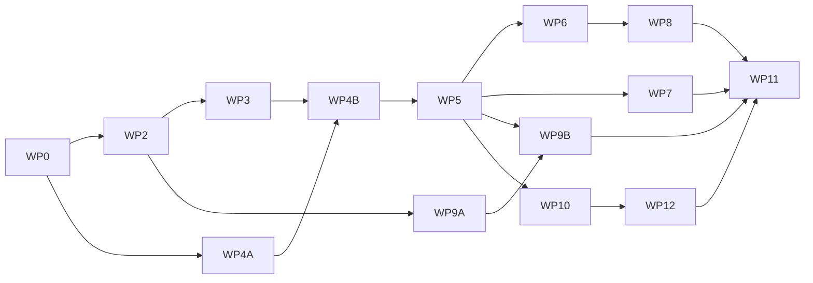
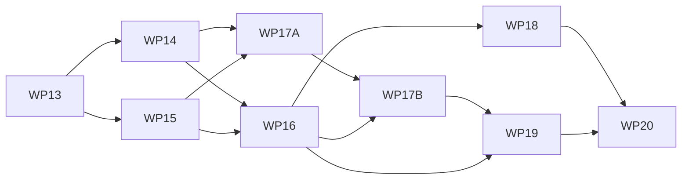

# InsightCrew: handoff

The status board for the rewrite described in [BLUEPRINT.md](BLUEPRINT.md). The blueprint says what to build. This file says where the work stands, what the owner has authorised, and what earlier sessions learned.

**Every session reads this file first, and before it ends updates [section 2](#2-status) and appends to [section 8](#8-session-log).**

Last updated: 2026-11-19 evening, by the building session. Submission is 2026-11-23 23:59.

> **Version 2.0 is built: work packages 0 to 12 are done. Version 2.1 is authorised (2026-11-19): the owner answered all seven questions under [Version 2.1](#version-21-traps-and-open-questions) in section 7.** It adds two evidence channels, fundamentals and disclosures, as work packages 13 to 20. The design is [BLUEPRINT.md section 18](BLUEPRINT.md#18-version-21-evidence-channels). Build WP13 to WP20 in the order of section 5.4.

> **The plan changed on 2026-11-19.** The owner reversed the zero-dependency decision: the system is built on maintained libraries (Pydantic AI, Pydantic, FastAPI, Typer, uv). BLUEPRINT.md, BLUEPRINT-REFERENCE.md and this file were revised together and are consistent. If you remember, or find in an older transcript, a version of the plan that says "standard library only", `python3 -m unittest`, `kernel/schema.py` or `adapters/openai_compat.py`, it is void.

## 1. Start here

Read in this order:

1. This file.
2. [BLUEPRINT.md](BLUEPRINT.md) sections 0.2, 2 and 3.
3. The work package you were given, and the sections it names. WP0 to WP12 are in BLUEPRINT.md section 13. WP13 to WP20 are in section 18.14; for those, read 18.1 to 18.3 as well.
4. The files it names in [BLUEPRINT-REFERENCE.md](BLUEPRINT-REFERENCE.md). WP13 to WP20 name none: read the code as built.

Which document to believe:

| Question | Believe |
|---|---|
| What to build, and every name in it | BLUEPRINT.md |
| What is already built, and what is allowed | This file |
| Why the design is what it is; the course fit | [TRANSFORMATION.md](TRANSFORMATION.md). Background only. Where it differs from the blueprint, the blueprint wins. |
| `README.md`, the body of `AGENTS.md`, `ARCHITECTURE.md`, `EVALUATION.md`, `ROADMAP.md` | Since WP11 they describe version 2.0 as built, and are right about it. They say nothing about version 2.1. WP20 updates them; no earlier package of version 2.1 edits them. |

## 2. Status

Statuses: `not started`, `in progress`, `done` (every acceptance command passed and the output is in the session log), `blocked` (say on what).

| WP | Result | Status | Notes |
|---|---|---|---|
| 0 | Clean branch, reference extracted, environment built, 58 tests pass | done | Committed by tonight's delegated session (the owner authorised "do all the planned work" on 2026-11-19 evening). `uv sync` succeeded; no certificate problem. |
| 1 | Withdrawn | n/a | The kernel is in the reference and frozen from WP0 |
| 2 | Symbols, bars, CSV adapter, synthetic universe | done | 44 tests. Determinism, point-in-time, all error classes verified. Interpretations in the session log. |
| 3 | Indicator registry and the ledger | done | 40 tests. Both paths agree over 277 data points (eval consistency). Interpretations in the session log. |
| 4A | Rulebook and audit, with their tests | done | 66 tests. Intake evaluator signatures and other interpretations in the session log. |
| 4B | `load_rules` and the injection evaluation | done | 19/19 mutations detected, 0/6 false alarms, exit 0. 8 new loader tests. |
| 5 | The offline system | done | All 16 scenarios match; `analyze --no-open` delivers with `accepted 2/3`; THIN refused with no model call; `IC_TODAY` board.json byte-identical; four stub commands exit 2. **Redone by the planning session on 2026-11-19 08:50 (`stages.py`, `wiring.py`, `report.py`, `cli.py` rewritten; acceptance re-run) — see the session log.** |
| 6 | `check` and `replay` commands | done | `replay` reproduces a demo run identically (exit 0) and a THIN refusal; `check` prints settings without secrets and the no-key reason, exit 2. Against a real provider: not run, no key — the with-model path was exercised against a temporary stand-in server and is covered by `tests/test_models.py`. |
| 7 | Offline evaluations as commands | done | `eval all` runs inject (19/19), consistency (277 points × 29 outputs), pit (864 facts) — exit 0. |
| 8 | Real-model runs, prompt fixes, ablation | done | 30 real-model journals in `insightcrew/evals/archive/`, all replay `一致`; ablation table in `archive/ablation.json`; results table in the session log entry "2026-11-19 09:45". Tiers `deepseek-flash` / `deepseek-v4-pro`. |
| 9A | Yahoo adapter and its test | done | 16 tests over saved fixtures; no network in tests. |
| 9B | `fetch` command | done | Yahoo still throttles (429); since `4228e68` `fetch` falls back to Eastmoney. `fetch AAPL 0700.HK --years 3` wrote four series (about 750 bars each); `facts 0700.HK --universe real` prints an HKD ledger. |
| 10 | Run page, static | done | Verified in the in-app browser: mode badge, pipeline, audit rejection, route back to Trader, three judges, price chart, playback controls. **Page rewritten by the planning session on 2026-11-19 08:50 and verified again in the browser.** |
| 12 | Local web app (`serve`) | done | Verified live in the browser: form starts a demo run, stream advances stages, same outcome and confidence lines as the CLI; THIN refuses; past runs open; clean shutdown. 409 covered by test. **Server rewritten by the planning session on 2026-11-19 08:50 and verified again.** |
| 11 | Documents and packaging | done | README, AGENTS, ARCHITECTURE, EVALUATION, ROADMAP rewritten; `start.sh`, `start.bat`; a `git archive` zip unzipped into an empty directory passes `uv sync`, 380 tests and a keyless `analyze`. Session log entry "2026-11-19 10:05". |
| 13 | Version 2.1: tag, branch, shared contracts, ports, the two analyst roles, audit checks, flow switch, settings | done | Authorised 2026-11-19; built the same evening. All seven contracts, both ports, both roles, the six audit checks, the flow switch and `[disclosures]` settings in place. `evidence` is the WP13 stub (every named channel `unavailable`, reason `尚未接入数据源`). 406 tests. |
| 14 | Version 2.1: statements, both paths, the fundamentals ledger, synthetic statements | done | Both paths agree at every swept date; acceptance numbers exact (940 / 1105 / 1081 with warnings / 1090 / NotCovered); generator deterministic. 424 tests. Owner settled questions 8 and 9. |
| 15 | Version 2.1: disclosures adapter, synthetic items | done | 14 tests; window edges inclusive, undated dropped and counted, out-of-cover and missing file NotCovered, malformed SourceUnavailable; generator deterministic; the three acceptance numbers of 18.14 hold. 438 tests. |
| 16 | Version 2.1: the offline system with channels; 21 scenarios | done | Real `evidence`, wiring, `--channels`, `facts` channels, the grown views and prompt paragraphs, two report sections, five scenarios, three evaluation blocks. 21 scenarios match; eval all prints both blocks; `uncovered`'s report verified; replay of a channel run 一致. 462 tests. |
| 17A | Version 2.1: SEC EDGAR and Eastmoney announcement adapters, with tests | done | 20 tests over synthetic saved responses (structure real, no real download): tag order per concept, span and form filters, duplicate keys keep the last, titles for 8-K items, paging and covers_from. 483 tests. |
| 17B | Version 2.1: `fetch` downloads evidence | blocked | Code done, three checks green. The live acceptance run is blocked: Eastmoney's bars endpoint twice answered `Server disconnected without sending a response` (Yahoo 429 as before), so `fetch` exits 1 at the bars stage and the evidence downloads never start. `IC_SEC_CONTACT` **is** set in `.env` (key checked, value not read). Stopped per the network rule; the owner decides. |
| 18 | Version 2.1: run page sections | done | Pipeline shows the two analyst stages when a run has them; the evidence area gains a channel-status line, a fundamentals table with the card, and an item list with signals; verified in the in-app browser for `channels_clean`, `uncovered` and `demo` (no channel → the page shows nothing new). 486 tests. |
| 19 | Version 2.1: real-model runs with channels, `eval channels` | done | 13 real runs archived (one pilot + 12 evaluation), every journal replays 一致; no prompt fix was needed (the pilot journal showed clean channel outputs and substantive, not mechanical, dissents); `[flow] channels` stays unset. Total spend ≈ 0.5 USD of the 2 USD cap. |
| 20 | Version 2.1: documents and packaging | not started | Needs everything else built or cut |

**Work packages 0 to 12 are done: that is version 2.0, and it is a complete submission.** [ROADMAP.md](ROADMAP.md) lists its known issues and next steps. Work packages 13 to 20 are version 2.1, in [BLUEPRINT.md section 18](BLUEPRINT.md#18-version-21-evidence-channels).

## 3. The repository at handoff

**As it stands on 2026-11-19 11:10**, before any work on version 2.1:

- Branch `v2`, head `9d3a0ff`. The only tag is `v1-data-analyst`. Remote `origin` on GitHub holds only `main` at the first commit (`f80272c`); `v2` has no upstream and has not been pushed.
- The working tree is clean except `docs/BLUEPRINT.md` and this file, which hold the plan for version 2.1 and are not committed.
- `.env` exists and holds the model key. It is ignored by git. Never print it.
- `data/market/real/` exists on this machine (four series from `fetch`). It is ignored by git.
- `../InsightCrew.zip`, outside the repository, was built from `v2` at 10:14. It is version 2.0 and is the submission if version 2.1 is not finished.
- 380 tests, 16 scenarios, 30 archived real-model journals.

**As it stood before WP0.** The rest of this section is history:

- Work in `InsightCrew/`. It is its own git repository: branch `main`, one commit (`f80272c`), no tags, remote `origin` on GitHub.
- No code of version 2 exists yet. The working tree still holds version 1.
- The working tree has uncommitted changes, all intended. They are the documentation of version 1 rewritten in English, and the planning documents:

  ```
  RM agents.md -> AGENTS.md
   M README.md
   D docs/02_项目设计方案.md
   D docs/08_操作手册.md
   D 使用说明.md
  ?? CLAUDE.md  demo.sh  start.sh
  ?? docs/ARCHITECTURE.md  docs/EVALUATION.md  docs/ROADMAP.md
  ?? docs/TRANSFORMATION.md  docs/BLUEPRINT.md  docs/BLUEPRINT-REFERENCE.md  docs/HANDOFF.md
  ```

  WP0 step 1 commits all of them in one commit, then tags it `v1-data-analyst`. Before `git add -A`, check that `git status` lists nothing under `runs/` and no `.env`.
- There is no `.env` and no API key on this machine.
- BLUEPRINT-REFERENCE.md is the only source of the reference code. It was extracted into an empty directory with its own script (`wrote 27 files`), the environment was built there with `uv sync`, and 58 tests passed on Python 3.12.10, 3.13.3, 3.14.7 and 3.15.2, with `ruff check` and `pyright` clean. Do not look for the code anywhere else.
- `TradingAgents-main/` and `open-multi-agent-main/`, beside this repository, are read-only reference. Do not copy code from them.

## 4. What the owner has authorised

| Matter | State |
|---|---|
| Starting the rewrite | Yes (2026-11-19) |
| Commits | **Only when the prompt that starts your session says so.** If it does: one commit per finished work package, on branch `v2`, after its acceptance commands pass, holding only that package's files, added by path (section 5.3). Message: `WP<label>: <result>`. WP0 also makes the one commit on `main` and the tag. If it does not: leave the work uncommitted and say so in the log. |
| Push | No |
| Third-party packages | **Yes, since 2026-11-19, and only these:** the ones in `pyproject.toml`, installed by `uv sync` at the versions in `uv.lock`. Not authorised: `uv add`, `uv remove`, upgrading a package, changing the `exclude-newer` date, `pip install`. A package you think is missing is a question for the owner. |
| API key | A DeepSeek key in `.env` (ignored by git) since 2026-11-19 09:00. Real-model runs cost money; WP8 spends on them. |
| Topic change, with the instructor | Not changed (owner, 2026-11-19). |
| Changing a name, a rule, a limit or an invariant in the blueprint | No. Stop and ask (section 7). |
| Version 2.1: planning | Yes (2026-11-19). The owner chose both channels and asked for the plan to be written into the blueprint and this file, with no code, for review. |
| Version 2.1: building (WP13 to WP20) | **Yes (2026-11-19).** The owner accepts the schedule and the stop-loss rule of 18.15. If time runs short, cut in the order of 18.15 and tell the owner before each cut. |
| Version 2.1: the tag `v2.0`, the branch `v2.1`, commits | **Yes (2026-11-19).** WP13 tags `v2.0` on the head of `v2`, creates `v2.1`, and commits the uncommitted plan in `docs/BLUEPRINT.md` and this file as one commit `Plan: version 2.1`. Each package then commits its own files by path on `v2.1` after acceptance, message `WP<n>: <result>`. Never push; never commit on `v2` again. |
| Version 2.1: live downloads from the SEC and Eastmoney | **WP17B may (2026-11-19): the live downloads its acceptance names, once each.** The SEC is called only with a contact address the owner supplies as `IC_SEC_CONTACT` in `.env`; if it is absent at WP17B, skip the real SEC download and say so in the log — do not invent one and do not read `.env`'s contents. The planning session made one-off, read-only requests to nine public endpoints on 2026-11-19 to see whether the sources answer (session log); nothing was written into the repository. |
| Version 2.1: real-model spending (WP19) | **Yes (2026-11-19), cap 2 USD.** Stop and ask the owner when close to the cap. |
| Version 2.1: packages | None is needed. The rule above stands: no `uv add`, no upgrade. |

## 5. What may run at the same time

Packages are labelled as in the status table: `4A` and `4B` are the two parts of WP4, `9A` and `9B` of WP9.

### 5.1 The sets

Read down. A row starts when its condition is met; everything in one row may be worked on at the same time, each by its own agent.

| Step | Starts when | May run at the same time | Agents at once |
|---|---|---|---|
| 1 | Now | **WP0**. Alone: it commits, tags, branches and builds the environment. | 1 |
| 2 | WP0 is done | **WP2** · **WP4A** | 2 |
| 3 | WP2 is done | **WP3** · **WP9A** · WP4A if it is still running | up to 3 |
| 4 | WP3 and WP4A are both done | **WP4B** · WP9A if it is still running | up to 2 |
| 5 | WP4B is done | **WP5**, by the planning session · WP9A if it is still running | up to 2 |
| 6 | WP5 is done | **WP6** · **WP7** · **WP9B** (also needs WP9A) · **WP10, then WP12**, by the planning session | up to 4 |
| 7 | WP6 is done and there is an API key | **WP8**, by the planning session | see below |
| 8 | Everything else is done or cut | **WP11**. Alone: it rewrites the documents from what was built. | 1 |



What cannot be made parallel, and why:

- **WP2, then WP3, then WP4B, then WP5.** Each uses what the one before it built: bars, then the ledger over bars, then an evaluation over the ledger, then the system over all of it.
- **WP10, then WP12.** The web app serves the page WP10 writes.
- **WP5, WP10, WP12 and WP8 are all the planning session's**, and one session does one thing at a time. That chain, with WP0, 2, 3, 4B before it and WP11 after it, is about 30 of the 38 hours. Parallel work saves the other 8 or so, not more.
- If the owner wants that chain shorter: WP8 shares no file with WP10 and WP12, so a second capable session could do WP8 while the planning session does the page. WP8's step 5 edits `evals/run.py` and waits for WP7.

Optional, in step 2 or later: the planning session may start the part of WP5 that needs only WP0 (`insightcrew/app/__init__.py`, `app/settings.py`, `tests/test_settings.py`, `adapters/store_fs.py`, `insightcrew.toml`) while WP2 to WP4 are under way.

### 5.2 The files each package owns

An agent creates and edits the files in its own row and no others. Paths under `insightcrew/` are written without that prefix.

| Package | Creates | Edits, in files it did not create |
|---|---|---|
| WP2 | `domain/market.py`, `domain/symbols.py`, `adapters/market_csv.py`, `data/make_market.py`, `data/market/synthetic/`, `tests/test_market.py` | |
| WP3 | `data/indicators.toml`, `domain/ledger.py`, `adapters/declarations.py`, `tests/test_ledger.py` | `domain/types.py`: adds `Unavailable`, `DataCard`. `tests/test_indicators.py`: makes it registry-driven. |
| WP4A | `data/rules.toml`, `domain/rules.py`, `domain/audit.py`, `tests/test_rules.py`, `tests/test_audit.py` | `domain/types.py`: adds `RuleSpec`, `RuleResult` |
| WP4B | `evals/__init__.py`, `evals/inject.py` | `adapters/declarations.py`: adds `load_rules`. `tests/test_rules.py`: adds its cases. |
| WP9A | `adapters/yahoo.py`, `tests/test_yahoo.py`, `tests/fixtures/yahoo/` | |
| WP5 | Everything in `app/` except the files of WP10 and WP12; `flows/deps.py`; `adapters/store_fs.py`; `evals/scenarios.py`; `evals/run.py` as a stub; `insightcrew.toml`; `data/scenarios/`; `tests/test_stages.py`, `test_settings.py`, `test_scenarios.py`, `test_report.py` | `flows/stages.py`: the five functions. `flows/analyze.py`: the type of `deps`. `domain/types.py`: adds `Scope`, `AuditStatus`. |
| WP6 | | `app/check.py`, `app/replay.py`: fills in the stubs |
| WP7 | `evals/consistency.py`, `evals/pit.py` | `evals/run.py`: fills in the stub |
| WP9B | | `app/fetch.py`: fills in the stub |
| WP10 | `app/assets/page.html`, `app/replay_html.py`, `tests/test_run_page.py` | `app/cli.py` |
| WP12 | `app/server.py`, `tests/test_server.py` | `app/assets/page.html`, `app/cli.py` |
| WP8 | `evals/ablation.py`, `evals/archive/` | `roles/prompts/*.md`, `insightcrew.toml`, `evals/run.py` |
| WP11 | | `README.md`, `AGENTS.md`, `docs/`, the start scripts |

Three files need care:

- **`domain/types.py`** is the only file two agents may add to at the same time (WP3 and WP4A). Each adds its own classes and changes no existing line. Read the file again immediately before editing it.
- **`app/cli.py`** is written once, in WP5, with every command registered. WP6, WP7 and WP9B do not touch it: each fills in a function that `cli.py` already calls (BLUEPRINT.md section 10.3). This is why they can run together.
- **`docs/HANDOFF.md`**, this file, is shared by everyone. Change only your own row in the status table, and append your log entry at the end. Read the file again immediately before editing it.

### 5.3 Rules when more than one agent is working

1. **Stay in your row** of the table in 5.2. A problem in someone else's file is theirs: report it, do not fix it.
2. **Git.** Everyone stays on branch `v2`. If your prompt authorises commits, commit only your own files, by path: `git add <your files>`, then `git commit -m "WP<label>: <result>" -- <your files>`. Never `git add -A`, `git add .` or `git commit -a`; they would commit another agent's half-written files. Never `switch`, `checkout`, `stash`, `restore`, `reset`, `clean` or `rebase`. If git says `index.lock` exists, another agent is committing: wait and try again, and never delete the lock. WP0 runs alone and is the one package that may use `git add -A`.
3. **uv.** Use `uv run` and nothing else. No `uv sync`, `uv lock`, `uv add`, `uv remove`, `uv python pin`. Only WP0 builds the environment.
4. **The three checks, while others are working.** Run all three on the whole repository. A failure inside a file that belongs to another package whose status is `in progress` is not yours: say so in your log and leave it. Every other failure is yours. Your package is `done` when the reference tests and your own tests pass, and `ruff` and `pyright` report nothing in your files.
5. **The three checks, at the two joins.** Before WP5 starts and before WP11 starts, the session that starts them runs the three checks while no other agent is working, except that WP9A may still be running before WP5. They must be entirely clean. Whatever fails then goes back to the package that owns the file.
6. **Mark your row `in progress` before you write your first file**, so that the others can tell whose a failure is.

### 5.4 Version 2.1: work packages 13 to 20

Nothing here starts before the owner's go-ahead (section 4). `17A` and `17B` are the two parts of WP17.

| Step | Starts when | May run at the same time | Agents at once |
|---|---|---|---|
| 1 | The owner's go-ahead | **WP13**. Alone: it tags, branches, and changes files every later package builds on. | 1 |
| 2 | WP13 is done | **WP14** · **WP15** | 2 |
| 3 | WP14 and WP15 are both done | **WP16** · **WP17A** | 2 |
| 4 | WP16 is done | **WP18** · **WP17B** (also needs WP17A) | 2 |
| 5 | WP16 and WP17B are done, or WP17 is cut | **WP19** · WP18 if it is still running | up to 2 |
| 6 | Everything else is done or cut | **WP20**. Alone. | 1 |



The chain that cannot be made parallel is WP13, 14, 16, 19, 20: about 19.5 of the 26.5 hours. The blueprint's section 18.15 has the dates, the order of cuts, and the rule for stopping.

The files each package owns. Paths under `insightcrew/` are written without that prefix.

| Package | Creates | Edits, in files it did not create |
|---|---|---|
| WP13 | `domain/statements.py`, `domain/disclosures.py`, `roles/prompts/fundamentals.md`, `roles/prompts/disclosures.md` | `domain/types.py`, `domain/market.py`, `domain/audit.py`, `roles/__init__.py` (the two new roles and `ALL` only), `flows/deps.py`, `flows/analyze.py`, `flows/stages.py`, `app/settings.py`, `insightcrew.toml`, `.env.example`, `tests/fake_stages.py`, `tests/test_audit.py`, `test_flow.py`, `test_stages.py`, `test_settings.py`, `test_architecture.py` |
| WP14 | `domain/fundamentals.py`, `domain/fundamentals_sql.py`, `domain/fundamentals_ledger.py`, `data/fundamentals.toml`, `adapters/statements_json.py`, `data/make_statements.py`, `data/market/synthetic/statements/`, `tests/test_fundamentals.py` | `adapters/declarations.py`: adds `load_fundamentals`. `tests/test_architecture.py`: the second pair of paths. |
| WP15 | `adapters/disclosures_json.py`, `data/make_disclosures.py`, `data/market/synthetic/disclosures/`, `tests/test_disclosures.py` | |
| WP16 | Five files in `data/scenarios/` | `flows/stages.py` (`evidence`), `app/wiring.py`, `roles/__init__.py` (the `reads` of the existing roles), the prompts of `bull`, `bear`, `manager` and `judge`, `app/report.py`, `app/cli.py`, `evals/inject.py`, `evals/consistency.py`, `evals/pit.py`, `evals/scenarios.py`, `tests/test_stages.py`, `test_report.py`, `test_scenarios.py`, `test_cli.py`, `test_wiring.py`, `test_architecture.py` |
| WP17A | `adapters/edgar.py`, `adapters/eastmoney_ann.py`, `tests/test_edgar.py`, `tests/test_eastmoney_ann.py`, `tests/fixtures/edgar/`, `tests/fixtures/eastmoney_ann/` | |
| WP17B | | `app/fetch.py` |
| WP18 | | `app/assets/page.html`, `app/replay_html.py`, `tests/test_run_page.py` |
| WP19 | `evals/channels.py`, new directories under `evals/archive/` | `evals/run.py`, the `eval` command in `app/cli.py`, `roles/prompts/*.md`, `insightcrew.toml` |
| WP20 | | `README.md`, `AGENTS.md`, `docs/`, the start scripts |

Rules, in addition to 5.3:

1. **Git.** WP13 is the one package that tags and switches: `git tag v2.0` on the head of `v2`, then `git switch -c v2.1`. After that everyone stays on `v2.1`, and rule 2 of section 5.3 applies with `v2.1` in place of `v2`. Nothing is committed on `v2` again, so `v2` and the tag stay the version that was verified. The uncommitted plan in `docs/BLUEPRINT.md` and this file travels to `v2.1` with the switch.
2. **Nobody outside this table edits `insightcrew/kernel/`, `pyproject.toml` or `uv.lock`.** No package of version 2.1 needs to.
3. **`tests/test_architecture.py` is edited by WP13, WP14 and WP16**, which never run at the same time. Each adds assertions and changes none.
4. **The join.** Before WP16 starts, and before WP20 starts, the three checks and the proof in the blueprint's section 18.3 are run while no other agent is working.

## 6. Environment

| Fact | Value |
|---|---|
| Machine | macOS, zsh |
| uv | 0.11.16. It builds the environment, runs every command, and provides Python. |
| Python | 3.12, pinned by `.python-version` (WP0 writes it). The reference also passed on 3.13, 3.14 and 3.15; implementing agents need not repeat that. |
| Working directory for every command | `InsightCrew/` |
| The three checks | `uv run pytest -q`, `uv run ruff check .`, `uv run pyright`. All three must be clean at the end of every work package. |
| One test file | `uv run pytest tests/test_market.py -q` |
| The command line, from WP5 on | `uv run insightcrew ...`. Before WP5 the command does not exist; that is expected. |
| Network | `uv sync` in WP0 needs it. After that, not before WP8 and WP9. Tests never use it. |
| SQLite | The one built into Python. 3.54.1 on this machine. |

**Package installs on this machine.** The owner's machine blocks package versions less than three days old, and has a known conflict between two security tools that breaks certificate checks. Both show up as a certificate error or an HTTP 502. `pyproject.toml` already keeps new versions out with a cut-off date, so `uv sync` should not meet the first. If any install or HTTPS call fails that way (`uv sync`, the Yahoo fetch in WP9, the model in WP8): do not retry, do not change versions, and never turn certificate verification off. Report it and stop; the workspace rule on Aikido and Zscaler has the fix, and it is the owner's to apply.

## 7. Traps, and what to do when the blueprint is silent

- **The prompts have never been run against a model, and no real model has been called at all.** Offline tests use a scripted model that ignores the prompt. Do not rewrite a prompt before WP8, and do not call one verified before then.
- **Sections 6 to 10 of the blueprint are design, not tested code**, except where the reference covers them. Gaps are likely. When you find one: stop, write it under "Open questions" below, and ask the owner. Do not fill it by guessing; later packages build on it.
- **What you remember of Pydantic AI is probably out of date.** The reference uses version 2.68.0, and its API was read from the installed package, not from memory. Work packages 2 to 4 need none of it: they are plain Python and Pydantic models. If you do need a call the reference does not show, read the source under `.venv/lib/python*/site-packages/pydantic_ai/`. A deprecation warning fails the test run, on purpose.
- **Contracts are frozen and closed.** Build them with keyword arguments. Change one with `x.model_copy(update={...})`. A field the contract does not declare is an error, including in TOML and JSON files. Sequences are tuples.
- **Only `insightcrew/kernel/` and `insightcrew/adapters/` may import `pydantic_ai`; `flows/` and `roles/` import no third-party package at all; `domain/` imports only `pydantic`.** `tests/test_architecture.py` enforces it. Do not widen its tables to make an import pass.
- **`tests/fake_stages.py` is a test double.** It shows the shape of the code stages with made-up logic. The real stages follow BLUEPRINT.md section 8.3. `tests/test_flow.py` keeps using the double after the real stages exist; that is intended.
- **The kernel is frozen from WP0.** A package that seems to need a kernel change stops and reports.
- **`insightcrew/flows/analyze.py` changes once**, in WP5, and only to name the type `Deps`.
- **`insightcrew/app/cli.py` is not edited by WP6, WP7 or WP9B.** Each fills in a function that `cli.py` already calls. If the stub's signature does not fit, stop and ask.
- **`evals/` never imports `app/`.** The app is the outermost layer and calls the evaluations, not the other way round. An evaluation that needs a run is given the function that opens one.
- **A failing reference test means the new code is wrong.** Do not edit the test. The same goes for `ruff` and `pyright`: add no `# noqa` and no `# type: ignore`, and do not change the rule sets. The one `# type: ignore` in `tests/test_kernel.py` is deliberate: that test passes a wrong type on purpose.
- **Scenario files come after the `facts` command works** (WP5 step 4). Their numbers are copied from its output, not invented.
- **`AGENTS.md` is out of date from WP0 to WP11.** Its commands and invariants describe deleted code. Its working rules still hold.
- **Leave `runs/` alone.** It holds version 1 output and is ignored by git.

### Open questions

Add one line per question: date, work package, the question, and the answer once the owner gives it.

| Date | WP | Question | Answer |
|---|---|---|---|
| 2026-11-19 (night) | all | The owner's prompt for tonight ("you do all the planned work for me") was read as authorising the plan's own commit protocol (section 4): one commit per finished work package on `v2` by path, WP0's commit + tag on `main`, never pushed. Everything is local and revertible with `git reset`. | Owner, 2026-11-19 09:05: commits on `v2` are authorised; no push. |
| 2026-11-19 (night) | WP8 | WP8 is blocked on an API key (DeepSeek per `insightcrew.toml`'s `[tiers]`). Everything offline is done; WP8 + WP11 are all that remain. | Key supplied by the owner on 2026-11-19; it is in `.env`. |
| 2026-11-19 (night) | WP9 | The one permitted real fetch attempt was throttled (HTTP 429, not the machine's certificate conflict). Retry `uv run insightcrew fetch AAPL 0700.HK --years 3` when you can; on success run `uv run insightcrew facts 0700.HK --universe real`. | 2026-11-19 09:10: Yahoo still answers 429 (both `query1` and `query2`); Stooq now needs a JavaScript check. The owner asked for another source if Yahoo fails: `fetch` now falls back to Eastmoney (BLUEPRINT 9.4, commit `4228e68`). The fetch succeeded and `facts 0700.HK --universe real` prints an HKD ledger. |
| 2026-11-19 (night) | WP11 | WP11 (documents and packaging) was not started: its precondition "everything else done or cut" is not met while WP8 is blocked, and the documents must tie numbers to real-model journals. Start it after WP8. | — |
| 2026-11-19 (night) | 6.5/9.4 | WP3 read "more than 1e-6 relative or 1e-9 absolute" as isclose-negation (exceed both bounds). The literal OR reading would halt every run on float noise. Confirm or override. | Owner delegated the decision on 2026-11-19 09:05; the planning session keeps the isclose reading: a disagreement must exceed both bounds. |
| 2026-11-19 08:50 | 5, 10, 12 | The redo of WP5/10/12 departs from the blueprint's text in the places listed in that session's log entry ("Where the code now differs from the blueprint's text"). BLUEPRINT.md has not been edited. Confirm, and the text will be brought into line; or say which to undo. | Owner delegated the decision on 2026-11-19 09:05; all seven kept. A notice at the top of BLUEPRINT section 10 points here and says the code is right on those points; WP11 describes them in ARCHITECTURE.md. |
| 2026-11-19 08:50 | 8 | **`.env.example` has an uncommitted change that puts what looks like a real DeepSeek key on the `DEEPSEEK_API_KEY=` line** (file modified at 08:05, not by the session then running). `.env.example` is tracked; `.env` is the ignored file the program reads, and it does not exist. Nothing reads the key where it is, so every run is still scripted. **Do not `git add` that file as it stands.** The owner decides: move the value to `.env` and restore `.env.example`, and consider replacing the key, since it has been shown in a tool output of that session. | Owner, 2026-11-19 09:00: move it. Done: `.env` created from it (mode 600, ignored by git), `.env.example` restored to its committed text. Owner, 09:05: the key is not replaced. |
| 2026-11-19 09:05 | — | Topic change with the instructor | Owner: the topic is not changed. |

### Version 2.1: traps and open questions

Traps, for whoever builds WP13 to WP20:

- **The plan is a design and nothing in it has been run.** BLUEPRINT.md section 18 was written by reading the code, not by building. Gaps are likely. When you find one, stop, record it in the table below, and ask.
- **The compatibility rule (18.3) is the one thing that must not break.** With no channel switched on, a run writes the artifacts and sends the prompts of version 2.0. The 30 archived journals and every number in EVALUATION.md depend on it. Run the proof at the end of every package. If an archived journal stops replaying, the package is wrong; the journal is not.
- **The contracts listed in 18.3 gain no field.** `AuditStatus` in particular stays as it is; the channel analyses are tracked in `audit/channels`.
- **Three statements in the traps above are amended for version 2.1, if the owner agrees.** `flows/analyze.py` changes a second time, in WP13, in the three places 18.8 names. `tests/fake_stages.py` and `tests/test_flow.py` gain doubles and cases; nothing in them is changed or removed. The kernel stays frozen.
- **Replay does not compare a role's instructions.** WP16 adds a paragraph to the prompts of `bull`, `bear`, `manager` and `judge`. The archived runs will still replay, but they were made with the old wording, and the documents must say so (WP20).
- **Evidence files live in subdirectories of a universe** (`statements/`, `disclosures/`). Check that nothing which lists a universe's bars picks them up. The proof in 18.3 would show it.
- **The SEC is never called without `IC_SEC_CONTACT`,** and tests never call it at all. Eastmoney's announcement endpoint is unofficial and may change or refuse.
- **A certificate error or an HTTP 502 on a download is not a reason to retry.** Section 6 applies.
- **`insightcrew.__version__` is still 2.0.0.** No package changes it unless the owner says so (question 7).

Questions for the owner. Answered 2026-11-19; WP13 to WP20 are authorised.

| # | Date | Question | Answer |
|---|---|---|---|
| 1 | 2026-11-19 | May version 2.1 be built at all, given four and a half days and about 26.5 hours of estimated work? Version 2.0 stays a complete submission throughout; if WP16 is not done by the end of 11-21 the plan stops and ships version 2.0 behaviour (18.15). | Yes (2026-11-19): build it, accepting the schedule and the stop-loss rule of 18.15. |
| 2 | 2026-11-19 | Section 4 says a name, a rule, a limit or an invariant in the blueprint is not changed without the owner. Version 2.1 changes these: `FlowConfig` gains `channels`; `Finding.owner` gains two values; `flows/analyze.py` gains two pipeline stages; invariants 3, 4 and 6 are reworded or extended; invariants 17 and 18 are new (18.16). Agreed? | Yes (2026-11-19), to question 2's list and to the changes 18.16 lists. No other name, rule, limit or invariant changes without asking first. |
| 3 | 2026-11-19 | May WP13 create the tag `v2.0` and the branch `v2.1`, and may each package commit its own files by path on `v2.1` when its acceptance passes? No push. | Yes (2026-11-19). After switching to `v2.1`, first commit the uncommitted plan in `docs/BLUEPRINT.md` and this file alone as `Plan: version 2.1`. Then one commit per accepted package, by path, message `WP<n>: <result>`. Never push; never commit on `v2` again. |
| 4 | 2026-11-19 | The SEC asks callers to identify themselves. Will the owner put a contact (a name and an email address) in `.env` as `IC_SEC_CONTACT`? Without it, real US statements and filings are not downloaded and both channels run on synthetic evidence for US tickers. | The owner writes `IC_SEC_CONTACT` into `.env` themselves (2026-11-19). If it is still absent when WP17B starts, skip the real SEC download and say so in the log; do not invent a contact and do not read `.env`'s contents. |
| 5 | 2026-11-19 | May WP17B make the live downloads its acceptance names, and may WP19 spend on real-model runs (estimated 1 to 2 USD, twelve runs and the prompt fixes before them)? | Yes (2026-11-19): the live downloads named in WP17B's acceptance, once each; WP19's real-model runs allowed, spending capped at 2 USD — stop and ask when close to the cap. |
| 6 | 2026-11-19 | The chat on 2026-11-19 showed six stages and about 22 hours. Written out, the plan is eight packages and about 26.5 hours: the run page became its own package, and the real sources were split so that the adapters can be built beside WP16. Is the larger figure acceptable, or should a cut be taken now (18.15 lists them in order)? | The 26.5-hour estimate is accepted (2026-11-19). If time runs short, cut in the order of 18.15 and tell the owner before each cut. |
| 7 | 2026-11-19 | Should the version become 2.1.0 in WP20? It is written in `pyproject.toml` and `insightcrew/__init__.py` and recorded in every `run.started`; changing it changes the project's own entry in `uv.lock`, which no package is otherwise allowed to touch. Until answered it stays 2.0.0. | No (2026-11-19): the version stays 2.0.0; do not change `pyproject.toml` or `uv.lock`. |

Gaps found while building (the plan warns about these; each stops the package that meets it):

| # | Date | WP | The gap | Suggested answer |
|---|---|---|---|---|
| 8 | 2026-11-19 | 14, 15 | **Where synthetic evidence may live.** BLUEPRINT 18.7 puts evidence files at `data/market/<universe>/statements/<file_stem>.json` (and `disclosures/`). But WP2's test `tests/test_market.py::test_generator_writes_the_same_bytes_twice` snapshots `data/market/synthetic/` with `iterdir()` and asserts the entry set **equals exactly** the bars CSVs plus `universe.toml`; any subdirectory makes it fail (first as `IsADirectoryError`). The working rules forbid editing an existing test, and the blueprint's path is a name, which may not be changed without the owner. The two cannot both hold as written. | Owner, 2026-11-19: **agreed to the suggested fix.** `_snapshot()` lists files only (`path.is_file()`); applied. Evidence stays at the blueprint's path; the generator's own output set is still asserted exactly. |
| 9 | 2026-11-19 | 14, 16 | **`pe_fy` under a currency mismatch.** 18.6: "`pe_fy` is unavailable when the statements' currency differs from the instrument's." `build_fundamentals` has the instrument and can withhold the fact (implemented). But `recompute_fundamentals(statements, close, as_of, specs)` has no instrument, so it computes a value for `pe_fy` that path 1 never emits, and `disagreements` (not to be changed) would report `pe_fy` as a one-sided disagreement and halt the run. | Owner, 2026-11-19: **agreed.** WP16's `evidence` passes `recompute_fundamentals` the specs with price-dependent declarations removed whenever the currencies differ; signatures and `disagreements` untouched. |
| 11 | 2026-11-19 | 17B | **Who creates the `httpx2.Client`.** 18.12's adapters are "functions on `httpx2.Client`" and the tests pass one in, but nothing says where a production client comes from; `app` may not import `httpx2` (architecture test), and WP17B's file list holds only `app/fetch.py`. | Suggested: the three-line `client(timeout=60.0)` factory already added to `adapters/edgar.py` (WP17A's file, same session, no other owner); `fetch` imports it from there. If the owner prefers, it can move to `adapters/__init__.py` or a new small adapter module — say so and it moves. |
| 10 | 2026-11-19 | 16 | **`facts` output vs WP5's exact-count assertion.** 18.11 requires `facts` to print, after the ledger, the fundamentals facts and card and the window's items (or the channel's state). WP5's `tests/test_cli.py::test_facts_prints_the_ledger_and_the_data_card` asserts the output holds **exactly 29 two-space-indented lines** (the ledger's 29 facts); the mandated new lines are indented the same way, so the count becomes 47. The working rules forbid editing an existing test; the blueprint's requirement and the assertion cannot both hold. | Owner, 2026-11-19: **agreed to the suggested fix.** The assertion now counts the ledger's own lines (`"indicators." in line`), still exactly 29; the channel lines are asserted by WP16's new `test_facts_prints_the_channels`. |

### Corrections to the blueprint

When the owner settles a question, the fix goes into BLUEPRINT.md and is listed here, so that a later session knows the text changed.

| Date | Section | Change |
|---|---|---|
| 2026-11-19 | 12.1, 13 | WP9's test file and fixtures are named: `tests/test_yahoo.py`, `tests/fixtures/yahoo/`. |
| 2026-11-19 | 10.2 | Step 3 contradicted WP5's acceptance (`analyze THIN` with no key). With no key and a ticker but no scenario, the model is a script with no replies, not an error. |
| 2026-11-19 | 4, 10.3, 10.5, 10.6, 12.1, 13, 14, 16 | The owner added a live local web app (decision 22). 10.5 is the run page, 10.6 the server; WP12 added; `serve` command; invariant 15; real bars are the first cut. |
| 2026-11-19 | **Whole document** | **The owner reversed decision 12: maintained libraries instead of a hand-written kernel.** Rewritten: sections 0, 2 (principle 8), 3, 4 (decisions 12, 13, 17, 18 changed; 23 to 28 added), 5, 9, 10.1 to 10.3, 10.6, 11, 12.1, 13 to 17. Patched: 6.1, 7, 8, 10.4, 10.5. The kernel is now built on Pydantic AI; contracts are Pydantic models; the flow is `async`; the HTTP model adapter, the schema module and the model registry are gone; tests run under pytest; uv manages the environment. WP1 is withdrawn, WP6 is only the two commands, the total is about 38 hours. BLUEPRINT-REFERENCE.md was regenerated: 27 files, 58 tests. |
| 2026-11-19 | 0.2, 3.1, 3.2, 10.3, 13, 14 | **Packages may run in parallel.** WP4 is split into part A (rules, audit, tests; needs only WP0) and part B (`load_rules`, the injection evaluation). `app/cli.py` is written once in WP5 with every command registered; WP6, WP7 and WP9B fill in stub functions in `app/check.py`, `app/replay.py`, `evals/run.py` and `app/fetch.py` and no longer edit `cli.py`. Rule 1 no longer says "in order"; it says "when what it needs is done". |
| 2026-11-19 | 3.1, and `tests/test_architecture.py` in the reference | **A defect fixed.** The architecture test let `evals` import `app` and not the reverse, so the `scenarios` and `eval` commands could not have been written without breaking it. Now `app` is outermost and may import `evals`; `evals` may not import `app`. |
| 2026-11-19 | Invariants | "Nothing outside the standard library is imported" is withdrawn. Invariant 12 now reads: dependencies point inward, and each layer imports only the libraries it is allowed. Invariant 16 is new: every value that crosses a boundary is a frozen, closed contract. |
| 2026-11-19 (night) | 8.3 | `Deps.market` is typed as a structural subtype of `MarketData` that also exposes `dropped_rows(ticker)`, which 9.3 already requires of `CsvMarket`; the ledger stage needs it for the data card. `flows/deps.py` declares `LedgerMarket(MarketData, Protocol)`. |
| 2026-11-19 (night) | 10.2, 10.4 | `open_run` accepts two optional parameters beyond the blueprint's signature: `flow` (the `FlowConfig` the caller will actually use — recorded in `run.started`, so replay can restore it) and `batch` (a batch parent `Budget`, which 10.2 step 4's "when one is passed in" implies). `report.render` accepts an optional third `run_id` argument, because section 12 of the report needs the run ID and no event carries it. |
| 2026-11-19 (night) | 10.4, 6.6 | The report's rule table reconciles two constraints: 6.6 says the formula is printed in the report, and WP5's acceptance says a `review` report contains no rating words outside the opinions section — but `action_matches_rating`'s formula names the ratings. Delivered reports print the formula column; review reports omit it. The rule RESULT `message` is not printed at all in the report (WP4A's messages narrate entry/stop values); the page shows it. |
| 2026-11-19 (night) | 8.3, 13 WP5 | In `flows/analyze.py`, `pass_audit` and `scrutinise` are typed `deps: Deps`; the `analyze` entry point keeps `deps: Any`, because the reference test `test_flow.py` passes `None` and reference tests may not change. |
| 2026-11-19 (night) | 12.2 | The scenario table maps to 16 files (`thin`, `stale`, `unknown` are separate files, not one row). |
| 2026-11-19 | 10 | A notice at the top of section 10 accepts the seven differences recorded in the 08:50 session log entry. |
| 2026-11-19 | 9.4, 3.2 | A second real-bar source: `adapters/eastmoney.py`, used by `fetch` when Yahoo fails, and `adapters/real_universe.py`, shared by both adapters. Tests: `tests/test_eastmoney.py`, `tests/fixtures/eastmoney/`. |
| 2026-11-19 | 7, 11.2 | From WP8: the role declarations pass `max_output_tokens` (8000 quick, 12000 manager), because the ceiling includes reasoning tokens; the judges run at `effort="low"`. `roles/__init__.py` was edited for this, which section 5.2 did not list for WP8. |
| 2026-11-19 | 10.3, 12.3 | `eval ablation` exists. `evals/run.py`'s `run` takes keyword arguments `open_run`, `analyze`, `base` and `no_model_reason`; `cli.py`'s `eval` command passes them for `ablation` only. Cells and configurations are in `evals/ablation.py`. |
| 2026-11-19 11:10 | 18 (new), and one bullet in the introduction | **Section 18 added: the plan for version 2.1, evidence channels.** It is a proposal, not a correction: sections 0 to 17 are unchanged and still describe version 2.0 as built. Section 18 carries its own decisions (29 to 38), work packages (13 to 20), and the changes it asks for to invariants 3, 4, 6 and new invariants 17 and 18. None of it is in force until the owner agrees (the questions above). |
| 2026-11-19 evening | 18.6, 18.7 (by way of questions 8 and 9) | **Two gaps settled by the owner.** (8) Evidence stays at `data/market/<universe>/{statements,disclosures}/`; WP2's `test_generator_writes_the_same_bytes_twice` had its `_snapshot()` helper amended (with authorisation) to list files only, so the generator's output set is still asserted exactly. (9) Under a currency mismatch, `evidence` (WP16) passes `recompute_fundamentals` the specs without price-dependent declarations; the blueprint's signatures and `disagreements` stand. |

## 8. Session log

Append; never rewrite an earlier entry. Use this form:

```
### <date> <time> · WP<n> · <agent or model>
Result: done | in progress | blocked on <what>
Commands run, with the last lines of their output:
  ...
Not run, and why:
  ...
Unverified:
  ...
Files created or changed:
  ...
Committed: <hash> | no
For the next session:
  ...
```

### 2026-11-19 00:50 · planning · planning session

Result: plan and reference handed over; nothing built.

Commands run:

- The reference files: `python3.12 -m unittest` and `python3.15 -m unittest`, 40 tests, OK, both before writing BLUEPRINT-REFERENCE.md and after extracting it into an empty directory with its own script (`wrote 26 files`).
- Links and anchors in BLUEPRINT.md, BLUEPRINT-REFERENCE.md and TRANSFORMATION.md resolve.

Not run: anything against a real model (no key). Nothing in the repository's version 1 code was run or changed.

Unverified: the prompts; every part of BLUEPRINT.md sections 6 to 10 not covered by the reference; the hour estimates.

Files created or changed: `docs/BLUEPRINT.md`, `docs/BLUEPRINT-REFERENCE.md`, `docs/HANDOFF.md`, `docs/TRANSFORMATION.md`; a notice at the top of `AGENTS.md`; one paragraph in the workspace `AGENTS.md` one level up.

Committed: no.

For the next session: WP0. It needs the commit authorisation, because it commits, tags and branches.

### 2026-11-19 02:15 · re-planning on libraries · planning session

Result: the plan, the reference and this file now describe a system built on maintained libraries. Nothing built in the repository. The entry above describes the standard-library plan this one replaces; no implementing agent had started.

Commands run, all on a scratch copy outside the repository:

- `uv sync`, then `uv run pytest -q`: 58 passed, on Python 3.12.10, 3.13.3, 3.14.7 and 3.15.2. `uv run ruff check .`: All checks passed. `uv run pyright`: 0 errors. Run before writing BLUEPRINT-REFERENCE.md, and again after extracting it into an empty directory with its own script (`wrote 27 files`); the extracted tree was identical to the source, and the fresh `uv.lock` held the same versions.
- Seventeen defects injected one at a time into the reference; each made a test fail. One was missed on the first pass (findings routed to the latest owner instead of the earliest); `test_findings_for_two_owners_restart_from_the_earliest` was added and catches it.
- The real-model path against a stand-in HTTP server, for a DeepSeek model and a generic OpenAI-compatible one, in each output mode, with 401, 429 and 500 replies. All but the 429 case are now `tests/test_models.py`.
- Scratch scripts for `pydantic-settings` (TOML, nested environment overrides, an unknown key rejected), FastAPI's server-sent events through its test client, and the trusted-host middleware.
- Links and anchors in BLUEPRINT.md and BLUEPRINT-REFERENCE.md resolve.

Found on the way, and fixed in the plan:

- Ten of the packages first resolved, the agent library and FastAPI among them, had been published within the previous four days. `pyproject.toml` now sets `exclude-newer = "2026-11-15T00:00:00Z"`, and the reference was rerun on the older versions that selects (Pydantic AI 2.68.0, FastAPI 0.163.0, `httpx2` 2.16.0).
- The provider classes deprecate `httpx` in favour of `httpx2`. The project depends on `httpx2`. This surfaced only because warnings are errors in the test run.
- The shared prompt told the model to "output one JSON object". With tool-based structured output that instruction works against the library, so it now says to answer in the given format. Not tested against a model.

Not run: anything against a real model or a real provider (no key). The Yahoo endpoint with `httpx2` (it was probed earlier with `urllib`). Typer, Uvicorn and the fallback install with `pip` were not exercised beyond importing. Nothing in the repository's version 1 code was run or changed.

Unverified: the prompts; whether DeepSeek accepts the requests the library builds, and under which model names; every part of BLUEPRINT.md sections 6 to 10 not covered by the reference; the hour estimates; that the marker's machine can run `uv sync`.

Files created or changed: `docs/BLUEPRINT.md`, `docs/BLUEPRINT-REFERENCE.md`, `docs/HANDOFF.md`; the notice at the top of `AGENTS.md`; the last paragraphs of the workspace `AGENTS.md` one level up.

Committed: no.

For the next session: WP0. It needs the commit authorisation and network access.

### 2026-11-19 02:35 · parallel plan · planning session

Result: section 5 of this file rewritten to say exactly what may run at the same time; the blueprint changed where that needed it. Nothing built in the repository.

What changed, and why:

- Under the plan as it stood, almost nothing could run in parallel: one side job, and five packages after WP5 queued behind `app/cli.py`. WP4 is now two parts, of which part A needs only WP0; and `cli.py` is written once in WP5, so WP6, WP7 and WP9B each fill in a function of their own.
- A defect found while doing this: the layer table in `tests/test_architecture.py` allowed `evals` to import `app` but not `app` to import `evals`, which the `scenarios` and `eval` commands need. The table is corrected and BLUEPRINT-REFERENCE.md regenerated.

Commands run, on a scratch copy outside the repository:

- The reference with the corrected table: `uv run pytest -q`, 58 passed; `ruff check`, clean; `pyright`, 0 errors. Then extracted again from BLUEPRINT-REFERENCE.md into an empty directory (`wrote 27 files`), built with `uv sync` on Python 3.12, same three results, tree identical to the source.
- The corrected table tried both ways: a module in `app/` importing `evals` passes; a module in `evals/` importing `app` fails the test.
- Links and anchors in BLUEPRINT.md, BLUEPRINT-REFERENCE.md and this file resolve.

Not run: the parallel procedure itself. No two agents have yet worked in this directory at the same time, so the rules in section 5.3 are untested.

Unverified: as in the entry above. In addition, the signatures of the four stub functions are not written down anywhere yet; WP5 writes them.

Files changed: `docs/BLUEPRINT.md`, `docs/BLUEPRINT-REFERENCE.md`, `docs/HANDOFF.md`.

Committed: no.

For the next session: WP0, alone. When it is done, WP2 and WP4A may start together.

### 2026-11-19 (evening) · WP0 · overnight delegated session (GLM, via ZCode)

Result: done. The owner's prompt for tonight was "plan for tonight's work … you do all the planned work for me"; this session read that as authorising the plan's own commit protocol (section 4): one commit per finished work package on `v2`, added by path, never pushed. WP0 is the one package that used `git add -A`.

Commands run, with the last lines of their output:

- `git add -A && git commit` on `main`, then `git tag v1-data-analyst`, then `git switch -c v2`. Before the commit, `git status` listed nothing under `runs/` and no `.env`. Commit on `main`: `1d5e4e4`.
- Deleted the version 1 files listed in WP0 step 2 (`git rm -r`), then removed their leftover `__pycache__` directories.
- `python3 -I extract_reference.py docs/BLUEPRINT-REFERENCE.md` → `wrote 27 files`. The script was deleted afterwards.
- `uv python pin 3.12` → wrote `.python-version` with `3.12`.
- `uv sync` → succeeded, no certificate error or 502. `uv.lock` written.
- `uv run pytest -q` → `58 passed in 3.44s`.
- `uv run ruff check .` → `All checks passed!`
- `uv run pyright` → `0 errors, 0 warnings, 0 informations`.
- `git tag -l` → `v1-data-analyst`. `git status` shows `.python-version` and `uv.lock` as new files, nothing under `runs/`, `.venv/` or `.env`.

Not run, and why: nothing against a real model (no key). WP8 stays blocked.

Unverified: as before — the prompts against a real model; sections 6 to 10 not covered by the reference.

Files created or changed: the 27 reference files under `insightcrew/` and `tests/`, `pyproject.toml`, `.python-version`, `uv.lock`, `.gitignore` (added `.pytest_cache/`, `.ruff_cache/`, `data/market/real/`), `.env.example` (replaced with the WP0 step 6 text); deleted the version 1 code.

Committed: on `main` `1d5e4e4` (tag `v1-data-analyst`); on `v2` the WP0 commit (hash in the next entry's place: see `git log`).

For the next session: WP2 and WP4A may start together. Tonight's session continues with WP2, WP4A, then WP3 and WP9A, then WP4B, then WP5.

### 2026-11-19 (evening) · WP2 · agent under the overnight delegated session

Result: done. 44 new tests; the full suite at the end of the run was 189 passed.

Commands run, with the last lines of their output:

- `uv run pytest -q` → `189 passed in 1.93s` (58 reference + 44 market + tests of the parallel agents).
- `uv run ruff check .` → `All checks passed!` (after the orchestrator fixed its own `wiring.py` findings).
- `uv run python data/make_market.py && git status --short data/` → second run changed nothing (deterministic bytes).

Files created: `insightcrew/domain/market.py`, `insightcrew/domain/symbols.py`, `insightcrew/adapters/market_csv.py`, `data/make_market.py`, `data/market/synthetic/` (7 CSVs + `universe.toml`), `tests/test_market.py`.

Interpretations where the blueprint was silent (agent's own list, for the owner to glance at):

1. `CsvMarket(root, universe)`: root is the directory containing universes, so `CsvMarket("data/market", "synthetic")`.
2. A five-digit HK code without a leading zero stays five digits (`99992.HK` unchanged); 6.2's rules only cover shorter and leading-zero codes.
3. `normalize` refuses index forms (`^HSI` → `InvalidTicker`), per "not accepted from the user".
4. For SYNUS/SYNHK/THIN/STALE/GAPPY, `universe.toml` carries `benchmark_for`'s answer as benchmark and `lot = 0`.
5. Generator parameters (start prices, drift, per-ticker volume, GAPPY's anomaly positions) chosen within the spec's words; ACME is a mild 2.3× uptrend, no one-day move over 40 percent.
6. `dropped_rows(ticker)` counts empty-close rows over the whole file; unknown ticker raises `UnknownTicker`.
7. A missing or malformed `universe.toml` propagates as `FileNotFoundError` / `TOMLDecodeError` (start-up configuration error, not `SourceUnavailable`); a table with an unknown field raises `ValidationError` naming the field.
8. A readable CSV with zero usable rows raises `NoData` (the source reads fine; there is just no settled bar).
9. An empty field other than close makes the file malformed → `SourceUnavailable`.
10. Error messages are in Chinese.

Not run: nothing against a real model or the network.

Committed: yes, by path, on `v2` (hash in git log).

For the next session: WP3 may start (WP2 done).

### 2026-11-19 (evening) · WP4A · agent under the overnight delegated session

Result: done. 66 new tests (34 rules, 32 audit); the full suite at the end of the run was 189 passed.

Commands run, with the last lines of their output:

- `uv run pytest -q` → `189 passed`.
- `uv run ruff check .` on its own files → clean; whole-repo findings were the orchestrator's `wiring.py` (since fixed).
- `uv run pyright` on its own files → 0 errors. `domain/types.py` diff: 20 insertions, 0 deletions (append-only).

Files created: `data/rules.toml` (14 rules in table order), `insightcrew/domain/rules.py`, `insightcrew/domain/audit.py`, `tests/test_rules.py`, `tests/test_audit.py`. Edited: `insightcrew/domain/types.py` (appended `RuleSpec`, `RuleResult`).

Interpretations where the blueprint was silent (agent's own list):

1. Intake evaluator signatures: `data_fresh(last_bar: date, as_of: date, spec: RuleSpec) -> RuleResult` and `min_history(bars: int, spec: RuleSpec) -> RuleResult`. WP5's intake uses these.
2. `RuleSpec.limit: float | None = None` — TOML omits `limit` for the rules with no numeric limit (TOML cannot express null), as BLUEPRINT 5.1 permits for code-filled fields.
3. `RuleResult.limit`/`actual` default to `None`.
4. `source` strings invented for 13 of the 14 rules on a consistent scheme ("数据规则 1.x", "交易规则 3.x", "风控规则 2.x"), keeping "风控规则 2.1" where the blueprint pinned it.
5. `cash_sufficient`'s result `limit` is the caller's `cash_pct`; `size_range` carries `limit=None` (its bounds are fixed constants, stated in the message).
6. A rule missing from the declaration gives an `n/a` result naming the rule, not an error.
7. `min_stop_distance_atr` / `entry_near_market` are `n/a` when `atr_14` / `close` is absent from the facts; `stop_side` is `n/a` when entry or stop is null.
8. `point_cites_claimed_fact` fails a point that cites any unclaimed ID; `proposal_cites_known_fact` subjects are `proposal.cites` / `proposal.cites[i]`.
9. L3 subjects are `proposal` except `stop_required` / `stop_side` → `proposal.stop`.
10. L2 findings carry `limit`/`actual` null except `claim_value_matches_fact` (pinned by 6.7).

Not run: nothing against a model or the network. `load_rules` (WP4B) will re-validate `rules.toml` at start-up.

Committed: yes, by path, on `v2`.

For the next session: WP4B may start when WP3 is done.

### 2026-11-19 (night) · WP3 · agent under the overnight delegated session

Result: done. 40 new tests; full suite 296 passed at the join.

Commands run, with the last lines of their output:

- `uv run pytest -q` → `247 passed` excluding the orchestrator's then-uncollectable WP5 test files; after WP4B landed, everything passes.
- `uv run ruff check .` → `All checks passed!`
- `uv run pyright` → 0 errors in its files.

Files created or changed: `data/indicators.toml` (25 tables, 29 outputs), `insightcrew/domain/ledger.py`, `insightcrew/adapters/declarations.py` (`load_indicators`), `insightcrew/domain/types.py` (appended `Unavailable`, `DataCard`), `tests/test_ledger.py`, `tests/test_indicators.py` (registry-driven).

Interpretations where the blueprint was silent (agent's list):

1. Disagreement tolerance: "more than 1e-6 relative or 1e-9 absolute" implemented as the negation of `math.isclose(rel_tol=1e-6, abs_tol=1e-9)` — a disagreement must exceed both bounds; the literal OR reading would flag float noise at large magnitudes and halt every run. A `None` on path 2 counts as "not existing".
2. Gap rule: days strictly between consecutive bars > 5 (span ≥ 7) is a gap; GAPPY's gap flagged exactly once.
3. `IndicatorSpec` subclasses `Contract` with `strict=True` so mistyped TOML scalars are refused, not coerced.
4. Path 1 returning `None` with enough bars raises `ValueError` naming the spec (impossible with the shipped registry).
5. Sweep boundary checks run at a date only when the history there has ≥ min_bars bars (both paths then give `None` and agree).
6. `Fact.as_of` = last bar's date; `build_ledger` does not re-filter bars against `as_of` (the history port guarantees them).

Committed: `c8cf023`.

### 2026-11-19 (night) · WP4B · agent under the overnight delegated session

Result: done.

Commands run, with the last lines of their output:

- `uv run python -m insightcrew.evals.inject` → exit 0, `结论：故障 19/19 被发现；有效变体 0/6 误报`.
- `uv run pytest -q` → 8 failures at its final run, all in the orchestrator's `tests/test_server.py` (TestClient's default Host rejected by the trusted-host middleware — orchestrator's test bug, fixed after).
- `uv run ruff check .` → clean. `uv run pyright` → 0 errors.

Files created or changed: `insightcrew/adapters/declarations.py` (`load_rules`), `insightcrew/evals/__init__.py`, `insightcrew/evals/inject.py`, `tests/test_rules.py` (+8 loader cases).

Interpretations where the blueprint was silent (agent's list):

1. Mutation 13 ("entry at close + 5 × ATR") translates stop and target with the entry, so `entry_near_market` is reachable instead of cascading to n/a via `stop_side`; the blueprint's 19/19 count requires this.
2. Valid variants "risk exactly at the limit" and "entry exactly 2.0 × ATR" move stop/target/size together to stay valid proposals.
3. "Hold with size 5" / "Sell with no position" mutations set the coherent null levels too.
4. `load_rules` validates with `strict=True` at the call site; an integer TOML limit is accepted as a float.
5. Extra findings from single-field mutations are tolerated ("found" = at least one Finding with the expected check).

Committed: `8b0fbfb`.

### 2026-11-19 (night) · WP5 · orchestrator (overnight delegated session)

Result: done. The offline system runs end to end.

Commands run, with the last lines of their output:

- `uv run insightcrew scenarios` → all 16 scenarios `相符`, exit 0 (after fixing the authored replies: thesis points must cite only facts the analysis claims cite).
- `uv run insightcrew analyze --no-open` → `结果：delivered（原因 ok）；判断：accepted 2/3；核验：verified`; the run directory holds `journal.jsonl`, `report.md`, `board.json`, `replay.html`.
- `uv run insightcrew analyze THIN --no-open` → `结果：REVIEW（原因：insufficient_history）`; the journal has 0 `model.called` events.
- The `contested` report contains none of `Buy`/`Sell`/`Overweight`/`Underweight` outside the opinions section and no entry/stop (after the report fix recorded under Corrections).
- `IC_TODAY=2027-01-01 uv run insightcrew analyze --no-open` → `board.json` byte-identical to the unpinned run (`cmp` clean).
- `check`, `replay <run>`, `eval all`, `fetch AAPL 0700.HK` each printed `此命令尚未实现` and exited 2 (before WP6/WP7/WP9B filled them).
- Join check with no agents running: `uv run pytest -q` → `296 passed`; `uv run ruff check .` → `All checks passed!`; `uv run pyright` → `0 errors, 0 warnings, 0 informations`.

Files created or changed: `insightcrew/app/` (`__init__`, `settings`, `wiring`, `report`, `cli`, `check`, `replay`, `fetch` stubs), `insightcrew/flows/deps.py`, `insightcrew/flows/stages.py` (the five real stages), `insightcrew/flows/analyze.py` (`Deps` typing as recorded under Corrections), `insightcrew/adapters/store_fs.py`, `insightcrew/evals/run.py` (stub), `insightcrew/evals/scenarios.py`, `insightcrew/domain/types.py` (appended `Scope`, `AuditStatus`), `insightcrew.toml`, `data/scenarios/` (16 files), `tests/test_settings.py`, `tests/test_report.py`, `tests/test_stages.py`, `tests/test_scenarios.py`.

Design notes (gap-fills, all recorded under Corrections): `open_run` gained `flow` and `batch` parameters; `render` gained optional `run_id`; `Deps.market` is the `LedgerMarket` protocol.

Committed: `74b41fd`.

For the next session: WP6, WP7, WP9B, WP10, WP12 all startable; all but WP6 were done the same night.

### 2026-11-19 (night) · WP9B · agent under the overnight delegated session

Result: done, with the live download throttled.

Commands run, with the last lines of their output:

- `uv run pytest -q` → `296 passed`. `uv run ruff check .` → clean. `uv run pyright` → 0 errors.
- `uv run insightcrew fetch AAPL 0700.HK --years 3` — attempted exactly once → `数据源不可用，没有写入任何文件：Yahoo 数据源不可用：HTTP 429（AAPL）`, exit 1. `data/market/` still holds only `synthetic/`.
- `uv run insightcrew scenarios` → all match.

Not run, and why: the success path (`facts 0700.HK --universe real`, HKD ledger) — the endpoint throttled the one permitted attempt. A retry belongs to the owner; the command's failure path is covered by WP9A's tests.

Unverified: the real download itself.

Files changed: `insightcrew/app/fetch.py`.

Committed: `72d1dd5`.

### 2026-11-19 (night) · WP7 · agent under the overnight delegated session

Result: done.

Commands run, with the last lines of their output:

- `uv run insightcrew eval all` → exit 0: `结论：故障 19/19 被发现；有效变体 0/6 误报` / `一致性评测：277 个数据点 × 29 项声明，全部一致` / `时点评测：18 个数据点，比对 864 项事实：加新 K 线不改变任何事实，也没有事实晚于分析日`.
- `uv run pytest -q` → `296 passed`. `uv run ruff check .` → clean. `uv run pyright` → 0 errors.
- `uv run insightcrew scenarios` → all match. `eval ablation` prints `此命令尚未实现` and exits 2 (WP8 adds it).

Files created or changed: `insightcrew/evals/run.py`, `insightcrew/evals/consistency.py`, `insightcrew/evals/pit.py`.

Committed: `f6c3c06`.

### 2026-11-19 (night) · WP10 · orchestrator (overnight delegated session)

Result: done. The page was verified in the in-app browser (Chromium webview, static mode, served over loopback because the browser cannot open `file:` URLs; the page makes no network requests either way — CSP `default-src 'none'`).

What was looked at, and in which browser: the `demo` run `20261119-032524-ACME-2026-09-30-7518` (`replay.html`), in ZCode's in-app browser. The snapshot and screenshot show: the scripted-mode badge (`离线演示 · 脚本化模型（回复为预先编写）`), the nine-stage pipeline strip, the delivered result with levels and the two confidence lines, the claims table with ledger values, the rule table, the usage table (9 calls, 11,700 tokens), the price chart with entry/stop/target lines, and the timeline with the audit rejecting proposal v1 (`闸门 审计：发现 1 个问题`), the route back to the Trader (`⤺ 重跑 交易员`), proposal v2, and all three judges' cards. Playback controls present (play/step/speeds/slider).

Fixes made during verification: the live-mode-only "过去的运行" section is hidden in static mode; the live page now fetches `/api/runs/<id>/bars` after the stream ends (commit `e5e06e5`).

Committed: `989c17a`, then `e5e06e5`.

### 2026-11-19 (night) · WP12 · orchestrator (overnight delegated session)

Result: done, verified live.

Commands run, with the last lines of their output:

- `uv run pytest tests/test_server.py -q` → `10 passed` (after fixing the fixture's Host: `TestClient(base_url="http://127.0.0.1")`).
- Live verification in the in-app browser against `uv run insightcrew serve --no-open`: `GET /` 200; `/api/meta` reports scripted mode with instruments and scenarios; the form starts a demo run → the page navigates to `?run=<id>`, the stream delivers all 47 events, and the result area shows the same outcome and confidence lines as `analyze --no-open` (`核验：事实与规则已核验；判断：评审接受（2/3）`); the price chart renders after the stream ends; `thin` started from the form ends `REVIEW：未给出评级 / 原因：历史数据不足 / 核验：未核验；判断：未经评审`; a `delivered` row from 过去的运行 opens the same result content as its replay.html; console log holds one Chinese line per run; SIGINT shutdown with no traceback in the log.
- "Starting a second run while one is active shows the server's refusal" is covered by `test_second_start_gets_409` (a live race is impractical: an offline run finishes in milliseconds).

Files created or changed: `insightcrew/app/server.py`, `tests/test_server.py`, the `serve` command in `insightcrew/app/cli.py` (WP5's cli already carries it — noted here), live-mode UI in `insightcrew/app/assets/page.html`.

Committed: `f93f394` (server + tests), page fixes `e5e06e5`.

### 2026-11-19 (night) · WP6 · agent under the overnight delegated session

Result: done.

Commands run, with the last lines of their output:

- `uv run pytest -q` → `296 passed`. `uv run ruff check .` → clean. `uv run pyright` → 0 errors.
- `uv run insightcrew replay runs/20261119-033737-ACME-2026-09-30-8652` → `一致：结果（delivered，原因 ok，判断 accepted 2/3）与黑板快照完全相同`, exit 0. Also verified: the bare-id form and a degraded run (THIN → review / insufficient_history) both `一致`.
- `uv run insightcrew check` → prints the settings (`"api_key": null`; masked `**********` when set), then `档位 quick（deepseek:deepseek-chat）没有可用模型：Set the DEEPSEEK_API_KEY environment variable…` for both tiers and `没有可用的模型：两个档位都无法构造…`, exit 2.
- `uv run insightcrew scenarios` → all match.
- With-model path exercised against a temporary local stand-in server (outside the repo, deleted after): four lines per tier, all four output modes accepted, tokens printed, exit 0; plus the mixed case and `IC_FORCE_OFFLINE`.

Not run, and why: `check` against a real provider — no API key on this machine. Real-provider specifics (401 handling, a refused output mode, pricing) remain covered only by `tests/test_models.py`.

Interpretations where the blueprint was silent (agent's list):

1. Replay restores everything `run.started` records (flow, output_mode, universe, limits, run-level ceilings) via a `settings.model_copy`; role-group ceilings, batch ceilings, tiers and `IC_TODAY` come from current settings. Noted for the owner: recording `budget.roles` in `run.started` would make budget-halted runs replay faithfully — a wiring change, reported not made.
2. `check` with a partial build prints the failing tier's reason and probes the tier that built, exit 0; exit 2 only when no model is available at all. A refused output mode is printed as a result, not a failure.
3. Replay of a missing/unreadable run directory exits 1 with a reason.

Files changed: `insightcrew/app/check.py`, `insightcrew/app/replay.py`.

Committed: `3a9b082`.

### 2026-11-19 (morning) · whole-implementation review · review session (GLM, via ZCode)

Result: review only; no implementation file changed. Findings reported to the owner, the actionable ones in brief:

1. **P1, user input not validated.** `analyze --date <非法值>` raises a raw `ValueError` traceback (intake's comment claims callers validate; `cli.py` and `server.py` do not). Worse, the raw `as_of` string goes into the run directory name (`wiring.open_run` → `new_run_dir`): a `/` in it verifiably creates nested directories under `runs/`, and `..` can escape it. Fix belongs at the edges (validate ISO date before building the request) — no blueprint change needed; adding a new Halt reason inside intake would need the owner's agreement.
2. **P2, report defect.** `app/report.py` `_usage`: the 合计 row prints the combined token total in *both* the 输入 and 输出 columns.
3. **P2, repeated full-journal parsing.** `server.py` `_run_info` (per past run, up to 50 per `/api/runs`) and `_scope_of` (per `/bars`) parse the entire journal although `run.started` is always the first line; `/api/meta` and `/bars` also rebuild `CsvMarket` per request.
4. **P3s:** SSE `_stream` re-reads the whole file every 0.2 s (byte-offset reads would fix); duplicated helpers (`_one_line` ×2, unit formatting ×2, universe-ticker listing ×2 — `CsvMarket` could expose `tickers`); `recompute.load` would raise an uncaught `IntegrityError` on duplicate dates; `/api/runs` 500s when `runs/` does not exist.

Commands run: the three checks (`296 passed`; ruff clean; pyright 0 errors), plus two probe runs of `analyze` with a malformed `--date` (traceback + nested run dir confirmed; both test run dirs deleted afterwards).

Committed: no.

For the next session: none of this blocks WP8/WP11. The P1 fix touches `cli.py` (WP5's file) and `server.py`/`RunRequest` (WP12's) — the owner decides who applies it and whether the session is authorised to commit.

### 2026-11-19 08:50 · WP5, WP10, WP12 redone · planning session

Result: done, uncommitted. The owner asked the planning session to redo the packages that were planned for it and that the delegated session had built instead (WP5, WP10, WP12; WP8 is still blocked), and to fix what was unreasonable.

What was wrong, confirmed by running it before any change:

- `analyze BRK.B`, a malformed `--date` and an unknown `--scenario` each ended in a traceback; the raw `as_of` went into the run directory name (the review session's P1).
- A refusal at intake or the ledger wrote no `gate.checked`, and the audit's `gate.checked` carried a count and no detail, though blueprint 5.2 says "and detail". The page and the report had nothing to explain a refusal with.
- `replay` of a `budget_early` or `budget_late` run reported a mismatch, because role-group ceilings were not in `run.started`. Every replay, the `scenarios` command and the tests wrote run directories into `runs/` (423 of them).
- The CLI and the server ignored a scenario's own flow configuration. `review` reports printed the thesis text and finding messages, which carry the rating and the levels. The usage total row printed one number in two columns.
- The server parsed whole journals for the run list, re-read the whole file every 0.2 s for the stream, rebuilt the market adapter per request, and returned 500 when `runs/` was missing.
- The page had no way to see why a gate refused, drew the pipeline one stage behind, and showed one column per event (47 columns for the demo run).

What was rewritten: `flows/stages.py`, `app/wiring.py`, `app/report.py`, `app/cli.py`, `app/server.py`, `app/assets/page.html`. Patched: `app/replay.py`, `adapters/market_csv.py` (`tickers()`).

Commands run, with the last lines of their output:

- `uv run pytest -q` → `360 passed in 11.29s`. `uv run ruff check .` → `All checks passed!`. `uv run pyright` → `0 errors, 0 warnings, 0 informations`.
- `uv run insightcrew scenarios` → 16 lines `✓ <name>：相符`, exit 0; the number of directories in `runs/` was 431 before and 431 after.
- `uv run insightcrew analyze --no-open` → progress lines, then `结果：delivered（原因 ok）；判断：accepted 2/3；核验：verified`; the run directory holds `board.json`, `journal.jsonl`, `replay.html`, `report.md`.
- `uv run insightcrew analyze THIN --no-open --quiet` → `结果：REVIEW（原因：insufficient_history）；核验：unverified；判断：not reviewed`.
- `uv run insightcrew analyze BRK.B --no-open --quiet` → `结果：REVIEW（原因：invalid_ticker）…`, directory `…-INVALID-2026-11-19-…`, exit 0.
- `uv run insightcrew analyze ACME --date 2026-13-40 --no-open` → `日期 '2026-13-40' 无法解析：请写成 YYYY-MM-DD，例如 2026-09-30`, exit 2. `--scenario nope` → one line naming the 16 scenarios, exit 2.
- `uv run insightcrew replay runs/<id>` for a demo run, a THIN refusal, a `budget_late` run and a `contested` run → `一致：…与黑板快照完全相同`, exit 0, four times; no new directory in `runs/`.
- `uv run insightcrew eval all` → `结论：故障 19/19 被发现；有效变体 0/6 误报`, 277 × 29 consistent, 864 facts point-in-time, exit 0.
- `uv run insightcrew check` → settings with `"api_key": null`, the no-key reason for both tiers, exit 2.
- `uv run insightcrew serve --no-open --port 9999`, in the in-app browser at `http://localhost:9999/`: the form started `demo` and `contested`; the pipeline advanced stage by stage (sampled: `事实账本:running` → `交易员:running` → `评审:running` → `交易员:revised 审计:running` → `评审:halted 报告:done`); the contested result card showed `REVIEW：未给出评级` with no rating, no levels and no level lines on the chart; a `THIN` request with no scenario ended at the intake gate and the detail panel showed `[insufficient_history] request · 已结算 K 线 40 根，不足下限 60 根`; a finished run opened by its `?run=` address showed the timeline from its first column; SIGINT stopped the server and freed the port.
- A static `replay.html` (served from its run directory, because the browser's administrator allow-list refuses `file://` and `127.0.0.1`): opened in its final state with no form, the chart with the three levels, the timeline, the evidence tables.

Not run, and why:

- Any real-model call. `.env` does not exist, so every run was scripted. See the open question about `.env.example`.
- WP8 and WP11.

Unverified:

- The page's JavaScript has no automated test; it was checked by hand in the browser, at one window width (about 960 px), in the Cursor browser only. The form was submitted and the speed buttons pressed from script (`requestSubmit()`, `click()`), not with the mouse, except the first `demo` start. The `查看` buttons of the run list, speed `slow`, the slider, single-step and the `Last-Event-ID` resume were not exercised by hand (resume is covered by `tests/test_server.py`).
- The real-model branch of the page and the server (mode badge `真实模型`, cost column with prices, the `/api/meta` reply with a model) is covered only by tests that build a model without calling it.
- The review session's P3 about `recompute.load` and duplicate dates was not looked at; it is WP3's file.

Where the code now differs from the blueprint's text (BLUEPRINT.md not edited; see the open question):

1. 10.2: `wiring.prepare(settings, *, ticker, as_of, scenario, judges, debate_rounds) -> Job` is new. It turns user input into a request, a scenario and a flow configuration, and raises `BadRequest` for a malformed date, an unknown scenario, or no ticker when a real model is available. The CLI and the server both call it, so they cannot disagree. `open_run` takes `runs_dir=`; it no longer prints.
2. 10.2: a run directory is named with the normalised ticker, or `INVALID` when the ticker does not parse, and with the resolved date (the last settled bar when none was given). Nothing typed by the user reaches the file system.
3. 5.2: `run.started` records `ceilings.roles` as well as `run_tokens` and `run_cost`, and the ceilings recorded are the ones in force (a scenario may tighten them). `gate.checked` is written on a refusal too, with `detail` as a list of `{check, subject, message, owner?}`.
4. 10.3: `replay` runs in a temporary directory and leaves nothing in `runs/`; it restores role ceilings from the journal and pins the original run's analysis date. The `scenarios` command also runs in a temporary directory.
5. 10.4: a `review` report withholds the rating, the levels, the thesis text, the judges' critique text, the finding messages and the formula column; it prints the check, the subject, the owner, the limit and the actual value, and the refusal message from `gate.checked`. The rework section is chronological.
6. 10.5: the timeline is one lane per actor and one column per turn (a run of consecutive events from one actor), not one column per event. The pipeline marks the next stage as running when a gate passes.
7. 10.6: the run list reports `running` and `incomplete` for journals without `run.finished`; a POST whose `Origin` is not the server's own is refused with 403; replies carry `Cache-Control: no-store`.

Files created or changed: `insightcrew/flows/stages.py`, `insightcrew/app/wiring.py`, `insightcrew/app/report.py`, `insightcrew/app/cli.py`, `insightcrew/app/server.py`, `insightcrew/app/assets/page.html`, `insightcrew/app/replay.py`, `insightcrew/adapters/market_csv.py`, `tests/test_stages.py`, `tests/test_report.py`, `tests/test_scenarios.py`, `tests/test_server.py`, `tests/test_wiring.py` (new), `tests/test_cli.py` (new), this file. The probes and acceptance runs added about twenty directories to `runs/` (ignored by git); nothing there was deleted.

After the report, the owner answered two questions: move the key to `.env`, and commit by path to `v2` without pushing. Done: `.env` holds the key and `.env.example` is back to its committed text; `tests/test_scenarios.py` now loads its settings with `force_offline=True`, so that no test can build a real model from `.env`; the three checks were run again with `.env` present (`360 passed in 11.40s`, ruff clean, pyright 0 errors). No real-model call was made.

Committed: `049cf70`, on `v2`, by path, not pushed.

For the next session: WP8. Every run without a scenario now calls the real model and costs money; start with `uv run insightcrew check`. The seven differences from the blueprint's text are still waiting for the owner (open questions).

### 2026-11-19 09:45 · WP8, and a second source for WP9 · planning session

Result: WP8 done. The owner authorised commits on `v2` (no push), delegated the open decisions, kept the key and the topic, and asked for another data source if Yahoo kept failing.

**Real bars.** Yahoo answered 429 again (`query1` and `query2`); Stooq now serves a JavaScript check. Eastmoney's kline endpoint serves all four series with no key. Added `adapters/eastmoney.py`, `adapters/real_universe.py` (shared by both adapters), `tests/test_eastmoney.py` and its fixtures; `app/fetch.py` tries Yahoo, then Eastmoney. `uv run insightcrew fetch AAPL 0700.HK --years 3` → `Yahoo 数据源不可用：HTTP 429（AAPL）；改用东方财富数据源。` then four series, `数据源：东方财富`, exit 0. `facts 0700.HK --universe real` → 737 bars to 2026-11-18, HKD, `复算分歧：无`. Commit `4228e68`.

**`check`.** The provider serves two models, `deepseek-flash` and `deepseek-v4-pro`; `deepseek-chat` is an alias of the first. Tiers set to `deepseek:deepseek-flash` (quick) and `deepseek:deepseek-v4-pro` (deep). Both accept `auto`, `tool` and `prompted` and are priced; `native` is refused by the library. `run.output_mode` stays `auto` (tool output). Training cutoff as each model states it: flash 2024-06, v4-pro 2023-10. Neither statement has been verified.

**What the first runs showed, and the fixes, one at a time:**

1. `runs/20261119-091407-ACME-…-15ce`: `manager#1` spent all 2000 output tokens reasoning (`finish_reason: length`) → `malformed_output`. Every role reasons by default, and `bear` used 1809 of 2000. Fix: `max_output_tokens` 8000 for the quick roles, 12000 for the manager, in `roles/__init__.py`.
2. `runs/20261119-091600-ACME-…-35da`: the whole flow ran; the judges rejected the thesis, the manager revised it, and the run ended `contested`. Two judge replies came as imitation `<artifact>` text instead of a tool call, each fixed by its corrective retry. Fix: `_common.md` now says to submit through the output tool when one is given and not to imitate the `<artifact>` format.
3. Round 1, five runs (table below): the evidence judge rejected 8 of 8 times. In 3 of those calls it went back and forth between accept and reject until the ceiling cut it off ("Hmm, one more consideration…"). Fix: `effort="low"` for the three judges.
4. Round 2, the same five cells: no truncation, no corrective retry, all delivered, about 100 s and 0.03 USD a run. The judges still reject: evidence 4 times, and one rejection on ACME 09-30 sent the run back to the manager.

Budget: largest run observed 107,145 tokens (round 1, judges at high effort) → `budget.run_tokens = 220000`. Slowest 338 s → `limits.max_seconds = 900`, because a run with every revision allowed could take about twice as long.

**Results.** Every row is a journal in `insightcrew/evals/archive/<run id>/`. Revisions are `route` events; retries are `requests − calls`; truncated counts replies with `finish_reason: length`; cost in USD from the library's price table.

Round 1 (judges at high effort; the first `35da` run included):

| Run | Outcome | Rating | Revisions | Calls | Retries | Truncated | Tokens | Cost | Seconds |
|---|---|---|---|---|---|---|---|---|---|
| 20261119-091600-ACME-2026-09-30-35da | review/contested | Hold | 1 | 12 | 2 | 1 | 101264 | 0.0874 | 308 |
| 20261119-092432-ACME-2026-09-30-3d67 | review/contested | Overweight | 1 | 12 | 1 | 2 | 107145 | 0.0912 | 338 |
| 20261119-092432-ACME-2026-05-29-298c | review/contested | Underweight | 1 | 11 | 0 | 0 | 75903 | 0.0725 | 296 |
| 20261119-092432-0000.HK-2026-09-30-d6ee | delivered/ok | Underweight | 0 | 8 | 0 | 0 | 49275 | 0.0459 | 137 |
| 20261119-092432-0000.HK-2026-04-30-74de | delivered/ok | Hold | 0 | 8 | 0 | 1 | 52410 | 0.0417 | 138 |
| 20261119-092432-GAPPY-2026-09-29-ee52 | delivered/ok | Hold | 0 | 8 | 0 | 0 | 48459 | 0.0394 | 129 |

Round 2 (final configuration):

| Run | Outcome | Rating | Revisions | Calls | Retries | Truncated | Tokens | Cost | Seconds |
|---|---|---|---|---|---|---|---|---|---|
| 20261119-093057-ACME-2026-09-30-f6aa | delivered/ok | Hold | 1 | 11 | 0 | 0 | 72772 | 0.0717 | 228 |
| 20261119-093057-ACME-2026-05-29-6147 | delivered/ok | Hold | 0 | 8 | 0 | 0 | 41471 | 0.0289 | 96 |
| 20261119-093057-0000.HK-2026-09-30-9ab5 | delivered/ok | Underweight | 0 | 8 | 0 | 0 | 45973 | 0.0340 | 110 |
| 20261119-093057-0000.HK-2026-04-30-eb97 | delivered/ok | Hold | 0 | 7 | 0 | 0 | 39566 | 0.0316 | 101 |
| 20261119-093057-GAPPY-2026-09-29-d50e | delivered/ok | Hold | 0 | 8 | 0 | 0 | 45132 | 0.0352 | 106 |

Real bars (Eastmoney, analysis date 2026-11-18, after both stated cutoffs):

| Run | Outcome | Rating | Revisions | Calls | Retries | Tokens | Cost | Seconds |
|---|---|---|---|---|---|---|---|---|
| 20261119-093532-AAPL-2026-11-18-a161 | review/contested | Overweight | 1 | 12 | 1 | 88319 | 0.0901 | 276 |
| 20261119-093533-0700.HK-2026-11-18-fdc0 | delivered/ok | Underweight | 0 | 7 | 0 | 37424 | 0.0322 | 96 |

Ablation, `uv run insightcrew eval ablation`: 4 cells (ACME 2026-09-30 and 2026-05-29, 0000.HK 2026-09-30 and 2026-04-30) × 4 configurations; per-cell run IDs in `archive/ablation.json`:

| Configuration | Runs | Delivered | Delivered that the audit would reject | REVIEW rate | Revisions per run | Retries per run | Tokens per run | Cost per run |
|---|---|---|---|---|---|---|---|---|
| full | 4 | 4 | 0/4 | 0% | 0.25 | 0.25 | 54041 | 0.0459 |
| no_judges | 4 | 4 | 0/4 | 0% | 0.0 | 0.0 | 21371 | 0.0205 |
| shadow | 4 | 4 | 0/4 | 0% | 0.0 | 0.0 | 24507 | 0.0315 |
| bare | 4 | 4 | 0/4 | 0% | 0.0 | 0.0 | 15114 | 0.0164 |

Ratings per cell (full / no_judges / shadow / bare): ACME 09-30 Hold / Overweight / Overweight / Buy; ACME 05-29 Hold / Hold / Hold / Buy; 0000.HK 09-30 Underweight / Underweight / Sell / Underweight; 0000.HK 04-30 Hold ×4.

What these numbers support, and what they do not (BLUEPRINT 12.4):

- **The audit never fired.** In all 29 runs that reached it, the first proposal passed: 13 here, 16 in the ablation. That includes the shadow configurations, where nothing would have sent it back. With this model on these cells, the audit's measured value is zero. It is a guarantee, not scaffolding (11.3), so it stays. The value it adds is shown only by the injection evaluation and the scripted scenarios.
- **The judges changed one outcome in four cells.** On ACME 09-30 they rejected an Overweight thesis and the revision came back as Hold. Without judges the same cell was delivered as Overweight.
- **Run-to-run noise is about the size of the effects.** `no_judges` and `shadow` are the same flow when the audit never fires, and they still disagree on one cell of four (Underweight against Sell). Removing the debate changed two cells, both to Buy. That is barely above the noise, so it is not evidence either way about the debate. Four cells cannot separate any configuration from chance.
- **The synthetic bars carry no information**, so none of the ratings above says anything about decision quality.

Commands run, with the last lines of their output:

- `uv run pytest -q` → `380 passed`; `uv run ruff check .` → `All checks passed!`; `uv run pyright` → `0 errors, 0 warnings, 0 informations`; `uv run insightcrew scenarios` → all 16 `相符`.
- `IC_FORCE_OFFLINE=1 uv run insightcrew replay <dir>` for each of the 30 archived directories → `replayed ok=30 bad=0`.

Not run, and why: the ablation on real bars (the two real runs are enough to show the path; more would cost time for no claim we may make). Reasoning effort per role other than the judges was not varied.

Unverified: whether `effort="low"` lowers the judges' quality. Their critiques after the change still cite specific facts, but nobody has scored them. The 0-retry result in round 2 comes from the prompt fix and the effort change together, and the two cannot be separated. The two real-bar journals replay only on a machine that has run `fetch`, because `data/market/real/` is not committed.

Files created or changed: `insightcrew.toml` (tiers, budget, time limit), `insightcrew/roles/__init__.py`, `insightcrew/roles/prompts/_common.md`, `insightcrew/evals/ablation.py`, `insightcrew/evals/run.py`, `insightcrew/app/cli.py` (the `eval` command), `tests/test_ablation.py`, `insightcrew/evals/archive/` (30 journals and `ablation.json`), `docs/BLUEPRINT.md` (sections 7, 9.4, 10, 11.2), this file. Earlier in the session, `4228e68`: the Eastmoney files listed above. Five interrupted runs from 09:23 remain in `runs/` as `incomplete`; they were killed with the shell that started them.

Committed: see `git log` (WP8 commit after this entry).

For the next session: WP11. Its precondition is met. The numbers for `docs/EVALUATION.md` are the tables above, and each row is tied to an archived journal.

### 2026-11-19 10:05 · WP11 · planning session

Result: done. Documents rewritten for version 2, start scripts added, the zip built and verified from a fresh unzip.

**Two sessions wrote the same documents.** At 09:56 and 09:57, while this session was working, another session rewrote `docs/EVALUATION.md`, `docs/ROADMAP.md` and the anchors in `README.md`, replacing this session's versions. This session committed them unknowingly in `dcb1001`. The owner chose to keep the other session's versions. This session then checked them:

- Every number in EVALUATION.md's tables against the 09:45 entry above. All match.
- The AAPL walkthrough against `archive/20261119-093532-AAPL-2026-11-18-a161/journal.jsonl`: Hold, then rejected by evidence and aggressive with conservative accepting (seq 27, 29, 31); Overweight with Buy 352.45, stop 340, size 18% (seq 39), audit pass; evidence rejected the thesis (0.62 × ATR, downside 12.45 against upside 8.38) and conservative the levels (seq 48, 50); `review`, `contested`. All match.
- ROADMAP.md's statements about `sell_requires_position`, `cash_sufficient` (`rules.toml`, `domain/rules.py`) and `IC_BASE_URL` (`app/settings.py`). All hold.

Fixed afterwards (`8d57d74`): two anchors in ARCHITECTURE.md that this session had pointed at its own section numbers; ROADMAP section 4 gains the review session's duplicate-date P3 (still open: `market_csv.py` does not reject a repeated date, so `recompute.load` would raise `IntegrityError`) and the duplicated `_one_line`. The review's other findings were checked and are fixed in the code: the `_usage` total row, byte-offset SSE reads, `/api/runs` without `runs/`, first-line-only reads in `_run_info`.

Commands run, with the last lines of their output:

- `uv run pytest -q` → `380 passed`; `uv run ruff check .` → `All checks passed!`; `uv run pyright` → `0 errors, 0 warnings, 0 informations`.
- A link check over README, AGENTS, ARCHITECTURE, EVALUATION and ROADMAP (files and heading anchors) → `bad 0`.
- Without uv, in a copy of the tracked files: `python3 -m venv .venv && .venv/bin/pip install -e .` on Python 3.15.2 → pydantic-ai-slim 2.70.0, fastapi 0.165.0 (newer than the lock); `.venv/bin/insightcrew analyze --no-open` → `delivered（ok）`, exit 0; `scenarios` → all `相符`.
- `git archive --format=zip --prefix=InsightCrew/ HEAD` → 220 files, including `uv.lock`, `.env.example`, both start scripts and the 30 archived journals; no `.env`, `.venv/`, `runs/` or `data/market/real/`. Unzipped into an empty directory: `uv sync` ok; `uv run pytest -q` → `380 passed`; `uv run insightcrew analyze --no-open` with no key and no `.env` → `delivered（原因 ok）；判断：accepted 2/3；核验：verified`, exit 0; `./start.sh --no-open --port 9876` → `GET /` 200, `/api/meta` `"mode":"scripted"`, stopped cleanly. `start.sh` keeps its executable bit.

Not run, and why: `start.bat` on Windows (no Windows machine). Building the zip on Windows was not tried; all file names are ASCII.

Committed: `dcb1001`, `8d57d74`, and this entry. Not pushed. The final zip is `../InsightCrew.zip` (outside the repository), built from the commit with this entry.

For the next session: none. Known issues and next steps are in ROADMAP.md.

### 2026-11-19 11:10 · planning version 2.1 · planning session

Result: plan written; nothing built. The owner asked what InsightCrew can learn from the information layer of `TradingAgents-main/` and for a roadmap, a design and an ordered plan. Of the options offered, the owner chose both channels (fundamentals and disclosures), and chose to have the plan written into BLUEPRINT.md and this file, with no code, for review before any building.

What was read, and what it showed:

- `TradingAgents-main/`: `tradingagents/graph/setup.py`, `graph/analyst_execution.py`, `agents/analysts/`, `agents/tools.py`, `agents/context.py`, `dataflows/router.py`, `date_window.py`, `errors.py`, `vendors/` (SEC EDGAR, FRED, StockTwits, Reddit, Yahoo), `default_config.py`, the README and the figures under `assets/`. Read only; nothing copied. Its architecture figure names sources (X, Bloomberg, Reuters, FinnHub, EODHD) that the code does not call. What the code does is in the table in BLUEPRINT.md 18.1.
- InsightCrew as built: the roles, the flow, the stages, `Deps`, the contracts, the audit, the kernel runtime and board, the scripted and replay models, `app/replay.py`, the settings, the commands, the report, a scenario file. The finding that shaped the design: replay compares every user prompt and the whole board, and `run.started` records the flow configuration, so a new feature must write nothing and change no prompt when it is switched off.

Commands run, with their results:

- One-off, read-only requests from this machine to see whether candidate sources answer. Output was kept in `/tmp/ic_probe/`, outside the repository:
  - SEC `companyfacts` for AAPL → 200. Each figure carries `filed`; the newest annual rows end 2026-09-26, filed 2026-11-03 on a 10-K.
  - SEC `submissions` for AAPL → 200. 1004 filings under `recent`, 2015-10-07 to 2026-11-18.
  - SEC `company_tickers.json`, with no contact address → 403. With an address: not tried.
  - Eastmoney announcement list for 00700 → 200. 1508 announcements, each dated and categorised. Paging not tried.
  - HKEX's stock-code lookup → 200. Not used in the plan.
  - Yahoo's RSS feed for AAPL → 200, 19 items spanning about 6 hours. Google News RSS → 200, 59 items spanning under 3 days. Both too recent for a point-in-time rule; not used.
  - GDELT → 429. Not used.
  - FRED's CSV download → curl error 92, an HTTP/2 stream error and not a certificate error. Not retried; macro data is out of scope.
- `git status --short`, `git tag -l`, `git branch -a -vv`: the state recorded in section 3.

Not run, and why:

- The three checks, the scenarios and the evaluations. No code, test, prompt or setting was changed, so their results are those of the 10:05 entry.
- Anything against a model. No download into the repository.

Unverified:

- Every part of BLUEPRINT.md section 18. It is a design. In particular: the compatibility rule rests on `Board.view` leaving out a key that is absent and on no role reading by wildcard, both read in the code (`kernel/board.py`, `roles/__init__.py`) and not tested with a new key in `reads`; the tag list and the 350-to-380-day filter for SEC figures were checked against one company; Eastmoney's paging and its behaviour for a US ticker are unknown; the two new prompts are not written.
- The hour estimates.
- The call counts stated for the new scenarios in 18.13 and for WP13's acceptance in 18.14. They were worked out by hand from the flow.

Files created or changed: `docs/BLUEPRINT.md` (one bullet in the introduction, and section 18), this file (the notice at the top, sections 1 to 5 and 7, section 9, this entry). No file under `insightcrew/`, `tests/` or `data/`.

Committed: no. Both files are uncommitted on `v2`.

For the next session: nothing, until the owner answers the questions under "Version 2.1" in section 7. When questions 1 to 4 are answered, WP13, alone. If the owner declines version 2.1, the submission is `../InsightCrew.zip` as built at 10:14, and section 18 and the rows for WP13 to WP20 stay as a record of a proposal that was not taken.

### 2026-11-19 evening · WP13 · building session (GLM, via ZCode)

Result: done. The owner answered all seven questions (section 7); this session filled the answers in, tagged, branched, committed the plan, then built WP13.

Commands run, with the last lines of their output:

- `git tag v2.0` on the head of `v2` (`9d3a0ff`), then `git switch -c v2.1`, then one commit of the two plan documents: `89d256f Plan: version 2.1`. `git tag -l` → `v1-data-analyst` / `v2.0`.
- `uv run pytest -q` → `406 passed in 11.41s` (380 before; 26 new: 14 audit, 2 flow, 6 stages, 4 settings, plus the architecture assertions).
- `uv run ruff check .` → `All checks passed!` `uv run pyright` → `0 errors, 0 warnings, 0 informations`.
- Proof of 18.3: `IC_FORCE_OFFLINE=1 uv run insightcrew scenarios` → `16` lines `✓ …：相符`, exit 0; `IC_FORCE_OFFLINE=1 uv run insightcrew eval all` → `故障 19/19 被发现；有效变体 0/6 误报` / `277 个数据点 × 29 项声明，全部一致` / `18 个数据点，比对 864 项事实：加新 K 线不改变任何事实，也没有事实晚于分析日`; `IC_FORCE_OFFLINE=1 uv run insightcrew replay <dir>` for each of the 30 directories in `insightcrew/evals/archive/` → `replayed ok=30 bad=0` (both real-bar journals included; `data/market/real/` is on this machine).
- WP13's own acceptance (a scripted run with both channels named makes 7 calls and two `unavailable` statuses) is `tests/test_flow.py::test_unavailable_channels_make_no_model_call_and_behave_like_20`, passing.

Not run, and why: nothing against a real model (the two new prompts are untested until WP19, as BLUEPRINT 7 warns); no channel reads real evidence yet — `evidence` is the stub 18.14 WP13 step 6 specifies, and WP16 replaces it.

Unverified: whether the two new prompts work against a model; whether `channel_ready` gating reads well with a real `available` channel (WP16).

Files created: `insightcrew/domain/statements.py`, `insightcrew/domain/disclosures.py`, `insightcrew/roles/prompts/fundamentals.md`, `insightcrew/roles/prompts/disclosures.md`. Edited: `insightcrew/domain/types.py` (seven contracts of 18.4, `Finding.owner` widened, `Point.cites` description), `insightcrew/domain/market.py` (`NotCovered`), `insightcrew/domain/audit.py` (the keyword parameters and the six checks of 18.10; `_points` widened to claim-cited fact IDs and signal-cited item IDs), `insightcrew/roles/__init__.py` (`FUNDAMENTALS`, `DISCLOSURES`, `ALL`), `insightcrew/flows/deps.py` (five new fields with defaults), `insightcrew/flows/analyze.py` (`FlowConfig.channels`, two pipeline stages, the `if cfg.channels` call after `ledger`), `insightcrew/flows/stages.py` (the `evidence` stub, `channel_ready`, the audit's channel branch and `audit/channels`, `audited_current` extended), `insightcrew/app/settings.py` (`[disclosures]`, `sec_contact`), `insightcrew.toml` (`[disclosures]`, a commented `channels` line), `.env.example` (the two lines of 18.11), `tests/fake_stages.py` (doubles for `evidence` and `channel_ready` only), `tests/test_audit.py`, `tests/test_flow.py`, `tests/test_stages.py`, `tests/test_settings.py`, `tests/test_architecture.py` (cases added; nothing removed).

Notes:

1. **`.env.example` carried an uncommitted line the plan did not put there**: `IC_SEC_CONTACT="Yinan Zhao your.email@example.com"` (a placeholder address, written after the planning session, not by it). Per answer 4 the contact belongs in `.env`, and 18.11 says `.env.example` gains the commented form only, so this session replaced that line with the blueprint's two comment lines. If the owner meant it to stay, say so. Whether `IC_SEC_CONTACT` actually sits in `.env` was not read and will be checked at WP17B.
2. One interpretation worth recording: in `audit`, the widened `point_cites_claimed_fact` accepts an ID that a **claim of any analyst cited** or a **signal cited** — not any ID that merely exists among the fundamentals facts or items (18.10's "cited by a claim of any analyst"). Implemented and tested accordingly (`test_thesis_point_citing_an_uncited_fundamentals_fact_is_a_finding`).
3. `stages.audit` writes `audit/channels` whenever at least one channel analysis is on the board (18.8), and `audited_current` then requires every entry's `seq` to match the board. With no channel, neither key is written — proven by `test_audit_without_channel_analysis_writes_no_channel_keys` and the 30 replays.

Committed: WP13 files by path (see `git log`), then this file as `Status board: WP13 done`. On `v2.1`, not pushed.

For the next session: WP14 and WP15 may start together (section 5.4 step 2).

### 2026-11-19 evening · WP14 · building session (GLM, via ZCode)

Result: **blocked on questions 8 and 9 (section 7).** The package's code and tests are written and passing; two gaps in BLUEPRINT 18 that the working rules do not allow to be filled by guessing stop it from being accepted and committed.

Commands run, with the last lines of their output:

- `uv run pytest -q` → `1 failed, 423 passed` — the one failure is WP2's `test_generator_writes_the_same_bytes_twice` against the new `data/market/synthetic/statements/` directory (question 8). Everything else passes, including the 25 new tests of this package. `uv run ruff check .` → `All checks passed!` `uv run pyright` → `0 errors, 0 warnings, 0 informations`.
- `uv run python data/make_statements.py` twice → identical sha (`265291c3…`), `写出 …ACME.json（22 行）`.
- Acceptance numbers, run inline through the port and both builders:
  `2026-02-10 revenue_fy=940.0 warnings=0 一致=True` / `2026-05-29 revenue_fy=1105.0 warnings=0 一致=True` / `2026-09-30 revenue_fy=1081.0 warnings=3 一致=True` / `2026-11-30 revenue_fy=1090.0 warnings=3 一致=True` / `2027-01-04 NotCovered: ACME 的年报数据覆盖到 2026-12-31，不含 2027-01-04`.
- Proof of 18.3: `scenarios` → 16 相符; 30 archived journals → `replayed ok=30 bad=0`; `eval all` → 19/19, 0/6, 277 × 29, 864.

Not run, and why: WP14 is not committed (acceptance not passed while question 8 is open). Nothing against a real model.

Unverified: nothing beyond the package's own scope; both paths agree at every swept date, which is the package's core claim.

Files created: `insightcrew/domain/fundamentals.py`, `insightcrew/domain/fundamentals_sql.py`, `insightcrew/domain/fundamentals_ledger.py`, `data/fundamentals.toml`, `insightcrew/adapters/statements_json.py`, `data/make_statements.py`, `data/market/synthetic/statements/ACME.json`, `tests/test_fundamentals.py`. Edited: `insightcrew/adapters/declarations.py` (`load_fundamentals`), `tests/test_architecture.py` (a second independence test, added; the first untouched).

Notes:

1. **Question 8** (evidence files inside a universe vs WP2's generator test) is recorded in section 7 with a suggested minimal fix. Until answered, the synthetic file stays where the blueprint puts it and the WP2 test keeps failing.
2. **Question 9** (`pe_fy` under a currency mismatch) is recorded with the suggested split-specs answer; `test_pe_fy_is_unavailable_when_the_currency_differs` already encodes it.
3. Both computation modules are standard-library-only as 18.6 demands: they receive statement rows structurally (a read-only `Protocol`), so `statements.py` is not imported from either.

Committed: no. The WP14 files and this entry wait for the owner's answers.

For the next session: on answers to questions 8 and 9 — apply them, rerun the acceptance and the three checks, commit WP14, then WP15.

### 2026-11-19 evening · WP14 unblocked and committed · building session (GLM, via ZCode)

Result: done. The owner agreed to both suggested answers (section 7, questions 8 and 9). Applied: `_snapshot()` in `tests/test_market.py` now lists files only (the one authorised edit to an existing test); the blueprint's paths and signatures stand.

Commands run, with the last lines of their output:

- `uv run pytest -q` → `424 passed in 13.38s`. `uv run ruff check .` → `All checks passed!` `uv run pyright` → `0 errors, 0 warnings, 0 informations`.
- Proof of 18.3: `scenarios` → `16` 相符; 30 archived journals → `replayed ok=30 bad=0`; `eval all` → `19/19`、`0/6`、`277 × 29`、`864` (run in full before the commit; the file-listing fix touches no runtime code).
- The package's acceptance numbers and the deterministic generator are in the blocked entry above; nothing changed since.

Files changed beyond WP14's own list: `tests/test_market.py` (the authorised one-line `_snapshot()` fix), `docs/HANDOFF.md` (answers, correction, status).

Committed: WP14 files by path plus the authorised test fix, then this file. See `git log`.

For the next session: WP15 may start; it needs only WP13.

### 2026-11-19 evening · WP15 · building session (GLM, via ZCode)

Result: done. The disclosures port's JSON adapter, the deterministic generator, both synthetic files and 14 tests.

Commands run, with the last lines of their output:

- `uv run python data/make_disclosures.py` → `写出 …disclosures/ACME.json（13 条）` / `写出 …disclosures/0000.HK.json（4 条）`; the generator's determinism is `test_generator_is_deterministic` (two runs, byte-equal).
- Acceptance numbers as tests: `ACME` on 2026-09-30 with a 90-day window → `["ACME-0009", "ACME-0010", "ACME-0011"]`, `dropped == 1`; `0000.HK` on 2026-06-30 → `items == ()`; `ACME` on 2025-03-31 → `NotCovered`.
- `uv run pytest -q` → `438 passed in 12.82s`. `uv run ruff check .` → `All checks passed!` `uv run pyright` → `0 errors, 0 warnings, 0 informations`.
- Proof of 18.3: `scenarios` → `16` 相符; 30 archived journals → `replayed ok=30 bad=0`; `eval all` → `19/19`、`0/6`、`277 × 29`、`864`.

Not run, and why: nothing beyond the package's scope. Sorting, truncation and D1 numbering stay in `evidence` (18.8), so they arrive with WP16; the port returns file order (asserted).

Unverified: nothing.

Files created: `insightcrew/adapters/disclosures_json.py`, `data/make_disclosures.py`, `data/market/synthetic/disclosures/ACME.json`, `data/market/synthetic/disclosures/0000.HK.json`, `tests/test_disclosures.py`.

Committed: by path, then this file. See `git log`.

For the next session: WP16 (needs WP14 and WP15, both done) and WP17A (same) may start together.

### 2026-11-19 evening · WP16 · building session (GLM, via ZCode)

Result: done. The offline system with both channels end to end. Question 10 was found and settled on the way (section 7): the owner approved the one-line amendment to WP5's exact-count assertion, intent unchanged.

Commands run, with the last lines of their output:

- `uv run pytest -q` → `462 passed in 15.26s`. `uv run ruff check .` → `All checks passed!` `uv run pyright` → `0 errors, 0 warnings, 0 informations`.
- `IC_FORCE_OFFLINE=1 uv run insightcrew scenarios` → `21` lines `✓ …：相符` (16 old + `channels_clean` 9 calls, `misquote_fundamentals` 15, `ghost_item` 14, `uncovered` 8, `quiet` 7, as 18.13 states).
- `IC_FORCE_OFFLINE=1 uv run insightcrew eval all` → `故障 19/19…；有效变体 0/6` / `证据通道故障 6/6…；有效变体 0/2` / `277 个数据点 × 29 项声明，全部一致` / `基本面一致性评测：46 个数据点 × 12 项声明，全部一致` / `时点评测：…864 项事实…` / `证据通道时点评测：16 个数据点：加更晚的申报与公告不改变任何更早日期的事实或条目，也没有事实晚于分析日`.
- 30 archived journals → `replayed ok=30 bad=0`.
- `IC_FORCE_OFFLINE=1 uv run insightcrew analyze --scenario uncovered --no-open --quiet` → `结果：delivered（原因 ok）；判断：accepted 2/3；核验：verified`; its report contains `基本面通道：不可用（0000.HK 在宇宙 synthetic 里没有年报数据文件）` and `公告通道：可用`, no 基本面事实 section, and the 公告条目 section with source titles; `replay` of that run → `一致：…与黑板快照完全相同`.

Not run, and why: the page sections (WP18); real-model runs (WP19); nothing else.

Unverified: the four prompt paragraphs are prompt changes — untested until WP19, and the archived runs were made with the old wording (the documents must say so, WP20).

Files created: `data/scenarios/channels_clean.json`, `misquote_fundamentals.json`, `ghost_item.json`, `uncovered.json`, `quiet.json`. Edited: `insightcrew/flows/stages.py` (the real `evidence`), `insightcrew/app/wiring.py` (ports wired, `channels` in `prepare`), `insightcrew/app/cli.py` (`--channels`, `facts` channels, stage names), `insightcrew/roles/__init__.py` (the grown `reads`), `insightcrew/roles/prompts/{bull,bear,manager,judge}.md` (one paragraph each), `insightcrew/app/report.py` (two sections, quality lines), `insightcrew/evals/inject.py`, `consistency.py`, `pit.py` (the added blocks), `tests/test_stages.py`, `test_report.py`, `test_scenarios.py`, `test_cli.py`, `test_wiring.py`, `test_architecture.py` (cases added; the one authorised amendment to `test_cli.py` recorded under question 10).

Notes:

1. `facts` now prints the channels by running the same `evidence` stage on a throwaway board — the numbers a scenario file copies are by construction the numbers a run sees.
2. Under a currency mismatch the `evidence` stage passes `recompute_fundamentals` the specs without `price_multiple` (question 9's answer, in force).
3. The fundamentals report section appears only when `fundamentals/facts` is on the board (18.11's "printed only when its keys are on the board"); an unavailable or empty channel states itself in 数据质量 and prints no table.

Committed: by path, then this file. See `git log`.

For the next session: WP17A (adapters and tests, needs WP14/15 ✓), then WP17B (`fetch`, needs WP17A and WP16 ✓).

### 2026-11-19 evening · WP17 part A · building session (GLM, via ZCode)

Result: done. The two real-source adapters and their tests, entirely offline.

Commands run, with the last lines of their output:

- `uv run pytest -q` → `483 passed in 12.79s` (20 new: 13 edgar, 7 eastmoney_ann). `uv run ruff check .` → `All checks passed!` `uv run pyright` → `0 errors, 0 warnings, 0 informations`.
- Proof of 18.3: `scenarios` → `21` 相符; 30 archived journals → `replayed ok=30 bad=0`; `eval all` unchanged (`19/19`、`0/6`、`6/6`、`0/2`、`277 × 29`、`46 × 12`、`864`、`16`).

Not run, and why: any live request — part A is offline by design; the live downloads are part B's acceptance, gated on `IC_SEC_CONTACT` and the owner's request.

Unverified: that the real SEC and Eastmoney responses match the fixtures' shapes (the planning session probed both on 2026-11-19 and they answered; the fixtures encode that structure, trimmed).

Files created: `insightcrew/adapters/edgar.py`, `insightcrew/adapters/eastmoney_ann.py`, `tests/test_edgar.py`, `tests/test_eastmoney_ann.py`, `tests/fixtures/edgar/` (3 files, synthetic), `tests/fixtures/eastmoney_ann/` (3 files).

Notes:

1. `download_statements` / `download_disclosures` return `(file_stem, json_content)` or `None` for a non-SEC filer; both take `today=` for deterministic tests, and raise `ValueError` before any request when the contact is empty (asserted: zero requests).
2. One reading of 18.12 recorded: "a fiscal year keeps the first tag that reports it" is judged **per concept** — different concepts share a period end, and each keeps its own first tag. Tested by `test_a_fiscal_year_keeps_the_first_tag_that_reports_it` plus the balance tests.

Committed: by path, then this file. See `git log`.

For the next session: WP17B — `fetch` downloads evidence after bars.

### 2026-11-19 evening · WP17 part B · building session (GLM, via ZCode)

Result: **code done, live acceptance blocked on the network.**

What was built: `fetch` now downloads evidence after bars, exactly as 18.12 says — bars are written first and never undone by an evidence failure; the exit code still depends on the bars alone; empty and failed downloads write nothing; files are written to a temporary name and renamed; US statements and filings come from the SEC (only when `IC_SEC_CONTACT` is set — it is, key checked, value not read), HK announcements from Eastmoney, and HK gets no statements file by design. One deviation to record: a three-line `client()` factory was added to `adapters/edgar.py` (WP17A's file, outside WP17B's list), because the architecture test forbids `app` from importing `httpx2` and the blueprint does not say who creates the client (question 11 below).

Commands run, with the last lines of their output:

- `uv run pytest -q` → `483 passed in 14.06s`. `uv run ruff check .` → `All checks passed!` `uv run pyright` → `0 errors, 0 warnings, 0 informations`.
- `uv run insightcrew fetch AAPL 0700.HK --years 3` → `Yahoo 数据源不可用：HTTP 429（AAPL）；改用东方财富数据源。` then `数据源不可用，没有写入任何文件：连不上东方财富数据源：Server disconnected without sending a response.（AAPL）`, exit 1. Retried once (not a certificate error nor a 502): identical. Stopped there per the network rule; the evidence stage never ran.

Not run, and why: `facts AAPL --universe real` and `facts 0700.HK --universe real` need the evidence files the blocked download would write; the bars themselves are already on this machine from WP9 (`data/market/real/`, ignored by git, last bar 2026-11-18).

Unverified: the live SEC and Eastmoney-announcement endpoints from this code path (WP17A's tests cover the parsing; the planning session probed both endpoints on 2026-11-19 with 200s).

Files changed: `insightcrew/app/fetch.py` (the evidence stage), `insightcrew/adapters/edgar.py` (the `client()` factory — the one file outside WP17B's list, see question 11).

Committed: no, until the owner settles question 11 and the network.

### 2026-11-19 evening · WP18 · building session (GLM, via ZCode)

Result: done. The run page shows the channels.

Commands run, with the last lines of their output:

- `uv run pytest -q` → `486 passed` (3 new page tests). `uv run ruff check .` → `All checks passed!` `uv run pyright` → `0 errors, 0 warnings, 0 informations`.
- Proof of 18.3: `scenarios` → `21` 相符; 30 archived journals → `replayed ok=30 bad=0`; `eval all` → all six lines unchanged (`19/19`、`0/6`、`6/6`、`0/2`、`277 × 29`、`46 × 12`、`864`、`16`).
- Verified in the in-app browser (pages served over loopback from their run directories), DOM snapshots:
  - `channels_clean`: pipeline holds eleven stages including 基本面分析 and 公告分析; timeline lanes 证据/基本面分析师/公告分析师 present; evidence area shows `基本面通道：可用` and `公告通道：可用`, the fundamentals table (1081 USD million etc. with the restatement note from the card), the item table D1–D3 with source titles, the signal list, stance and window note; usage table has nine role groups.
  - `uncovered`: `基本面通道：不可用（0000.HK 在宇宙 synthetic 里没有年报数据文件）`, no fundamentals table, `公告通道：可用` with D1 and its signal.
  - `demo` (no channel): pipeline has the original nine stages and **zero** channel mentions anywhere on the page — looks as it did.

Not run, and why: nothing beyond the package. The page's JavaScript has no automated test beyond the three Python-side cases; the browser pass above is the acceptance evidence, at one window width.

Files changed: `insightcrew/app/assets/page.html` (two stages, three lanes, channel-status lines, two evidence blocks, `.signals` style; chips skip stages a run never opened), `tests/test_run_page.py` (cases added).

Committed: by path, then this file. See `git log`.

For the next session: retry `fetch` once for WP17B; then WP19 (needs a key, present) and WP20.

### 2026-11-19 evening · WP19 · building session (GLM, via ZCode)

Result: done. One pilot run, no prompt fix needed, twelve evaluation runs, everything archived and replayable.

**The pilot** (`runs/20261119-220223-ACME-2026-09-30-f983`, archived): ACME 2026-09-30, both channels, ended `review/contested` after 13 calls. The journal shows both new analysts performing cleanly — fundamentals produced 8 claims with every value copied exactly (including the restated figures) and a narrative that states the restatement; disclosures produced 3 well-reasoned signals; zero corrective retries; the audit found nothing. The judges' dissents were substantive (an unhandled pe_fy ≈ 129× as contrary evidence, a stop too close to the 20-day mean) — the kind of disagreement the debate exists for, not a prompt defect. **No prompt was changed**, per the rule that a fix must be tied to a journal defect.

**`eval channels`** (4 cells × 3 configurations; per-cell run IDs in `insightcrew/evals/archive/channels.json`):

| 配置 | 运行 | 交付 | REVIEW 率 | 每次返工 | 每次调用 | 每次 token | 每次成本 | 论点引用通道证据 | 发现（按检查项） |
|---|---|---|---|---|---|---|---|---|---|
| none | 4 | 3 | 25% | 0.25 | 8.25 | 53207 | 0.0198 | 0/14 | 无 |
| fundamentals | 4 | 3 | 25% | 0.75 | 11.0 | 75336 | 0.0332 | 1/11 | 无 |
| both | 4 | 3 | 25% | 1.0 | 12.5 | 96328 | 0.0482 | 3/14 | point_cites_claimed_fact×2 |

What these numbers support, and what they do not (18.17 applies):

- **The channels work end to end against a real model**: ACME cells read `fundamentals:available`/`disclosures:available`, the analysts' outputs passed the audit, thesis points did cite channel evidence (1/11 and 3/14), and the `point_cites_claimed_fact×2` findings in the `both` row show the widened audit catching and routing a real mis-citation — the mechanism, not the decision quality.
- **The real-universe cells ran with both channels unavailable** (no evidence files on disk — WP17B is blocked on the network), so `both` on AAPL/0700.HK differs from `none` only by the two status lines. The run in `both/AAPL` ended contested; the run-to-run noise seen in WP8 makes nothing of that.
- **Cost and rework rise with channels** (≈2.4× cost, ≈4× revisions in `both`); citation share stays low. Four cells per configuration cannot separate any of this from chance (12.4), so **`[flow] channels` stays unset in `insightcrew.toml`**: the submission's default behaviour remains that of version 2.0, with the channels available on request (`--channels`).

Commands run, with the last lines of their output:

- `uv run insightcrew check` → both tiers build and are priced.
- Pilot and evaluation runs as above; `uv run insightcrew eval channels` → exit 0, table above, `每个格子的运行 ID 与汇总已写入 channels.json`.
- Archives: the 13 journals copied under `insightcrew/evals/archive/<run id>/`; `IC_FORCE_OFFLINE=1 uv run insightcrew replay <dir>` for each → new `ok=13 bad=0`; then all 43 archive directories → `ok=43 bad=0`.
- `uv run pytest -q` → `486 passed`. `uv run ruff check .` → `All checks passed!` `uv run pyright` → `0 errors, 0 warnings, 0 informations`. `scenarios` → `21` 相符.

Spend: ≈0.5 USD in total (pilot ≈0.09, twelve runs ≈0.41, check probes negligible) against the 2 USD cap.

Not run, and why: `eval ablation` again (WP8's stands); the channels evaluation on real evidence (WP17B blocked).

Files created: `insightcrew/evals/channels.py`, `insightcrew/evals/archive/channels.json`, 13 archived journals. Edited: `insightcrew/evals/run.py` (`channels` dispatch), `insightcrew/app/cli.py` (the `eval` command passes a universe-aware opener), `insightcrew.toml` unchanged on purpose.

Committed: by path, then this file. See `git log`.

For the next session: WP20 (documents and packaging) — everything else is built or blocked; WP17B's live acceptance waits on the network or the owner's choice.

## 9. Prompts for starting a session

The owner pastes one of these. Replace `<label>` with the package's label in the status table, for example `2`, `4A` or `9B`. Keep or delete the commit sentence; it is the authorisation in section 4.

**Any package except WP0.** The same prompt serves whether the agent works alone or beside others:

> Work in `InsightCrew/`. Read `docs/HANDOFF.md` first and follow its section 1. You are doing WP`<label>` from `docs/BLUEPRINT.md`: implement it exactly as written and do not start any other work package. First check in `docs/HANDOFF.md` section 5.1 that everything it needs is done, and set its row to `in progress`. Other agents may be working in the same directory at the same time: touch only the files section 5.2 lists for your package, and follow the rules in section 5.3. Run the acceptance commands and the three checks (`uv run pytest -q`, `uv run ruff check .`, `uv run pyright`) and show me the output. Then set your row in the status table and append a session log entry. Do not add or upgrade any package. If the blueprint is ambiguous, silent, or contradicts a test, stop, record the question in `docs/HANDOFF.md`, and ask me. You may commit your own files by path on branch `v2` once the acceptance commands pass, as section 5.3 describes; never push. Reply to me in Chinese.

**A package of version 2.1, WP14 to WP20.** Use the prompt above with three changes: the package is in `docs/BLUEPRINT.md` section 18.14 and the agent reads 18.1 to 18.3 first; the sets, files and rules are in section 5.4; the branch is `v2.1`. Add: "Before you finish, run the proof in section 18.3 and show me its output."

**WP13.** It runs alone, and only after the owner has answered questions 1 to 4 under "Version 2.1" in section 7:

> Work in `InsightCrew/`. Read `docs/HANDOFF.md` first and follow its section 1. Implement WP13 from `docs/BLUEPRINT.md` section 18.14 exactly as written, after reading 18.1 to 18.5 and 18.8 to 18.11; do not start any other work package. Touch only the files section 5.4 lists for WP13. Do not edit `insightcrew/kernel/`, `pyproject.toml` or `uv.lock`, and do not add or upgrade any package. Run the three checks and the proof in section 18.3 and show me the output. Then set your row in the status table and append a session log entry. If the blueprint is ambiguous, silent, or contradicts a test, stop, record the question in `docs/HANDOFF.md`, and ask me. You may create the tag `v2.0` on the head of `v2` and the branch `v2.1`, and commit your own files by path on `v2.1` once acceptance passes; never push. Reply to me in Chinese.

**WP0.** It runs alone; start nothing else until it is done:

> Work in `InsightCrew/`. Read `docs/HANDOFF.md` first and follow its section 1. Implement WP0 from `docs/BLUEPRINT.md` exactly as written; do not start any other work package. Run its acceptance commands and the three checks and show me the output. Then update the status table and append a session log entry in `docs/HANDOFF.md`. If anything is ambiguous, or `uv sync` fails, stop and ask me. You may make the commit on `main`, the tag `v1-data-analyst`, the branch `v2`, and one commit on `v2` when WP0's acceptance passes; never push. Reply to me in Chinese.

**Review of a finished package:**

> Work in `InsightCrew/`. Read `docs/HANDOFF.md`, then WP`<label>` in `docs/BLUEPRINT.md` and section 16. Change nothing. Rerun WP`<label>`'s acceptance commands and the three checks, check that the files created or edited are exactly those in its row of `docs/HANDOFF.md` section 5.2, that the reference tests in `docs/BLUEPRINT-REFERENCE.md` are still present unchanged (cases may be added, none removed or weakened), that `insightcrew/kernel/`, `pyproject.toml` and `uv.lock` are unchanged since the WP0 commit, and that no `# noqa` or `# type: ignore` was added. If another package is in progress, failures inside its files are not this package's; list them separately. Report what passed, what failed and what you could not check. Reply to me in Chinese.
