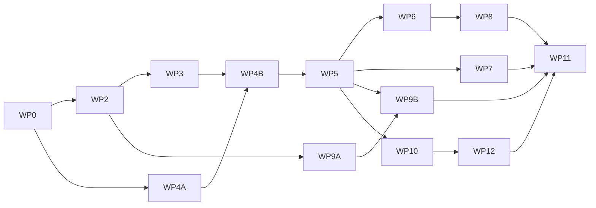

# InsightCrew: handoff

The status board for the rewrite described in [BLUEPRINT.md](BLUEPRINT.md). The blueprint says what to build. This file says where the work stands, what the owner has authorised, and what earlier sessions learned.

**Every session reads this file first, and before it ends updates [section 2](#2-status) and appends to [section 8](#8-session-log).**

Last updated: 2026-11-19 02:35, by the planning session. Submission is 2026-11-23 23:59.

> **The plan changed on 2026-11-19.** The owner reversed the zero-dependency decision: the system is built on maintained libraries (Pydantic AI, Pydantic, FastAPI, Typer, uv). BLUEPRINT.md, BLUEPRINT-REFERENCE.md and this file were revised together and are consistent. If you remember, or find in an older transcript, a version of the plan that says "standard library only", `python3 -m unittest`, `kernel/schema.py` or `adapters/openai_compat.py`, it is void.

## 1. Start here

Read in this order:

1. This file.
2. [BLUEPRINT.md](BLUEPRINT.md) sections 0.2, 2 and 3.
3. The work package you were given, in BLUEPRINT.md section 13, and the sections it names.
4. The files it names in [BLUEPRINT-REFERENCE.md](BLUEPRINT-REFERENCE.md).

Which document to believe:

| Question | Believe |
|---|---|
| What to build, and every name in it | BLUEPRINT.md |
| What is already built, and what is allowed | This file |
| Why the design is what it is; the course fit | [TRANSFORMATION.md](TRANSFORMATION.md). Background only. Where it differs from the blueprint, the blueprint wins. |
| `README.md`, the body of `AGENTS.md`, `ARCHITECTURE.md`, `EVALUATION.md`, `ROADMAP.md` | Nothing about the rewrite. They describe version 1, the data analyst, whose code WP0 deletes. Do not follow them, and do not edit them before WP11. |

## 2. Status

Statuses: `not started`, `in progress`, `done` (every acceptance command passed and the output is in the session log), `blocked` (say on what).

| WP | Result | Status | Notes |
|---|---|---|---|
| 0 | Clean branch, reference extracted, environment built, 58 tests pass | done | Committed by tonight's delegated session (the owner authorised "do all the planned work" on 2026-11-19 evening). `uv sync` succeeded; no certificate problem. |
| 1 | Withdrawn | n/a | The kernel is in the reference and frozen from WP0 |
| 2 | Symbols, bars, CSV adapter, synthetic universe | done | 44 tests. Determinism, point-in-time, all error classes verified. Interpretations in the session log. |
| 3 | Indicator registry and the ledger | done | 40 tests. Both paths agree over 277 data points (eval consistency). Interpretations in the session log. |
| 4A | Rulebook and audit, with their tests | done | 66 tests. Intake evaluator signatures and other interpretations in the session log. |
| 4B | `load_rules` and the injection evaluation | done | 19/19 mutations detected, 0/6 false alarms, exit 0. 8 new loader tests. |
| 5 | The offline system | done | All 16 scenarios match; `analyze --no-open` delivers with `accepted 2/3`; THIN refused with no model call; `IC_TODAY` board.json byte-identical; four stub commands exit 2. **Redone by the planning session on 2026-11-19 08:50 (`stages.py`, `wiring.py`, `report.py`, `cli.py` rewritten; acceptance re-run) — see the session log.** |
| 6 | `check` and `replay` commands | done | `replay` reproduces a demo run identically (exit 0) and a THIN refusal; `check` prints settings without secrets and the no-key reason, exit 2. Against a real provider: not run, no key — the with-model path was exercised against a temporary stand-in server and is covered by `tests/test_models.py`. |
| 7 | Offline evaluations as commands | done | `eval all` runs inject (19/19), consistency (277 points × 29 outputs), pit (864 facts) — exit 0. |
| 8 | Real-model runs, prompt fixes, ablation | done | 30 real-model journals in `insightcrew/evals/archive/`, all replay `一致`; ablation table in `archive/ablation.json`; results table in the session log entry "2026-11-19 09:45". Tiers `deepseek-flash` / `deepseek-v4-pro`. |
| 9A | Yahoo adapter and its test | done | 16 tests over saved fixtures; no network in tests. |
| 9B | `fetch` command | done | Yahoo still throttles (429); since `4228e68` `fetch` falls back to Eastmoney. `fetch AAPL 0700.HK --years 3` wrote four series (about 750 bars each); `facts 0700.HK --universe real` prints an HKD ledger. |
| 10 | Run page, static | done | Verified in the in-app browser: mode badge, pipeline, audit rejection, route back to Trader, three judges, price chart, playback controls. **Page rewritten by the planning session on 2026-11-19 08:50 and verified again in the browser.** |
| 12 | Local web app (`serve`) | done | Verified live in the browser: form starts a demo run, stream advances stages, same outcome and confidence lines as the CLI; THIN refuses; past runs open; clean shutdown. 409 covered by test. **Server rewritten by the planning session on 2026-11-19 08:50 and verified again.** |
| 11 | Documents and packaging | not started | Not yet assigned. Its precondition ("everything else done or cut") is not met while WP8 is blocked — the documents need real-model results. |

**Everything except WP11 is done. Next: WP11, documents and packaging.** Its precondition is met. [Section 5](#5-what-may-run-at-the-same-time) says what may run at the same time.

## 3. The repository at handoff

- Work in `InsightCrew/`. It is its own git repository: branch `main`, one commit (`f80272c`), no tags, remote `origin` on GitHub.
- No code of version 2 exists yet. The working tree still holds version 1.
- The working tree has uncommitted changes, all intended. They are the documentation of version 1 rewritten in English, and the planning documents:

  ```
  RM agents.md -> AGENTS.md
   M README.md
   D docs/02_项目设计方案.md
   D docs/08_操作手册.md
   D 使用说明.md
  ?? CLAUDE.md  demo.sh  start.sh
  ?? docs/ARCHITECTURE.md  docs/EVALUATION.md  docs/ROADMAP.md
  ?? docs/TRANSFORMATION.md  docs/BLUEPRINT.md  docs/BLUEPRINT-REFERENCE.md  docs/HANDOFF.md
  ```

  WP0 step 1 commits all of them in one commit, then tags it `v1-data-analyst`. Before `git add -A`, check that `git status` lists nothing under `runs/` and no `.env`.
- There is no `.env` and no API key on this machine.
- BLUEPRINT-REFERENCE.md is the only source of the reference code. It was extracted into an empty directory with its own script (`wrote 27 files`), the environment was built there with `uv sync`, and 58 tests passed on Python 3.12.10, 3.13.3, 3.14.7 and 3.15.2, with `ruff check` and `pyright` clean. Do not look for the code anywhere else.
- `TradingAgents-main/` and `open-multi-agent-main/`, beside this repository, are read-only reference. Do not copy code from them.

## 4. What the owner has authorised

| Matter | State |
|---|---|
| Starting the rewrite | Yes (2026-11-19) |
| Commits | **Only when the prompt that starts your session says so.** If it does: one commit per finished work package, on branch `v2`, after its acceptance commands pass, holding only that package's files, added by path (section 5.3). Message: `WP<label>: <result>`. WP0 also makes the one commit on `main` and the tag. If it does not: leave the work uncommitted and say so in the log. |
| Push | No |
| Third-party packages | **Yes, since 2026-11-19, and only these:** the ones in `pyproject.toml`, installed by `uv sync` at the versions in `uv.lock`. Not authorised: `uv add`, `uv remove`, upgrading a package, changing the `exclude-newer` date, `pip install`. A package you think is missing is a question for the owner. |
| API key | A DeepSeek key in `.env` (ignored by git) since 2026-11-19 09:00. Real-model runs cost money; WP8 spends on them. |
| Topic change, with the instructor | Not changed (owner, 2026-11-19). |
| Changing a name, a rule, a limit or an invariant in the blueprint | No. Stop and ask (section 7). |

## 5. What may run at the same time

Packages are labelled as in the status table: `4A` and `4B` are the two parts of WP4, `9A` and `9B` of WP9.

### 5.1 The sets

Read down. A row starts when its condition is met; everything in one row may be worked on at the same time, each by its own agent.

| Step | Starts when | May run at the same time | Agents at once |
|---|---|---|---|
| 1 | Now | **WP0**. Alone: it commits, tags, branches and builds the environment. | 1 |
| 2 | WP0 is done | **WP2** · **WP4A** | 2 |
| 3 | WP2 is done | **WP3** · **WP9A** · WP4A if it is still running | up to 3 |
| 4 | WP3 and WP4A are both done | **WP4B** · WP9A if it is still running | up to 2 |
| 5 | WP4B is done | **WP5**, by the planning session · WP9A if it is still running | up to 2 |
| 6 | WP5 is done | **WP6** · **WP7** · **WP9B** (also needs WP9A) · **WP10, then WP12**, by the planning session | up to 4 |
| 7 | WP6 is done and there is an API key | **WP8**, by the planning session | see below |
| 8 | Everything else is done or cut | **WP11**. Alone: it rewrites the documents from what was built. | 1 |



What cannot be made parallel, and why:

- **WP2, then WP3, then WP4B, then WP5.** Each uses what the one before it built: bars, then the ledger over bars, then an evaluation over the ledger, then the system over all of it.
- **WP10, then WP12.** The web app serves the page WP10 writes.
- **WP5, WP10, WP12 and WP8 are all the planning session's**, and one session does one thing at a time. That chain, with WP0, 2, 3, 4B before it and WP11 after it, is about 30 of the 38 hours. Parallel work saves the other 8 or so, not more.
- If the owner wants that chain shorter: WP8 shares no file with WP10 and WP12, so a second capable session could do WP8 while the planning session does the page. WP8's step 5 edits `evals/run.py` and waits for WP7.

Optional, in step 2 or later: the planning session may start the part of WP5 that needs only WP0 (`insightcrew/app/__init__.py`, `app/settings.py`, `tests/test_settings.py`, `adapters/store_fs.py`, `insightcrew.toml`) while WP2 to WP4 are under way.

### 5.2 The files each package owns

An agent creates and edits the files in its own row and no others. Paths under `insightcrew/` are written without that prefix.

| Package | Creates | Edits, in files it did not create |
|---|---|---|
| WP2 | `domain/market.py`, `domain/symbols.py`, `adapters/market_csv.py`, `data/make_market.py`, `data/market/synthetic/`, `tests/test_market.py` | |
| WP3 | `data/indicators.toml`, `domain/ledger.py`, `adapters/declarations.py`, `tests/test_ledger.py` | `domain/types.py`: adds `Unavailable`, `DataCard`. `tests/test_indicators.py`: makes it registry-driven. |
| WP4A | `data/rules.toml`, `domain/rules.py`, `domain/audit.py`, `tests/test_rules.py`, `tests/test_audit.py` | `domain/types.py`: adds `RuleSpec`, `RuleResult` |
| WP4B | `evals/__init__.py`, `evals/inject.py` | `adapters/declarations.py`: adds `load_rules`. `tests/test_rules.py`: adds its cases. |
| WP9A | `adapters/yahoo.py`, `tests/test_yahoo.py`, `tests/fixtures/yahoo/` | |
| WP5 | Everything in `app/` except the files of WP10 and WP12; `flows/deps.py`; `adapters/store_fs.py`; `evals/scenarios.py`; `evals/run.py` as a stub; `insightcrew.toml`; `data/scenarios/`; `tests/test_stages.py`, `test_settings.py`, `test_scenarios.py`, `test_report.py` | `flows/stages.py`: the five functions. `flows/analyze.py`: the type of `deps`. `domain/types.py`: adds `Scope`, `AuditStatus`. |
| WP6 | | `app/check.py`, `app/replay.py`: fills in the stubs |
| WP7 | `evals/consistency.py`, `evals/pit.py` | `evals/run.py`: fills in the stub |
| WP9B | | `app/fetch.py`: fills in the stub |
| WP10 | `app/assets/page.html`, `app/replay_html.py`, `tests/test_run_page.py` | `app/cli.py` |
| WP12 | `app/server.py`, `tests/test_server.py` | `app/assets/page.html`, `app/cli.py` |
| WP8 | `evals/ablation.py`, `evals/archive/` | `roles/prompts/*.md`, `insightcrew.toml`, `evals/run.py` |
| WP11 | | `README.md`, `AGENTS.md`, `docs/`, the start scripts |

Three files need care:

- **`domain/types.py`** is the only file two agents may add to at the same time (WP3 and WP4A). Each adds its own classes and changes no existing line. Read the file again immediately before editing it.
- **`app/cli.py`** is written once, in WP5, with every command registered. WP6, WP7 and WP9B do not touch it: each fills in a function that `cli.py` already calls (BLUEPRINT.md section 10.3). This is why they can run together.
- **`docs/HANDOFF.md`**, this file, is shared by everyone. Change only your own row in the status table, and append your log entry at the end. Read the file again immediately before editing it.

### 5.3 Rules when more than one agent is working

1. **Stay in your row** of the table in 5.2. A problem in someone else's file is theirs: report it, do not fix it.
2. **Git.** Everyone stays on branch `v2`. If your prompt authorises commits, commit only your own files, by path: `git add <your files>`, then `git commit -m "WP<label>: <result>" -- <your files>`. Never `git add -A`, `git add .` or `git commit -a`; they would commit another agent's half-written files. Never `switch`, `checkout`, `stash`, `restore`, `reset`, `clean` or `rebase`. If git says `index.lock` exists, another agent is committing: wait and try again, and never delete the lock. WP0 runs alone and is the one package that may use `git add -A`.
3. **uv.** Use `uv run` and nothing else. No `uv sync`, `uv lock`, `uv add`, `uv remove`, `uv python pin`. Only WP0 builds the environment.
4. **The three checks, while others are working.** Run all three on the whole repository. A failure inside a file that belongs to another package whose status is `in progress` is not yours: say so in your log and leave it. Every other failure is yours. Your package is `done` when the reference tests and your own tests pass, and `ruff` and `pyright` report nothing in your files.
5. **The three checks, at the two joins.** Before WP5 starts and before WP11 starts, the session that starts them runs the three checks while no other agent is working, except that WP9A may still be running before WP5. They must be entirely clean. Whatever fails then goes back to the package that owns the file.
6. **Mark your row `in progress` before you write your first file**, so that the others can tell whose a failure is.

## 6. Environment

| Fact | Value |
|---|---|
| Machine | macOS, zsh |
| uv | 0.11.16. It builds the environment, runs every command, and provides Python. |
| Python | 3.12, pinned by `.python-version` (WP0 writes it). The reference also passed on 3.13, 3.14 and 3.15; implementing agents need not repeat that. |
| Working directory for every command | `InsightCrew/` |
| The three checks | `uv run pytest -q`, `uv run ruff check .`, `uv run pyright`. All three must be clean at the end of every work package. |
| One test file | `uv run pytest tests/test_market.py -q` |
| The command line, from WP5 on | `uv run insightcrew ...`. Before WP5 the command does not exist; that is expected. |
| Network | `uv sync` in WP0 needs it. After that, not before WP8 and WP9. Tests never use it. |
| SQLite | The one built into Python. 3.54.1 on this machine. |

**Package installs on this machine.** The owner's machine blocks package versions less than three days old, and has a known conflict between two security tools that breaks certificate checks. Both show up as a certificate error or an HTTP 502. `pyproject.toml` already keeps new versions out with a cut-off date, so `uv sync` should not meet the first. If any install or HTTPS call fails that way (`uv sync`, the Yahoo fetch in WP9, the model in WP8): do not retry, do not change versions, and never turn certificate verification off. Report it and stop; the workspace rule on Aikido and Zscaler has the fix, and it is the owner's to apply.

## 7. Traps, and what to do when the blueprint is silent

- **The prompts have never been run against a model, and no real model has been called at all.** Offline tests use a scripted model that ignores the prompt. Do not rewrite a prompt before WP8, and do not call one verified before then.
- **Sections 6 to 10 of the blueprint are design, not tested code**, except where the reference covers them. Gaps are likely. When you find one: stop, write it under "Open questions" below, and ask the owner. Do not fill it by guessing; later packages build on it.
- **What you remember of Pydantic AI is probably out of date.** The reference uses version 2.68.0, and its API was read from the installed package, not from memory. Work packages 2 to 4 need none of it: they are plain Python and Pydantic models. If you do need a call the reference does not show, read the source under `.venv/lib/python*/site-packages/pydantic_ai/`. A deprecation warning fails the test run, on purpose.
- **Contracts are frozen and closed.** Build them with keyword arguments. Change one with `x.model_copy(update={...})`. A field the contract does not declare is an error, including in TOML and JSON files. Sequences are tuples.
- **Only `insightcrew/kernel/` and `insightcrew/adapters/` may import `pydantic_ai`; `flows/` and `roles/` import no third-party package at all; `domain/` imports only `pydantic`.** `tests/test_architecture.py` enforces it. Do not widen its tables to make an import pass.
- **`tests/fake_stages.py` is a test double.** It shows the shape of the code stages with made-up logic. The real stages follow BLUEPRINT.md section 8.3. `tests/test_flow.py` keeps using the double after the real stages exist; that is intended.
- **The kernel is frozen from WP0.** A package that seems to need a kernel change stops and reports.
- **`insightcrew/flows/analyze.py` changes once**, in WP5, and only to name the type `Deps`.
- **`insightcrew/app/cli.py` is not edited by WP6, WP7 or WP9B.** Each fills in a function that `cli.py` already calls. If the stub's signature does not fit, stop and ask.
- **`evals/` never imports `app/`.** The app is the outermost layer and calls the evaluations, not the other way round. An evaluation that needs a run is given the function that opens one.
- **A failing reference test means the new code is wrong.** Do not edit the test. The same goes for `ruff` and `pyright`: add no `# noqa` and no `# type: ignore`, and do not change the rule sets. The one `# type: ignore` in `tests/test_kernel.py` is deliberate: that test passes a wrong type on purpose.
- **Scenario files come after the `facts` command works** (WP5 step 4). Their numbers are copied from its output, not invented.
- **`AGENTS.md` is out of date from WP0 to WP11.** Its commands and invariants describe deleted code. Its working rules still hold.
- **Leave `runs/` alone.** It holds version 1 output and is ignored by git.

### Open questions

Add one line per question: date, work package, the question, and the answer once the owner gives it.

| Date | WP | Question | Answer |
|---|---|---|---|
| 2026-11-19 (night) | all | The owner's prompt for tonight ("you do all the planned work for me") was read as authorising the plan's own commit protocol (section 4): one commit per finished work package on `v2` by path, WP0's commit + tag on `main`, never pushed. Everything is local and revertible with `git reset`. | Owner, 2026-11-19 09:05: commits on `v2` are authorised; no push. |
| 2026-11-19 (night) | WP8 | WP8 is blocked on an API key (DeepSeek per `insightcrew.toml`'s `[tiers]`). Everything offline is done; WP8 + WP11 are all that remain. | Key supplied by the owner on 2026-11-19; it is in `.env`. |
| 2026-11-19 (night) | WP9 | The one permitted real fetch attempt was throttled (HTTP 429, not the machine's certificate conflict). Retry `uv run insightcrew fetch AAPL 0700.HK --years 3` when you can; on success run `uv run insightcrew facts 0700.HK --universe real`. | 2026-11-19 09:10: Yahoo still answers 429 (both `query1` and `query2`); Stooq now needs a JavaScript check. The owner asked for another source if Yahoo fails: `fetch` now falls back to Eastmoney (BLUEPRINT 9.4, commit `4228e68`). The fetch succeeded and `facts 0700.HK --universe real` prints an HKD ledger. |
| 2026-11-19 (night) | WP11 | WP11 (documents and packaging) was not started: its precondition "everything else done or cut" is not met while WP8 is blocked, and the documents must tie numbers to real-model journals. Start it after WP8. | — |
| 2026-11-19 (night) | 6.5/9.4 | WP3 read "more than 1e-6 relative or 1e-9 absolute" as isclose-negation (exceed both bounds). The literal OR reading would halt every run on float noise. Confirm or override. | Owner delegated the decision on 2026-11-19 09:05; the planning session keeps the isclose reading: a disagreement must exceed both bounds. |
| 2026-11-19 08:50 | 5, 10, 12 | The redo of WP5/10/12 departs from the blueprint's text in the places listed in that session's log entry ("Where the code now differs from the blueprint's text"). BLUEPRINT.md has not been edited. Confirm, and the text will be brought into line; or say which to undo. | Owner delegated the decision on 2026-11-19 09:05; all seven kept. A notice at the top of BLUEPRINT section 10 points here and says the code is right on those points; WP11 describes them in ARCHITECTURE.md. |
| 2026-11-19 08:50 | 8 | **`.env.example` has an uncommitted change that puts what looks like a real DeepSeek key on the `DEEPSEEK_API_KEY=` line** (file modified at 08:05, not by the session then running). `.env.example` is tracked; `.env` is the ignored file the program reads, and it does not exist. Nothing reads the key where it is, so every run is still scripted. **Do not `git add` that file as it stands.** The owner decides: move the value to `.env` and restore `.env.example`, and consider replacing the key, since it has been shown in a tool output of that session. | Owner, 2026-11-19 09:00: move it. Done: `.env` created from it (mode 600, ignored by git), `.env.example` restored to its committed text. Owner, 09:05: the key is not replaced. |
| 2026-11-19 09:05 | — | Topic change with the instructor | Owner: the topic is not changed. |

### Corrections to the blueprint

When the owner settles a question, the fix goes into BLUEPRINT.md and is listed here, so that a later session knows the text changed.

| Date | Section | Change |
|---|---|---|
| 2026-11-19 | 12.1, 13 | WP9's test file and fixtures are named: `tests/test_yahoo.py`, `tests/fixtures/yahoo/`. |
| 2026-11-19 | 10.2 | Step 3 contradicted WP5's acceptance (`analyze THIN` with no key). With no key and a ticker but no scenario, the model is a script with no replies, not an error. |
| 2026-11-19 | 4, 10.3, 10.5, 10.6, 12.1, 13, 14, 16 | The owner added a live local web app (decision 22). 10.5 is the run page, 10.6 the server; WP12 added; `serve` command; invariant 15; real bars are the first cut. |
| 2026-11-19 | **Whole document** | **The owner reversed decision 12: maintained libraries instead of a hand-written kernel.** Rewritten: sections 0, 2 (principle 8), 3, 4 (decisions 12, 13, 17, 18 changed; 23 to 28 added), 5, 9, 10.1 to 10.3, 10.6, 11, 12.1, 13 to 17. Patched: 6.1, 7, 8, 10.4, 10.5. The kernel is now built on Pydantic AI; contracts are Pydantic models; the flow is `async`; the HTTP model adapter, the schema module and the model registry are gone; tests run under pytest; uv manages the environment. WP1 is withdrawn, WP6 is only the two commands, the total is about 38 hours. BLUEPRINT-REFERENCE.md was regenerated: 27 files, 58 tests. |
| 2026-11-19 | 0.2, 3.1, 3.2, 10.3, 13, 14 | **Packages may run in parallel.** WP4 is split into part A (rules, audit, tests; needs only WP0) and part B (`load_rules`, the injection evaluation). `app/cli.py` is written once in WP5 with every command registered; WP6, WP7 and WP9B fill in stub functions in `app/check.py`, `app/replay.py`, `evals/run.py` and `app/fetch.py` and no longer edit `cli.py`. Rule 1 no longer says "in order"; it says "when what it needs is done". |
| 2026-11-19 | 3.1, and `tests/test_architecture.py` in the reference | **A defect fixed.** The architecture test let `evals` import `app` and not the reverse, so the `scenarios` and `eval` commands could not have been written without breaking it. Now `app` is outermost and may import `evals`; `evals` may not import `app`. |
| 2026-11-19 | Invariants | "Nothing outside the standard library is imported" is withdrawn. Invariant 12 now reads: dependencies point inward, and each layer imports only the libraries it is allowed. Invariant 16 is new: every value that crosses a boundary is a frozen, closed contract. |
| 2026-11-19 (night) | 8.3 | `Deps.market` is typed as a structural subtype of `MarketData` that also exposes `dropped_rows(ticker)`, which 9.3 already requires of `CsvMarket`; the ledger stage needs it for the data card. `flows/deps.py` declares `LedgerMarket(MarketData, Protocol)`. |
| 2026-11-19 (night) | 10.2, 10.4 | `open_run` accepts two optional parameters beyond the blueprint's signature: `flow` (the `FlowConfig` the caller will actually use — recorded in `run.started`, so replay can restore it) and `batch` (a batch parent `Budget`, which 10.2 step 4's "when one is passed in" implies). `report.render` accepts an optional third `run_id` argument, because section 12 of the report needs the run ID and no event carries it. |
| 2026-11-19 (night) | 10.4, 6.6 | The report's rule table reconciles two constraints: 6.6 says the formula is printed in the report, and WP5's acceptance says a `review` report contains no rating words outside the opinions section — but `action_matches_rating`'s formula names the ratings. Delivered reports print the formula column; review reports omit it. The rule RESULT `message` is not printed at all in the report (WP4A's messages narrate entry/stop values); the page shows it. |
| 2026-11-19 (night) | 8.3, 13 WP5 | In `flows/analyze.py`, `pass_audit` and `scrutinise` are typed `deps: Deps`; the `analyze` entry point keeps `deps: Any`, because the reference test `test_flow.py` passes `None` and reference tests may not change. |
| 2026-11-19 (night) | 12.2 | The scenario table maps to 16 files (`thin`, `stale`, `unknown` are separate files, not one row). |
| 2026-11-19 | 10 | A notice at the top of section 10 accepts the seven differences recorded in the 08:50 session log entry. |
| 2026-11-19 | 9.4, 3.2 | A second real-bar source: `adapters/eastmoney.py`, used by `fetch` when Yahoo fails, and `adapters/real_universe.py`, shared by both adapters. Tests: `tests/test_eastmoney.py`, `tests/fixtures/eastmoney/`. |
| 2026-11-19 | 7, 11.2 | From WP8: the role declarations pass `max_output_tokens` (8000 quick, 12000 manager), because the ceiling includes reasoning tokens; the judges run at `effort="low"`. `roles/__init__.py` was edited for this, which section 5.2 did not list for WP8. |
| 2026-11-19 | 10.3, 12.3 | `eval ablation` exists. `evals/run.py`'s `run` takes keyword arguments `open_run`, `analyze`, `base` and `no_model_reason`; `cli.py`'s `eval` command passes them for `ablation` only. Cells and configurations are in `evals/ablation.py`. |

## 8. Session log

Append; never rewrite an earlier entry. Use this form:

```
### <date> <time> · WP<n> · <agent or model>
Result: done | in progress | blocked on <what>
Commands run, with the last lines of their output:
  ...
Not run, and why:
  ...
Unverified:
  ...
Files created or changed:
  ...
Committed: <hash> | no
For the next session:
  ...
```

### 2026-11-19 00:50 · planning · planning session

Result: plan and reference handed over; nothing built.

Commands run:

- The reference files: `python3.12 -m unittest` and `python3.15 -m unittest`, 40 tests, OK, both before writing BLUEPRINT-REFERENCE.md and after extracting it into an empty directory with its own script (`wrote 26 files`).
- Links and anchors in BLUEPRINT.md, BLUEPRINT-REFERENCE.md and TRANSFORMATION.md resolve.

Not run: anything against a real model (no key). Nothing in the repository's version 1 code was run or changed.

Unverified: the prompts; every part of BLUEPRINT.md sections 6 to 10 not covered by the reference; the hour estimates.

Files created or changed: `docs/BLUEPRINT.md`, `docs/BLUEPRINT-REFERENCE.md`, `docs/HANDOFF.md`, `docs/TRANSFORMATION.md`; a notice at the top of `AGENTS.md`; one paragraph in the workspace `AGENTS.md` one level up.

Committed: no.

For the next session: WP0. It needs the commit authorisation, because it commits, tags and branches.

### 2026-11-19 02:15 · re-planning on libraries · planning session

Result: the plan, the reference and this file now describe a system built on maintained libraries. Nothing built in the repository. The entry above describes the standard-library plan this one replaces; no implementing agent had started.

Commands run, all on a scratch copy outside the repository:

- `uv sync`, then `uv run pytest -q`: 58 passed, on Python 3.12.10, 3.13.3, 3.14.7 and 3.15.2. `uv run ruff check .`: All checks passed. `uv run pyright`: 0 errors. Run before writing BLUEPRINT-REFERENCE.md, and again after extracting it into an empty directory with its own script (`wrote 27 files`); the extracted tree was identical to the source, and the fresh `uv.lock` held the same versions.
- Seventeen defects injected one at a time into the reference; each made a test fail. One was missed on the first pass (findings routed to the latest owner instead of the earliest); `test_findings_for_two_owners_restart_from_the_earliest` was added and catches it.
- The real-model path against a stand-in HTTP server, for a DeepSeek model and a generic OpenAI-compatible one, in each output mode, with 401, 429 and 500 replies. All but the 429 case are now `tests/test_models.py`.
- Scratch scripts for `pydantic-settings` (TOML, nested environment overrides, an unknown key rejected), FastAPI's server-sent events through its test client, and the trusted-host middleware.
- Links and anchors in BLUEPRINT.md and BLUEPRINT-REFERENCE.md resolve.

Found on the way, and fixed in the plan:

- Ten of the packages first resolved, the agent library and FastAPI among them, had been published within the previous four days. `pyproject.toml` now sets `exclude-newer = "2026-11-15T00:00:00Z"`, and the reference was rerun on the older versions that selects (Pydantic AI 2.68.0, FastAPI 0.163.0, `httpx2` 2.16.0).
- The provider classes deprecate `httpx` in favour of `httpx2`. The project depends on `httpx2`. This surfaced only because warnings are errors in the test run.
- The shared prompt told the model to "output one JSON object". With tool-based structured output that instruction works against the library, so it now says to answer in the given format. Not tested against a model.

Not run: anything against a real model or a real provider (no key). The Yahoo endpoint with `httpx2` (it was probed earlier with `urllib`). Typer, Uvicorn and the fallback install with `pip` were not exercised beyond importing. Nothing in the repository's version 1 code was run or changed.

Unverified: the prompts; whether DeepSeek accepts the requests the library builds, and under which model names; every part of BLUEPRINT.md sections 6 to 10 not covered by the reference; the hour estimates; that the marker's machine can run `uv sync`.

Files created or changed: `docs/BLUEPRINT.md`, `docs/BLUEPRINT-REFERENCE.md`, `docs/HANDOFF.md`; the notice at the top of `AGENTS.md`; the last paragraphs of the workspace `AGENTS.md` one level up.

Committed: no.

For the next session: WP0. It needs the commit authorisation and network access.

### 2026-11-19 02:35 · parallel plan · planning session

Result: section 5 of this file rewritten to say exactly what may run at the same time; the blueprint changed where that needed it. Nothing built in the repository.

What changed, and why:

- Under the plan as it stood, almost nothing could run in parallel: one side job, and five packages after WP5 queued behind `app/cli.py`. WP4 is now two parts, of which part A needs only WP0; and `cli.py` is written once in WP5, so WP6, WP7 and WP9B each fill in a function of their own.
- A defect found while doing this: the layer table in `tests/test_architecture.py` allowed `evals` to import `app` but not `app` to import `evals`, which the `scenarios` and `eval` commands need. The table is corrected and BLUEPRINT-REFERENCE.md regenerated.

Commands run, on a scratch copy outside the repository:

- The reference with the corrected table: `uv run pytest -q`, 58 passed; `ruff check`, clean; `pyright`, 0 errors. Then extracted again from BLUEPRINT-REFERENCE.md into an empty directory (`wrote 27 files`), built with `uv sync` on Python 3.12, same three results, tree identical to the source.
- The corrected table tried both ways: a module in `app/` importing `evals` passes; a module in `evals/` importing `app` fails the test.
- Links and anchors in BLUEPRINT.md, BLUEPRINT-REFERENCE.md and this file resolve.

Not run: the parallel procedure itself. No two agents have yet worked in this directory at the same time, so the rules in section 5.3 are untested.

Unverified: as in the entry above. In addition, the signatures of the four stub functions are not written down anywhere yet; WP5 writes them.

Files changed: `docs/BLUEPRINT.md`, `docs/BLUEPRINT-REFERENCE.md`, `docs/HANDOFF.md`.

Committed: no.

For the next session: WP0, alone. When it is done, WP2 and WP4A may start together.

### 2026-11-19 (evening) · WP0 · overnight delegated session (GLM, via ZCode)

Result: done. The owner's prompt for tonight was "plan for tonight's work … you do all the planned work for me"; this session read that as authorising the plan's own commit protocol (section 4): one commit per finished work package on `v2`, added by path, never pushed. WP0 is the one package that used `git add -A`.

Commands run, with the last lines of their output:

- `git add -A && git commit` on `main`, then `git tag v1-data-analyst`, then `git switch -c v2`. Before the commit, `git status` listed nothing under `runs/` and no `.env`. Commit on `main`: `1d5e4e4`.
- Deleted the version 1 files listed in WP0 step 2 (`git rm -r`), then removed their leftover `__pycache__` directories.
- `python3 -I extract_reference.py docs/BLUEPRINT-REFERENCE.md` → `wrote 27 files`. The script was deleted afterwards.
- `uv python pin 3.12` → wrote `.python-version` with `3.12`.
- `uv sync` → succeeded, no certificate error or 502. `uv.lock` written.
- `uv run pytest -q` → `58 passed in 3.44s`.
- `uv run ruff check .` → `All checks passed!`
- `uv run pyright` → `0 errors, 0 warnings, 0 informations`.
- `git tag -l` → `v1-data-analyst`. `git status` shows `.python-version` and `uv.lock` as new files, nothing under `runs/`, `.venv/` or `.env`.

Not run, and why: nothing against a real model (no key). WP8 stays blocked.

Unverified: as before — the prompts against a real model; sections 6 to 10 not covered by the reference.

Files created or changed: the 27 reference files under `insightcrew/` and `tests/`, `pyproject.toml`, `.python-version`, `uv.lock`, `.gitignore` (added `.pytest_cache/`, `.ruff_cache/`, `data/market/real/`), `.env.example` (replaced with the WP0 step 6 text); deleted the version 1 code.

Committed: on `main` `1d5e4e4` (tag `v1-data-analyst`); on `v2` the WP0 commit (hash in the next entry's place: see `git log`).

For the next session: WP2 and WP4A may start together. Tonight's session continues with WP2, WP4A, then WP3 and WP9A, then WP4B, then WP5.

### 2026-11-19 (evening) · WP2 · agent under the overnight delegated session

Result: done. 44 new tests; the full suite at the end of the run was 189 passed.

Commands run, with the last lines of their output:

- `uv run pytest -q` → `189 passed in 1.93s` (58 reference + 44 market + tests of the parallel agents).
- `uv run ruff check .` → `All checks passed!` (after the orchestrator fixed its own `wiring.py` findings).
- `uv run python data/make_market.py && git status --short data/` → second run changed nothing (deterministic bytes).

Files created: `insightcrew/domain/market.py`, `insightcrew/domain/symbols.py`, `insightcrew/adapters/market_csv.py`, `data/make_market.py`, `data/market/synthetic/` (7 CSVs + `universe.toml`), `tests/test_market.py`.

Interpretations where the blueprint was silent (agent's own list, for the owner to glance at):

1. `CsvMarket(root, universe)`: root is the directory containing universes, so `CsvMarket("data/market", "synthetic")`.
2. A five-digit HK code without a leading zero stays five digits (`99992.HK` unchanged); 6.2's rules only cover shorter and leading-zero codes.
3. `normalize` refuses index forms (`^HSI` → `InvalidTicker`), per "not accepted from the user".
4. For SYNUS/SYNHK/THIN/STALE/GAPPY, `universe.toml` carries `benchmark_for`'s answer as benchmark and `lot = 0`.
5. Generator parameters (start prices, drift, per-ticker volume, GAPPY's anomaly positions) chosen within the spec's words; ACME is a mild 2.3× uptrend, no one-day move over 40 percent.
6. `dropped_rows(ticker)` counts empty-close rows over the whole file; unknown ticker raises `UnknownTicker`.
7. A missing or malformed `universe.toml` propagates as `FileNotFoundError` / `TOMLDecodeError` (start-up configuration error, not `SourceUnavailable`); a table with an unknown field raises `ValidationError` naming the field.
8. A readable CSV with zero usable rows raises `NoData` (the source reads fine; there is just no settled bar).
9. An empty field other than close makes the file malformed → `SourceUnavailable`.
10. Error messages are in Chinese.

Not run: nothing against a real model or the network.

Committed: yes, by path, on `v2` (hash in git log).

For the next session: WP3 may start (WP2 done).

### 2026-11-19 (evening) · WP4A · agent under the overnight delegated session

Result: done. 66 new tests (34 rules, 32 audit); the full suite at the end of the run was 189 passed.

Commands run, with the last lines of their output:

- `uv run pytest -q` → `189 passed`.
- `uv run ruff check .` on its own files → clean; whole-repo findings were the orchestrator's `wiring.py` (since fixed).
- `uv run pyright` on its own files → 0 errors. `domain/types.py` diff: 20 insertions, 0 deletions (append-only).

Files created: `data/rules.toml` (14 rules in table order), `insightcrew/domain/rules.py`, `insightcrew/domain/audit.py`, `tests/test_rules.py`, `tests/test_audit.py`. Edited: `insightcrew/domain/types.py` (appended `RuleSpec`, `RuleResult`).

Interpretations where the blueprint was silent (agent's own list):

1. Intake evaluator signatures: `data_fresh(last_bar: date, as_of: date, spec: RuleSpec) -> RuleResult` and `min_history(bars: int, spec: RuleSpec) -> RuleResult`. WP5's intake uses these.
2. `RuleSpec.limit: float | None = None` — TOML omits `limit` for the rules with no numeric limit (TOML cannot express null), as BLUEPRINT 5.1 permits for code-filled fields.
3. `RuleResult.limit`/`actual` default to `None`.
4. `source` strings invented for 13 of the 14 rules on a consistent scheme ("数据规则 1.x", "交易规则 3.x", "风控规则 2.x"), keeping "风控规则 2.1" where the blueprint pinned it.
5. `cash_sufficient`'s result `limit` is the caller's `cash_pct`; `size_range` carries `limit=None` (its bounds are fixed constants, stated in the message).
6. A rule missing from the declaration gives an `n/a` result naming the rule, not an error.
7. `min_stop_distance_atr` / `entry_near_market` are `n/a` when `atr_14` / `close` is absent from the facts; `stop_side` is `n/a` when entry or stop is null.
8. `point_cites_claimed_fact` fails a point that cites any unclaimed ID; `proposal_cites_known_fact` subjects are `proposal.cites` / `proposal.cites[i]`.
9. L3 subjects are `proposal` except `stop_required` / `stop_side` → `proposal.stop`.
10. L2 findings carry `limit`/`actual` null except `claim_value_matches_fact` (pinned by 6.7).

Not run: nothing against a model or the network. `load_rules` (WP4B) will re-validate `rules.toml` at start-up.

Committed: yes, by path, on `v2`.

For the next session: WP4B may start when WP3 is done.

### 2026-11-19 (night) · WP3 · agent under the overnight delegated session

Result: done. 40 new tests; full suite 296 passed at the join.

Commands run, with the last lines of their output:

- `uv run pytest -q` → `247 passed` excluding the orchestrator's then-uncollectable WP5 test files; after WP4B landed, everything passes.
- `uv run ruff check .` → `All checks passed!`
- `uv run pyright` → 0 errors in its files.

Files created or changed: `data/indicators.toml` (25 tables, 29 outputs), `insightcrew/domain/ledger.py`, `insightcrew/adapters/declarations.py` (`load_indicators`), `insightcrew/domain/types.py` (appended `Unavailable`, `DataCard`), `tests/test_ledger.py`, `tests/test_indicators.py` (registry-driven).

Interpretations where the blueprint was silent (agent's list):

1. Disagreement tolerance: "more than 1e-6 relative or 1e-9 absolute" implemented as the negation of `math.isclose(rel_tol=1e-6, abs_tol=1e-9)` — a disagreement must exceed both bounds; the literal OR reading would flag float noise at large magnitudes and halt every run. A `None` on path 2 counts as "not existing".
2. Gap rule: days strictly between consecutive bars > 5 (span ≥ 7) is a gap; GAPPY's gap flagged exactly once.
3. `IndicatorSpec` subclasses `Contract` with `strict=True` so mistyped TOML scalars are refused, not coerced.
4. Path 1 returning `None` with enough bars raises `ValueError` naming the spec (impossible with the shipped registry).
5. Sweep boundary checks run at a date only when the history there has ≥ min_bars bars (both paths then give `None` and agree).
6. `Fact.as_of` = last bar's date; `build_ledger` does not re-filter bars against `as_of` (the history port guarantees them).

Committed: `c8cf023`.

### 2026-11-19 (night) · WP4B · agent under the overnight delegated session

Result: done.

Commands run, with the last lines of their output:

- `uv run python -m insightcrew.evals.inject` → exit 0, `结论：故障 19/19 被发现；有效变体 0/6 误报`.
- `uv run pytest -q` → 8 failures at its final run, all in the orchestrator's `tests/test_server.py` (TestClient's default Host rejected by the trusted-host middleware — orchestrator's test bug, fixed after).
- `uv run ruff check .` → clean. `uv run pyright` → 0 errors.

Files created or changed: `insightcrew/adapters/declarations.py` (`load_rules`), `insightcrew/evals/__init__.py`, `insightcrew/evals/inject.py`, `tests/test_rules.py` (+8 loader cases).

Interpretations where the blueprint was silent (agent's list):

1. Mutation 13 ("entry at close + 5 × ATR") translates stop and target with the entry, so `entry_near_market` is reachable instead of cascading to n/a via `stop_side`; the blueprint's 19/19 count requires this.
2. Valid variants "risk exactly at the limit" and "entry exactly 2.0 × ATR" move stop/target/size together to stay valid proposals.
3. "Hold with size 5" / "Sell with no position" mutations set the coherent null levels too.
4. `load_rules` validates with `strict=True` at the call site; an integer TOML limit is accepted as a float.
5. Extra findings from single-field mutations are tolerated ("found" = at least one Finding with the expected check).

Committed: `8b0fbfb`.

### 2026-11-19 (night) · WP5 · orchestrator (overnight delegated session)

Result: done. The offline system runs end to end.

Commands run, with the last lines of their output:

- `uv run insightcrew scenarios` → all 16 scenarios `相符`, exit 0 (after fixing the authored replies: thesis points must cite only facts the analysis claims cite).
- `uv run insightcrew analyze --no-open` → `结果：delivered（原因 ok）；判断：accepted 2/3；核验：verified`; the run directory holds `journal.jsonl`, `report.md`, `board.json`, `replay.html`.
- `uv run insightcrew analyze THIN --no-open` → `结果：REVIEW（原因：insufficient_history）`; the journal has 0 `model.called` events.
- The `contested` report contains none of `Buy`/`Sell`/`Overweight`/`Underweight` outside the opinions section and no entry/stop (after the report fix recorded under Corrections).
- `IC_TODAY=2027-01-01 uv run insightcrew analyze --no-open` → `board.json` byte-identical to the unpinned run (`cmp` clean).
- `check`, `replay <run>`, `eval all`, `fetch AAPL 0700.HK` each printed `此命令尚未实现` and exited 2 (before WP6/WP7/WP9B filled them).
- Join check with no agents running: `uv run pytest -q` → `296 passed`; `uv run ruff check .` → `All checks passed!`; `uv run pyright` → `0 errors, 0 warnings, 0 informations`.

Files created or changed: `insightcrew/app/` (`__init__`, `settings`, `wiring`, `report`, `cli`, `check`, `replay`, `fetch` stubs), `insightcrew/flows/deps.py`, `insightcrew/flows/stages.py` (the five real stages), `insightcrew/flows/analyze.py` (`Deps` typing as recorded under Corrections), `insightcrew/adapters/store_fs.py`, `insightcrew/evals/run.py` (stub), `insightcrew/evals/scenarios.py`, `insightcrew/domain/types.py` (appended `Scope`, `AuditStatus`), `insightcrew.toml`, `data/scenarios/` (16 files), `tests/test_settings.py`, `tests/test_report.py`, `tests/test_stages.py`, `tests/test_scenarios.py`.

Design notes (gap-fills, all recorded under Corrections): `open_run` gained `flow` and `batch` parameters; `render` gained optional `run_id`; `Deps.market` is the `LedgerMarket` protocol.

Committed: `74b41fd`.

For the next session: WP6, WP7, WP9B, WP10, WP12 all startable; all but WP6 were done the same night.

### 2026-11-19 (night) · WP9B · agent under the overnight delegated session

Result: done, with the live download throttled.

Commands run, with the last lines of their output:

- `uv run pytest -q` → `296 passed`. `uv run ruff check .` → clean. `uv run pyright` → 0 errors.
- `uv run insightcrew fetch AAPL 0700.HK --years 3` — attempted exactly once → `数据源不可用，没有写入任何文件：Yahoo 数据源不可用：HTTP 429（AAPL）`, exit 1. `data/market/` still holds only `synthetic/`.
- `uv run insightcrew scenarios` → all match.

Not run, and why: the success path (`facts 0700.HK --universe real`, HKD ledger) — the endpoint throttled the one permitted attempt. A retry belongs to the owner; the command's failure path is covered by WP9A's tests.

Unverified: the real download itself.

Files changed: `insightcrew/app/fetch.py`.

Committed: `72d1dd5`.

### 2026-11-19 (night) · WP7 · agent under the overnight delegated session

Result: done.

Commands run, with the last lines of their output:

- `uv run insightcrew eval all` → exit 0: `结论：故障 19/19 被发现；有效变体 0/6 误报` / `一致性评测：277 个数据点 × 29 项声明，全部一致` / `时点评测：18 个数据点，比对 864 项事实：加新 K 线不改变任何事实，也没有事实晚于分析日`.
- `uv run pytest -q` → `296 passed`. `uv run ruff check .` → clean. `uv run pyright` → 0 errors.
- `uv run insightcrew scenarios` → all match. `eval ablation` prints `此命令尚未实现` and exits 2 (WP8 adds it).

Files created or changed: `insightcrew/evals/run.py`, `insightcrew/evals/consistency.py`, `insightcrew/evals/pit.py`.

Committed: `f6c3c06`.

### 2026-11-19 (night) · WP10 · orchestrator (overnight delegated session)

Result: done. The page was verified in the in-app browser (Chromium webview, static mode, served over loopback because the browser cannot open `file:` URLs; the page makes no network requests either way — CSP `default-src 'none'`).

What was looked at, and in which browser: the `demo` run `20261119-032524-ACME-2026-09-30-7518` (`replay.html`), in ZCode's in-app browser. The snapshot and screenshot show: the scripted-mode badge (`离线演示 · 脚本化模型（回复为预先编写）`), the nine-stage pipeline strip, the delivered result with levels and the two confidence lines, the claims table with ledger values, the rule table, the usage table (9 calls, 11,700 tokens), the price chart with entry/stop/target lines, and the timeline with the audit rejecting proposal v1 (`闸门 审计：发现 1 个问题`), the route back to the Trader (`⤺ 重跑 交易员`), proposal v2, and all three judges' cards. Playback controls present (play/step/speeds/slider).

Fixes made during verification: the live-mode-only "过去的运行" section is hidden in static mode; the live page now fetches `/api/runs/<id>/bars` after the stream ends (commit `e5e06e5`).

Committed: `989c17a`, then `e5e06e5`.

### 2026-11-19 (night) · WP12 · orchestrator (overnight delegated session)

Result: done, verified live.

Commands run, with the last lines of their output:

- `uv run pytest tests/test_server.py -q` → `10 passed` (after fixing the fixture's Host: `TestClient(base_url="http://127.0.0.1")`).
- Live verification in the in-app browser against `uv run insightcrew serve --no-open`: `GET /` 200; `/api/meta` reports scripted mode with instruments and scenarios; the form starts a demo run → the page navigates to `?run=<id>`, the stream delivers all 47 events, and the result area shows the same outcome and confidence lines as `analyze --no-open` (`核验：事实与规则已核验；判断：评审接受（2/3）`); the price chart renders after the stream ends; `thin` started from the form ends `REVIEW：未给出评级 / 原因：历史数据不足 / 核验：未核验；判断：未经评审`; a `delivered` row from 过去的运行 opens the same result content as its replay.html; console log holds one Chinese line per run; SIGINT shutdown with no traceback in the log.
- "Starting a second run while one is active shows the server's refusal" is covered by `test_second_start_gets_409` (a live race is impractical: an offline run finishes in milliseconds).

Files created or changed: `insightcrew/app/server.py`, `tests/test_server.py`, the `serve` command in `insightcrew/app/cli.py` (WP5's cli already carries it — noted here), live-mode UI in `insightcrew/app/assets/page.html`.

Committed: `f93f394` (server + tests), page fixes `e5e06e5`.

### 2026-11-19 (night) · WP6 · agent under the overnight delegated session

Result: done.

Commands run, with the last lines of their output:

- `uv run pytest -q` → `296 passed`. `uv run ruff check .` → clean. `uv run pyright` → 0 errors.
- `uv run insightcrew replay runs/20261119-033737-ACME-2026-09-30-8652` → `一致：结果（delivered，原因 ok，判断 accepted 2/3）与黑板快照完全相同`, exit 0. Also verified: the bare-id form and a degraded run (THIN → review / insufficient_history) both `一致`.
- `uv run insightcrew check` → prints the settings (`"api_key": null`; masked `**********` when set), then `档位 quick（deepseek:deepseek-chat）没有可用模型：Set the DEEPSEEK_API_KEY environment variable…` for both tiers and `没有可用的模型：两个档位都无法构造…`, exit 2.
- `uv run insightcrew scenarios` → all match.
- With-model path exercised against a temporary local stand-in server (outside the repo, deleted after): four lines per tier, all four output modes accepted, tokens printed, exit 0; plus the mixed case and `IC_FORCE_OFFLINE`.

Not run, and why: `check` against a real provider — no API key on this machine. Real-provider specifics (401 handling, a refused output mode, pricing) remain covered only by `tests/test_models.py`.

Interpretations where the blueprint was silent (agent's list):

1. Replay restores everything `run.started` records (flow, output_mode, universe, limits, run-level ceilings) via a `settings.model_copy`; role-group ceilings, batch ceilings, tiers and `IC_TODAY` come from current settings. Noted for the owner: recording `budget.roles` in `run.started` would make budget-halted runs replay faithfully — a wiring change, reported not made.
2. `check` with a partial build prints the failing tier's reason and probes the tier that built, exit 0; exit 2 only when no model is available at all. A refused output mode is printed as a result, not a failure.
3. Replay of a missing/unreadable run directory exits 1 with a reason.

Files changed: `insightcrew/app/check.py`, `insightcrew/app/replay.py`.

Committed: `3a9b082`.

### 2026-11-19 (morning) · whole-implementation review · review session (GLM, via ZCode)

Result: review only; no implementation file changed. Findings reported to the owner, the actionable ones in brief:

1. **P1, user input not validated.** `analyze --date <非法值>` raises a raw `ValueError` traceback (intake's comment claims callers validate; `cli.py` and `server.py` do not). Worse, the raw `as_of` string goes into the run directory name (`wiring.open_run` → `new_run_dir`): a `/` in it verifiably creates nested directories under `runs/`, and `..` can escape it. Fix belongs at the edges (validate ISO date before building the request) — no blueprint change needed; adding a new Halt reason inside intake would need the owner's agreement.
2. **P2, report defect.** `app/report.py` `_usage`: the 合计 row prints the combined token total in *both* the 输入 and 输出 columns.
3. **P2, repeated full-journal parsing.** `server.py` `_run_info` (per past run, up to 50 per `/api/runs`) and `_scope_of` (per `/bars`) parse the entire journal although `run.started` is always the first line; `/api/meta` and `/bars` also rebuild `CsvMarket` per request.
4. **P3s:** SSE `_stream` re-reads the whole file every 0.2 s (byte-offset reads would fix); duplicated helpers (`_one_line` ×2, unit formatting ×2, universe-ticker listing ×2 — `CsvMarket` could expose `tickers`); `recompute.load` would raise an uncaught `IntegrityError` on duplicate dates; `/api/runs` 500s when `runs/` does not exist.

Commands run: the three checks (`296 passed`; ruff clean; pyright 0 errors), plus two probe runs of `analyze` with a malformed `--date` (traceback + nested run dir confirmed; both test run dirs deleted afterwards).

Committed: no.

For the next session: none of this blocks WP8/WP11. The P1 fix touches `cli.py` (WP5's file) and `server.py`/`RunRequest` (WP12's) — the owner decides who applies it and whether the session is authorised to commit.

### 2026-11-19 08:50 · WP5, WP10, WP12 redone · planning session

Result: done, uncommitted. The owner asked the planning session to redo the packages that were planned for it and that the delegated session had built instead (WP5, WP10, WP12; WP8 is still blocked), and to fix what was unreasonable.

What was wrong, confirmed by running it before any change:

- `analyze BRK.B`, a malformed `--date` and an unknown `--scenario` each ended in a traceback; the raw `as_of` went into the run directory name (the review session's P1).
- A refusal at intake or the ledger wrote no `gate.checked`, and the audit's `gate.checked` carried a count and no detail, though blueprint 5.2 says "and detail". The page and the report had nothing to explain a refusal with.
- `replay` of a `budget_early` or `budget_late` run reported a mismatch, because role-group ceilings were not in `run.started`. Every replay, the `scenarios` command and the tests wrote run directories into `runs/` (423 of them).
- The CLI and the server ignored a scenario's own flow configuration. `review` reports printed the thesis text and finding messages, which carry the rating and the levels. The usage total row printed one number in two columns.
- The server parsed whole journals for the run list, re-read the whole file every 0.2 s for the stream, rebuilt the market adapter per request, and returned 500 when `runs/` was missing.
- The page had no way to see why a gate refused, drew the pipeline one stage behind, and showed one column per event (47 columns for the demo run).

What was rewritten: `flows/stages.py`, `app/wiring.py`, `app/report.py`, `app/cli.py`, `app/server.py`, `app/assets/page.html`. Patched: `app/replay.py`, `adapters/market_csv.py` (`tickers()`).

Commands run, with the last lines of their output:

- `uv run pytest -q` → `360 passed in 11.29s`. `uv run ruff check .` → `All checks passed!`. `uv run pyright` → `0 errors, 0 warnings, 0 informations`.
- `uv run insightcrew scenarios` → 16 lines `✓ <name>：相符`, exit 0; the number of directories in `runs/` was 431 before and 431 after.
- `uv run insightcrew analyze --no-open` → progress lines, then `结果：delivered（原因 ok）；判断：accepted 2/3；核验：verified`; the run directory holds `board.json`, `journal.jsonl`, `replay.html`, `report.md`.
- `uv run insightcrew analyze THIN --no-open --quiet` → `结果：REVIEW（原因：insufficient_history）；核验：unverified；判断：not reviewed`.
- `uv run insightcrew analyze BRK.B --no-open --quiet` → `结果：REVIEW（原因：invalid_ticker）…`, directory `…-INVALID-2026-11-19-…`, exit 0.
- `uv run insightcrew analyze ACME --date 2026-13-40 --no-open` → `日期 '2026-13-40' 无法解析：请写成 YYYY-MM-DD，例如 2026-09-30`, exit 2. `--scenario nope` → one line naming the 16 scenarios, exit 2.
- `uv run insightcrew replay runs/<id>` for a demo run, a THIN refusal, a `budget_late` run and a `contested` run → `一致：…与黑板快照完全相同`, exit 0, four times; no new directory in `runs/`.
- `uv run insightcrew eval all` → `结论：故障 19/19 被发现；有效变体 0/6 误报`, 277 × 29 consistent, 864 facts point-in-time, exit 0.
- `uv run insightcrew check` → settings with `"api_key": null`, the no-key reason for both tiers, exit 2.
- `uv run insightcrew serve --no-open --port 9999`, in the in-app browser at `http://localhost:9999/`: the form started `demo` and `contested`; the pipeline advanced stage by stage (sampled: `事实账本:running` → `交易员:running` → `评审:running` → `交易员:revised 审计:running` → `评审:halted 报告:done`); the contested result card showed `REVIEW：未给出评级` with no rating, no levels and no level lines on the chart; a `THIN` request with no scenario ended at the intake gate and the detail panel showed `[insufficient_history] request · 已结算 K 线 40 根，不足下限 60 根`; a finished run opened by its `?run=` address showed the timeline from its first column; SIGINT stopped the server and freed the port.
- A static `replay.html` (served from its run directory, because the browser's administrator allow-list refuses `file://` and `127.0.0.1`): opened in its final state with no form, the chart with the three levels, the timeline, the evidence tables.

Not run, and why:

- Any real-model call. `.env` does not exist, so every run was scripted. See the open question about `.env.example`.
- WP8 and WP11.

Unverified:

- The page's JavaScript has no automated test; it was checked by hand in the browser, at one window width (about 960 px), in the Cursor browser only. The form was submitted and the speed buttons pressed from script (`requestSubmit()`, `click()`), not with the mouse, except the first `demo` start. The `查看` buttons of the run list, speed `slow`, the slider, single-step and the `Last-Event-ID` resume were not exercised by hand (resume is covered by `tests/test_server.py`).
- The real-model branch of the page and the server (mode badge `真实模型`, cost column with prices, the `/api/meta` reply with a model) is covered only by tests that build a model without calling it.
- The review session's P3 about `recompute.load` and duplicate dates was not looked at; it is WP3's file.

Where the code now differs from the blueprint's text (BLUEPRINT.md not edited; see the open question):

1. 10.2: `wiring.prepare(settings, *, ticker, as_of, scenario, judges, debate_rounds) -> Job` is new. It turns user input into a request, a scenario and a flow configuration, and raises `BadRequest` for a malformed date, an unknown scenario, or no ticker when a real model is available. The CLI and the server both call it, so they cannot disagree. `open_run` takes `runs_dir=`; it no longer prints.
2. 10.2: a run directory is named with the normalised ticker, or `INVALID` when the ticker does not parse, and with the resolved date (the last settled bar when none was given). Nothing typed by the user reaches the file system.
3. 5.2: `run.started` records `ceilings.roles` as well as `run_tokens` and `run_cost`, and the ceilings recorded are the ones in force (a scenario may tighten them). `gate.checked` is written on a refusal too, with `detail` as a list of `{check, subject, message, owner?}`.
4. 10.3: `replay` runs in a temporary directory and leaves nothing in `runs/`; it restores role ceilings from the journal and pins the original run's analysis date. The `scenarios` command also runs in a temporary directory.
5. 10.4: a `review` report withholds the rating, the levels, the thesis text, the judges' critique text, the finding messages and the formula column; it prints the check, the subject, the owner, the limit and the actual value, and the refusal message from `gate.checked`. The rework section is chronological.
6. 10.5: the timeline is one lane per actor and one column per turn (a run of consecutive events from one actor), not one column per event. The pipeline marks the next stage as running when a gate passes.
7. 10.6: the run list reports `running` and `incomplete` for journals without `run.finished`; a POST whose `Origin` is not the server's own is refused with 403; replies carry `Cache-Control: no-store`.

Files created or changed: `insightcrew/flows/stages.py`, `insightcrew/app/wiring.py`, `insightcrew/app/report.py`, `insightcrew/app/cli.py`, `insightcrew/app/server.py`, `insightcrew/app/assets/page.html`, `insightcrew/app/replay.py`, `insightcrew/adapters/market_csv.py`, `tests/test_stages.py`, `tests/test_report.py`, `tests/test_scenarios.py`, `tests/test_server.py`, `tests/test_wiring.py` (new), `tests/test_cli.py` (new), this file. The probes and acceptance runs added about twenty directories to `runs/` (ignored by git); nothing there was deleted.

After the report, the owner answered two questions: move the key to `.env`, and commit by path to `v2` without pushing. Done: `.env` holds the key and `.env.example` is back to its committed text; `tests/test_scenarios.py` now loads its settings with `force_offline=True`, so that no test can build a real model from `.env`; the three checks were run again with `.env` present (`360 passed in 11.40s`, ruff clean, pyright 0 errors). No real-model call was made.

Committed: `049cf70`, on `v2`, by path, not pushed.

For the next session: WP8. Every run without a scenario now calls the real model and costs money; start with `uv run insightcrew check`. The seven differences from the blueprint's text are still waiting for the owner (open questions).

### 2026-11-19 09:45 · WP8, and a second source for WP9 · planning session

Result: WP8 done. The owner authorised commits on `v2` (no push), delegated the open decisions, kept the key and the topic, and asked for another data source if Yahoo kept failing.

**Real bars.** Yahoo answered 429 again (`query1` and `query2`); Stooq now serves a JavaScript check. Eastmoney's kline endpoint serves all four series with no key. Added `adapters/eastmoney.py`, `adapters/real_universe.py` (shared by both adapters), `tests/test_eastmoney.py` and its fixtures; `app/fetch.py` tries Yahoo, then Eastmoney. `uv run insightcrew fetch AAPL 0700.HK --years 3` → `Yahoo 数据源不可用：HTTP 429（AAPL）；改用东方财富数据源。` then four series, `数据源：东方财富`, exit 0. `facts 0700.HK --universe real` → 737 bars to 2026-11-18, HKD, `复算分歧：无`. Commit `4228e68`.

**`check`.** The provider serves two models, `deepseek-flash` and `deepseek-v4-pro`; `deepseek-chat` is an alias of the first. Tiers set to `deepseek:deepseek-flash` (quick) and `deepseek:deepseek-v4-pro` (deep). Both accept `auto`, `tool` and `prompted` and are priced; `native` is refused by the library. `run.output_mode` stays `auto` (tool output). Training cutoff as each model states it: flash 2024-06, v4-pro 2023-10. Neither statement has been verified.

**What the first runs showed, and the fixes, one at a time:**

1. `runs/20261119-091407-ACME-…-15ce`: `manager#1` spent all 2000 output tokens reasoning (`finish_reason: length`) → `malformed_output`. Every role reasons by default, and `bear` used 1809 of 2000. Fix: `max_output_tokens` 8000 for the quick roles, 12000 for the manager, in `roles/__init__.py`.
2. `runs/20261119-091600-ACME-…-35da`: the whole flow ran; the judges rejected the thesis, the manager revised it, and the run ended `contested`. Two judge replies came as imitation `<artifact>` text instead of a tool call, each fixed by its corrective retry. Fix: `_common.md` now says to submit through the output tool when one is given and not to imitate the `<artifact>` format.
3. Round 1, five runs (table below): the evidence judge rejected 8 of 8 times. In 3 of those calls it went back and forth between accept and reject until the ceiling cut it off ("Hmm, one more consideration…"). Fix: `effort="low"` for the three judges.
4. Round 2, the same five cells: no truncation, no corrective retry, all delivered, about 100 s and 0.03 USD a run. The judges still reject: evidence 4 times, and one rejection on ACME 09-30 sent the run back to the manager.

Budget: largest run observed 107,145 tokens (round 1, judges at high effort) → `budget.run_tokens = 220000`. Slowest 338 s → `limits.max_seconds = 900`, because a run with every revision allowed could take about twice as long.

**Results.** Every row is a journal in `insightcrew/evals/archive/<run id>/`. Revisions are `route` events; retries are `requests − calls`; truncated counts replies with `finish_reason: length`; cost in USD from the library's price table.

Round 1 (judges at high effort; the first `35da` run included):

| Run | Outcome | Rating | Revisions | Calls | Retries | Truncated | Tokens | Cost | Seconds |
|---|---|---|---|---|---|---|---|---|---|
| 20261119-091600-ACME-2026-09-30-35da | review/contested | Hold | 1 | 12 | 2 | 1 | 101264 | 0.0874 | 308 |
| 20261119-092432-ACME-2026-09-30-3d67 | review/contested | Overweight | 1 | 12 | 1 | 2 | 107145 | 0.0912 | 338 |
| 20261119-092432-ACME-2026-05-29-298c | review/contested | Underweight | 1 | 11 | 0 | 0 | 75903 | 0.0725 | 296 |
| 20261119-092432-0000.HK-2026-09-30-d6ee | delivered/ok | Underweight | 0 | 8 | 0 | 0 | 49275 | 0.0459 | 137 |
| 20261119-092432-0000.HK-2026-04-30-74de | delivered/ok | Hold | 0 | 8 | 0 | 1 | 52410 | 0.0417 | 138 |
| 20261119-092432-GAPPY-2026-09-29-ee52 | delivered/ok | Hold | 0 | 8 | 0 | 0 | 48459 | 0.0394 | 129 |

Round 2 (final configuration):

| Run | Outcome | Rating | Revisions | Calls | Retries | Truncated | Tokens | Cost | Seconds |
|---|---|---|---|---|---|---|---|---|---|
| 20261119-093057-ACME-2026-09-30-f6aa | delivered/ok | Hold | 1 | 11 | 0 | 0 | 72772 | 0.0717 | 228 |
| 20261119-093057-ACME-2026-05-29-6147 | delivered/ok | Hold | 0 | 8 | 0 | 0 | 41471 | 0.0289 | 96 |
| 20261119-093057-0000.HK-2026-09-30-9ab5 | delivered/ok | Underweight | 0 | 8 | 0 | 0 | 45973 | 0.0340 | 110 |
| 20261119-093057-0000.HK-2026-04-30-eb97 | delivered/ok | Hold | 0 | 7 | 0 | 0 | 39566 | 0.0316 | 101 |
| 20261119-093057-GAPPY-2026-09-29-d50e | delivered/ok | Hold | 0 | 8 | 0 | 0 | 45132 | 0.0352 | 106 |

Real bars (Eastmoney, analysis date 2026-11-18, after both stated cutoffs):

| Run | Outcome | Rating | Revisions | Calls | Retries | Tokens | Cost | Seconds |
|---|---|---|---|---|---|---|---|---|
| 20261119-093532-AAPL-2026-11-18-a161 | review/contested | Overweight | 1 | 12 | 1 | 88319 | 0.0901 | 276 |
| 20261119-093533-0700.HK-2026-11-18-fdc0 | delivered/ok | Underweight | 0 | 7 | 0 | 37424 | 0.0322 | 96 |

Ablation, `uv run insightcrew eval ablation`: 4 cells (ACME 2026-09-30 and 2026-05-29, 0000.HK 2026-09-30 and 2026-04-30) × 4 configurations; per-cell run IDs in `archive/ablation.json`:

| Configuration | Runs | Delivered | Delivered that the audit would reject | REVIEW rate | Revisions per run | Retries per run | Tokens per run | Cost per run |
|---|---|---|---|---|---|---|---|---|
| full | 4 | 4 | 0/4 | 0% | 0.25 | 0.25 | 54041 | 0.0459 |
| no_judges | 4 | 4 | 0/4 | 0% | 0.0 | 0.0 | 21371 | 0.0205 |
| shadow | 4 | 4 | 0/4 | 0% | 0.0 | 0.0 | 24507 | 0.0315 |
| bare | 4 | 4 | 0/4 | 0% | 0.0 | 0.0 | 15114 | 0.0164 |

Ratings per cell (full / no_judges / shadow / bare): ACME 09-30 Hold / Overweight / Overweight / Buy; ACME 05-29 Hold / Hold / Hold / Buy; 0000.HK 09-30 Underweight / Underweight / Sell / Underweight; 0000.HK 04-30 Hold ×4.

What these numbers support, and what they do not (BLUEPRINT 12.4):

- **The audit never fired.** In all 29 runs that reached it, the first proposal passed: 13 here, 16 in the ablation. That includes the shadow configurations, where nothing would have sent it back. With this model on these cells, the audit's measured value is zero. It is a guarantee, not scaffolding (11.3), so it stays. The value it adds is shown only by the injection evaluation and the scripted scenarios.
- **The judges changed one outcome in four cells.** On ACME 09-30 they rejected an Overweight thesis and the revision came back as Hold. Without judges the same cell was delivered as Overweight.
- **Run-to-run noise is about the size of the effects.** `no_judges` and `shadow` are the same flow when the audit never fires, and they still disagree on one cell of four (Underweight against Sell). Removing the debate changed two cells, both to Buy. That is barely above the noise, so it is not evidence either way about the debate. Four cells cannot separate any configuration from chance.
- **The synthetic bars carry no information**, so none of the ratings above says anything about decision quality.

Commands run, with the last lines of their output:

- `uv run pytest -q` → `380 passed`; `uv run ruff check .` → `All checks passed!`; `uv run pyright` → `0 errors, 0 warnings, 0 informations`; `uv run insightcrew scenarios` → all 16 `相符`.
- `IC_FORCE_OFFLINE=1 uv run insightcrew replay <dir>` for each of the 30 archived directories → `replayed ok=30 bad=0`.

Not run, and why: the ablation on real bars (the two real runs are enough to show the path; more would cost time for no claim we may make). Reasoning effort per role other than the judges was not varied.

Unverified: whether `effort="low"` lowers the judges' quality. Their critiques after the change still cite specific facts, but nobody has scored them. The 0-retry result in round 2 comes from the prompt fix and the effort change together, and the two cannot be separated. The two real-bar journals replay only on a machine that has run `fetch`, because `data/market/real/` is not committed.

Files created or changed: `insightcrew.toml` (tiers, budget, time limit), `insightcrew/roles/__init__.py`, `insightcrew/roles/prompts/_common.md`, `insightcrew/evals/ablation.py`, `insightcrew/evals/run.py`, `insightcrew/app/cli.py` (the `eval` command), `tests/test_ablation.py`, `insightcrew/evals/archive/` (30 journals and `ablation.json`), `docs/BLUEPRINT.md` (sections 7, 9.4, 10, 11.2), this file. Earlier in the session, `4228e68`: the Eastmoney files listed above. Five interrupted runs from 09:23 remain in `runs/` as `incomplete`; they were killed with the shell that started them.

Committed: see `git log` (WP8 commit after this entry).

For the next session: WP11. Its precondition is met. The numbers for `docs/EVALUATION.md` are the tables above, and each row is tied to an archived journal.

## 9. Prompts for starting a session

The owner pastes one of these. Replace `<label>` with the package's label in the status table, for example `2`, `4A` or `9B`. Keep or delete the commit sentence; it is the authorisation in section 4.

**Any package except WP0.** The same prompt serves whether the agent works alone or beside others:

> Work in `InsightCrew/`. Read `docs/HANDOFF.md` first and follow its section 1. You are doing WP`<label>` from `docs/BLUEPRINT.md`: implement it exactly as written and do not start any other work package. First check in `docs/HANDOFF.md` section 5.1 that everything it needs is done, and set its row to `in progress`. Other agents may be working in the same directory at the same time: touch only the files section 5.2 lists for your package, and follow the rules in section 5.3. Run the acceptance commands and the three checks (`uv run pytest -q`, `uv run ruff check .`, `uv run pyright`) and show me the output. Then set your row in the status table and append a session log entry. Do not add or upgrade any package. If the blueprint is ambiguous, silent, or contradicts a test, stop, record the question in `docs/HANDOFF.md`, and ask me. You may commit your own files by path on branch `v2` once the acceptance commands pass, as section 5.3 describes; never push. Reply to me in Chinese.

**WP0.** It runs alone; start nothing else until it is done:

> Work in `InsightCrew/`. Read `docs/HANDOFF.md` first and follow its section 1. Implement WP0 from `docs/BLUEPRINT.md` exactly as written; do not start any other work package. Run its acceptance commands and the three checks and show me the output. Then update the status table and append a session log entry in `docs/HANDOFF.md`. If anything is ambiguous, or `uv sync` fails, stop and ask me. You may make the commit on `main`, the tag `v1-data-analyst`, the branch `v2`, and one commit on `v2` when WP0's acceptance passes; never push. Reply to me in Chinese.

**Review of a finished package:**

> Work in `InsightCrew/`. Read `docs/HANDOFF.md`, then WP`<label>` in `docs/BLUEPRINT.md` and section 16. Change nothing. Rerun WP`<label>`'s acceptance commands and the three checks, check that the files created or edited are exactly those in its row of `docs/HANDOFF.md` section 5.2, that the reference tests in `docs/BLUEPRINT-REFERENCE.md` are still present unchanged (cases may be added, none removed or weakened), that `insightcrew/kernel/`, `pyproject.toml` and `uv.lock` are unchanged since the WP0 commit, and that no `# noqa` or `# type: ignore` was added. If another package is in progress, failures inside its files are not this package's; list them separately. Report what passed, what failed and what you could not check. Reply to me in Chinese.
