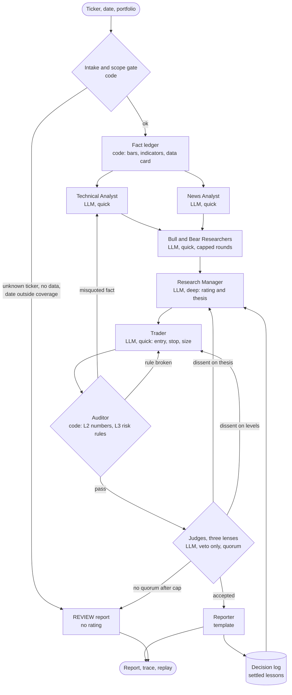

# Transformation plan: from metric analyst to trading assistant

Status: **superseded as the build plan by [BLUEPRINT.md](BLUEPRINT.md)** (2026-11-19), which rewrites the project from an empty directory and wins wherever the two differ; its section 17 lists the differences. In particular, every statement below that the project uses only the standard library or has no dependencies is void: the owner withdrew that constraint on 2026-11-19 (BLUEPRINT.md decision 12). This document remains the record of what was learned from the two reference systems, of decisions 1 to 10, and of the fit with the course requirements. Written 2026-11-18. No source code has been changed. This document describes a target design and a phased plan for turning InsightCrew into a multi-agent trading assistant, using ideas from the two reference systems in the workspace. It changes three of the invariants in [AGENTS.md](../AGENTS.md). The project owner made three of the decisions and delegated the rest; all are recorded in [section 14](#14-decisions). `AGENTS.md` itself is updated when the code changes, in phase 5, because until then it describes the code as it stands.

How the design answers the course requirements, and what will decide the grade, is in [section 16](#16-fit-with-the-course-requirements).

The current system is described in [ARCHITECTURE.md](ARCHITECTURE.md). Its known issues are in [ROADMAP.md](ROADMAP.md).

## 1. Summary

**What the system becomes.** Given a ticker, an analysis date and optionally a portfolio, the system produces a trade proposal: a rating, entry and stop levels, a position size, the evidence behind it, and a record of how each part was checked. It assists a human. It never places an order.

**The design idea.** A trade proposal contains two kinds of statement, and they need different checks:

| Kind of statement | Example | Has a ground truth at decision time? | How it is checked |
|---|---|---|---|
| Fact or arithmetic | "RSI(14) is 61.3", "this position risks 0.9% of equity" | Yes | Deterministic code, as InsightCrew does today |
| Judgment | "The uptrend is likely to continue" | No | Structured debate, a veto by independent judges, and scoring against the outcome once it is known |

TradingAgents checks both kinds with LLM debate. InsightCrew today checks only the first kind, with code. The transformed system keeps the deterministic audit for everything that can be computed and adds debate and judges only for what cannot. The report states which is which, and never calls a judgment "verified".

**The constraint that drives the plan.** The roadmap gives the submission deadline as 2026-11-23, five days after this document was written. My estimate for the full transformation is six to seven and a half working days, plus real-model testing that cannot be done offline. The project owner has decided that the trading assistant is what will be submitted. The plan therefore fixes a scope that fits five days (phases 0, 1, 2 and 5) and treats phases 3 and 4 as work to do only if that scope finishes early. See [section 11](#11-phased-plan).

## 2. What carries over

Most of the current design transfers, because its ideas are not specific to revenue figures.

| Current mechanism | In the trading assistant |
|---|---|
| Deterministic Critic, no model calls | Unchanged in principle. It audits numbers and risk rules. |
| Structured `filters` instead of prose | A structured proposal (direction, entry, stop, size) and structured claims that cite facts by ID |
| Two independent computation paths (L2) | Indicators computed in Python for the agents and recomputed in SQL for the audit |
| Metric dictionary (L3) | A risk rulebook: required checks with limits, stored as data |
| Errors return to the layer that can fix them | Same rule, with more layers: see [section 6](#6-verification-and-error-routing) |
| Decline rather than guess | A `REVIEW` outcome: no tradeable rating when data is missing, stale, or the judges do not agree |
| Scope gate, coverage guard, zero-row rule | Point-in-time guards: no data after the analysis date, and "unavailable" is never reported as "nothing happened" |
| Offline scripted model | Kept, extended to the new roles |
| Blackboard, versioned artifacts, trace, HTML replay | Kept, extended |
| Standard library only, no agent framework | Kept |

What does not carry over: the two CSV tables, the four metrics, the question parser's region and quarter logic, the metric dictionary's content, the 12 evaluation questions, and the archived results. The Profiler role is retired; a data-quality card computed by code replaces it.

## 3. What the reference systems do, and what to take

File paths in this section are relative to the workspace root, outside this repository. Ideas are taken, not code: both references depend on frameworks and packages this project does not use.

### 3.1 TradingAgents

A LangGraph pipeline: four analysts run in parallel, a bull and a bear researcher debate, a research manager decides, a trader proposes a transaction, three risk analysts debate it, and a portfolio manager issues the final rating.

| Technique | Where | Decision |
|---|---|---|
| Role pipeline of analysts, opposing researchers, manager and trader | `tradingagents/graph/setup.py` | **Adopt**, with fewer roles |
| Debate with a round cap counted in state, speakers alternating by rule | `graph/conditional_logic.py` | **Adopt.** The orchestrator, not a model, decides who speaks and when to stop. |
| Two model tiers: a quick model for analysts and debaters, a deep model for managers | `default_config.py`, `graph/setup.py` | **Adopt** |
| Decision agents return typed fields; the typed rating is the decision and is never re-read from prose | `agents/schemas.py`, `agents/managers/portfolio_manager.py` | **Adopt.** Same principle as the current `filters`. |
| Tolerant coercion of numeric fields: "N/A" becomes null, a percentage is rejected as a price | `agents/schemas.py` (`_coerce_optional_float`) | **Adopt** |
| `REVIEW` sentinel: an unreadable decision is not recorded as Hold | `agents/rating.py` | **Adopt.** It is the trading form of "decline rather than guess". |
| Point-in-time rules: clamp every requested date to the analysis date, half-open windows, withhold data that has no historical vintage, report a feed that cannot reach a window as unavailable and not as empty | `dataflows/date_window.py` | **Adopt.** The most important transfer. Without it, any backtest result is invalid. |
| Explicit markers for missing input: "no report in this run" and "the opponent has not spoken yet" | `agents/context.py` (`report_or_absent`, `opponent_argument_or_opening`) | **Adopt.** An empty section invites the model to invent its content. |
| Portfolio context with three distinct states: a position, a flat book, not provided | `portfolio.py` | **Adopt** |
| Memory log: each decision is stored pending, later settled with raw return and return against a benchmark, and given a short written lesson. A lesson is shown to later runs only if its outcome was known by their analysis date. | `memory/log.py`, `memory/settlement.py`, `memory/reflection.py` | **Adopt**, stored as append-only JSON lines instead of rewritten markdown |
| Backtest as a grid of independent (ticker, date) cells, scored by rating: hit rate and mean excess return. Hold claims no direction and is not scored as right or wrong. Explicitly not a portfolio simulator. | `backtest.py` | **Adopt**, late in the plan |
| Cap on tool rounds, then a forced wrap-up | `graph/setup.py` (`_analyst_graph`) | **Adopt if** agents get tool-calling loops. Not needed in the first phases, where code computes the inputs. |
| A "verified snapshot" the analyst is told to treat as the source of truth for exact figures | `agents/analysts/market_analyst.py` | **Replace.** There it is a prompt instruction. Here it becomes a check in code: see the fact ledger in [section 5](#5-structured-contracts). |
| Three risk personas debating in free prose | `agents/risk_mgmt/*.py` | **Replace** with three judges that return a structured accept or reject: see 3.2 |
| LangGraph, Pydantic, vendor SDKs, social-media sentiment, SQLite checkpointer, interactive CLI | various | **Not taken** |

A second pass over the TradingAgents source, looking for the smaller practices that make it dependable. All of these are adopted:

| Practice | Where | How it applies here |
|---|---|---|
| Error classes named by how the caller must react, not by cause: no usable data, vendor unavailable, vendor not configured. A vendor that failed has said nothing about the instrument. | `dataflows/errors.py`, `dataflows/router.py` | Three exception classes in `tools/market_data.py`. "The download failed" and "this ticker has no data" produce different reports. |
| Stale-data guard: a latest bar more than 10 calendar days before the analysis date is refused | `dataflows/vendors/yahoo/ohlcv.py` | The `data_fresh` rule, same limit |
| A newest bar with no closing price is an unsettled session, not missing data; the series ends at the last settled bar. Today's bar is never scored. | `yahoo/ohlcv.py`, `memory/settlement.py` | Same rule in the ledger builder and the Settler |
| Prices quoted to the user are served as reported; only indicator inputs are gap-filled. A filled cell is yesterday's price under today's date. | `yahoo/ohlcv.py`, `yahoo/snapshot.py` | Price facts come from raw bars. Indicators use the filled series and record how many bars were filled. |
| Never cache an empty or failed download; write caches atomically; refetch a same-day file after a short time | `yahoo/ohlcv.py`, `dataflows/files.py` | Same rules in the fetch script |
| Symbol normalisation in one place (`700.HK` becomes `0700.HK`), and a ticker is validated before it becomes part of a file path | `dataflows/symbols.py` | `core/intake.py`. Also closes a path-traversal hole the current code does not have to consider. |
| Instrument identity is resolved by code once and given to every agent, so that no agent infers a different company from a price pattern. For a historical date only the name is given. | `agents/context.py` | Identity is a fact in the ledger. Unknown identity is stated as unknown. |
| An analysis date in the future is rejected | `graph/trading_graph.py` | Scope gate |
| Analysts are told: report what your data supports, another agent decides the trade | `agents/analysts/*.py` | Same separation, and enforced by schema: an analyst's output has no rating field |
| Managers are told that conflicting arguments alone are not a reason to Hold, and not to force a direction either | `agents/schemas.py`, `agents/managers/*.py` | Research Manager prompt |
| Entry and stop are absolute prices grounded in price structure and volatility; a percentage is not a price | `agents/trader/trader.py`, `agents/schemas.py` | Trader prompt, the proposal schema, and the `entry_near_market` rule |
| The settlement window starts at the first close after the analysis date, and the reflection prompt states the window length, so that one week's outcome is not read as disproof of a longer thesis | `memory/settlement.py`, `memory/reflection.py` | Settler and Reflector |
| A failure while settling or reading the memory log does not end the run; the report says what could not be settled | `graph/trading_graph.py` (`_memory_step`) | Same |
| The report header records what produced the run: version, models per tier, debate rounds, data source. Built from an allow-list, so that no endpoint or key is written. | `graph/trading_graph.py` (`run_settings`), `reporting.py` | Reporter header and `blackboard.json` |
| Machine-read labels stay in English when the prose is in another language | `agents/context.py` | Ratings, actions and verdicts are English enum values. Narratives and the report are in Chinese. |
| Token counts kept separately for input and output, behind a lock | `cli/stats_handler.py` | The budget ledger in [section 9.1](#91-token-and-cost-control) |
| Statements as filed, with filing dates, from SEC EDGAR, which needs no key | `dataflows/vendors/sec_edgar.py` | After submission, for a Fundamentals Analyst. US filers only. |
| A large automated test suite, including tests named for each look-ahead path | `tests/` | A `tests/` directory using `unittest`. Closes roadmap finding F15. |

### 3.2 Open Multi-Agent (OMA)

A TypeScript runtime: a coordinator model turns a goal into a task graph, a deterministic scheduler runs it, and optional judges verify task results.

| Technique | Where | Decision |
|---|---|---|
| Consensus: a proposer answers, judges try to refute, the loop stops at a quorum or a round cap. Judges see the original question. A malformed verdict counts as dissent. Judges run one after another so that quorum and budget can stop the rest. | `docs/consensus.md`, `packages/core/src/orchestrator/consensus.ts` | **Adopt** for judgments only. Judges can veto. They cannot change a number or a rating. |
| Lens mode: each judge reviews from a distinct angle | `docs/consensus.md` | **Adopt.** The three TradingAgents risk personas become three lenses. |
| Declared roles and order as the alternative to a topology chosen by a model | `docs/coordinator.md` ("Declared governance") | **Adopt.** A trading workflow has a fixed shape. |
| Structured handoff between tasks: pass validated structured results, fail instead of silently falling back to prose | `docs/task-scheduling.md` (`dependencyPayload`) | **Adopt** |
| Namespaced shared memory: every entry is `<agent>/<key>`, so it is attributable | `docs/shared-memory.md` | **Adopt** on the blackboard |
| Token and cost budgets: nested ceilings where the lower wins, a cost estimate from a price table the application supplies, shared accounting for workers and judges, a defined result when a budget trips | `docs/budgets-and-limits.md`, `packages/core/src/orchestrator/budget.ts` | **Adopt in full.** Detailed in [section 9.1](#91-token-and-cost-control). It also closes roadmap finding F5. |
| Loop detection on repeated identical turns | `docs/budgets-and-limits.md` | **Already present** as the stagnation rule |
| Model routing by phase and role, with an ordered fallback on retryable provider errors | `docs/model-routing.md` | **Adopt** the per-role part. Fallback is optional. |
| Journal events that name the events that caused them | `docs/run-journal.md` (`sourceEventSeqs`) | **Adopt** in the trace: a sequence number and a `caused_by` field |
| Plan revisions that append and never rewrite history | `docs/adaptive-recovery.md` | **Already present** as versioned artifacts. Keep the property. |
| Parallel execution of independent tasks | `docs/task-scheduling.md` | **Adopt in a small form**: one parallel fan-out stage for the analysts |
| Coordinator model that plans a task graph; general DAG scheduler | `docs/coordinator.md`, `scheduler.ts` | **Not taken now.** The workflow is fixed, so a general scheduler would be machinery without a use. Reconsider if the system later handles several kinds of request. |
| Checkpoint and restore, durable human approvals, MCP tools, OpenTelemetry | `docs/checkpoint.md`, `docs/durable-approvals.md` | **Not taken.** A run takes minutes and executes nothing irreversible. |

### 3.3 What neither reference does

Three things would be this project's own contribution:

1. **Numbers in a proposal are checked by code against a ledger of computed facts.** In the TradingAgents files read for this document, numeric accuracy rests on prompt instructions.
2. **Risk limits are enforced by code**, as data-driven rules, before any model is asked for an opinion.
3. **The evaluation separates what can be proven from what cannot.** "No delivered proposal contains an ungrounded number or breaks a risk rule" is testable offline with error injection. "The ratings are profitable" is not provable at this scale, and the report says so.

## 4. The task and the agents

### 4.1 Task

Input: a ticker, an analysis date (default: the last date in the data), optionally a portfolio file (cash and positions), optionally a holding horizon.

Output: a report with a rating (Buy, Overweight, Hold, Underweight, Sell, or `REVIEW`), entry price, stop-loss, position size, the facts cited, the bull and bear cases, the verification record, and the conditions that would invalidate the thesis.

Not in scope: order execution, broker connections, intraday data, short selling, options, portfolio optimisation across tickers. The system is a course project and its output is not investment advice; the report must say so.

### 4.2 Flow



Deterministic checks run before LLM scrutiny. A proposal that code already rejects does not spend judge tokens.

### 4.3 Roles

| Role | Backed by | Responsibility | Reads | Writes |
|---|---|---|---|---|
| Intake | Code | Parse the request, resolve the ticker, check that data covers the date | Request, data index | Run parameters, or a refusal |
| Fact ledger builder | Code | Load bars up to the analysis date, compute indicators, build the data-quality card | Bars | `facts`: ID, name, value, date, source |
| Technical Analyst | LLM, quick tier | Read trend, momentum, volatility and levels | Facts of kind price and indicator | A list of claims citing fact IDs, plus a narrative |
| News Analyst | LLM, quick tier | Summarise dated headlines in the window and their likely effect | Headlines in the window, or an "unavailable" marker | Claims citing headline IDs, plus a narrative |
| Bull Researcher, Bear Researcher | LLM, quick tier | Argue for and against, answering the other side's last argument | Analyst claims, debate history | Arguments that cite claim IDs |
| Research Manager | LLM, deep tier | Decide the rating and state the thesis and what would invalidate it | Debate, claims, settled lessons | Structured plan: rating, thesis points, invalidation conditions |
| Trader | LLM, quick tier | Turn the plan into levels and a size | Plan, price and volatility facts, portfolio, the risk limits | Structured proposal: action, entry, stop, target, size, horizon |
| Auditor | Code | Check every cited number against the ledger, recompute derived quantities, apply the rulebook | Structured claims and proposal only | Verdict: PASS, REVISE or UNVERIFIED, with issues |
| Judges (aggressive, conservative, evidence) | LLM, quick tier | Try to refute the proposal from one angle each | The request, the audited proposal, the claims. Not the debate prose. | `{accept, critique, target}` |
| Reporter | Code template | Assemble the report | Blackboard | Report |
| Settler | Code | Score past decisions whose holding window has traded | Decision log, bars | Outcome records |
| Reflector | LLM, quick tier | Write a short lesson from a settled decision | The decision and its outcome | Lesson text |

This gives ten model-backed roles and five deterministic ones. It answers roadmap finding F14 (two of five roles make no model calls) without giving up the point that verification of numbers should not be a model.

### 4.4 What each role is not given

| Role | Withheld | Reason |
|---|---|---|
| Analysts | Any data dated after the analysis date | Point-in-time integrity |
| Researchers | The portfolio | The case for or against a stock should not depend on what the user holds. TradingAgents makes the same separation. |
| Research Manager | Lessons whose outcome was not yet known on the analysis date | A backtest run must not learn from the future |
| Trader | The auditor's recomputation code | Independence of the second path |
| Auditor | All prose: narratives, debate, prompts | It judges structured content, as the Critic does today |
| Judges | The debate transcript and each other's verdicts | A judge that reads the argument tends to be persuaded by it |
| Reporter | Any way to compute | Unchanged |

**One deliberate change from the current design.** Today the Planner is not shown the metric dictionary, so that the dictionary stays an independent check. In the trading assistant the Trader **is** shown the risk limits. A trader is expected to know the mandate, and hiding it would only produce avoidable rejections. The audit's value here is enforcement: the Trader cannot edit the rulebook, and compliance is decided by code. How often a model breaks limits it was told about becomes a measurable result.

## 5. Structured contracts

The current design rests on `filters` being data. The same idea applies to four objects.

**Fact.** Computed by code, never by a model.

```json
{"id": "F12", "kind": "indicator", "name": "rsi_14", "value": 61.3,
 "as_of": "2026-09-30", "source": "tools.indicators.rsi", "bars_used": 15}
```

**Claim.** An analyst may state a number only by citing a fact.

```json
{"fact": "F12", "value": 61.3, "reading": "Momentum is positive and not overbought"}
```

**Proposal.** The Trader's output. All levels are absolute prices.

```json
{"action": "Buy", "entry": 189.50, "stop": 181.20, "target": 205.00,
 "size_pct": 8.0, "horizon_days": 20, "cites": ["F3", "F12", "F15"]}
```

**Rule.** One entry in `data/risk_rules.json`.

```json
{"key": "max_risk_per_trade_pct", "limit": 1.0,
 "formula": "(entry - stop) / entry * size_pct",
 "desc": "Loss at the stop, as a share of equity", "source": "Risk policy 2.1"}
```

First rulebook, long-only. The limits are common retail risk-management conventions chosen as defaults. They are not derived from this project's data, and each is one number in the JSON file.

| Rule | Check | Default limit |
|---|---|---|
| `stop_required` | A Buy has a stop | n/a |
| `stop_side` | The stop is below the entry | n/a |
| `max_risk_per_trade_pct` | Loss at the stop, as a share of equity | at most 1% |
| `max_position_pct` | Position size, counting any existing position | at most 20% |
| `min_reward_risk` | If a target is given, reward divided by risk | at least 1.5 |
| `min_stop_distance_atr` | Distance from entry to stop, so the stop is outside normal daily noise | at least 1.0 × ATR(14) |
| `entry_near_market` | Distance from the last close to the entry. Catches a level in the wrong unit. | at most 2.0 × ATR(14) |
| `cash_sufficient` | When a portfolio is given in the ticker's currency, the position can be paid for | n/a |
| `data_fresh` | Age of the last settled bar at the analysis date | at most 10 calendar days |
| `min_history` | Every cited indicator had the bars its definition needs | per indicator |

Model output is validated against these shapes with standard-library code. On a validation failure the model gets the error once and may correct it. A second failure ends the step. This follows OMA's single corrective retry for structured output.

## 6. Verification and error routing

| Layer | What is checked | By | Result if it fails |
|---|---|---|---|
| L1 Context | The auditor and judges receive structured content only | Construction of their inputs | n/a |
| L2 Numbers | (a) Each claim's value equals the cited fact. (b) Derived quantities in the proposal are recomputed. (c) Each indicator in the ledger is recomputed in SQL from the raw bars. | Code | REVISE |
| L3 Rules | The proposal against the rulebook | Code | REVISE |
| L4 Judgment | Whether the thesis follows from the cited claims and whether the risk is acceptable | Three LLM judges, quorum of two, at most two rounds | Revise once, then `REVIEW` |
| Outcome | Whether the rating was right over the holding window | Settler, after the fact | A lesson for later runs |

L4 is scrutiny, not proof. The report keeps two separate fields in place of today's single confidence level: **facts and rules**, which is `verified` or `unverified`, and **judgment**, which is `accepted n of 3` or `contested`. A direction is never labelled high confidence.

On the scope of L2(c): in the first phases the indicators are computed by this project's own tool code, so the SQL recomputation guards against bugs in that code, such as an off-by-one window or a bar from after the analysis date. The check that constrains the model is L2(a). If a later phase lets an agent write its own analysis code in the sandbox, L2(c) audits that code's output in the same way the Critic audits the Analyst today.

Routing:

| Error | Detected by | Goes to | Why there |
|---|---|---|---|
| Output does not match the schema | Validator | The same agent, once | A formatting slip |
| A claim's number differs from the cited fact, or cites no fact | Auditor, L2 | The analyst that made the claim | The proposal may be sound; one input is wrong |
| A derived number is wrong, or a rule is broken | Auditor, L2 or L3 | Trader, with the rule, the limit and the computed value | The thesis is unaffected |
| Judges reject the thesis | Judges | Research Manager | Changing levels cannot repair a thesis |
| Judges reject the levels or size | Judges | Trader | The rating stands |
| No bars, stale bars, too little history, a date outside coverage | Intake, ledger builder | Nobody: `REVIEW` | New data is needed |
| News feed cannot cover the window | News tool | Nobody: the News Analyst's report is marked unavailable and the run continues | Missing news is not "no news" |
| Same issues rejected twice, or a turn, time or token limit | Orchestrator | Nobody: `REVIEW`, with the unresolved issues listed | Unchanged from today |

## 7. Data and point-in-time integrity

**Bars.** Daily open, high, low, close and volume per ticker in `data/market/<TICKER>.csv`, plus one benchmark series. Two sources:

- A seeded generator, `data/make_market.py`, for tests and the offline demo. It plants known traps: a missing week, a stale last bar, a price gap, a series too short for a 200-day average. This plays the role the synthetic orders data plays today.
- A fetch script, `tools/fetch_bars.py`, that downloads real bars with `urllib` into an ignored cache directory. Required for any statement about decision quality. The source is Yahoo Finance's chart endpoint. Tested on 2026-11-18 from the development machine with the standard library only: `AAPL`, `0700.HK`, `SPY` and `^HSI` each returned daily open, high, low, close, volume and adjusted close, with the currency and exchange time zone. The endpoint is unofficial and undocumented, so it can change or throttle without notice; the bundled synthetic data keeps the system runnable when it does. A second source tried the same day, Stooq's CSV download, now answers with a browser check and is not usable from a script.

The fetch script and the bar loader follow the data practices listed in section 3.1: a failed download is not "no data", a stale series is refused, an unsettled newest bar is dropped, quoted prices are as reported, and nothing empty is cached.

**Markets.** US and Hong Kong equities. Supporting two markets has four consequences:

| Concern | Handling |
|---|---|
| Ticker format | `AAPL` for US, `0700.HK` for Hong Kong. Intake validates the form and declines anything else. |
| Benchmark | Chosen by ticker suffix from a table in `config.py`: `SPY` for tickers with no suffix, `^HSI` for `.HK`. These are the choices in TradingAgents' benchmark table. Returns are compared as percentages, each in its own currency. |
| Currency | A label carried on price facts and in the report (USD or HKD). No conversion is performed. A portfolio file states its own currency, and `cash_sufficient` is checked only when it matches the ticker's. |
| Trading calendar | Not modelled. Trading days are the dates present in the ticker's own bars, and the benchmark is valued at its last close on or before each of those dates. |

Hong Kong shares trade in board lots whose size differs by stock. Position size is stated as a percentage of equity, so the rulebook is unaffected. A share count is printed only when the lot size is known from the data; otherwise the report gives the percentage alone.

**News.** A dated fixture file per ticker, each item with an ID and a publication timestamp. A live news feed is out of scope for the first version.

**Rules every data tool follows**, adapted from `dataflows/date_window.py`:

1. A tool takes the analysis date as a required argument and returns nothing dated after it.
2. A requested date later than the analysis date is clamped to it.
3. Windows are half-open and compared as dates, not strings.
4. An undated item is excluded from a historical run.
5. A window the source cannot cover is reported as unavailable, never as empty.
6. `date.today()` is read in one place and can be pinned by a setting. This closes roadmap finding F11.

An evaluation script asserts rule 1 for every tool over a range of dates.

**Indicators.** Simple and exponential moving averages, RSI, MACD, ATR, Bollinger bands, recent high and low, and period returns. Each is registered in three places, replacing the current three-place rule for metrics: `data/indicator_dict.json` (definition, formula, minimum bars), `tools/indicators.py` (Python), and `tools/recompute.py` (SQL, used only by the Auditor). A consistency test fails if they disagree. An indicator without a second implementation is not offered to the agents. SQLite window functions need version 3.25 or later; the version on the development machine is 3.54.

## 8. Memory and settlement

`memory/decisions.jsonl` is an append-only event log. Two record types:

- `decision`: run ID, ticker, analysis date, rating, proposal, cited fact IDs. Written at the end of a run. At most one per ticker and date.
- `outcome`: refers to a decision. Raw return and return against the benchmark over the holding window, measured from the first close after the analysis date; whether the stop or the target was reached first, from daily highs and lows; the date the outcome became known; a lesson of two to four sentences.

A decision whose window has not fully traded stays pending. Nothing is settled on a partial window.

At the start of a run, the Research Manager receives up to five settled decisions for the same ticker and three lessons from other tickers, filtered to those whose outcome date is on or before the analysis date.

Appending instead of rewriting avoids the file locking and atomic-rewrite logic TradingAgents needs, at the cost of folding the log on read. At this project's scale that cost is negligible.

## 9. Orchestration

The hand-written loop stays. Three changes:

1. **One parallel stage.** The analysts run in a thread pool with a configurable width, default 1. With width 1 the run is fully sequential and deterministic, which is what the offline demo and the tests use. No general scheduler is added.
2. **Enforced budgets.** Tokens and cost are capped as described in [section 9.1](#91-token-and-cost-control). Each feedback edge has its own retry cap. The wall-clock limit applies to a single model call as well as to the run, closing roadmap finding F8.
3. **Per-role models.** `IC_MODEL_QUICK` and `IC_MODEL_DEEP`, with `IC_MODEL` as the fallback for both. One table in `config.py` maps roles to tiers.

Trace events gain a sequence number, a step ID and a `caused_by` list, so that the replay page can show why a step ran, and so that events from the parallel stage can be ordered. Blackboard entries are keyed `<role>/<key>`.

Existing roadmap findings that the transformation must fix along the way, because more model calls and batch runs make them worse: F2 (first call can crash the run), F3 (run directories collide), F5 (token budget not enforced), F11 (date dependence).

### 9.1 Token and cost control

Today `IC_MAX_TOKENS` is read from the environment and never checked, and `core/llm.py` keeps one running total (roadmap finding F5). The new system makes two to three times as many model calls per run, and a backtest multiplies that by the number of cells, so spending needs a real limit. The design follows OMA's budget model (`docs/budgets-and-limits.md`, `orchestrator/budget.ts`), rewritten in Python with the standard library. No code is copied.

**The ledger.** A new module, `core/budget.py`, holds a `Budget` object. Every model call goes through `core/llm.py`, which reports to the ledger after each response: role, model, tier, phase, input tokens, output tokens, and whether the call was a retry. The ledger is the only place usage is added up, and it takes a lock, because the analyst stage can run in threads.

**Two ceilings, three scopes.**

| Scope | Token ceiling | Cost ceiling | Applies to |
|---|---|---|---|
| Batch | `IC_BATCH_MAX_TOKENS` | `IC_BATCH_MAX_COST` | A whole evaluation or backtest grid |
| Run | `IC_MAX_TOKENS` | `IC_MAX_COST` | One ticker on one date |
| Role | a table in `config.py` | none | One role within a run, for example the judges together |

The rules, each taken from OMA:

- **The lower ceiling wins.** A role's effective ceiling is the lower of its own and what remains of the run's. A run's is the lower of its own and what remains of the batch's. An inner scope can narrow a ceiling and never widen it.
- **A ceiling counts input plus output tokens, cumulatively.** Comparison is strictly greater than: reaching the ceiling exactly is not a breach.
- **Everything counts.** Retries after malformed output, bull and bear rounds, judge calls and revisions all draw on the same run ceiling. Verification is not free and is not accounted separately.
- **Cost comes from a price table the user supplies**, `data/model_prices.json`: price per million input tokens and per million output tokens, by model name. The project ships no prices. Prices change, differ by provider and are not something this repository can keep correct.
- **A cost ceiling with no price for a model in use is a configuration error at start-up.** It is not silently ignored. A price that is negative or not a number is also an error.
- **Exhausting a budget is not an exception.** It is a defined outcome, described below.

**Where the check runs.** Before each model call: if the scope is already over a ceiling, the call is not made. A single response cannot be interrupted, so a run can overshoot by at most one call. Each call also carries an output-token limit, which bounds that overshoot. OMA checks after each turn and accepts the same one-turn overshoot.

**What happens when a ceiling is reached.**

1. One `budget_exceeded` event is written to the trace, once per run, naming the scope, the ceiling and the total.
2. No further model call is admitted in that scope. Calls already in flight in the parallel analyst stage finish and are counted. This is OMA's drain-then-skip.
3. Deterministic stages still run. They cost nothing, and they are what makes a partial result safe to show.
4. The outcome depends on how far the run got:

| Reached when | Delivered |
|---|---|
| Before any proposal passed the audit | `REVIEW`, with the reason `budget_exhausted`. No rating and no levels. |
| After the audit passed, before the judges reached quorum | The audited proposal, with the judgment marked "not reviewed: budget exhausted" |
| A role ceiling only | That role stops. The effect is the same as that role reaching its retry cap. |
| A batch ceiling | The current run finishes under its own ceiling. The remaining cells are recorded as skipped, and the grid can be resumed. |

5. A run that ended on budget is not retried automatically. The run summary has `budget_exhausted: true`.

**What is reported.** `blackboard.json` and the report carry a usage table: for each role and each model, the number of calls, input tokens, output tokens, retries and estimated cost, with the totals set against the ceilings. Following TradingAgents, input and output are kept apart, because they are priced differently. Without a price table the cost column reads "not priced". If a provider returns no usage figures, the ledger estimates from character counts and the report labels the figures as estimates.

**Offline.** The scripted model returns a fixed usage figure per reply, so that the budget paths can be tested without a model: a run that trips the run ceiling, one that trips a role ceiling, and one where the judges are cut off.

**In the evaluation.** Tokens and cost per run are reported for each ablation mode. This gives the price of each verification layer next to what it catches, which the current evaluation cannot show.

Other limits from the same OMA document, already in the plan: a timeout per model call separate from the run's, round caps on every feedback edge, and stagnation detection, which the current orchestrator already has.

Departures from OMA: there is no pluggable cost-estimator callback, only the price table, because one provider protocol is supported. There is no cost ceiling per role, because a token ceiling is enough at that level.

## 10. Invariants

Changes to [AGENTS.md](../AGENTS.md) that this plan requires. All are accepted (decision 4 in [section 14](#14-decisions)).

On invariant 3: the Trader is shown the risk limits. Today the Analyst is not shown `required_filters`, because the test is whether it derives the right filters by itself. A risk limit is different. It is a constraint the proposal must meet, and it cannot be derived. Hiding it would spend rounds on guessing and test nothing. What stays hidden from the Trader is the recomputation code and the Auditor's working, so the check remains independent of the thing checked.

| # | Today | Proposed |
|---|---|---|
| 1 | The Critic makes no model calls | **Keep**, for the Auditor. Add: LLM judges exist, may only veto, and never produce or alter a number or a rating. |
| 2 | `filters` has six fixed keys | **Replace.** The structured objects are Fact, Claim, Proposal and Rule. No level, size or rating is carried in prose. |
| 3 | Two computation paths stay independent; the Analyst never sees `required_filters` | **Change.** The two indicator implementations stay independent. The Trader sees the risk limits but not the recomputation code. |
| 4 | Errors go to the layer that can fix them | **Keep**, with the routing table in section 6 |
| 5 | The Reporter does not compute | **Keep** |
| 6 | The sandbox is not weakened | **Keep.** The sandbox is unused in the first phases and unchanged. |
| 7 | A metric is registered in three places | **Replace** with the three-place rule for indicators |
| 8 | Decline rather than guess | **Keep**, as `REVIEW` |
| 9 | No third-party dependencies | **Keep** |
| new | | No data tool returns anything dated after the analysis date |
| new | | A lesson reaches a run only if its outcome was known by that run's analysis date |
| new | | The system never executes, routes or simulates an order |
| new | | Every model call is counted in the budget ledger, and no call is made once a ceiling is passed |

## 11. Phased plan

Effort figures are my estimates for focused work with an AI coding assistant. They are not measured, and prompt work with a real model is the least predictable part.

| Phase | Content | Exit criteria | Estimate |
|---|---|---|---|
| 0. Preparation | Commit the current documentation. Tag the commit `v1-data-analyst`. Create a `trading` branch. Confirm with the instructor that the topic may change. Obtain an API key. | The tag exists and runs the default question as before. | 0.5 day |
| 1. Audited proposal | Bars, generator, fetch script, indicator registry in Python and SQL, fact ledger, intake and scope gate, Technical Analyst, Trader, Auditor with L2 and L3, rulebook, Reporter, offline script in which the first proposal breaks a rule and the first claim misquotes a fact. Budget ledger with the run token ceiling and the usage table (F5). Fix F2, F3, F11. | Offline run ends in PASS after two rounds. Error injection rejects every injected case and no correct one. The point-in-time test passes. The consistency test passes. A scripted run that passes the token ceiling ends in `REVIEW` with `budget_exhausted`. | 2 days |
| 2. Judgment | Bull and Bear with a round cap, Research Manager, three judges with quorum, structured-output validation with one retry, `REVIEW`, model tiers. Cost ceiling with the price table, role ceilings. | Offline run shows a dissent, a revision and an acceptance. A scripted case with no quorum ends in `REVIEW`. A scripted case cuts the judges off on budget and delivers the audited proposal marked not reviewed. One real-model run of five tickers completes. | 1 to 1.5 days |
| 3. Breadth | Parallel analyst stage, News Analyst with dated fixtures and the unavailable marker, portfolio context, trace sequence and causes, replay page lanes. | Width 1 and width 2 produce the same report offline. A run without news says so in the report. | 1 day |
| 4. Learning | Decision log, Settler, Reflector, lesson injection with the date filter, backtest grid and summary, batch ceilings. | A two-ticker, ten-date grid runs, resumes after interruption, and settles. A test shows a future lesson is not injected. | 1 to 1.5 days |
| 5. Evidence and documents | Evaluation runs, rewrite of README, ARCHITECTURE, EVALUATION, ROADMAP and AGENTS.md, demo script. Required whichever phase is the last one built. | Every number in the documents is re-run or labelled. The checks in AGENTS.md are updated and pass. | 1 day |

Total: six and a half to seven and a half days. Five days remain.

**Submission scope.** The trading assistant is submitted on 2026-11-23. Phases 0, 1, 2 and 5 come to four and a half to five days, which fits only if nothing slips. Budget control and the data practices from section 3.1 were added to phase 1 after the first estimate and used up what slack there was, so the order of cuts below should be expected to apply. Phases 3 and 4 are built only if the earlier phases finish ahead of this schedule, and are otherwise described as future work.

| Date | Work | Must be true by the end of the day |
|---|---|---|
| 11-19 | Phase 0, then phase 1: data, indicators in both implementations, fact ledger, consistency and point-in-time tests | Both tests pass |
| 11-20 | Phase 1: Technical Analyst, Trader, Auditor, rulebook, Reporter, offline script, error injection | Offline run reaches PASS in two rounds; injection is clean |
| 11-21 | Phase 2: debate, Research Manager, judges, `REVIEW`, model tiers, cost and role ceilings | Offline run shows dissent, revision and acceptance |
| 11-22 | Real-model runs on US and Hong Kong tickers, prompt fixes, evaluation runs | A real-model run of five tickers completes; results archived |
| 11-23 | Phase 5: documents, demo script, packaging | A fresh unzip runs offline with no API key |

**Order of cuts if a day is missed.** Each cut keeps the system coherent:

1. The judges (L4). The Research Manager's rating then stands after the audit, and the report marks the judgment as not reviewed.
2. The bull and bear debate. The Technical Analyst reports directly to the Research Manager.
3. Hong Kong. The benchmark table and ticker validation stay, with US tickers only in the demo and the evaluation.

Cutting both 1 and 2 leaves three LLM roles: the Technical Analyst, the Research Manager and the Trader. That is the same number as the current system, and it weakens the answer to "why multi-agent" ([section 16](#16-fit-with-the-course-requirements)). The judges are cut before the debate for that reason: the debate adds two LLM roles with opposed briefs, and the judges add one role run three times.

Phase 1 is not cut. On its own it is already a coherent system: an LLM proposes a trade and code refuses to deliver it until its numbers are grounded and its risk is within limits. Each later phase adds to it without changing it.

The `v1-data-analyst` tag is kept as a record of the earlier system. It also remains a working submission if the instructor does not accept the change of topic.

After submission: an agent that writes analysis code in the existing sandbox for questions the indicator registry does not cover, a real news source, fundamentals from filings with their filing dates, a coordinator that chooses which analysts to run, resumable backtests across processes.

## 12. Evaluation plan

| Experiment | Needs a model | What it can show |
|---|---|---|
| Error injection: misquoted fact, uncited number, stop on the wrong side, oversized position, reward-to-risk below the limit, stale data, a bar from the future | No | The audit rejects known-bad proposals and passes correct ones |
| Point-in-time property test | No | No tool leaks data from after the analysis date |
| Indicator consistency | No | The dictionary and both implementations agree |
| Budget paths, scripted | No | A run over its ceiling stops calling the model and ends in a defined, labelled state |
| Offline end-to-end, with ablations: full, no audit, no judges, single agent | No | The mechanism: which stage catches which planted error. Wrong first answers are scripted, so the rates are true by construction. |
| Real-model ablation, same four modes, 20 or more (ticker, date) cells | Yes | How often a real model delivers an ungrounded number or breaks a stated limit, with and without the audit. Also the `REVIEW` rate, rounds, and tokens and cost per run for each mode, which is the price of each verification layer. |
| Backtest grid on real bars | Yes | Hit rate and mean excess return by rating. Indicative only. |

What the evaluation cannot show, and the documents must not claim:

- **Profitability.** A grid that fits the time and budget has tens of cells. That is too few to separate skill from chance.
- **Decision quality on synthetic bars.** Generated prices have no information in them. Synthetic data tests mechanisms only.
- **Freedom from hindsight.** The point-in-time rules control what the tools return. They do not control what the model remembers from training. A backtest over dates before the model's training cutoff may be flattered by that memory. Use dates after the cutoff where possible, and state the cutoff.
- **Prompt quality from offline runs.** The scripted model ignores prompts, as it does today.

## 13. Risks

| Risk | Effect | Mitigation |
|---|---|---|
| The deadline, with no slack in the schedule | An unfinished system is submitted in place of a finished one | A fixed submission scope, daily exit criteria, an agreed order of cuts, and the `v1-data-analyst` tag |
| The topic change is not accepted by the instructor | The submission does not match the approved project | Ask on the first day, before building |
| Ten prompts, none testable offline | Real-model behaviour unknown until late | A real-model run is an exit criterion of phase 2, not phase 5 |
| Cost and latency: roughly 9 to 12 model calls per run against 3 to 5 today (estimate) | Slower demo, higher evaluation cost | Quick tier for most roles, judges stop at quorum, enforced token and cost ceilings per run and per batch ([section 9.1](#91-token-and-cost-control)) |
| The real-data endpoint is unofficial | The fetch script stops working, possibly during the demo | The demo and all tests run on bundled synthetic bars. Downloaded bars are cached. The failure is reported as "source unavailable", not as "no data". |
| Free-text narratives can contain numbers the audit does not see | An unchecked figure reaches the report | Reports print structured claims as the evidence. Narrative numbers that match no fact are flagged as unverified. This is a heuristic and is listed as a limitation. |
| The rulebook is hand-written and is the authority | A missing rule is not enforced | Same limitation as the metric dictionary today. State it. |
| Judges may agree with each other for the same wrong reason | False assurance | L4 is labelled scrutiny, not verification. Different lenses, no shared context. Optionally a different model for one judge. |
| A user reads the output as advice | Harm outside the course | Disclaimer in every report, no order execution, long-only, `REVIEW` on doubt |
| Real market data terms | Redistribution may not be allowed | Do not commit downloaded bars. Commit only the generator and its output. |

## 14. Decisions

Decided on 2026-11-18 by the project owner:

1. **Submission.** The trading assistant is submitted on 2026-11-23.
2. **Market data.** Synthetic bars for tests and the offline demo, plus a fetch script for real bars.
3. **Markets.** US and Hong Kong equities.

Decided on 2026-11-18 by the coding assistant, at the owner's request to choose. Each can be reversed by saying so; the cost of reversing is given.

| # | Decision | Reason | Cost to reverse |
|---|---|---|---|
| 4 | All invariant changes in section 10 are accepted. The Trader sees the risk limits. | A limit is a constraint and cannot be derived, so hiding it tests nothing. The check stays independent because the recomputation is hidden. | Low before phase 1. One prompt and one test after. |
| 5 | Rulebook limits as in section 5: 1% risk per trade, 20% position, reward-to-risk 1.5, stop at least 1 × ATR(14), entry within 2 × ATR(14), data at most 10 days old | Conventional defaults that are easy to defend in a presentation. The staleness limit is TradingAgents'. | Trivial. Each is one number in `data/risk_rules.json`. |
| 6 | Reports, console output and narratives in Chinese. Schema keys, ratings, actions, verdicts and rule keys in English. Documents in English. | Matches the current project rule. English enum values keep parsing independent of the prose language, as TradingAgents does. | Low. One instruction string and the report template. |
| 7 | The name stays InsightCrew. Subtitle: a multi-agent trading assistant with an independent audit. | The repository, the remote and every document use it, and the audit is still the idea the name was chosen for. | Low, but it touches every document. |
| 8 | Real bars from Yahoo Finance's chart endpoint, through `urllib` | The only source found that serves both US and Hong Kong tickers with no key and no dependency. Tested on 2026-11-18. | Low. The fetch script is the only code that knows the source. |
| 9 | Token and cost control as in section 9.1. Default ceilings are set after the first real-model runs on 11-22, from measured usage. | No real-model run of the new roles exists yet, so any figure chosen now would be a guess. Until then the current `IC_MAX_TOKENS` default applies. | None. |
| 10 | The judges use the quick tier, the Research Manager the deep tier | The Research Manager makes the one judgment the report rests on. The judges make a narrow yes or no three times over. | Trivial. One table in `config.py`. |

Not decided here, because it is not the assistant's or the owner's to decide: whether the instructor accepts the change of topic. Ask before building.

## 15. Module map

| Today | After | Change |
|---|---|---|
| `core/orchestrator.py` | same | Stages replaced; loop, limits and degraded output kept; parallel stage added |
| `core/blackboard.py` | same | Adds facts, claims, debate, proposals, verdicts; namespaced keys |
| `core/messages.py` | same | New intents; sequence number, step ID, `caused_by` |
| `core/llm.py` | same | Model tiers; schema validation with one retry; reports usage to the budget ledger; scripted replies carry a usage figure |
| new | `core/budget.py` | Budget ledger: ceilings, scopes, usage and cost rollup |
| new | `data/model_prices.json` | Price table supplied by the user. Shipped with no prices. |
| new | `tools/fetch_bars.py` | Downloads real bars into an ignored cache |
| new | `tests/` | `unittest` cases for point-in-time, indicator consistency, budget paths and symbol handling |
| `core/question_parser.py` | `core/intake.py` | Rewritten: ticker, date, portfolio, scope gate |
| `core/scripts.py` | same | Rewritten for the new roles |
| `core/sandbox.py` | same | Unchanged, unused until a later phase |
| new | `core/schema.py` | Standard-library validators for Claim, Plan, Proposal, Verdict |
| `tools/data_tools.py` | `tools/market_data.py` | Point-in-time bars and the SQLite load |
| `tools/metrics.py` | `tools/recompute.py` | SQL indicators, Auditor only |
| new | `tools/indicators.py`, `tools/news.py`, `tools/portfolio.py` | Python indicators, dated news, portfolio context |
| `tools/metric_dict.py`, `data/metric_dict.json` | `tools/rulebook.py`, `data/risk_rules.json`, `data/indicator_dict.json` | Rules and indicator definitions |
| `agents/profiler.py` | removed | Replaced by the data card in the ledger |
| `agents/planner.py` | `agents/research_manager.py` | States the thesis and rating as structured fields |
| `agents/analyst.py` | `agents/technical_analyst.py`, `agents/news_analyst.py`, `agents/trader.py` | |
| `agents/critic.py` | `agents/auditor.py` | Same verdicts, new checks |
| new | `agents/researchers.py`, `agents/judges.py` | Debate and consensus |
| `agents/reporter.py` | same | New template; two-part confidence |
| new | `memory/decision_log.py`, `memory/settlement.py`, `memory/reflection.py` | Phase 4 |
| `eval/*` | same directory | Injection, consistency and ablation scripts rewritten; point-in-time test and backtest added |
| `ui/render_report.py` | same | Lanes for the debate and the judges |
| `data/orders.csv`, `data/refunds.csv`, `data/make_data.py` | `data/market/`, `data/news/`, `data/make_market.py` | |

## 16. Fit with the course requirements

The rubric weights and the brief's requirements are quoted in [ROADMAP.md](ROADMAP.md). This section is an assessment by the author of this plan. It is not a prediction of a grade: nobody who marks the project has seen it.

**Is it a multi-agent system?** Yes, and more clearly than the current one. The brief asks for LLM-based agents. Roadmap finding F14 records that two of today's five roles make no model call. The submission scope (phases 0, 1, 2 and 5) has six LLM roles, one of which runs as three instances, and four deterministic ones:

| Brief asks for | Where the design answers it |
|---|---|
| A clear task | One ticker, one date, an optional portfolio; a rating and a trade proposal, or a refusal (section 4.1) |
| Why more than one agent | Three reasons, each testable by ablation: roles are given different information and deliberately denied some (4.4); a proposer does not review its own proposal (judges, 6); opposed roles are made to argue both sides before a rating (debate) |
| Each agent's role | Section 4.3 |
| Information and tools per agent | Sections 4.3 and 4.4, including what each is not given |
| Task decomposition | Fixed pipeline: facts, analysis, debate, rating, proposal, audit, scrutiny, report (4.2) |
| Communication | Blackboard with namespaced, versioned entries, and a message log that is the trace (9) |
| Final output | Report with a two-part confidence label (6) |
| Working demo | Offline, with no key, from a fresh unzip (11) |
| Analysis, limitations, failure cases | Sections 12 and 13 |

**Against the rubric.**

| Criterion | Weight | Outlook | What it depends on |
|---|---|---|---|
| System design | 30% | Strongest area | The split between what code verifies and what agents judge is a design position with a reason behind it, and both references are compared against it. Risk: the design described is larger than the design built. The documents must describe what was built. |
| Implementation | 25% | Depends on the schedule | Graded on what runs. Phases 1 and 2 finished and tested score better than five phases half done. No dependencies and an offline demo help: the marker can run it. |
| Problem formulation | 15% | Good | The task is concrete and its hard parts are named: ungrounded numbers, look-ahead, risk limits. The long-only, no-execution scope is stated. |
| Analysis | 15% | The weakest area today | Needs real-model results. Offline rates are true by construction and show mechanism only. One day is scheduled for real-model runs, and no key is available yet. If that day is lost, the analysis rests on injection tests and scripted ablations, and must say so. |
| Presentation | 15% | Good if rehearsed | A trace in which the audit rejects a proposal and the judges dissent is easy to show. The replay page gains its debate and judge lanes only in phase 3, so the demo may have to use the report and the console. |

**What would lose marks, in order of likelihood.**

1. Building all five phases and finishing none. The order of cuts exists to prevent this.
2. No real-model evidence. Get the key on the first day.
3. Documents that claim what was not run. The current project's rule holds: every number is re-run or labelled.
4. The topic change is not accepted. Ask first. The `v1-data-analyst` tag is the fallback.
5. Reading the system as a stock picker. It cannot show profitability and should not try. The claim to defend is narrower and stronger: no number reaches the user unchecked, and no proposal that breaks a stated limit is delivered.

**A note on agent count.** Adding roles does not by itself earn marks. Each role in section 4.3 is there because it holds different information or checks someone else's work, and the ablation removes them one group at a time to show what each group contributes. A role whose removal changes nothing in the ablation should be reported as such.
